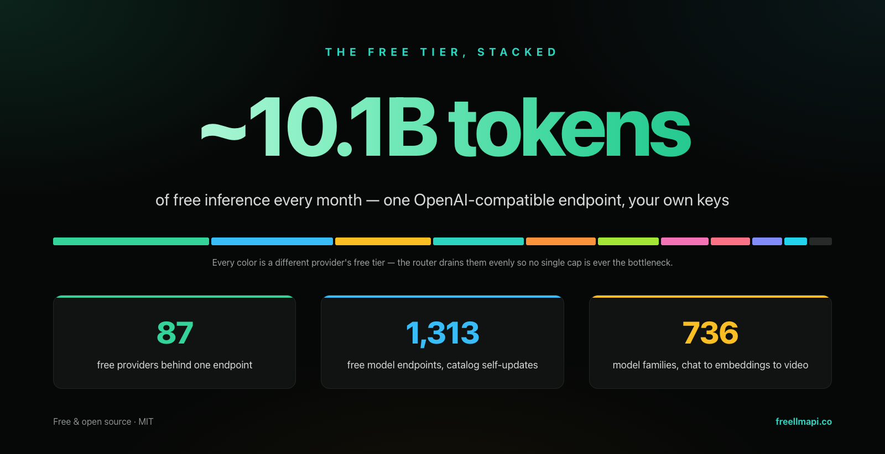
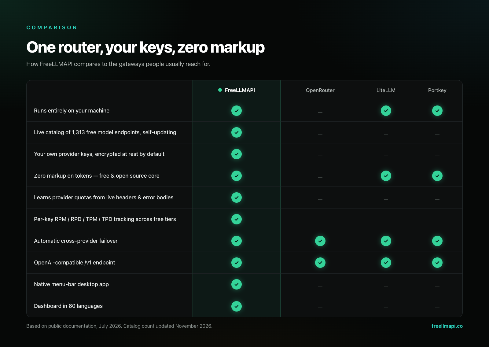
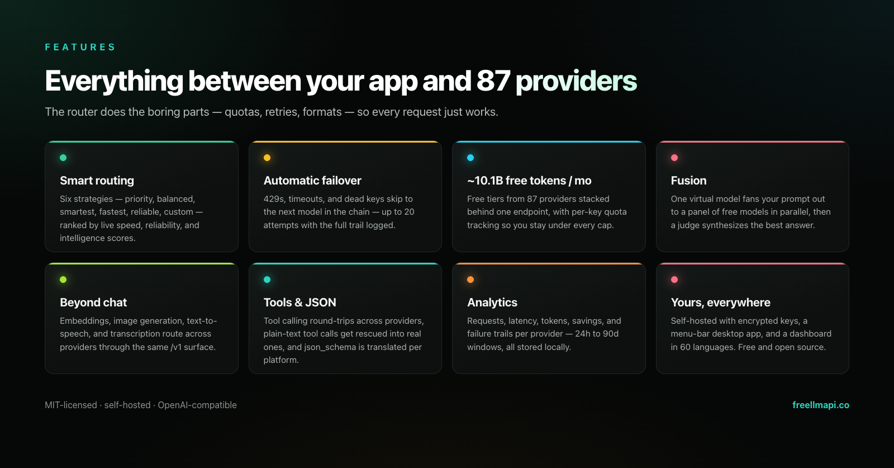
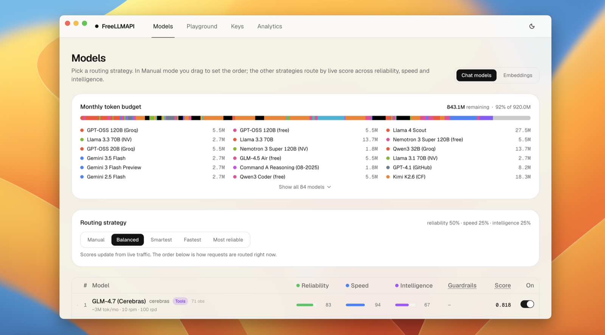
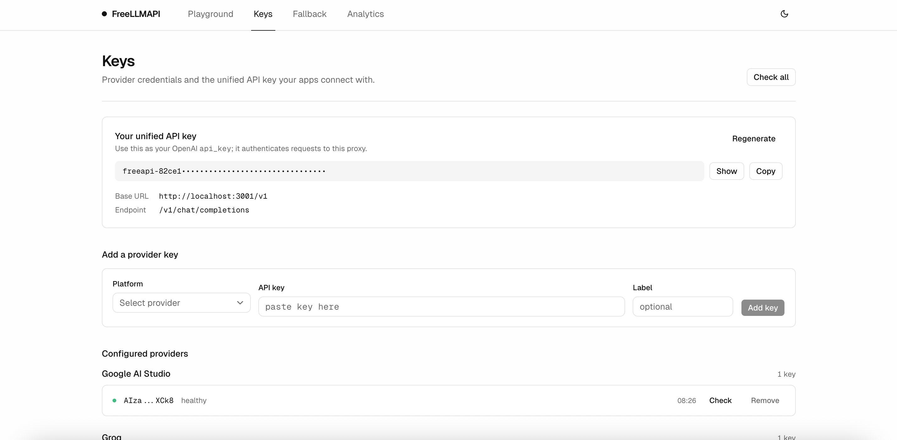
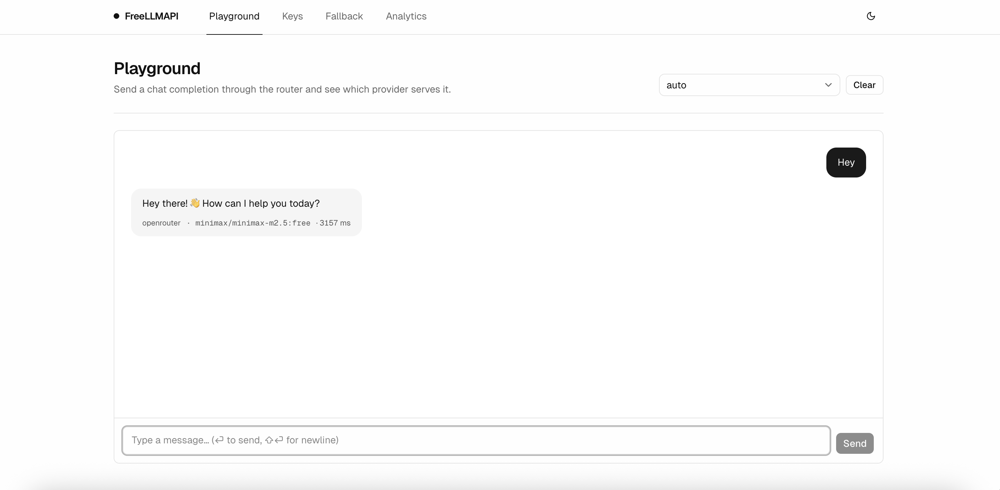
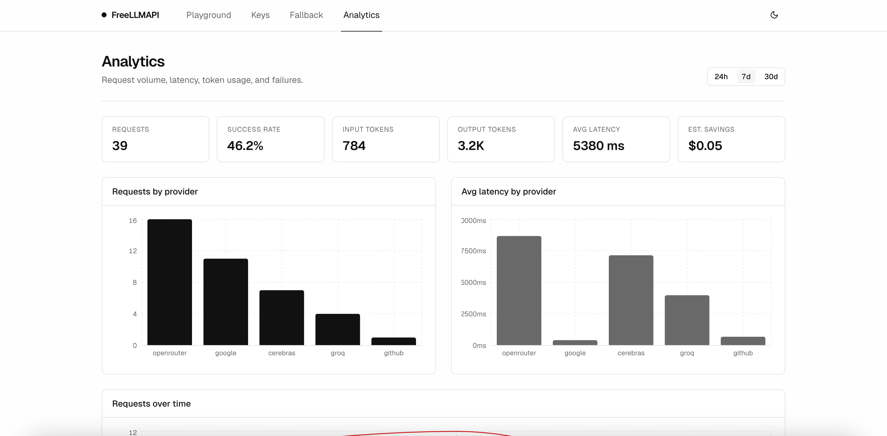
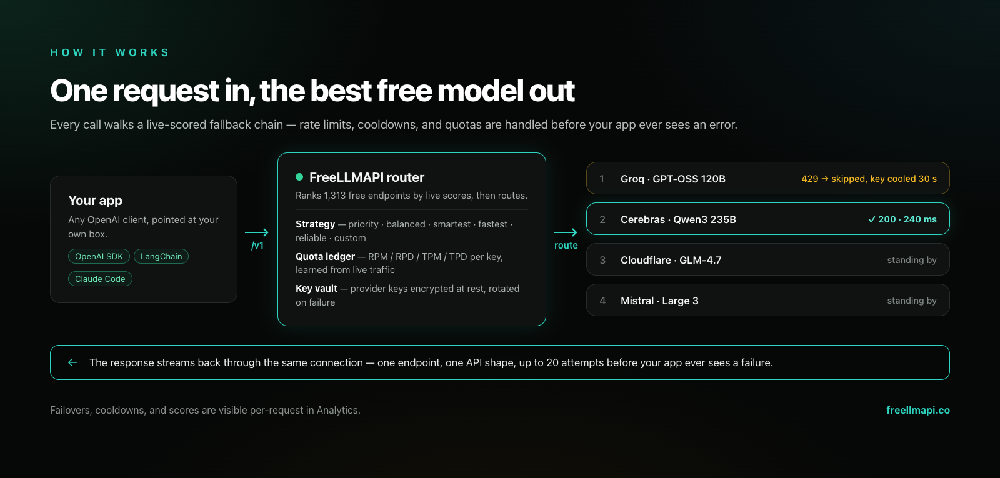

<div align="center">

# FreeLLMAPI

**10.1 مليار توكن شهريًا. 87 مزوّد LLM مجاني. 1,313 نقطة وصول مجانية للنماذج. واجهة API واحدة متوافقة مع OpenAI.**

يجمع الحصص المجانية من عشرات المزوّدين، بالإضافة إلى نقاط وصول OpenAI-متوافقة مخصصة للدردشة والتضمين وتوليد الصور والصوت، خلف واجهة `/v1` واحدة. المفاتيح مخزّنة مشفّرة. الموجّه يختار أفضل نموذج متاح لكل طلب، ويتحول تلقائيًا للمزوّد التالي عند بلوغ حد المعدل، ويتتبع الاستهلاك لكل مفتاح حتى تبقى دائمًا تحت سقف كل حصة مجانية.

[](https://github.com/tashfeenahmed/freellmapi/actions/workflows/ci.yml)
[](https://github.com/tashfeenahmed/freellmapi/stargazers)
[](./LICENSE)
[](#contributing)
[](https://github.com/tashfeenahmed/freellmapi/pkgs/container/freellmapi)
[](https://deepwiki.com/tashfeenahmed/freellmapi)

**[freellmapi.co](https://freellmapi.co/?utm_source=github&utm_medium=readme&utm_campaign=repository&utm_content=readme_top)** · تصفح الكتالوج الكامل: 736 عائلة نماذج و1,313 نقطة وصول مجانية

[English](README.md) · [Türkçe](README.tr.md) · [简体中文](README.zh-cn.md) · [Русский](README.ru.md) · [O'zbekcha](README.uz.md) · [한국어](README.ko.md) · [日本語](README.ja.md) · **العربية**

قد تتأخر الترجمة العربية عن آخر التحديثات. النسخة الأحدث دائمًا في ملف [README](README.md) الإنجليزي.

<p align="center">
  <a href="https://github.com/tashfeenahmed/freellmapi/releases/latest"></a>
  <a href="https://apps.microsoft.com/detail/9PBN6G8K2B7F"></a>
  <a href="docs/en/install/01-install.md#docker-compose"></a>
  <a href="https://play.google.com/store/apps/details?id=co.freellmapi.app"></a>
  <a href="https://apps.apple.com/app/id6804648934"></a>
</p>


<div dir="rtl">

الموجّه يحدّث كتالوج النماذج تلقائيًا من مصدر موقّع: النماذج المجانية الجديدة وتغيّرات الحصص وإصلاحات التوافق تصل دون الحاجة إلى `git pull`. النسخ المجانية تحصل على لقطة الكتالوج الشهرية، فيصلها النموذج بعد 30 يومًا من انضمامه للمصدر المباشر؛ أما الموجّهات المميزة فيصلها في نفس اليوم.
**[فعّل النسخة المباشرة من freellmapi.co](https://freellmapi.co/?utm_source=github&utm_medium=readme&utm_campaign=premium&utm_content=readme_top#pricing)** (‏$19 سنويًا، إلغاء في أي وقت).

</div>

---

<div dir="rtl">

## المحتويات

- [لماذا وُجد هذا المشروع](#why-this-exists)
- [المزوّدون المدعومون](#supported-providers)
- [واجهات الأوامر ووكلاء البرمجة المتوافقون](#compatible-clis--coding-agents)
- [كيف يقارن بغيره](#how-it-compares)
- [المزايا](#features)
- [البدء السريع](#quick-start)
- [تطبيق سطح المكتب](#desktop-app)
- [يعمل مع عملاء OpenAI-المتوافقين](#works-with-openai-compatible-clients)
- [اللغات](#languages)
- [المميز (الكتالوج المباشر)](#premium-live-catalog)
- [استخدام الـ API](#using-the-api)
- [لقطات الشاشة](#screenshots)
- [كيف يعمل](#how-it-works)
- [الأسئلة الشائعة](#faq)
- [القيود](#limitations)
- [المساهمة](#contributing)
- [إخلاء المسؤولية](#disclaimer)

</div>

**الأدلة:** [التثبيت والنشر](docs/en/install/01-install.md) · [مرجع الـ API](docs/en/api/01-rest-api.md) · [العملاء ووكلاء البرمجة](docs/en/clients/01-agent-clients.md) · [ضغط الموجّهات](docs/en/compression/01-compression-pipeline.md) · [البنية والتفاصيل الداخلية](docs/en/architecture/00-high-level-index.md) · [فهرس التوثيق](docs/en/README.md) · [دليل المساهمين](CONTRIBUTING.md)

<div dir="rtl">

## لماذا وُجد هذا المشروع

كل مختبر ذكاء اصطناعي جاد يقدم اليوم حصة مجانية: بضعة ملايين توكن شهريًا، وبضعة آلاف طلب يوميًا. كل حصة وحدها لعبة. لكن مجتمعة تصل إلى نحو **10.1 مليار توكن شهريًا** من قدرة استدلال عاملة، عبر **736 عائلة نماذج / 1,313 نقطة وصول للمزوّدين**، من الصغيرة السريعة إلى القادرة بجدارة.

المشكلة أن جمعها يدويًا متعب: 87 واجهة SDK مختلفة، و87 حد معدل مختلف، و87 مكانًا يمكن أن يفشل فيه الطلب. FreeLLMAPI يختصر كل ذلك في نقطة وصول واحدة متوافقة مع OpenAI. وجّه أي مكتبة عميل OpenAI إلى خادمك المحلي، وسيوجّه الطلبات بشفافية عبر أي مزوّد أضفت مفاتيحه.

ومشهد الحصص المجانية يتغير أسبوعيًا: المزوّدون يطلقون نماذج ويسحبونها ويغيّرون الحصص دون إشعار. FreeLLMAPI يتتبع كل ذلك عنك. الموجّه يسحب كتالوج نماذج موقّعًا من [freellmapi.co](https://freellmapi.co) تلقائيًا، فتبقى نسختك محدّثة دون `git pull`. انظر [المميز (الكتالوج المباشر)](#premium-live-catalog) لمعرفة سرعة التحديث.

</div>



<div dir="rtl">

## المزوّدون المدعومون

</div>

<div align="center">
<table>
<tr>
<td align="center" width="150"><br/><b>Groq</b></td>
<td align="center" width="150"><br/><b>Cerebras</b></td>
<td align="center" width="150"><picture><source media="(prefers-color-scheme: dark)" srcset="repo-assets/providers/opencode-dark.png"></picture><br/><b>OpenCode Zen</b></td>
</tr>
<tr>
<td align="center"><br/><b>Mistral</b></td>
<td align="center"><br/><b>OpenRouter</b></td>
<td align="center"><br/><b>Cloudflare</b></td>
<td align="center"><br/><b>Cohere</b></td>
</tr>
<tr>
<td align="center"><br/><b>Z.ai (Zhipu)</b></td>
<td align="center"><br/><b>NVIDIA</b></td>
<td align="center"><br/><b>HuggingFace</b></td>
</tr>
<tr>
<td align="center"><a href="https://modelscope.cn"><b>ModelScope</b><br/>Qwen3 · DeepSeek V4 · GLM-5 (يتطلب ربط Aliyun cn)</a></td>
</tr>
</table>

<i>… و75 مزوّدًا مجانيًا آخر</i>

</div>

<div dir="rtl">

بالإضافة إلى مزوّد **مخصص** — وجّه نماذج الدردشة أو التضمين أو الصور أو الصوت إلى أي نقطة وصول متوافقة مع OpenAI (llama.cpp أو LM Studio أو vLLM أو Ollama محلي أو بوابة بعيدة) من صفحة Keys.

القائمة الكاملة والمحدّثة دائمًا على **[freellmapi.co/models](https://freellmapi.co/models.html)** مع حدود المعدل ونوافذ السياق وميزانيات التوكنز المجانية لكل نموذج.

## واجهات الأوامر ووكلاء البرمجة المتوافقون

</div>

<div align="center">
<table>
<tr>
<td align="center" width="150"><br/><b>Claude Code</b></td>
<td align="center" width="150"><br/><b>Codex CLI</b></td>
<td align="center" width="150"><br/><b>Gemini CLI</b></td>
<td align="center" width="150"><br/><b>Cursor</b></td>
</tr>
<tr>
<td align="center"><br/><b>Cline</b></td>
<td align="center"><br/><b>Roo Code</b></td>
<td align="center"><br/><b>OpenCode</b></td>
<td align="center"><br/><b>Aider</b></td>
</tr>
</table>

<i>… بالإضافة إلى Continue وGoose وQwen Code وKilo Code وCrush وZed وJetBrains AI وDeepSeek Harness وMiMo Code وAtomCode وOpenClaw وHermes Agent وPi وReasonix وZCode وأي عميل متوافق مع OpenAI أو Anthropic أو Gemini أو Ollama</i>

</div>

<div dir="rtl">

معظم الوكلاء يهيئون أنفسهم بأمر واحد يقرأ كتالوجك المباشر، ويحتفظ بنسخة احتياطية من الإعدادات الحالية ويدمج فيها:

```bash
npx freellmapi setup-claude --url http://localhost:3001 --api-key <unified-key>
```

**[كل الوكلاء المدعومين وأوامر إعداداتهم →](docs/en/clients/02-supported-agents.md)** · [وصفات كل أداة وخادم MCP ورموز URL →](docs/en/clients/01-agent-clients.md)

## كيف يقارن بغيره

</div>



<div dir="rtl">

استنادًا إلى التوثيق العام، يوليو 2026 — التصحيحات مرحّب بها.

## المزايا

</div>



<div dir="rtl">

- **كل واجهات OpenAI** — `/v1/chat/completions` و`/v1/responses` (ما يحتاجه Codex CLI) و`/v1/completions` (الإكمال التلقائي داخل المحررات) و`/v1/images/generations` و`/v1/videos/generations` و`/v1/audio/speech` و`/v1/audio/transcriptions` و`/v1/embeddings` و`/v1/models` — بالبث وبدونه، من حزم SDK الرسمية أو أي عميل متوافق مع OpenAI. [مرجع الـ API →](docs/en/api/01-rest-api.md)
- **واجهة Anthropic Messages API** — `/v1/messages` تتحدث بصيغة Anthropic عبر نفس الموجّه، فيعمل **Claude Code** وحزم Anthropic الرسمية على مجمّعك المجاني. [التفاصيل →](docs/en/api/01-rest-api.md#anthropic--claude-clients)
- **واجهات Gemini وOllama الأصلية** — يستطيع Gemini CLI استخدام `/v1beta` (`generateContent` والبث وعدّ التوكنز والنماذج)، بينما يقدم محاكاة Ollama الاختيارية دردشة/توليد NDJSON والوسوم والبيانات الوصفية والتضمينات لعملاء النماذج المحلية مثل Zed وJetBrains.
- **الدمج (تخليق متعدد النماذج)** — اطلب النموذج الافتراضي `fusion` فيوزّع الموجّه موجّهك على لجنة من نماذج مجانية متنوعة بالتوازي، ثم يصوغ نموذج حَكَم إجابة واحدة من المسودات. [التفاصيل →](docs/en/api/01-rest-api.md#fusion-multi-model-synthesis)
- **الصور والفيديو وأدوات الاستدعاء** — أدوات بنمط OpenAI تنتقل ذهابًا وإيابًا عبر المزوّدين (استدعاءات الأدوات النصية تُنقَذ إلى `tool_calls` حقيقية)، بالإضافة إلى `response_format` و`seed` و`logprobs` والغرامات وبقية معاملات العيّنة حسب كل مزوّد.
- **توجيه ذكي بست استراتيجيات** — درجات حية للسرعة/القدرة/الموثوقية لكل نموذج ترتّب سلسلتك؛ والتحول التلقائي يعيد المحاولة على النموذج التالي عند 429/5xx مع فترات تهدئة وتدوير مفاتيح. [التوجيه بالتفصيل →](docs/en/architecture/00-high-level-index.md#how-it-works)
- **نماذج موحّدة وملفات تعريف** — النموذج نفسه على عدة مزوّدين يندمج في مدخل واحد مع تحوّل صارم داخل المجموعة؛ وملفات سلاسل التحوّل المسماة (سلسلة برمجة، سلسلة رؤية) تُبدّل من لوحة التحكم أو لكل طلب عبر `auto:<profile>`، ويمكن إعادة تسمية السلاسل المخصصة من مدير السلاسل.
- **تتبع المعدل لكل مفتاح** — عدادات RPM/RPD/TPM/TPD لكل `(platform, model, key)` تتعلم الأسقف المُعلنة من المزوّدين، فيبقى التوجيه دائمًا تحت كل سقف.
- **كتالوج نماذج ذاتي التحديث** — يزامن الموجّه كتالوجًا موقّعًا من freellmapi.co مرتين يوميًا: النماذج الجديدة وتغيّرات الحصص وإصلاحات خصوصيات المزوّدين تصل تلقائيًا. النسخ المجانية تتبع اللقطة الشهرية التي ينضم إليها كل نموذج بعد 30 يومًا من وصوله للمصدر المباشر؛ والموجّهات المميزة تحصل عليه في نفس اليوم. [المميز →](#premium-live-catalog)
- **جلسات لاصقة وتسليم سياق** — تبقى المحادثات على نموذج واحد لمدة 30 دقيقة؛ وملاحظة تسليم مختصرة اختيارية تحفظ تماسك الخيط عند حدوث تبديل وسط المحادثة. [التفاصيل →](docs/en/clients/01-agent-clients.md#context-handoff)
- **ضغط الموجّهات (اختياري)** — خط معالجة طلبات مشترك ومتسامح مع الأعطال يمكنه إزالة تكرار الموجّهات وترشيح مخرجات الأدوات وضغط JSON المتكرر وقص السياق القديم قبل البحث في الذاكرة المؤقتة والتوجيه. [التفاصيل →](docs/en/compression/01-compression-pipeline.md)
- **مفاتيح مشفّرة، ورمز واحد خارج** — مفاتيح المزوّدين مشفّرة بـ AES-256-GCM في SQLite وتُفك في الذاكرة لكل طلب؛ وتطبيقاتك لا ترى سوى رمز موحّد واحد `freellmapi-…`.
- **لوحة تحكم وتحليلات** — واجهة React لإدارة المفاتيح وإعادة ترتيب السلسلة وتشغيل ساحة تجربة وقراءة تحليلات p50/p95/TTFT على نوافذ 24 ساعة إلى 90 يومًا؛ محمية بتسجيل دخول، بسمات فاتحة/داكنة، [بلغات 60](#languages).
- **خادم MCP جاهز لـ ChatGPT وتوثيق تفاعلي** — يستطيع ChatGPT وعملاء MCP الآخرون استدعاء استدلال FreeLLMAPI وسرد النماذج المتاحة وفحص صحة المزوّدين/الاستخدام/الذاكرة المؤقتة/بيانات التوجيه وإدارة استراتيجية التوجيه عبر `/mcp`؛ وعارض OpenAPI بلا تبعيات على `/v1/docs`. [ChatGPT ووكلاء البرمجة →](docs/en/clients/01-agent-clients.md#mcp-server)
- **تسهيلات تشغيلية** — ذاكرة تخزين مؤقتة اختيارية للردود، ونسخ احتياطية مشفّرة لقاعدة البيانات، وفحوص دورية لصحة المفاتيح، واستيراد/تصدير جماعي للمفاتيح، وإعداد تشغيل تصريحي. [التثبيت والنشر →](docs/en/install/01-install.md)
- **يعمل أينما يعمل Node 20+** — Windows أو macOS أو خوادم Linux أو لوحة ARM صغيرة (بما فيها Raspberry Pi). ‏~40 ميجابايت RAM في الخمول خلف PM2 أو systemd أو أي مشرف تفضّله.

النطاق ضيق عمدًا — انظر [ما هو غير مدعوم بعد](docs/en/architecture/00-high-level-index.md#not-yet-supported).

## البدء السريع

**أمر واحد** (يتطلب Docker — يجهّز `~/freellmapi`، ويولّد مفتاح تشفير، ويسحب الصورة، ويشغّل الحاوية):

```bash
curl -fsSL https://freellmapi.co/install.sh | bash
```

تفضّل القراءة قبل التمرير إلى bash؟ [السكربت هنا](https://freellmapi.co/install.sh). إعادة تشغيله آمنة: ملف `.env` (ومفتاح التشفير) محفوظ والحاوية تتحدث إلى `:latest`.

افتح http://localhost:3001، وأضف مفاتيح مزوّديك في صفحة **Keys**، ورتّب **Fallback Chain** كما يعجبك، وخذ مفتاح API الموحّد من ترويسة صفحة **Keys**. هذا المفتاح الموحّد هو ما توجّه إليه حزمة OpenAI.

على Windows، أسهل طريق هو تطبيق سطح المكتب من **[Microsoft Store](https://apps.microsoft.com/detail/9PBN6G8K2B7F)**: موقّع (لذا يسمح Smart App Control بتشغيله) ويحدّث نفسه. مثبّت `.exe` في [Releases](https://github.com/tashfeenahmed/freellmapi/releases/latest) هو نفس التطبيق غير موقّع (بالأسفل). على Android، راجع [دليل Termux التجريبي](docs/en/install/02-android-termux.md).

كل ما عدا ذلك — Docker Compose والتطوير المحلي وإعداد التشغيل التصريحي وبناء الإنتاج والوصول عبر الشبكة المحلية والنسخ الاحتياطية — في **[docs/en/install/01-install.md](docs/en/install/01-install.md)**.

## تطبيق سطح المكتب

تطبيق شريط قوائم أصلي في [`desktop/`](./desktop): الموجّه كاملًا ولوحة التحكم يعملان محليًا من شريط المهام، مع نافذة زجاجية تعرض إحصاءات الطلبات الحية.

</div>



<div dir="rtl">

**[حمّل من Releases](https://github.com/tashfeenahmed/freellmapi/releases/latest)** — ملف `.dmg` لنظام macOS ومثبّت `.exe` لنظام Windows مرفقان بكل إصدار. على Windows، فضّل نسخة **[Microsoft Store](https://apps.microsoft.com/detail/9PBN6G8K2B7F)**: موقّعة، فلا يحجبها Smart App Control، والمتجر يبقيها محدّثة. لا حساب ولا كلمة مرور للإعداد: البيانات الاعتمادية الوحيدة التي تحتاجها هي مفتاح API الموحّد من النافذة المنبثقة في شريط المهام. خطوات البناء من المصدر وأين تسكن بياناتك: [docs/en/install/01-install.md#desktop-app](docs/en/install/01-install.md#desktop-app).

لنظام macOS 12 Monterey أو أحدث، اختر **arm64 (Apple Silicon)** أو **x64 (Intel)**. كلا بناءَي Mac يتضمنان تنزيل ZIP أيضًا.

## يعمل مع عملاء OpenAI-المتوافقين

أي شيء يمكنه استهداف رابط أساسي متوافق مع OpenAI يعمل: اضبطه على `http://localhost:3001/v1` مع المفتاح الموحّد من لوحة التحكم. كل مولّد يدعم `--dry-run`؛ وأمرا `npx freellmapi launch` (لـ Claude Code) و`launch-codex` (لـ Codex) يبقيان بيانات الاعتماد خارج ملفات الإعداد تمامًا. الموجّه يعمل أيضًا كخادم MCP يستطيع وكلاؤك فحصه أثناء الجلسة.

يتصل **ChatGPT** بنفس الموجّه المحلي عبر نفق MCP آمن خاص. أداة `ask_freellmapi` في MCP توجّه مهمة يطلبها ChatGPT عبر `/v1/chat/completions` وتعيد الإجابة مع بيانات النموذج المُقدَّم والتحوّل والذاكرة المؤقتة والتنفيذ والتوكنز. الرابط الأساسي ومصادقة الرمز موجودان في إعداد عميل النفق؛ والنموذج الافتراضي يُضبط بـ `MCP_INFERENCE_DEFAULT_MODEL`.

يمكن أيضًا إدارة مفاتيح المزوّدين من الطرفية: `npx freellmapi keys add|list|remove|test <platform>`، حيث يعيد `keys test` فحص المفاتيح المخزّنة. انظر [cli/README.md](cli/README.md#provider-keys).

FreeLLMAPI محلي أولًا وأحادي المستخدم بالتصميم. تبقى مفاتيح مزوّديك في قاعدة بيانات SQLite لديك، مشفّرة أثناء التخزين، والطلبات تذهب من جهازك إلى المزوّدين الذين فعّلتهم فقط.

## اللغات

لوحة التحكم تأتي بـ **60 لغة** (وقائمة تطبيق سطح المكتب بست لغات). تكتشف الواجهة لغة متصفحك/نظامك تلقائيًا عند أول تحميل ويمكنك التبديل في أي وقت من **⋯ → Settings**، ويُحفظ اختيارك. اللغات المكتوبة من اليمين لليسار (العربية، עברית، فارسی، اردو) تقلب التخطيط كله تلقائيًا، ولا يُحمَّل إلا قاموس اللغة النشطة — فالباقي لا يلمس باقتك أبدًا.

قائمة اللغات الكاملة في [`client/src/i18n/locale-config.ts`](./client/src/i18n/locale-config.ts).

اللغات الست الأصلية مراجعة بشريًا؛ أما الأحدث فمترجمة آليًا وتتحسن كلما أرسل المتحدثون الأصليون تصحيحات — وPR لتصحيح سلسلة واحدة مساهمة أولى رائعة.

الترجمات موجودة في [`client/src/i18n/locales/`](./client/src/i18n/locales) كملفات JSON مسطّحة. لتصحيح سلسلة، عدّل القيمة في ملف JSON الخاص باللغة. لإضافة لغة، انسخ `en.json` وترجم القيم وسجّل اللغة في `client/src/i18n/locale-config.ts` (وفي `desktop/src/i18n.ts` لسطح المكتب).

## المميز (الكتالوج المباشر)

الموجّه يزامن كتالوجًا موقّعًا من freellmapi.co مرتين يوميًا: النماذج الجديدة وتغيّرات الحصص وإصلاحات خصوصيات المزوّدين تطبق على قاعدة بياناتك المحلية. خيارات التفعيل/التعطيل والمزوّدون المخصصون لديك لا تُمس أبدًا، وكل تنزيل يُتحقق منه مقابل مفتاح Ed25519 مثبّت قبل تطبيقه.

يتتبع الكتالوج حاليًا **87 مزوّدًا** و**736 عائلة نماذج** و**1,313 نقطة وصول مجانية للمزوّدين/النماذج** (1,137 دردشة، 29 صور، 41 صوت، 68 تضمين، 19 تفريغ صوتي، 6 فيديو، 13 قرار)، ونحو **10.1 مليار توكن شهريًا** من القدرة المجانية المُدرجة. تصفح المجموعة الكاملة على **[freellmapi.co/models](https://freellmapi.co/models.html)**.

النسخ المجانية تسحب نفس الكتالوج الموقّع، لكن من اللقطة الشهرية: ينضم النموذج إليها بعد 30 يومًا من وصوله للمصدر المباشر، فتتأخر النسخة المجانية حاليًا بنحو 303 نماذج. لا شيء ينتهي ولا شيء معطّل — فقط يصل متأخرًا.

الاشتراك المميز يبقي هذا الكتالوج الموقّع حيًا على كل موجّه تشغّله. عندما يطلق مزوّد نموذجًا مجانيًا قويًا، أو يضيّق حصة بهدوء، أو يكسر صيغة توصيل، تصل التحديثات للموجّهات على المصدر المباشر في نفس يوم إرسالها.

**[فعّل النسخة المباشرة من freellmapi.co →](https://freellmapi.co/?utm_source=github&utm_medium=readme&utm_campaign=premium&utm_content=readme_bottom#pricing)**

- ‏$19 سنويًا أو $49 مرة واحدة مدى الحياة. دفع عبر Stripe؛ إلغاء في أي وقت، ذاتي الخدمة.
- مفتاح `fla_` واحد يغطي كل موجّه تشغّله: سطح مكتب، خادم منزلي، Raspberry Pi.
- التفعيل من لوحة التحكم تحت **Premium**؛ الإلغاء أو إدارة الفوترة ذاتيًا على [freellmapi.co/manage](https://freellmapi.co/manage).
- الموجّه نفسه يبقى برخصة MIT ومجانيًا بالكامل إلى الأبد. الاشتراك المميز هو المصدر المباشر فقط، وهو ما يموّل اختبار النماذج اليومي وصيانة الكتالوج التي تُبقي الكتالوج عاملًا.

خادم الكتالوج لا يرى أبدًا موجّهاتك أو إكمالاتك أو مفاتيح مزوّديك — يبقى الموجّه مستضافًا ذاتيًا بالكامل في الحالتين.

## استخدام الـ API

```python
from openai import OpenAI

client = OpenAI(
    base_url="http://localhost:3001/v1",
    api_key="freellmapi-your-unified-key",
)

response = client.chat.completions.with_raw_response.create(
    model="auto",  # let the router pick; or "auto:fast", "auto:smart", a profile, or a model id
    messages=[{"role": "user", "content": "Summarise the fall of Rome in one sentence."}],
)
completion = response.parse()
print(completion.choices[0].message.content)
print("Routed via:", response.headers.get("x-routed-via"))
```

البث، واستراتيجيات التوجيه `auto:*`، واستدعاء الأدوات، وإدخال الرؤية، وتأسيس بحث Google في Gemini، والتضمينات، وواجهة Anthropic Messages — مع أمثلة curl وPython لكل منها — كلها في **[docs/en/api/01-rest-api.md](docs/en/api/01-rest-api.md)**. كل رد يحمل ترويسة `X-Routed-Via: <platform>/<model>` حتى ترى أي مزوّد خدمه فعليًا.

## لقطات الشاشة

### النماذج

اختر استراتيجية توجيه وشاهد ميزانية التوكنز الشهرية تمتلئ عبر أسطول المزوّدين كله. كل نموذج يعرض درجات حية للموثوقية والسرعة والذكاء — الترتيب أدناه هو كيفية توجيه الطلبات الآن.

</div>


<div dir="rtl">

### المفاتيح

إدارة بيانات اعتماد المزوّدين وخذ مفتاح API الموحّد الذي تتصل به تطبيقاتك. كل مفتاح يعرض نقطة حالة ووقت آخر فحص صحة له.

</div>



<div dir="rtl">

### ساحة التجربة

أرسل إكمال دردشة عبر الموجّه وشاهد أي مزوّد خدمه، مع معرّف النموذج وزمن الاستجابة مطبوعين على الرسالة مباشرة. أرفق الملفات بزر أو بالسحب والإفلات أو باللصق: الصور (PNG/JPEG/WebP/GIF) تُصغَّر في المتصفح وتُرسل كأجزاء محتوى صور لنموذج قادر على الرؤية، والملفات النصية (TXT/MD/CSV/JSON/LOG) تُدرج في الموجّه ككتل محاطة.

</div>



<div dir="rtl">

### التحليلات

حجم الطلبات، ومعدل النجاح، والتوكنز الداخلة والخارجة، ومتوسط زمن الاستجابة، وتفصيلات لكل مزوّد على نوافذ 24 ساعة / 7 أيام / 30 يومًا / 90 يومًا.

</div>



<div dir="rtl">

## كيف يعمل

</div>



<div dir="rtl">

طلب واحد يدخل، وأفضل نموذج مجاني يخرج: يختار الموجّه النموذج الأعلى أولوية بمفتاح سليم وتحت كل حدود معدله، ويفك تشفير المفتاح في الذاكرة، وينادي المزوّد — وعند 429/5xx يبرّد ذلك المفتاح ويعيد المحاولة على النموذج التالي في سلسلتك. جولة المكوّنات وتفاصيل التوجيه الداخلية والتفاصيل التشغيلية في **[docs/en/architecture/00-high-level-index.md](docs/en/architecture/00-high-level-index.md)**.

## الأسئلة الشائعة

**هل أحتاج كلمة مرور؟** ليس لتطبيق سطح المكتب — لوحة التحكم تسجّل دخولها بنفسها بحساب محلي مخفي، فلا شيء للإعداد ولا شيء للنسيان. افتحها من أيقونة شريط المهام ← **Open Dashboard**، أو في أي متصفح على نفس الجهاز (مثل http://127.0.0.1:31415)؛ كلاهما يسجّل الدخول تلقائيًا. أي جهاز آخر يصل إلى التطبيق عبر الشبكة المحلية يرى نموذج تسجيل الدخول. تثبيتات الخادم (Docker، الأمر الواحد، `npm run dev`) لها حساب بريد إلكتروني + كلمة مرور.

**نسيت كلمة المرور في تثبيت خادم.** انقر **Forgot password?** في صفحة تسجيل الدخول. لا يوجد بريد لإرسال رابط إليه، فيُطبع الرمز المؤقت في سجل الخادم — اقرأه بـ `docker compose logs -f freellmapi` (أو في الطرفية التي تشغّل الخادم، أو في ملف سجل سطح المكتب)، ثم أدخله في نموذج إعادة الضبط. يعيش الرمز 15 دقيقة.

**أين السجلات؟** في سجل الحاوية لـ Docker، وفي الطرفية للتشغيل من المصدر، وفي `<data dir>/logs/freeapi.log` لتطبيق سطح المكتب — ويمكن الوصول إليها من قائمة شريط المهام **Open Logs Folder**.

**كيف أُلغي التثبيت؟** أزل التطبيق (سلة المهملات على macOS، *Settings ← Apps* على Windows، `docker compose down -v` لـ Docker)، ثم احذف مجلد البيانات: `%APPDATA%\FreeLLMAPI\` أو `~/Library/Application Support/FreeLLMAPI/` أو `~/.config/FreeLLMAPI/`. إلغاء التثبيت لا يلمس هذا المجلد تلقائيًا أبدًا.

إجابات أطول، حسب طريقة التثبيت: **[docs/en/install/01-install.md#faq-passwords-logs-uninstall](docs/en/install/01-install.md#faq-passwords-logs-uninstall)**.

## القيود

جمع الحصص المجانية له مفاضلات حقيقية: لا نماذج متقدمة جدًا، وزمن استجابة متغير، ولا اتفاقية مستوى خدمة — الحصص المجانية موجودة ليُنشئ المطوّرون نماذج أولية عليها؛ وليست بنية استدلال مستقرة مدعومة ولا ينبغي التعامل معها كذلك. إذا بنيت شيئًا حقيقيًا فوق FreeLLMAPI، استبدل بـ API مدفوع قبل الإطلاق. علاقتك بكل مزوّد خارجي تحكمها الشروط التي قبلتها عند إنشاء حسابك — وتظل تلك الشروط سارية عندما تمر الحركة عبر هذا المشروع، وأنت مسؤول عن الامتثال لها.

كيف تنظر شروط كل مزوّد إلى وسيط شخصي أحادي المستخدم — مراجعة مزوّدًا بمزوّد في مايو 2026 — في [docs/en/architecture/00-high-level-index.md#terms-of-service-review](docs/en/architecture/00-high-level-index.md#terms-of-service-review).

## المساهمة

انظر [CONTRIBUTING.md](CONTRIBUTING.md) لدورة التطوير وتوقعات الـ PR وسياسة المساهمات بمساعدة الذكاء الاصطناعي (باختصار: مرحّب بها، بنفس معيار الجودة لأي PR). مساهمات أولى جيدة:

- **أضف مزوّدًا** — انسخ `server/src/providers/openai-compat.ts` كقالب، ووصّله في `server/src/providers/index.ts`، وازرع نماذجه في `server/src/db/index.ts`، وأضف اختبارًا في `server/src/__tests__/providers/`.
- **أضف نقطة وصول** — واجهات OpenAI-متوافقة أخرى (مثل `/v1/realtime`). يمكن للفئة الأساسية للمزوّد أن تكسب طرقًا جديدة؛ والمحوّلات تعلن ما تدعمه.
- **حسّن الموجّه** — توجيه واعٍ بالتكلفة (مفاضلات الأرخص-السليم-الأسرع)، وأولوية موزونة بزمن استجابة أفضل، وتثبيت إقليمي.
- **تلميع لوحة التحكم** — رسوم بيانية في صفحة التحليلات، وتجربة مستخدم لتدوير المفاتيح، واستيراد جماعي للمفاتيح من `.env`.
- **التوثيق** — أمثلة أكثر، ومقتطفات مكتبات عملاء لـ Go/Rust وغيرهما، ووصفة نشر لـ Docker أو Fly.

`npm install && npm run dev` يشغّل الخادم على :3001 ولوحة التحكم على :5173، وكلاهما بإعادة تحميل فورية. لإعداد قابل للتكرار، استخدم `./scripts/dev-bootstrap.sh` على Bash أو `.\scripts\dev-bootstrap.ps1` على PowerShell؛ كلاهما يحفظ `.env` موجودًا. يجب أن تتضمن الـ PRs اختبارًا، وأن تُبقي المجموعة الحالية خضراء (`npm test`)، وأن تطابق إعدادات `.editorconfig` وtsconfig الموجودة في المستودع. سير عمل ترحيل قاعدة البيانات والدورة الكاملة للمساهم في [CONTRIBUTING.md](./CONTRIBUTING.md).

</div>
