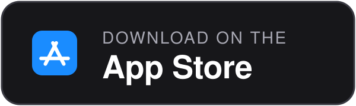
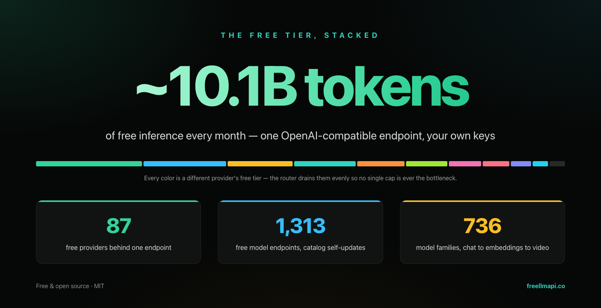
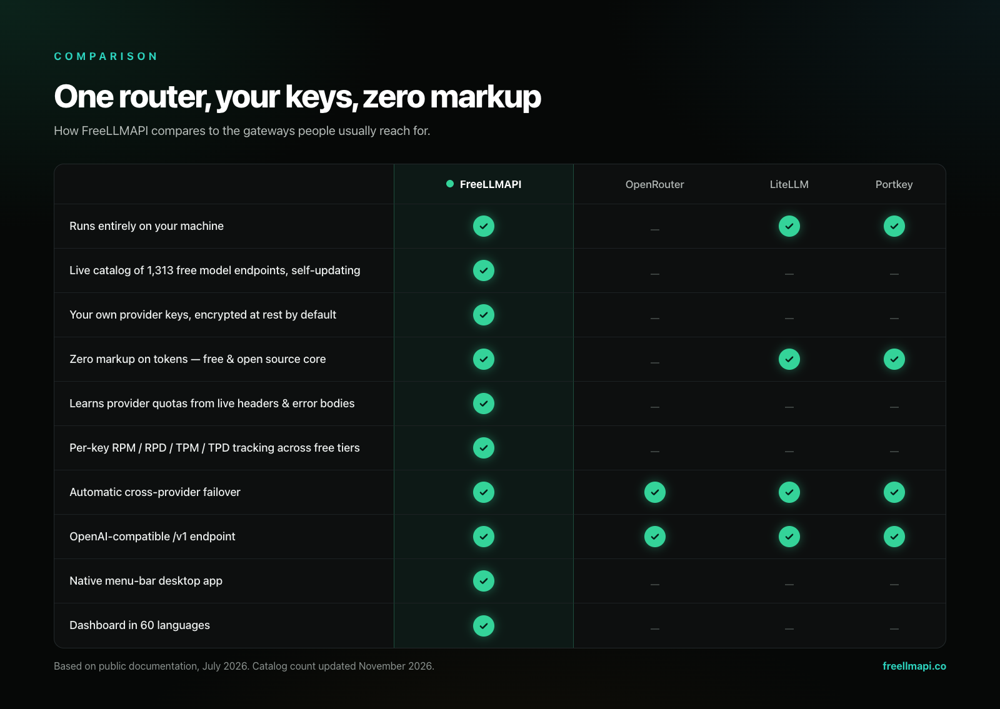
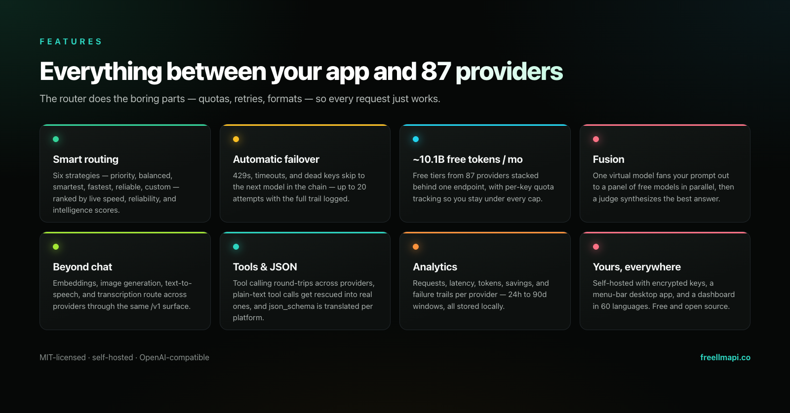
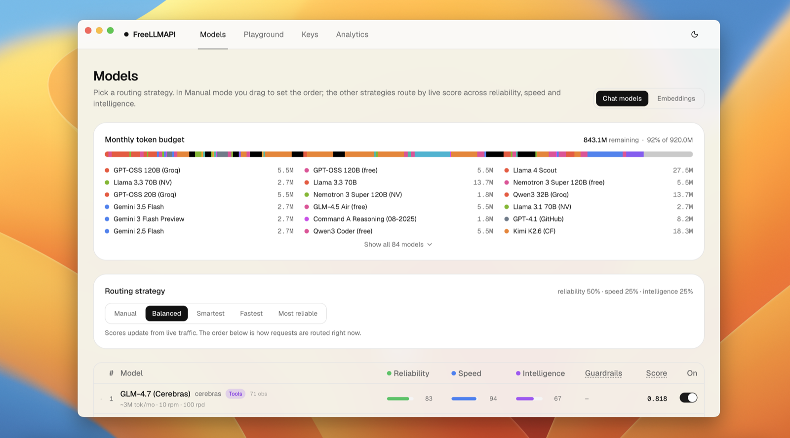
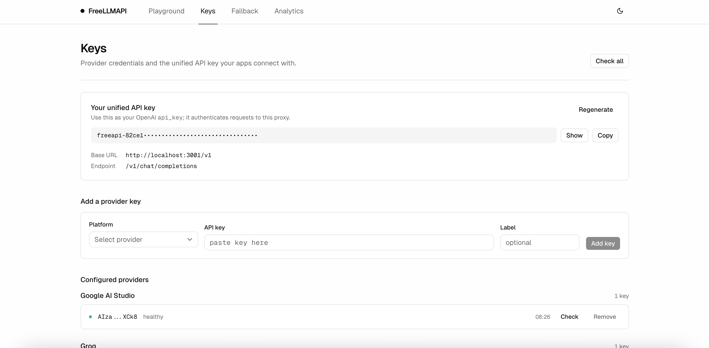
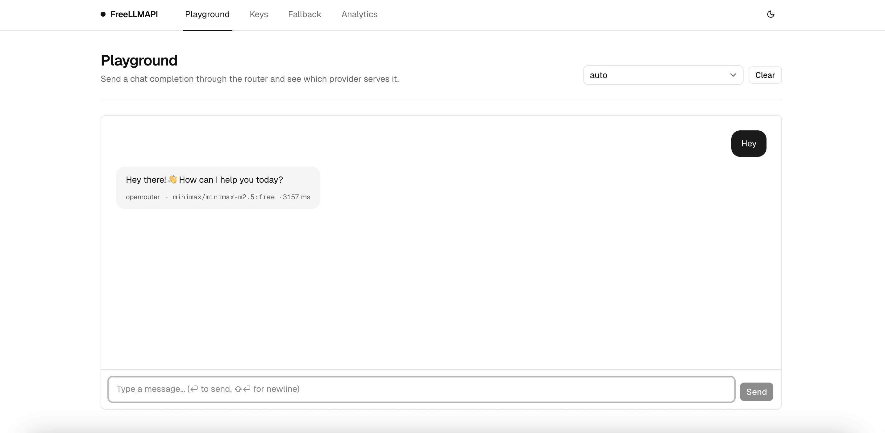
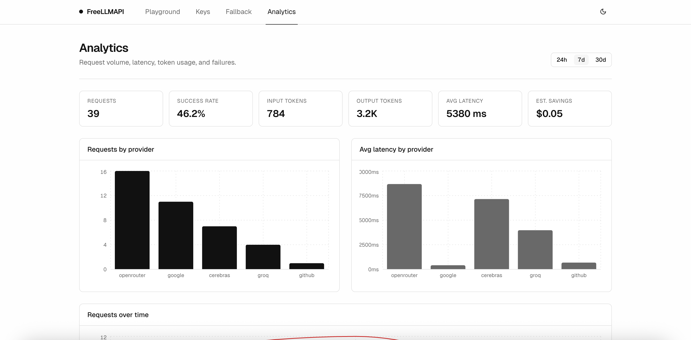
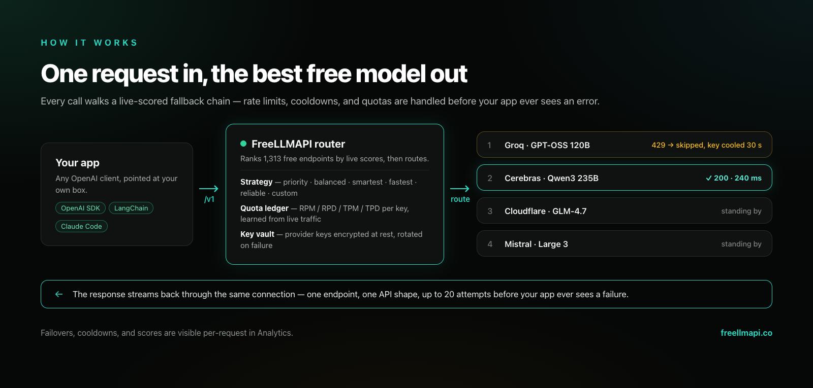

<div align="center">

# FreeLLMAPI

**月間 101 億トークン。87 の無料 LLM プロバイダー。1,313 の無料モデルエンドポイント。OpenAI 互換のエンドポイントはたった 1 つ。**

数十のプロバイダーの無料枠と、カスタムの OpenAI 互換チャット・埋め込み・画像・音声エンドポイントを、単一の `/v1` API の背後にまとめます。キーは暗号化して保存されます。ルーターがリクエストごとに利用可能な最適モデルを選び、レート制限にかかったプロバイダーがあれば次のプロバイダーへフェイルオーバーし、キーごとの使用量を追跡して、すべての無料枠の上限内に収まるようにします。

[](https://github.com/tashfeenahmed/freellmapi/actions/workflows/ci.yml)
[](https://github.com/tashfeenahmed/freellmapi/stargazers)
[](./LICENSE)
[](#コントリビュート)
[](https://github.com/tashfeenahmed/freellmapi/pkgs/container/freellmapi)
[](https://deepwiki.com/tashfeenahmed/freellmapi)

**[freellmapi.co](https://freellmapi.co/?utm_source=github&utm_medium=readme&utm_campaign=repository&utm_content=readme_top)** · 全カタログを閲覧: 736 のモデルファミリー、1,313 の無料エンドポイント

[English](README.md) · [Türkçe](README.tr.md) · [简体中文](README.zh-cn.md) · [Русский](README.ru.md) · [O'zbekcha](README.uz.md) · **日本語**

<p align="center">
  <a href="https://github.com/tashfeenahmed/freellmapi/releases/latest"></a>
  <a href="https://github.com/tashfeenahmed/freellmapi/releases/latest"></a>
  <a href="docs/en/install/01-install.md#docker-compose"></a>
  <a href="https://play.google.com/store/apps/details?id=co.freellmapi.app"></a>
  <a href="https://apps.apple.com/app/id6804648934"></a>
</p>


ルーターは署名付きフィードから自身のモデルカタログを更新します。新しい無料モデル、クォータの変更、互換性の修正が `git pull` なしで反映されます。無料版には月次スナップショットが配信されるため、モデルはライブフィードに加わってから 30 日後に届きます。プレミアムのルーターには当日中に届きます。
**[freellmapi.co でライブ版を始める](https://freellmapi.co/?utm_source=github&utm_medium=readme&utm_campaign=premium&utm_content=readme_top#pricing)**(年額 $19、いつでも解約可能)。

</div>

---

## 目次

- [このプロジェクトの目的](#このプロジェクトの目的)
- [対応プロバイダー](#対応プロバイダー)
- [互換性のある CLI とコーディングエージェント](#互換性のある-cli-とコーディングエージェント)
- [他サービスとの比較](#他サービスとの比較)
- [機能](#機能)
- [クイックスタート](#クイックスタート)
- [デスクトップアプリ](#デスクトップアプリ)
- [OpenAI 互換クライアントでの利用](#openai-互換クライアントでの利用)
- [対応言語](#対応言語)
- [プレミアム (ライブカタログ)](#プレミアム-ライブカタログ)
- [API の使い方](#api-の使い方)
- [スクリーンショット](#スクリーンショット)
- [仕組み](#仕組み)
- [FAQ](#faq)
- [制限事項](#制限事項)
- [コントリビュート](#コントリビュート)
- [免責事項](#免責事項)

**ガイド:** [インストールとデプロイ](docs/en/install/01-install.md) · [API リファレンス](docs/en/api/01-rest-api.md) · [クライアントとコーディングエージェント](docs/en/clients/01-agent-clients.md) · [プロンプト圧縮](docs/en/compression/01-compression-pipeline.md) · [アーキテクチャと内部構造](docs/en/architecture/00-high-level-index.md) · [ドキュメント索引](docs/en/README.md) · [コントリビューターガイド](CONTRIBUTING.md)

## このプロジェクトの目的

今や、真剣に取り組む AI ラボはどこも無料枠を提供しています。月に数百万トークン、1 日に数千リクエストです。単体ではどの無料枠もおもちゃのようなものですが、積み重ねれば、小型で高速なものから十分に高性能なものまで、**736 のモデルファミリー / 1,313 のプロバイダーエンドポイント**にわたり、月間およそ **101 億トークン**もの実用的な推論能力になります。

問題は、これらを手作業で積み重ねるのが大変だということです。87 種類の SDK、87 種類のレート制限、87 か所もの失敗しうる箇所があります。FreeLLMAPI は、それを OpenAI 互換の 1 つのエンドポイントにまとめます。任意の OpenAI クライアントライブラリをローカルサーバーに向ければ、キーを追加したプロバイダーの間でリクエストを透過的にルーティングします。

しかも無料枠の状況は毎週変わります。プロバイダーはモデルを公開し、廃止し、予告なくクォータを変更します。FreeLLMAPI はそのすべてを追跡します。ルーターは [freellmapi.co](https://freellmapi.co) から署名付きのモデルカタログを自動で取得するので、`git pull` をしなくてもインストール環境が最新に保たれます。更新の速さについては [プレミアム (ライブカタログ)](#プレミアム-ライブカタログ) をご覧ください。



## 対応プロバイダー

<div align="center">
<table>
<tr>
<td align="center" width="150"><br/><b>Google</b></td>
<td align="center" width="150"><picture><source media="(prefers-color-scheme: dark)" srcset="repo-assets/providers/groq-dark.png"></picture><br/><b>Groq</b></td>
<td align="center" width="150"><br/><b>Cerebras</b></td>
<td align="center" width="150"><picture><source media="(prefers-color-scheme: dark)" srcset="repo-assets/providers/opencode-dark.png"></picture><br/><b>OpenCode Zen</b></td>
</tr>
<tr>
<td align="center"><br/><b>Mistral</b></td>
<td align="center"><br/><b>OpenRouter</b></td>
<td align="center"><br/><b>Cloudflare</b></td>
<td align="center"><br/><b>Cohere</b></td>
</tr>
<tr>
<td align="center"><br/><b>Z.ai (Zhipu)</b></td>
<td align="center"><br/><b>NVIDIA</b></td>
<td align="center"><br/><b>HuggingFace</b></td>
</tr>
<tr>
<td align="center"><a href="https://modelscope.cn"><b>ModelScope</b><br/>Qwen3 · DeepSeek V4 · GLM-5(Aliyun の cn アカウント連携が必要)</a></td>
</tr>
</table>

<i>… ほかにも 75 の無料プロバイダー</i>

</div>

さらに **custom** プロバイダーがあり、チャット、埋め込み、画像、音声のモデルを、任意の OpenAI 互換エンドポイント(llama.cpp、LM Studio、vLLM、ローカルの Ollama、リモートのゲートウェイ)に向けられます。設定は「キー」ページから行います。

常に最新の全リストは **[freellmapi.co/models](https://freellmapi.co/models.html)** にあり、モデルごとのレート制限、コンテキストウィンドウ、無料トークン予算が載っています。

## 互換性のある CLI とコーディングエージェント

<div align="center">
<table>
<tr>
<td align="center" width="150"><br/><b>Claude Code</b></td>
<td align="center" width="150"><br/><b>Codex CLI</b></td>
<td align="center" width="150"><br/><b>Gemini CLI</b></td>
<td align="center" width="150"><br/><b>Cursor</b></td>
</tr>
<tr>
<td align="center"><br/><b>Cline</b></td>
<td align="center"><br/><b>Roo Code</b></td>
<td align="center"><br/><b>OpenCode</b></td>
<td align="center"><br/><b>Aider</b></td>
</tr>
</table>

<i>… ほかに Continue、Goose、Qwen Code、Kilo Code、Crush、Zed、JetBrains AI、DeepSeek Harness、MiMo Code、AtomCode、OpenClaw、Hermes Agent、Pi、Reasonix、ZCode、および OpenAI 互換・Anthropic・Gemini・Ollama のあらゆるクライアント</i>

</div>

ほとんどのエージェントは、1 つのコマンドで自動設定できます。このコマンドは稼働中のカタログを読み取り、既存の設定をバックアップしてからマージします。

```bash
npx freellmapi setup-claude --url http://localhost:3001 --api-key <unified-key>
```

**[対応エージェントの一覧とセットアップコマンド →](docs/en/clients/02-supported-agents.md)** · [ツールごとのレシピ、MCP サーバー、URL トークン →](docs/en/clients/01-agent-clients.md)

## 他サービスとの比較



公開ドキュメントに基づく(2026 年 7 月時点)。誤りがあればご指摘ください。

## 機能



- **OpenAI 形式のあらゆるインターフェース** — `/v1/chat/completions`、`/v1/responses`(Codex CLI に必要)、`/v1/completions`(エディターのゴーストテキスト補完)、`/v1/images/generations`、`/v1/videos/generations`、`/v1/audio/speech`、`/v1/audio/transcriptions`、`/v1/embeddings`、`/v1/models` に対応し、ストリーミング・非ストリーミングのどちらも、公式 SDK や任意の OpenAI 互換クライアントから利用できます。[API リファレンス →](docs/en/api/01-rest-api.md)
- **Anthropic Messages API** — `/v1/messages` は同じルーター上で Anthropic のワイヤーフォーマットを話すため、**Claude Code** や公式の Anthropic SDK が無料プールに対して動作します。[詳細 →](docs/en/api/01-rest-api.md#anthropic--claude-clients)
- **ネイティブの Gemini と Ollama のインターフェース** — Gemini CLI は `/v1beta`(`generateContent`、ストリーミング、トークン数の計算、モデル一覧)を使え、オプトインの Ollama エミュレーションは、Zed、JetBrains などのローカルモデルクライアント向けに、NDJSON のチャット/生成、タグ、メタデータ、埋め込みを提供します。
- **Fusion(複数モデルによる統合)** — 仮想モデル `fusion` をリクエストすると、ルーターがプロンプトを多様な無料モデルのパネルに並列で展開し、審査役のモデルが各下書きから 1 つの回答を統合します。[詳細 →](docs/en/api/01-rest-api.md#fusion-multi-model-synthesis)
- **画像・動画・音声の生成** — `/v1/images/generations`、`/v1/videos/generations`、`/v1/audio/speech` は、メディアモデルを提供するプロバイダー間でルーティングされます。画像と音声は、カスタムの OpenAI 互換メディアエンドポイントも受け付けます。動画ジョブは同期型とキュー型のプロバイダーにわたって正規化され、完成した MP4 が返ります。
- **ツール呼び出しと構造化出力** — OpenAI 形式の `tools` がプロバイダー間でそのまま往復します(プレーンテキストのツール呼び出しは本物の `tool_calls` に救済されます)。さらに `response_format`、`seed`、`logprobs`、ペナルティなどのサンプリングパラメーターも、プロバイダーごとにそのまま渡されます。
- **6 つの戦略によるスマートルーティング** — モデルごとの速度・能力・信頼性のライブスコアでチェーンを順位付けします。429/5xx ではクールダウンとキーのローテーションを伴い、次のモデルへ自動でフェイルオーバーします。[ルーティングの詳細 →](docs/en/architecture/00-high-level-index.md#how-it-works)
- **統合モデルとプロファイル** — 複数のプロバイダーにある同じモデルは、グループ内で厳密にフェイルオーバーする 1 つのエントリにまとまります。名前付きのフォールバックチェーンのプロファイル(コーディング用チェーン、ビジョン用チェーンなど)は、ダッシュボードから、またはリクエストごとに `auto:<profile>` で切り替えられ、カスタムチェーンはチェーンマネージャーでその場で名前を変更できます。
- **キーごとのレート追跡** — `(platform, model, key)` ごとに RPM/RPD/TPM/TPD のカウンターを持ち、プロバイダーが報告する上限値を学習するため、ルーティングは常にすべての上限の内側に収まります。
- **自己更新するモデルカタログ** — ルーターは freellmapi.co から署名付きカタログを 1 日 2 回同期します。新しいモデル、クォータの変更、プロバイダー固有の挙動の修正が自動で反映されます。無料版は月次スナップショットを追従し、各モデルはライブフィードに入ってから 30 日後に加わります。プレミアムのルーターには当日中に届きます。[プレミアム →](#プレミアム-ライブカタログ)
- **スティッキーセッションとコンテキストの引き継ぎ** — 会話は 30 分間、同じモデルにとどまります。会話の途中でモデルが切り替わる場合は、任意の簡潔な引き継ぎメモによってスレッドの一貫性が保たれます。[詳細 →](docs/en/clients/01-agent-clients.md#context-handoff)
- **プロンプト圧縮(オプトイン)** — 共有のフェイルオープンなリクエストパイプラインが、キャッシュ検索とルーティングの前に、プロンプトの重複排除、ツール出力のフィルタリング、繰り返される JSON の圧縮、古いコンテキストの削減を行えます。[詳細 →](docs/en/compression/01-compression-pipeline.md)
- **暗号化されたキーと、外に出すのは 1 つのトークンだけ** — プロバイダーのキーは SQLite 内で AES-256-GCM により暗号化され、リクエストごとにメモリ内でのみ復号されます。アプリから見えるのは、統合された 1 つの `freellmapi-…` Bearer トークンだけです。
- **管理ダッシュボードと分析** — キーの管理、チェーンの並べ替え、プレイグラウンドの実行、24 時間〜90 日の期間での p50/p95/TTFT 分析ができる React UI です。ログイン制で、ダークテーマとライトテーマがあり、[60 言語](#対応言語)に対応しています。
- **ChatGPT 対応の MCP サーバーとインタラクティブなドキュメント** — ChatGPT などの MCP クライアントは、`/mcp` 経由で FreeLLMAPI の推論の呼び出し、利用可能なモデルの一覧、プロバイダーのヘルス・使用量・キャッシュ・ルーティングのメタデータの確認、ルーティング戦略の管理ができます。依存関係のない OpenAPI ビューアーが `/v1/docs` にあります。[ChatGPT とコーディングエージェント →](docs/en/clients/01-agent-clients.md#mcp-server)
- **運用面の便利機能** — オプトインのレスポンスキャッシュ、暗号化された DB バックアップ、定期的なキーのヘルスチェック、キーの一括インポート/エクスポート、宣言的な起動設定。[インストールとデプロイ →](docs/en/install/01-install.md)
- **Node 20+ が動く場所ならどこでも** — Windows、macOS、Linux サーバー、小型の ARM SBC(Raspberry Pi を含む)。PM2 / systemd / お好みのスーパーバイザーの下で、アイドル時のメモリ使用量(RSS)は約 40 MB です。

対象範囲は意図的に絞っています。[まだ対応していないもの](docs/en/architecture/00-high-level-index.md#not-yet-supported)をご覧ください。

## クイックスタート

**ワンライナー**(Docker が必要です。`~/freellmapi` を用意し、暗号化キーを生成し、イメージを pull して、コンテナーを起動します):

```bash
curl -fsSL https://freellmapi.co/install.sh | bash
```

パイプで bash に渡す前に中身を読みたい方は、[スクリプトはこちら](https://freellmapi.co/install.sh)です。再実行しても安全で、`.env`(と暗号化キー)は保持され、コンテナーは `:latest` に更新されます。

http://localhost:3001 を開き、**キー**ページでプロバイダーのキーを追加し、**Fallback Chain** をお好みに並べ替えて、**キー**ページのヘッダーから統合 API キーを取得します。この統合キーが、OpenAI SDK の向け先になります。

Windows では、デスクトップ版の **[Releases にある `.exe` インストーラー](https://github.com/tashfeenahmed/freellmapi/releases/latest)**(下記)がもっとも簡単です。Android については、実験的な [Termux ガイド](docs/en/install/02-android-termux.md)をご覧ください。

それ以外のすべて(Docker Compose、ローカル開発、宣言的な起動設定、本番ビルド、LAN アクセス、バックアップ)は **[docs/en/install/01-install.md](docs/en/install/01-install.md)** にあります。

## デスクトップアプリ

ネイティブのメニューバーアプリが [`desktop/`](./desktop) にあります。ルーターとダッシュボードの全体がトレイからローカルで動き、リアルタイムのリクエスト統計を表示するガラス調のポップオーバーが付いています。



**[Releases からダウンロード](https://github.com/tashfeenahmed/freellmapi/releases/latest)** — macOS の `.dmg` と Windows の `.exe` インストーラーが、すべてのリリースに添付されています。アカウントもパスワードも設定不要で、必要な認証情報はトレイのポップオーバーにある統合 API キーだけです。ソースからのビルド手順とデータの保存場所は [docs/en/install/01-install.md#desktop-app](docs/en/install/01-install.md#desktop-app) をご覧ください。

macOS 12 Monterey 以降では、**arm64 (Apple Silicon)** か **x64 (Intel)** を選んでください。どちらの Mac 向けビルドにも ZIP のダウンロードがあります。

## OpenAI 互換クライアントでの利用

OpenAI 互換のベース URL を指定できるものなら何でも動きます。ベース URL を `http://localhost:3001/v1` に設定し、ダッシュボードの統合キーを使ってください。どのジェネレーターも `--dry-run` に対応しており、`npx freellmapi launch`(Claude Code)と `launch-codex`(Codex)は、認証情報を設定ファイルにまったく残しません。ルーターは、エージェントがセッションの途中で内部を調べられる MCP サーバーとしても機能します。

**ChatGPT** は、非公開の Secure MCP Tunnel を通じて、同じローカルルーターに接続します。
`ask_freellmapi` MCP ツールは、ChatGPT から依頼されたタスクを `/v1/chat/completions` 経由でルーティングし、
回答を、実際に使われたモデル、フォールバック、キャッシュ、実行、トークンのメタデータとともに返します。ベース
URL と Bearer 認証はトンネルクライアントの設定に置かれ、デフォルトのモデルは
`MCP_INFERENCE_DEFAULT_MODEL` で設定します(未設定の場合は `auto`)。キーを Git や
MCP の URL に含めてはいけません。**[ChatGPT のセットアップ →](docs/en/clients/01-agent-clients.md#chatgpt-private-secure-mcp-tunnel)**

プロバイダーのキーは、ダッシュボードのセッショントークン(`FREELLMAPI_DASHBOARD_TOKEN` または `--token`)を使えばターミナルからも管理できます。`npx freellmapi keys add|list|remove|test <platform>` で、`keys test` は保存済みのキーを再確認します。[cli/README.md](cli/README.md#provider-keys) をご覧ください。

FreeLLMAPI は設計上、ローカルファースト・シングルユーザーです。プロバイダーのキーは SQLite データベース内に暗号化して保存され、リクエストはあなたのマシンから、有効にした上流プロバイダーへ直接送られます。

## 対応言語

ダッシュボードは **60 言語**に対応しています(デスクトップのトレイメニューは 6 言語)。UI は初回読み込み時にブラウザー/システムの言語を
自動検出し、**⋯ → 設定**からいつでも切り替えられます。
選択は記憶されます。右から左に書く言語
(العربية、עברית、فارسی、اردو)ではレイアウト全体が自動で反転し、
読み込まれるのは有効な言語の辞書だけで、残りの言語が帯域を使うことはありません。

                                                 

ロケールの完全な一覧は
[`client/src/i18n/locale-config.ts`](./client/src/i18n/locale-config.ts) にあります。

最初の 6 つのロケールは人手でレビューされています。それ以降のものは機械
翻訳で、ネイティブスピーカーからの修正によって改善されていきます。1 文字列だけの PR でも、
最初のコントリビュートにぴったりです。

翻訳は [`client/src/i18n/locales/`](./client/src/i18n/locales) に、フラットな JSON ファイルとして置かれています。
文字列を直すには、そのロケールの JSON ファイルの値を編集します。
言語を追加するには、`en.json` をコピーして値を翻訳し、`client/src/i18n/locale-config.ts` にロケールを登録します
(トレイの文字列については `desktop/src/i18n.ts` にも登録します)。`npm test` はすべてのロケールについて、
キーとプレースホルダーの整合性をチェックします。
PR をお待ちしています。

## プレミアム (ライブカタログ)

ルーターは、モデルカタログを自動で最新に保ちます。署名付きカタログを
[freellmapi.co](https://freellmapi.co) から 1 日 2 回取得し、新しいモデル、
クォータの変更、プロバイダー固有の挙動の修正をローカル DB に適用します。あなた自身の
有効/無効の選択やカスタムプロバイダーには一切触れません。また、ダウンロードはすべて、適用の前に
固定された Ed25519 鍵で検証されます。

カタログは現在、**87 のプロバイダー**、**736 のモデルファミリー**、**1,313 の
無料プロバイダー/モデルエンドポイント**(チャット 1,137、画像 29、音声 41、埋め込み 68、
文字起こし 19、動画 6、decision 13)を追跡しており、掲載されている無料枠の容量は月間およそ **101 億トークン**です。
全体は
**[freellmapi.co/models](https://freellmapi.co/models.html)** で閲覧できます。

無料版も同じ署名付きカタログを取得しますが、月次スナップショットからです。モデルは
ライブフィードに入ってから 30 日後に加わるため、現在の無料ビルドは
約 303 モデル分遅れています。何かが失効することも、
機能が削られることもなく、届くのが遅れるだけです。

プレミアムは、その署名付きカタログを、あなたが運用するすべてのルーターでライブに保ちます。プロバイダーが
強力な無料モデルを公開したとき、静かにクォータを絞ったとき、ワイヤーフォーマットを壊したとき、
ライブフィードのルーターには、配信した当日に更新が届きます。

**[freellmapi.co でライブ版を始める →](https://freellmapi.co/?utm_source=github&utm_medium=readme&utm_campaign=premium&utm_content=readme_bottom#pricing)**

- 年額 $19、または買い切り $49(永久)。Stripe での決済で、いつでもセルフサービスで解約できます。
- 1 つの `fla_` キーで、運用しているすべてのルーターをカバーします(デスクトップ、ホームラボ、Raspberry Pi)。
- ダッシュボードの**プレミアム**で有効化します。解約や請求の管理は
  [freellmapi.co/manage](https://freellmapi.co/manage) でセルフサービスで行えます。
- ルーター本体は引き続き MIT ライセンスで、永久に完全無料です。プレミアムが提供するのは
  ライブフィードだけで、これが、カタログを機能させ続けるための日次のモデルテストと
  カタログのメンテナンスを支える資金になります。

カタログサーバーは、あなたのプロンプト、補完結果、プロバイダーのキーを一切目にしません。どちらの場合でも、ルーターは
完全にセルフホストのままです。

## API の使い方

```python
from openai import OpenAI

client = OpenAI(
    base_url="http://localhost:3001/v1",
    api_key="freellmapi-your-unified-key",
)

resp = client.chat.completions.create(
    model="auto",  # let the router pick; or "auto:fast", "auto:smart", a profile, or a model id
    messages=[{"role": "user", "content": "Summarise the fall of Rome in one sentence."}],
)
print(resp.choices[0].message.content)
print("Routed via:", resp.headers.get("x-routed-via"))
```

ストリーミング、`auto:*` ルーティング戦略、ツール呼び出し、ビジョン入力、Gemini の Google 検索グラウンディング、埋め込み、Anthropic Messages インターフェースは、それぞれに curl と Python の例を付けて、すべて **[docs/en/api/01-rest-api.md](docs/en/api/01-rest-api.md)** にまとめられています。すべてのレスポンスには `X-Routed-Via: <platform>/<model>` ヘッダーが付くので、実際にどのプロバイダーが処理したかを確認できます。

## スクリーンショット

### モデル

ルーティング戦略を選び、プロバイダー全体にわたって月間トークン予算が埋まっていく様子を確認できます。どのモデルにも、信頼性、速度、知能のライブスコアが表示され、以下の並びが、現在のリクエストのルーティング順です。


### キー

プロバイダーの認証情報を管理し、アプリの接続に使う統合 API キーを取得します。各キーにはステータスのドットと、最後にヘルスチェックした日時が表示されます。



### プレイグラウンド

ルーター経由でチャット補完を送り、どのプロバイダーが処理したかを確認できます。モデル ID とレイテンシーはメッセージ上にそのまま表示されます。ファイルは、ボタン、ドラッグ&ドロップ、貼り付けで添付できます。画像(PNG/JPEG/WebP/GIF)はブラウザー上で縮小され、画像コンテンツパートとしてビジョン対応モデルに送られます。テキストファイル(TXT/MD/CSV/JSON/LOG)は、フェンス付きブロックとしてプロンプトにインライン展開されます。



### 分析

リクエスト数、成功率、入出力トークン、平均レイテンシー、プロバイダーごとの内訳を、24 時間 / 7 日 / 30 日 / 90 日の期間で確認できます。



## 仕組み



1 つのリクエストから最適な無料モデルへ。ルーターは、健全なキーがあり、すべてのレート制限の内側にある最優先のモデルを選び、メモリ内でキーを復号してプロバイダーを呼び出します。429/5xx の場合は、そのキーをクールダウンさせ、チェーン内の次のモデルで再試行します。コンポーネントの解説、ルーティングの内部構造、運用の詳細は **[docs/en/architecture/00-high-level-index.md](docs/en/architecture/00-high-level-index.md)** にあります。

## FAQ

**パスワードは必要ですか?** デスクトップアプリでは不要です。ダッシュボードは非表示のローカルアカウントで自動的にサインインするため、設定するものも、忘れるものもありません。トレイアイコン → **Open Dashboard** から、または同じコンピューター上の任意のブラウザー(例: http://127.0.0.1:31415)で開いてください。どちらも自動でサインインします。LAN アクセス経由でアプリに接続する別のデバイスには、引き続きサインインフォームが表示されます。サーバーへのインストール(Docker、ワンライナー、`npm run dev`)には、メールアドレスとパスワードのアカウントがあります。

**サーバーへのインストールでパスワードを忘れました。** ログインページで **パスワードをお忘れですか？** をクリックしてください。リンクを送るメールがないため、ワンタイムコードはサーバーのログに出力されます。`docker compose logs -f freellmapi`(またはサーバーを動かしているターミナル、デスクトップのログファイル)で読み取り、リセットフォームに入力してください。コードの有効期限は 15 分です。

**ログはどこにありますか?** Docker ではコンテナーのログ、ソースからの実行ではターミナル、デスクトップアプリでは `<data dir>/logs/freeapi.log` にあります。トレイメニューの **Open Logs Folder** から開けます。

**アンインストールするには?** アプリを削除し(macOS ではゴミ箱、Windows では *設定 → アプリ*、Docker では `docker compose down -v`)、その後データディレクトリ(`%APPDATA%\FreeLLMAPI\`、`~/Library/Application Support/FreeLLMAPI/`、または `~/.config/FreeLLMAPI/`)を削除してください。アンインストールだけでは、そのフォルダーには手が付けられません。

インストール方法ごとの詳しい回答: **[docs/en/install/01-install.md#faq-passwords-logs-uninstall](docs/en/install/01-install.md#faq-passwords-logs-uninstall)**。

## 制限事項

無料枠を積み重ねることには、現実的なトレードオフがあります。最先端のモデルはなく、レイテンシーは一定せず、SLA もありません。さらに、上位モデルが 1 日の上限に達するにつれて、1 日の後半にはエンドポイントの実効的な知能が低下し、UTC の午前 0 時にリセットされます。本格的なものをこの上に構築する前に、**[docs/en/architecture/00-high-level-index.md#limitations](docs/en/architecture/00-high-level-index.md#limitations)** にある率直な一覧を読んでください。

## コントリビュート

コントリビューターを大歓迎します! 開発のループ、PR に求められること、AI/LLM を使ったコントリビュートの方針(要点: 歓迎、品質の基準は他の PR と同じ)については [CONTRIBUTING.md](CONTRIBUTING.md) をご覧ください。最初の PR にお勧めのもの:

- **プロバイダーの追加** — `server/src/providers/openai-compat.ts` をテンプレートとしてコピーし、`server/src/providers/index.ts` に組み込み、`server/src/db/index.ts` にそのモデルをシードし、`server/src/__tests__/providers/` にテストを追加します。
- **エンドポイントの追加** — ほかの OpenAI 互換インターフェース(例: `/v1/realtime`)。プロバイダーの基底クラスには新しいメソッドを追加でき、アダプターは自分が対応するものを宣言します。
- **ルーターの改善** — コストを考慮したルーティング(最安・健全・最速のトレードオフ)、レイテンシーで重み付けした優先度の改善、リージョンの固定。
- **ダッシュボードの磨き込み** — 分析ページのグラフ、キーのローテーションの UX、`.env` からのキーの一括インポート。
- **ドキュメント** — 例の追加、Go/Rust などのクライアントライブラリのスニペット、Docker や Fly 向けのデプロイレシピ。

`npm install && npm run dev` で、サーバーが :3001、ダッシュボードが :5173 で起動し、どちらも HMR に対応しています。再現性のあるセットアップには、Bash では `./scripts/dev-bootstrap.sh`、PowerShell では `.\scripts\dev-bootstrap.ps1` を使ってください。どちらも既存の `.env` を保持します。PR にはテストを含め、既存のスイートを通し(`npm test`)、リポジトリにすでにある `.editorconfig` / tsconfig のデフォルトに合わせてください。データベースマイグレーションのワークフローとコントリビューターの全体的な流れは [CONTRIBUTING.md](./CONTRIBUTING.md) にあります。

### コントリビューター

<a href="https://github.com/moaaz12-web"></a>
<a href="https://github.com/AdityaxDeore"></a>
<a href="https://github.com/lukasulc"></a>
<a href="https://github.com/VinhPhamAI"></a>
<a href="https://github.com/deadc"></a>
<a href="https://github.com/zhangyu1324"></a>
<a href="https://github.com/kentpan"></a>
<a href="https://github.com/stephenzwj"></a>
<a href="https://github.com/chongjiazhen"></a>
<a href="https://github.com/vjsai"></a>
<a href="https://github.com/long2ice"></a>
<a href="https://github.com/sadesguy"></a>
<a href="https://github.com/hodlmybeer69-bit"></a>
<a href="https://github.com/phoenixikkifullstack"></a>
<a href="https://github.com/jtbrennan-git"></a>
<a href="https://github.com/praveenkumarpranjal"></a>
<a href="https://github.com/nordbyte"></a>
<a href="https://github.com/mybropro"></a>
<a href="https://github.com/danscMax"></a>
<a href="https://github.com/jhash"></a>
<a href="https://github.com/JammyJames1234"></a>
<a href="https://github.com/coffcoe"></a>
<a href="https://github.com/Sumit4codes"></a>
<a href="https://github.com/meliani"></a>
<a href="https://github.com/thedavidweng"></a>
<a href="https://github.com/bharvey42"></a>
<a href="https://github.com/yuvrxj-afk"></a>
<a href="https://github.com/v0rtex1223"></a>
<a href="https://github.com/nicyoong"></a>
<a href="https://github.com/Aldo-f"></a>
<a href="https://github.com/Tazrif-Raim"></a>
<a href="https://github.com/m1nuzz"></a>
<a href="https://github.com/suantea"></a>
<a href="https://github.com/OhOkThisIsFine"></a>
<a href="https://github.com/LoneRifle"></a>
<a href="https://github.com/ita333"></a>
<a href="https://github.com/barbotkonv"></a>
<a href="https://github.com/Naster17"></a>
<a href="https://github.com/StealthTensor"></a>
<a href="https://github.com/EmranAhmed"></a>
<a href="https://github.com/itsfuad"></a>
<a href="https://github.com/RobinHoodO"></a>
<a href="https://github.com/hmm183"></a>
<a href="https://github.com/duemilionidieuro-bot"></a>
<a href="https://github.com/cagedbird043"></a>
<a href="https://github.com/jasnoorgill"></a>
<a href="https://github.com/Joey9024"></a>
<a href="https://github.com/AskingConical"></a>
<a href="https://github.com/ProAlit"></a>
<a href="https://github.com/hjhhoni"></a>
<a href="https://github.com/immanuelsavio"></a>
<a href="https://github.com/Slyker"></a>
<a href="https://github.com/wells1013"></a>
<a href="https://github.com/evgkrsk"></a>
<a href="https://github.com/aaronjmars"></a>
<a href="https://github.com/Robs87"></a>
<a href="https://github.com/dashitongzhi"></a>
<a href="https://github.com/QingJ01"></a>
<a href="https://github.com/3215"></a>
<a href="https://github.com/saifulaiub123"></a>
<a href="https://github.com/PietFourie"></a>
<a href="https://github.com/mhmdkrmabd"></a>
<a href="https://github.com/DemeulemeesterxMaxime"></a>
<a href="https://github.com/HoodBlah"></a>
<a href="https://github.com/SeanPedersen"></a>
<a href="https://github.com/andersmmg"></a>
<a href="https://github.com/chirag127"></a>
<a href="https://github.com/allababbot"></a>
<a href="https://github.com/johan-droid"></a>
<a href="https://github.com/redenfire"></a>
<a href="https://github.com/itzpingcat"></a>
<a href="https://github.com/kairwang01"></a>
<a href="https://github.com/gongjurenzhangwei"></a>
<a href="https://github.com/jsonring"></a>
<a href="https://github.com/1029734570"></a>
<a href="https://github.com/86TheCactus"></a>
<a href="https://github.com/AmiroKD"></a>
<a href="https://github.com/ecryptomillionaire-dev"></a>
<a href="https://github.com/4riful"></a>
<a href="https://github.com/fix2015"></a>
<a href="https://github.com/iisyw"></a>
<a href="https://github.com/xsfhacg"></a>
<a href="https://github.com/noobix"></a>
<a href="https://github.com/nandukmelath"></a>
<a href="https://github.com/NirvanaCh7"></a>
<a href="https://github.com/Mohamed3nan"></a>
<a href="https://github.com/Arman-Espiar"></a>
<a href="https://github.com/MetaMysteries8"></a>
<a href="https://github.com/lujun880726"></a>
<a href="https://github.com/qq97693453"></a>
<a href="https://github.com/emv33"></a>
<a href="https://github.com/ousamabenyounes"></a>
<a href="https://github.com/yfdyh000"></a>
<a href="https://github.com/s-uryansh"></a>
<a href="https://github.com/arsalanyavari"></a>
<a href="https://github.com/RoboMWM"></a>
<a href="https://github.com/gaurang-py"></a>
<a href="https://github.com/ddy4633"></a>
<a href="https://github.com/UrbsKali"></a>
<a href="https://github.com/hb-0"></a>
<a href="https://github.com/xyblue135"></a>
<a href="https://github.com/Icesenator"></a>
<a href="https://github.com/ZER0-auto"></a>
<a href="https://github.com/tashdroid"></a>
<a href="https://github.com/Patrickleondev"></a>
<a href="https://github.com/hiiamwaffledev"></a>
<a href="https://github.com/w0fv1"></a>
<a href="https://github.com/oppih"></a>
<a href="https://github.com/n3dhir"></a>
<a href="https://github.com/ksp2000"></a>
<a href="https://github.com/quabynahdavis"></a>
<a href="https://github.com/qinghuanandejiangshi"></a>
<a href="https://github.com/qatcod"></a>
<a href="https://github.com/CooperSheroy"></a>
<a href="https://github.com/shahidbeig-a11y"></a>
<a href="https://github.com/Kaban15"></a>
<a href="https://github.com/efcunha"></a>
<a href="https://github.com/sukaimi"></a>
<a href="https://github.com/rome-xi"></a>
<a href="https://github.com/bsi-bcp"></a>
<a href="https://github.com/rodion-gudz"></a>
<a href="https://github.com/bjornmage"></a>
<a href="https://github.com/kenanlabs"></a>
<a href="https://github.com/xzyj50609"></a>
<a href="https://github.com/Ahmedtahoon2"></a>
<a href="https://github.com/Inference1"></a>
<a href="https://github.com/yzhkali"></a>
<a href="https://github.com/levonk"></a>
<a href="https://github.com/tripstar6000"></a>
<a href="https://github.com/alkank"></a>
<a href="https://github.com/Yi-111-a"></a>
<a href="https://github.com/The88788"></a>
<a href="https://github.com/ac1982"></a>
<a href="https://github.com/agammann"></a>
<a href="https://github.com/Claven07"></a>
<a href="https://github.com/AymenJeddou"></a>
<a href="https://github.com/Thibaultjaigu"></a>
<a href="https://github.com/silvertakana"></a>
<a href="https://github.com/sidhunt"></a>
<a href="https://github.com/rubicon"></a>
<a href="https://github.com/JoAdo07"></a>
<a href="https://github.com/igormutton"></a>
<a href="https://github.com/georgeatparallel"></a>
<a href="https://github.com/BNTiyan"></a>
<a href="https://github.com/ChaosCom"></a>
<a href="https://github.com/Alexis12119"></a>
<a href="https://github.com/kevin9327"></a>
<a href="https://github.com/ilya-bogin-keenable"></a>
<a href="https://github.com/harsHdokyc"></a>
<a href="https://github.com/ALANDVO"></a>
<a href="https://github.com/HyperionBurn"></a>
<a href="https://github.com/emirhantasli"></a>
<a href="https://github.com/jayhemnani9910"></a>
<a href="https://github.com/ignamiranda"></a>
<a href="https://github.com/MoriDanWork"></a>
<a href="https://github.com/suvshox-oss"></a>
<a href="https://github.com/Swidan0"></a>
<a href="https://github.com/w21180239"></a>
<a href="https://github.com/kjgggggg"></a>
<a href="https://github.com/TheoCui-Saulcy"></a>
<a href="https://github.com/MatthewRobertDunn"></a>
<a href="https://github.com/nk-batman21"></a>
<a href="https://github.com/PowerTokens"></a>
<a href="https://github.com/navzo"></a>
<a href="https://github.com/motasimfuad"></a>
<a href="https://github.com/thedevil11255"></a>
<a href="https://github.com/kvianAR"></a>
<a href="https://github.com/TanmayShah29"></a>
<a href="https://github.com/heydryft"></a>
<a href="https://github.com/leucds2018-hub"></a>
<a href="https://github.com/zhangkom"></a>
<a href="https://github.com/noahkhomer18"></a>
<a href="https://github.com/mentallyunstable-lab"></a>

## 免責事項

**このプロジェクトは個人的な実験と学習のためのものであり、本番用ではありません。** 無料枠は、開発者がそれを使ってプロトタイプを作れるようにするためのものです。安定した、サポートされた推論基盤ではなく、そのように扱うべきでもありません。FreeLLMAPI の上に本格的なものを構築する場合は、公開前に有料の API に差し替えてください。各上流プロバイダーとの関係は、アカウント作成時に同意した規約に従います。トラフィックがこのプロジェクトを経由してプロキシされる場合でも、それらの規約は引き続き適用され、遵守する責任はあなたにあります。

各プロバイダーの利用規約が個人用・単一ユーザーのプロキシをどう見ているか(2026 年 5 月にプロバイダーごとに確認したもの)は、[docs/en/architecture/00-high-level-index.md#terms-of-service-review](docs/en/architecture/00-high-level-index.md#terms-of-service-review) にあります。

## ライセンス

[MIT](./LICENSE)
