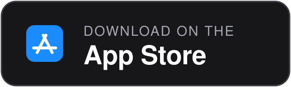
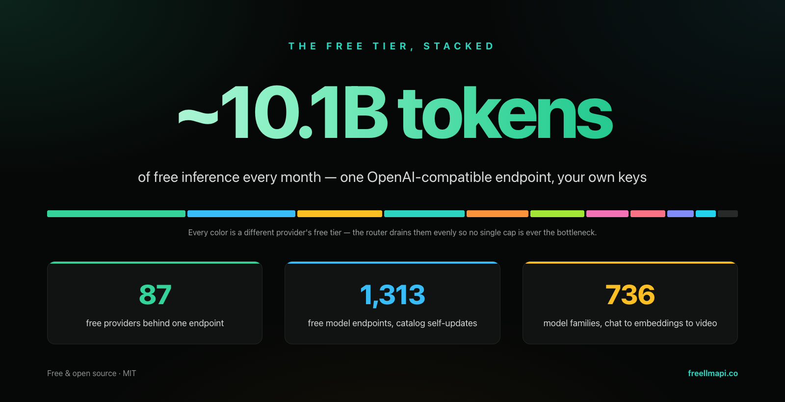
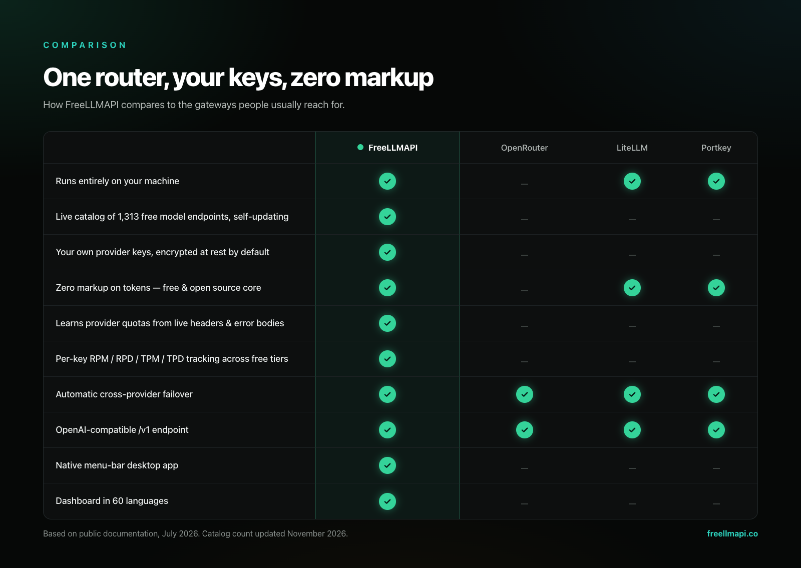
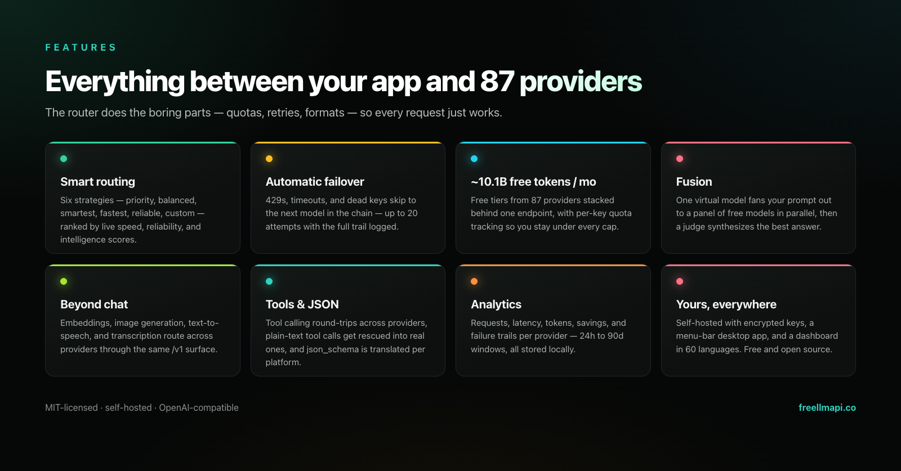
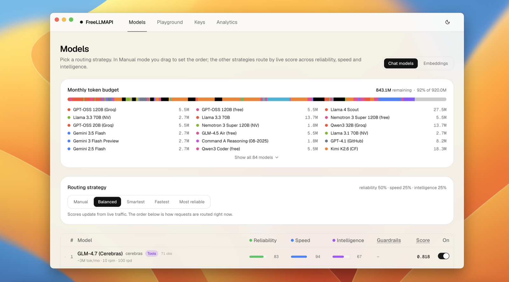
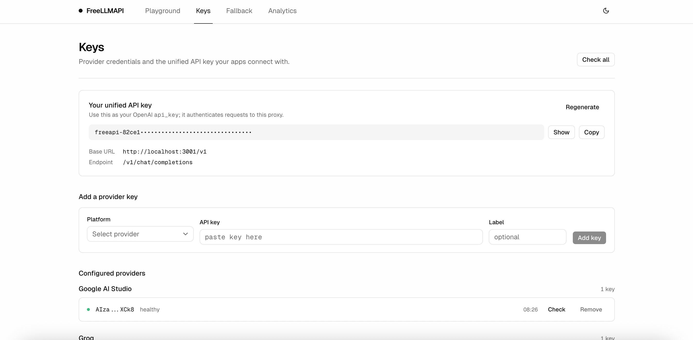
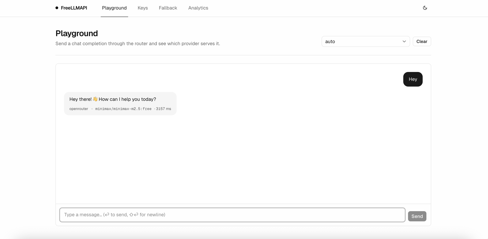
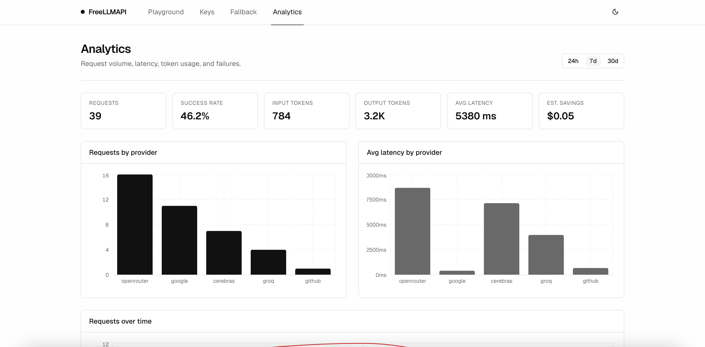
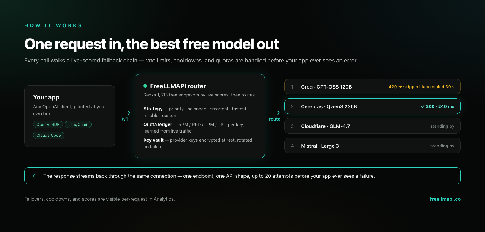

<div align="center">

# FreeLLMAPI

**무료 LLM 제공자 87곳의 모델 엔드포인트 1,313개를 OpenAI 호환 API 하나로 이용하세요. 무료 플랜을 합치면 월 101억 토큰입니다.**

FreeLLMAPI는 여러 제공자의 무료 플랜을 하나의 `/v1` API로 묶습니다. OpenAI 호환 채팅, 임베딩, 이미지, 오디오 엔드포인트를 직접 등록할 수도 있습니다. 라우터가 요청에 맞는 모델을 고릅니다. 제공자 한도에 걸리면 다음 후보를 시도합니다. API 키는 암호화해 저장하고, 무료 한도를 넘지 않도록 키별 사용량을 추적합니다.

[](https://github.com/tashfeenahmed/freellmapi/actions/workflows/ci.yml)
[](https://github.com/tashfeenahmed/freellmapi/stargazers)
[](./LICENSE)
[](#contributing)
[](https://github.com/tashfeenahmed/freellmapi/pkgs/container/freellmapi)
[](https://deepwiki.com/tashfeenahmed/freellmapi)

모델 계열 736개와 무료 엔드포인트 1,313개가 담긴 전체 카탈로그를 둘러보세요. **[freellmapi.co](https://freellmapi.co/?utm_source=github&utm_medium=readme&utm_campaign=repository&utm_content=readme_top)**

[English](README.md) · [Türkçe](README.tr.md) · [简体中文](README.zh-cn.md) · [Русский](README.ru.md) · [O'zbekcha](README.uz.md) · **한국어** · [日本語](README.ja.md)

<p align="center">
  <a href="https://github.com/tashfeenahmed/freellmapi/releases/latest"></a>
  <a href="https://apps.microsoft.com/detail/9PBN6G8K2B7F"></a>
  <a href="docs/en/install/01-install.md#docker-compose"></a>
  <a href="https://play.google.com/store/apps/details?id=co.freellmapi.app"></a>
  <a href="https://apps.apple.com/app/id6804648934"></a>
</p>


라우터는 서명된 피드에서 모델 카탈로그를 자동으로 갱신합니다. 무료 모델 추가, 할당량 변경, 호환성 수정 사항은 `git pull` 없이 반영됩니다. 무료 버전에는 월간 스냅샷을 통해 새 모델이 30일 뒤에 반영되고, 프리미엄 버전에는 피드에 올라온 날 반영됩니다.

**[실시간 카탈로그 이용하기](https://freellmapi.co/?utm_source=github&utm_medium=readme&utm_campaign=premium&utm_content=readme_top#pricing)** (연 19달러, 언제든 해지 가능)

</div>

---

## 목차

- [만든 이유](#why-this-exists)
- [지원하는 제공자](#supported-providers)
- [지원하는 CLI와 코딩 에이전트](#compatible-clis--coding-agents)
- [다른 도구와 비교](#how-it-compares)
- [주요 기능](#features)
- [빠른 시작](#quick-start)
- [데스크톱 앱](#desktop-app)
- [OpenAI 호환 클라이언트 연결](#works-with-openai-compatible-clients)
- [지원 언어](#languages)
- [프리미엄과 실시간 카탈로그](#premium-live-catalog)
- [API 사용법](#using-the-api)
- [화면 미리 보기](#screenshots)
- [작동 방식](#how-it-works)
- [자주 묻는 질문](#faq)
- [제약 사항](#limitations)
- [기여하기](#contributing)
- [면책 조항](#disclaimer)

**관련 문서** · [설치 및 배포](docs/en/install/01-install.md) · [API 레퍼런스](docs/en/api/01-rest-api.md) · [클라이언트와 코딩 에이전트](docs/en/clients/01-agent-clients.md) · [프롬프트 압축](docs/en/compression/01-compression-pipeline.md) · [구조와 내부 동작](docs/en/architecture/00-high-level-index.md) · [전체 문서](docs/en/README.md) · [기여 가이드](CONTRIBUTING.md)

<a name="why-this-exists"></a>

## 만든 이유

주요 AI 제공자들은 한 달에 수백만 토큰이나 하루에 수천 건의 요청을 무료로 제공합니다. 하나씩 쓰면 금방 한도에 닿지만, 모아 보면 **월 약 101억 토큰**을 쓸 수 있습니다. 작고 빠른 모델부터 성능이 좋은 모델까지 **모델 계열 736개와 제공자별 엔드포인트 1,313개**를 대상으로 합니다.

이걸 직접 연동하려면 87곳의 SDK와 요청 한도, 오류 처리 방식에 맞춰야 합니다. FreeLLMAPI에는 제공자 키를 등록하고 기존 OpenAI 클라이언트 라이브러리를 로컬 서버에 연결하면 됩니다. 어느 제공자에 요청을 보낼지는 라우터가 알아서 정합니다.

무료 플랜은 수시로 바뀝니다. 새 모델이 나오기도 하고, 쓰던 모델이나 할당량이 예고 없이 바뀌기도 합니다. 라우터가 freellmapi.co에서 서명된 카탈로그를 받아 오므로 `git pull`을 하지 않아도 변경 사항을 따라갈 수 있습니다. 반영 시점은 아래 프리미엄 항목에 정리했습니다. [freellmapi.co](https://freellmapi.co) · [프리미엄과 실시간 카탈로그](#premium-live-catalog)



<a name="supported-providers"></a>

## 지원하는 제공자

<div align="center">
<table>
<tr>
<td align="center" width="150"><br/><b>Google</b></td>
<td align="center" width="150"><picture><source media="(prefers-color-scheme: dark)" srcset="repo-assets/providers/groq-dark.png"></picture><br/><b>Groq</b></td>
<td align="center" width="150"><br/><b>Cerebras</b></td>
<td align="center" width="150"><picture><source media="(prefers-color-scheme: dark)" srcset="repo-assets/providers/opencode-dark.png"></picture><br/><b>OpenCode Zen</b></td>
</tr>
<tr>
<td align="center"><br/><b>Mistral</b></td>
<td align="center"><br/><b>OpenRouter</b></td>
<td align="center"><br/><b>Cloudflare</b></td>
<td align="center"><br/><b>Cohere</b></td>
</tr>
<tr>
<td align="center"><br/><b>Z.ai (Zhipu)</b></td>
<td align="center"><br/><b>NVIDIA</b></td>
<td align="center"><br/><b>HuggingFace</b></td>
</tr>
<tr>
<td align="center"><a href="https://modelscope.cn"><b>ModelScope</b><br/>Qwen3 · DeepSeek V4 · GLM-5 (중국판 Aliyun 계정 연동 필요)</a></td>
</tr>
</table>

<i>이 밖에 무료 제공자 75곳을 더 지원합니다.</i>

</div>

**Keys**(한국어 화면에서는 **열쇠**)에서 **사용자 지정 제공자**를 추가할 수 있습니다. llama.cpp, LM Studio, vLLM, 로컬 Ollama, 원격 게이트웨이 등 OpenAI 호환 엔드포인트가 있다면 채팅, 임베딩, 이미지, 오디오 모델을 연결할 수 있습니다.

최신 모델 목록과 모델별 사용 한도, 컨텍스트 창 크기, 무료 토큰 수를 확인할 수 있습니다. **[freellmapi.co/models](https://freellmapi.co/models.html)**

<a name="compatible-clis--coding-agents"></a>

## 지원하는 CLI와 코딩 에이전트

<div align="center">
<table>
<tr>
<td align="center" width="150"><br/><b>Claude Code</b></td>
<td align="center" width="150"><br/><b>Codex CLI</b></td>
<td align="center" width="150"><br/><b>Gemini CLI</b></td>
<td align="center" width="150"><br/><b>Cursor</b></td>
</tr>
<tr>
<td align="center"><br/><b>Cline</b></td>
<td align="center"><br/><b>Roo Code</b></td>
<td align="center"><br/><b>OpenCode</b></td>
<td align="center"><br/><b>Aider</b></td>
</tr>
</table>

<i>Continue, Goose, Qwen Code, Kilo Code, Crush, Zed, JetBrains AI, DeepSeek Harness, MiMo Code, AtomCode, OpenClaw, Hermes Agent, Pi, Reasonix, ZCode와 OpenAI 호환 클라이언트, Anthropic, Gemini, Ollama 클라이언트도 쓸 수 있습니다.</i>

</div>

대부분의 에이전트는 명령 한 줄로 설정할 수 있습니다. 설정 명령은 현재 카탈로그를 읽고, 기존 설정 파일을 백업한 뒤 필요한 내용을 추가합니다.

```bash
npx freellmapi setup-claude --url http://localhost:3001 --api-key <unified-key>
```

**[지원 에이전트 전체 목록과 설정 명령](docs/en/clients/02-supported-agents.md)** · [도구별 설정, MCP 서버, URL 토큰](docs/en/clients/01-agent-clients.md)

<a name="how-it-compares"></a>

## 다른 도구와 비교



2026년 7월 공개 문서를 기준으로 비교했습니다. 틀린 부분이 있으면 알려 주세요.

<a name="features"></a>

## 주요 기능



- **OpenAI 호환 API.** `/v1/chat/completions`, `/v1/responses`(Codex CLI), `/v1/completions`(코드 편집기의 인라인 자동 완성), `/v1/images/generations`, `/v1/videos/generations`, `/v1/audio/speech`, `/v1/audio/transcriptions`, `/v1/embeddings`, `/v1/models`를 지원합니다. 공식 SDK와 OpenAI 호환 클라이언트에서 스트리밍과 일반 응답을 쓸 수 있습니다. [API 레퍼런스](docs/en/api/01-rest-api.md)
- **Anthropic Messages API.** `/v1/messages`는 같은 라우터를 거치면서 Anthropic의 요청과 응답 형식을 따릅니다. **Claude Code**와 공식 Anthropic SDK에서도 등록한 무료 모델을 쓸 수 있습니다. [Anthropic 클라이언트 연결](docs/en/api/01-rest-api.md#anthropic--claude-clients)
- **Gemini와 Ollama API.** Gemini CLI에서 `/v1beta`를 통해 `generateContent`, 스트리밍, 토큰 수 계산, 모델 목록을 이용할 수 있습니다. Ollama 호환 모드를 켜면 Zed나 JetBrains 같은 로컬 모델 클라이언트에서 NDJSON 형식의 채팅·생성 응답, 태그, 메타데이터, 임베딩을 쓸 수 있습니다.
- **Fusion.** 가상 모델 `fusion`을 지정하면 라우터가 여러 무료 모델에 같은 프롬프트를 동시에 보냅니다. 평가 모델이 초안을 종합해 최종 답변 하나를 만듭니다. [Fusion 사용법](docs/en/api/01-rest-api.md#fusion-multi-model-synthesis)
- **이미지, 영상, 음성 생성.** `/v1/images/generations`, `/v1/videos/generations`, `/v1/audio/speech`로 미디어 모델을 제공하는 곳에 요청을 보냅니다. 이미지와 음성은 사용자 지정 OpenAI 호환 엔드포인트도 지원합니다. 영상 생성 API는 작업을 바로 처리하는 제공자와 큐에 넣어 처리하는 제공자 모두에서 완성된 MP4를 반환합니다.
- **도구 호출과 구조화된 출력.** OpenAI 형식의 `tools`를 제공자에게 전달하고, 일반 텍스트로 돌아온 도구 호출은 `tool_calls`로 변환합니다. `response_format`, `seed`, `logprobs`, 페널티 등 샘플링 옵션도 제공자에 맞춰 전달합니다.
- **라우팅 전략 6가지.** 모델별 속도, 성능, 안정성 점수에 따라 체인 순서를 정합니다. 429나 5xx 응답이 오면 해당 키에 재시도 대기 시간을 두고, 키를 교체하며 다음 모델을 시도합니다. [라우팅 동작](docs/en/architecture/00-high-level-index.md#how-it-works)
- **모델 통합과 프로필.** 여러 곳에서 제공하는 같은 모델은 목록에 하나로 표시하며, 실패하면 같은 그룹 안에서 다른 제공자를 시도합니다. 코딩용이나 이미지 입력용처럼 이름을 붙인 폴백 체인은 대시보드에서 바꾸거나 요청마다 `auto:<profile>`로 지정할 수 있습니다. 기존 사용자 지정 체인의 이름은 체인 관리자에서 바꿀 수 있습니다.
- **키별 사용량 추적.** `(platform, model, key)` 조합별로 분당·일일 요청 수(RPM/RPD)와 토큰 수(TPM/TPD)를 집계합니다. 제공자가 알려 주는 한도를 반영해 어느 한도도 넘지 않도록 라우팅합니다.
- **자동 카탈로그 갱신.** freellmapi.co의 서명된 카탈로그를 하루 두 번 동기화해 모델 추가, 할당량 변경, 제공자별 호환성 수정 사항을 반영합니다. 무료 버전에서는 실시간 피드에 올라온 모델을 30일 뒤 월간 스냅샷에서 받고, 프리미엄에서는 당일 받습니다. [프리미엄](#premium-live-catalog)
- **대화 중 모델 유지 및 컨텍스트 전달.** 한 대화에서는 30분 동안 같은 모델을 씁니다. 대화 중간에 모델을 바꿔야 할 때는 이전 내용을 짧게 정리해 넘길 수 있습니다. [컨텍스트 전달](docs/en/clients/01-agent-clients.md#context-handoff)
- **프롬프트 압축.** 기능을 켜면 공통 요청 처리 단계에서 캐시 조회와 라우팅에 앞서 중복 프롬프트를 걷어 내고, 도구 출력을 걸러 내고, 반복되는 JSON과 오래된 대화 컨텍스트를 줄입니다. 압축에 실패하면 원래 요청을 그대로 처리합니다. [프롬프트 압축 방식](docs/en/compression/01-compression-pipeline.md)
- **키 암호화와 통합 토큰.** 제공자 키는 AES-256-GCM으로 암호화해 SQLite에 저장하고 요청을 처리할 때 메모리에서 복호화합니다. 클라이언트 앱에는 통합 Bearer 토큰 `freellmapi-…` 하나만 넣으면 됩니다.
- **관리 대시보드와 분석.** React 대시보드에 로그인하면 키와 체인 순서를 관리하고 놀이터에서 모델을 시험해 볼 수 있습니다. 분석 페이지에는 24시간부터 90일까지의 p50·p95 응답 시간과 첫 토큰 응답 시간(TTFT)이 표시됩니다. 라이트·다크 테마와 60개 언어를 지원합니다. [지원 언어](#languages)
- **MCP 서버와 대화형 API 문서.** ChatGPT를 비롯한 MCP 클라이언트는 `/mcp`에서 추론 요청을 보내고, 사용 가능한 모델과 제공자 상태, 사용량, 캐시, 라우팅 정보를 조회하고, 라우팅 전략을 관리할 수 있습니다. `/v1/docs`에는 별도 의존성 없이 열리는 OpenAPI 뷰어가 있습니다. [ChatGPT와 코딩 에이전트 연결](docs/en/clients/01-agent-clients.md#mcp-server)
- **운영 편의 기능.** 선택적으로 켤 수 있는 응답 캐시, 암호화된 DB 백업, 정기 키 상태 확인, 키 일괄 가져오기·내보내기, 선언형 시작 설정을 제공합니다. [설치 및 배포](docs/en/install/01-install.md)
- **Node.js 20 이상에서 실행.** Windows, macOS, Linux 서버와 Raspberry Pi 같은 소형 ARM 싱글보드 컴퓨터에서 동작합니다. PM2나 systemd 같은 프로세스 관리 도구로 실행하면 유휴 상태에서 RSS는 약 40MB입니다.

현재 지원 범위는 아키텍처 문서에서 확인할 수 있습니다. [아직 지원하지 않는 기능](docs/en/architecture/00-high-level-index.md#not-yet-supported)

<a name="quick-start"></a>

## 빠른 시작

**설치 명령 한 줄.** Docker가 필요합니다. 스크립트는 `~/freellmapi`를 만들고 암호화 키를 생성한 다음, 이미지를 받아 컨테이너를 시작합니다.

```bash
curl -fsSL https://freellmapi.co/install.sh | bash
```

실행 전에 내용을 확인하려면 설치 스크립트를 먼저 열어 보세요. 다시 실행해도 `.env`와 암호화 키는 그대로 두고 컨테이너만 `:latest`로 갱신합니다. [설치 스크립트](https://freellmapi.co/install.sh)

<http://localhost:3001>에 접속해 **열쇠(Keys)** 페이지에 제공자 키를 추가하세요. **폴백 체인**에서 모델 순서를 바꿀 수 있습니다. OpenAI SDK에는 **열쇠** 페이지 상단의 통합 API 키를 복사해 넣으세요.

Windows에서는 Microsoft Store 앱으로 시작하는 게 가장 쉽습니다. 서명된 앱이라 Smart App Control에 막히지 않고 자동으로 업데이트됩니다. GitHub Releases에 있는 `.exe`는 같은 앱의 서명 없는 설치 파일입니다. Android에서는 실험 단계인 Termux 설치를 써 볼 수 있습니다. **[Microsoft Store](https://apps.microsoft.com/detail/9PBN6G8K2B7F)** · [GitHub Releases](https://github.com/tashfeenahmed/freellmapi/releases/latest) · [Termux 설치 안내](docs/en/install/02-android-termux.md)

Docker Compose, 로컬 개발, 선언형 시작 설정, 프로덕션 빌드, LAN 접속, 백업은 설치 문서에 정리되어 있습니다. **[설치 및 배포](docs/en/install/01-install.md)**

<a name="desktop-app"></a>

## 데스크톱 앱

`desktop/`에는 메뉴 막대나 시스템 트레이에서 실행하는 네이티브 앱이 있습니다. 라우터와 대시보드가 모두 로컬에서 돌고, 트레이 아이콘을 누르면 실시간 요청 통계가 담긴 반투명 팝업이 열립니다. [데스크톱 앱 소스](./desktop)



GitHub 릴리스마다 macOS용 `.dmg`와 Windows용 `.exe`가 올라옵니다. Windows에서는 Smart App Control을 통과하고 자동 업데이트도 되는 Microsoft Store 버전을 권장합니다. 트레이 팝업에서 통합 API 키를 복사하면 바로 쓸 수 있습니다. 계정이나 비밀번호 설정은 필요 없습니다. **[릴리스에서 다운로드](https://github.com/tashfeenahmed/freellmapi/releases/latest)** · **[Microsoft Store](https://apps.microsoft.com/detail/9PBN6G8K2B7F)** · [소스에서 빌드하는 방법과 데이터 저장 위치](docs/en/install/01-install.md#desktop-app)

macOS 12 Monterey 이상에서는 **arm64(Apple Silicon)**와 **x64(Intel)** 중 Mac에 맞는 버전을 고르세요. 두 버전 모두 ZIP 파일로도 받을 수 있습니다.

<a name="works-with-openai-compatible-clients"></a>

## OpenAI 호환 클라이언트 연결

OpenAI 호환 기본 URL을 지정할 수 있는 클라이언트라면 `http://localhost:3001/v1`과 대시보드의 통합 API 키로 연결할 수 있습니다. 설정을 생성하는 모든 명령은 `--dry-run`을 지원합니다. `npx freellmapi launch`(Claude Code)와 `launch-codex`(Codex)를 쓰면 설정 파일에 인증 정보를 남기지 않습니다. 라우터는 MCP 서버로도 동작해, 에이전트가 작업 중에 모델 목록과 라우팅 정보를 조회할 수 있습니다.

**ChatGPT**는 비공개 Secure MCP Tunnel로 같은 로컬 라우터에 연결합니다. MCP 도구 `ask_freellmapi`는 ChatGPT의 요청을 `/v1/chat/completions`로 보내고, 답변과 함께 실제 사용한 모델, 폴백, 캐시, 실행, 토큰 정보를 돌려줍니다. 기본 URL과 Bearer 인증은 터널 클라이언트에서 설정합니다. 기본 모델은 `MCP_INFERENCE_DEFAULT_MODEL`로 지정하며, 값을 비워 두면 `auto`를 씁니다. Git 저장소나 MCP URL에 키를 넣지 마세요. **[ChatGPT 연결 방법](docs/en/clients/01-agent-clients.md#chatgpt-private-secure-mcp-tunnel)**

터미널에서 제공자 키를 관리하려면 `FREELLMAPI_DASHBOARD_TOKEN` 또는 `--token`으로 대시보드 세션 토큰을 전달하고 `npx freellmapi keys add|list|remove|test <platform>`을 사용하세요. `keys test`는 저장된 키가 아직 유효한지 다시 확인합니다. [CLI의 제공자 키 관리](cli/README.md#provider-keys)

FreeLLMAPI는 한 사람이 자기 기기에서 쓰는 것을 전제로 설계했습니다. 제공자 키는 로컬 SQLite 데이터베이스에 암호화해 저장합니다. 요청은 사용자 기기에서 활성화된 제공자에게 바로 보냅니다.

<a name="languages"></a>

## 지원 언어

대시보드는 **60개 언어**, 데스크톱 트레이 메뉴는 6개 언어를 지원합니다. 처음 열 때 브라우저나 시스템의 언어를 감지합니다. **⋯ → 설정**에서 언제든 언어를 바꿀 수 있으며, 선택한 언어는 다음에도 유지됩니다. 아랍어(العربية), 히브리어(עברית), 페르시아어(فارسی), 우르두어(اردو)처럼 오른쪽에서 왼쪽으로 쓰는 언어는 화면 배치도 그에 맞게 바뀝니다. 선택한 언어의 번역 파일만 불러옵니다.

                                                 

지원 언어 전체 목록은 [`client/src/i18n/locale-config.ts`](./client/src/i18n/locale-config.ts)에서 확인할 수 있습니다.

처음 지원한 6개 언어는 사람이 검토했습니다. 이후 추가된 언어는 기계 번역을 바탕으로 원어민의 제보를 받아 손보고 있습니다. 어색한 문구 한 줄을 고치는 PR도 환영합니다.

번역은 중첩 없는 JSON 파일로 관리합니다. 문구를 고치려면 해당 언어 파일에서 값만 수정하세요. 언어를 추가하려면 `en.json`을 복사해 값을 번역한 뒤 `client/src/i18n/locale-config.ts`에 등록하세요. 트레이 메뉴 번역은 `desktop/src/i18n.ts`에도 등록해야 합니다. `npm test`는 모든 번역 파일의 키와 자리표시자가 일치하는지 검사합니다. [`client/src/i18n/locales/`](./client/src/i18n/locales)

<a name="premium-live-catalog"></a>

## 프리미엄과 실시간 카탈로그

라우터는 하루 두 번 서명된 모델 카탈로그를 받아 새 모델, 할당량 변경, 제공자별 호환성 수정 사항을 로컬 DB에 반영합니다. 모델을 켜고 끈 설정과 사용자 지정 제공자는 그대로 유지됩니다. 카탈로그를 내려받을 때마다 미리 지정된 Ed25519 공개 키로 서명을 검증한 뒤 적용합니다. [freellmapi.co](https://freellmapi.co)

카탈로그에는 현재 **제공자 87곳**, **모델 계열 736개**, **제공자별 무료 모델 엔드포인트 1,313개**가 등록되어 있습니다. 종류별로는 채팅 1,137개, 이미지 29개, 오디오 41개, 임베딩 68개, 음성 전사 19개, 영상 6개, 의사결정 13개입니다. 등록된 무료 한도를 모두 더하면 **월 약 101억 토큰**입니다. **[전체 모델 목록](https://freellmapi.co/models.html)**

무료 버전도 같은 서명된 카탈로그를 월간 스냅샷으로 받습니다. 새 모델이 실시간 피드에 올라오면 30일 뒤 스냅샷에 들어갑니다. 현재 두 카탈로그의 차이는 모델 약 303개입니다. 차이는 반영 시점뿐입니다. 무료 버전에서도 라우터의 모든 기능을 기간 제한 없이 쓸 수 있습니다.

프리미엄을 쓰면 직접 운영하는 모든 라우터가 실시간 카탈로그를 받습니다. 제공자가 성능 좋은 무료 모델을 내놓거나, 할당량을 낮추거나, API 형식을 바꿔 기존 연동에 문제가 생겨도 카탈로그 수정본이 올라오는 날 바로 받습니다.

**[실시간 카탈로그 이용하기](https://freellmapi.co/?utm_source=github&utm_medium=readme&utm_campaign=premium&utm_content=readme_bottom#pricing)**

- 연 19달러 또는 평생 이용권 49달러(1회 결제)입니다. Stripe로 결제하며, 구독은 언제든 직접 해지할 수 있습니다.
- 데스크톱, 홈랩, Raspberry Pi 등 직접 운영하는 모든 라우터에 `fla_` 키 하나를 쓸 수 있습니다.
- 대시보드의 **프리미엄** 메뉴에서 활성화하세요. 구독 해지와 결제 관리는 웹에서 직접 할 수 있습니다. [구독 관리](https://freellmapi.co/manage)
- 라우터는 앞으로도 MIT 라이선스로 무료 제공됩니다. 프리미엄 요금에는 실시간 피드만 포함되며, 수익은 매일 모델을 테스트하고 카탈로그를 관리하는 데 쓰입니다.

프리미엄을 이용해도 라우터는 전부 직접 호스팅합니다. 카탈로그 서버로 프롬프트, 모델 응답, 제공자 키를 보내지 않습니다.

<a name="using-the-api"></a>

## API 사용법

```python
from openai import OpenAI

client = OpenAI(
    base_url="http://localhost:3001/v1",
    api_key="freellmapi-your-unified-key",
)

response = client.chat.completions.with_raw_response.create(
    model="auto",  # 라우터가 모델을 고릅니다. "auto:fast", "auto:smart", 프로필, 모델 ID도 지정할 수 있습니다.
    messages=[{"role": "user", "content": "로마 제국의 몰락을 한 문장으로 요약해 주세요."}],
)
completion = response.parse()
print(completion.choices[0].message.content)
print("Routed via:", response.headers.get("x-routed-via"))
```

API 문서에는 스트리밍, `auto:*` 라우팅 전략, 도구 호출, 이미지 입력, Gemini의 Google 검색 그라운딩, 임베딩, Anthropic Messages API를 curl과 Python으로 호출하는 예제가 있습니다. 모든 응답의 `X-Routed-Via: <platform>/<model>` 헤더를 보면 어느 제공자의 어떤 모델이 요청을 처리했는지 알 수 있습니다. **[API 레퍼런스](docs/en/api/01-rest-api.md)**

<a name="screenshots"></a>

## 화면 미리 보기

### 모델

라우팅 전략을 고르고 전체 제공자의 월간 토큰 사용량을 볼 수 있습니다. 모델마다 안정성, 속도, 성능 점수가 실시간으로 표시됩니다. 라우터는 목록의 위쪽부터 모델을 시도합니다.


### 키 관리

제공자 키를 관리하고 앱을 연결할 통합 API 키를 복사할 수 있습니다. 키마다 현재 상태를 나타내는 점과 마지막 검사 시각이 표시됩니다.



### 놀이터

채팅을 보내면 응답한 제공자와 모델 ID, 걸린 시간이 메시지에 표시됩니다. 첨부 버튼을 쓰거나 파일을 끌어다 놓거나 붙여넣을 수 있습니다. 이미지(PNG/JPEG/WebP/GIF)는 브라우저에서 크기를 줄여 이미지 입력을 지원하는 모델로 보냅니다. 텍스트 파일(TXT/MD/CSV/JSON/LOG)은 코드 블록으로 감싸 프롬프트에 넣습니다.



### 분석

지난 24시간, 7일, 30일, 90일 동안의 요청 수, 성공률, 입력·출력 토큰 수, 평균 응답 시간, 제공자별 내역을 볼 수 있습니다.



<a name="how-it-works"></a>

## 작동 방식



요청이 들어오면 라우터는 정상 상태이고 한도가 남은 키를 가진 모델 가운데 우선순위가 가장 높은 모델을 고릅니다. 키를 메모리에서 복호화한 뒤 제공자에게 요청을 보냅니다. 429나 5xx 오류가 나면 해당 키를 잠시 사용하지 않고 체인의 다음 모델을 시도합니다. [구성 요소, 라우팅, 운영 방식](docs/en/architecture/00-high-level-index.md)

<a name="faq"></a>

## 자주 묻는 질문

**비밀번호가 필요한가요?** 데스크톱 앱은 내부에서 관리하는 로컬 계정으로 자동 로그인합니다. 트레이 아이콘에서 **Open Dashboard**를 누르거나 같은 컴퓨터의 브라우저에서 대시보드(예: <http://127.0.0.1:31415>)를 열면 됩니다. LAN으로 다른 기기에서 접속하면 로그인 화면이 나옵니다. Docker, 한 줄 설치 명령, `npm run dev`로 서버를 띄운 경우에는 이메일과 비밀번호를 사용합니다.

**서버 설치 후 비밀번호를 잊었어요.** 로그인 화면에서 **비밀번호를 잊으셨나요?**를 누르세요. 재설정 링크를 이메일로 보내는 대신 일회용 코드를 서버 로그에 남깁니다. `docker compose logs -f freellmapi`를 실행하거나 서버를 띄운 터미널 또는 데스크톱 앱 로그에서 코드를 찾아 재설정 화면에 입력하세요. 코드는 15분 동안 유효합니다.

**로그는 어디서 보나요?** Docker는 컨테이너 로그, 소스에서 실행한 서버는 터미널, 데스크톱 앱은 `<data dir>/logs/freeapi.log`에서 확인하세요. 데스크톱 앱에서는 트레이 메뉴의 **Open Logs Folder**를 누르면 로그 폴더가 열립니다.

**어떻게 삭제하나요?** macOS에서는 앱을 휴지통에 넣고, Windows에서는 **설정 → 앱**에서 제거하세요. Docker는 `docker compose down -v`를 실행합니다. 설치 방식에 따라 `%APPDATA%\FreeLLMAPI\`, `~/Library/Application Support/FreeLLMAPI/`, `~/.config/FreeLLMAPI/`에 남은 데이터 폴더도 직접 삭제하세요. 앱을 제거해도 이 폴더는 자동으로 지워지지 않습니다.

설치 방식별 자세한 설명은 설치 문서에 있습니다. **[비밀번호, 로그, 제거 방법](docs/en/install/01-install.md#faq-passwords-logs-uninstall)**

<a name="limitations"></a>

## 제약 사항

무료 플랜을 여러 개 묶어도 최상위 모델을 쓸 수 없고, 응답 시간은 일정하지 않으며, SLA도 없습니다. 성능이 좋은 모델부터 일일 한도에 걸리기 때문에 하루가 끝나 갈수록 답변 품질이 떨어질 수 있습니다. 일일 한도는 UTC 자정에 초기화됩니다. 실제 서비스에 적용하기 전에 제약 사항을 확인하세요. **[제약 사항 자세히 보기](docs/en/architecture/00-high-level-index.md#limitations)**

<a name="contributing"></a>

## 기여하기

개발 환경을 띄우는 방법, PR 작성 기준, AI·LLM을 활용한 기여 방침은 기여 가이드에 정리되어 있습니다. AI를 활용한 PR도 다른 PR과 같은 기준으로 검토합니다. [기여 가이드](CONTRIBUTING.md)

처음 기여한다면 아래 작업부터 시작해 보세요.

- **제공자 추가.** `server/src/providers/openai-compat.ts`를 참고해 새 제공자를 만들고 `server/src/providers/index.ts`에 등록하세요. `server/src/db/index.ts`에 모델의 초기 데이터를 추가하고 `server/src/__tests__/providers/`에 테스트를 작성하세요.
- **엔드포인트 추가.** `/v1/realtime` 같은 OpenAI 호환 엔드포인트를 추가할 수 있습니다. 제공자 기본 클래스에 메서드를 추가하고 어댑터에서 지원하는 메서드를 선언하면 됩니다.
- **라우터 개선.** 비용, 정상 동작 여부, 속도를 함께 고려하는 라우팅이나 응답 시간에 가중치를 주는 우선순위, 특정 리전 고정 같은 작업이 있습니다.
- **대시보드 개선.** 분석 페이지 차트, 키 교체 흐름, `.env`에서 키를 일괄로 가져오는 기능 등을 다듬을 수 있습니다.
- **문서 보강.** 사용 예제, Go나 Rust 클라이언트 코드, Docker나 Fly 배포 안내 등을 추가해 주세요.

`npm install && npm run dev`를 실행하면 서버는 3001번 포트, 대시보드는 5173번 포트에서 뜨며 둘 다 HMR을 지원합니다. 환경을 같은 방식으로 다시 구성하려면 Bash에서 `./scripts/dev-bootstrap.sh`, PowerShell에서 `.\scripts\dev-bootstrap.ps1`을 실행하세요. 두 스크립트 모두 기존 `.env`를 유지합니다. PR에는 테스트를 포함하고, 기존 테스트가 `npm test`에서 모두 통과하는지 확인하고, 저장소의 `.editorconfig`와 tsconfig 기본 설정을 따르세요. DB 마이그레이션 절차와 전체 작업 흐름은 기여 가이드에 있습니다. [기여 가이드](./CONTRIBUTING.md)

### 기여자

<a href="https://github.com/moaaz12-web"></a>
<a href="https://github.com/AdityaxDeore"></a>
<a href="https://github.com/lukasulc"></a>
<a href="https://github.com/VinhPhamAI"></a>
<a href="https://github.com/deadc"></a>
<a href="https://github.com/zhangyu1324"></a>
<a href="https://github.com/kentpan"></a>
<a href="https://github.com/stephenzwj"></a>
<a href="https://github.com/chongjiazhen"></a>
<a href="https://github.com/vjsai"></a>
<a href="https://github.com/long2ice"></a>
<a href="https://github.com/sadesguy"></a>
<a href="https://github.com/hodlmybeer69-bit"></a>
<a href="https://github.com/phoenixikkifullstack"></a>
<a href="https://github.com/jtbrennan-git"></a>
<a href="https://github.com/praveenkumarpranjal"></a>
<a href="https://github.com/nordbyte"></a>
<a href="https://github.com/mybropro"></a>
<a href="https://github.com/danscMax"></a>
<a href="https://github.com/jhash"></a>
<a href="https://github.com/JammyJames1234"></a>
<a href="https://github.com/coffcoe"></a>
<a href="https://github.com/Sumit4codes"></a>
<a href="https://github.com/meliani"></a>
<a href="https://github.com/thedavidweng"></a>
<a href="https://github.com/bharvey42"></a>
<a href="https://github.com/yuvrxj-afk"></a>
<a href="https://github.com/v0rtex1223"></a>
<a href="https://github.com/nicyoong"></a>
<a href="https://github.com/Aldo-f"></a>
<a href="https://github.com/Tazrif-Raim"></a>
<a href="https://github.com/m1nuzz"></a>
<a href="https://github.com/suantea"></a>
<a href="https://github.com/OhOkThisIsFine"></a>
<a href="https://github.com/LoneRifle"></a>
<a href="https://github.com/ita333"></a>
<a href="https://github.com/barbotkonv"></a>
<a href="https://github.com/Naster17"></a>
<a href="https://github.com/StealthTensor"></a>
<a href="https://github.com/EmranAhmed"></a>
<a href="https://github.com/itsfuad"></a>
<a href="https://github.com/RobinHoodO"></a>
<a href="https://github.com/hmm183"></a>
<a href="https://github.com/duemilionidieuro-bot"></a>
<a href="https://github.com/cagedbird043"></a>
<a href="https://github.com/jasnoorgill"></a>
<a href="https://github.com/Joey9024"></a>
<a href="https://github.com/AskingConical"></a>
<a href="https://github.com/ProAlit"></a>
<a href="https://github.com/hjhhoni"></a>
<a href="https://github.com/immanuelsavio"></a>
<a href="https://github.com/Slyker"></a>
<a href="https://github.com/wells1013"></a>
<a href="https://github.com/evgkrsk"></a>
<a href="https://github.com/aaronjmars"></a>
<a href="https://github.com/Robs87"></a>
<a href="https://github.com/dashitongzhi"></a>
<a href="https://github.com/QingJ01"></a>
<a href="https://github.com/3215"></a>
<a href="https://github.com/saifulaiub123"></a>
<a href="https://github.com/PietFourie"></a>
<a href="https://github.com/mhmdkrmabd"></a>
<a href="https://github.com/DemeulemeesterxMaxime"></a>
<a href="https://github.com/HoodBlah"></a>
<a href="https://github.com/SeanPedersen"></a>
<a href="https://github.com/andersmmg"></a>
<a href="https://github.com/chirag127"></a>
<a href="https://github.com/allababbot"></a>
<a href="https://github.com/johan-droid"></a>
<a href="https://github.com/redenfire"></a>
<a href="https://github.com/itzpingcat"></a>
<a href="https://github.com/kairwang01"></a>
<a href="https://github.com/gongjurenzhangwei"></a>
<a href="https://github.com/jsonring"></a>
<a href="https://github.com/1029734570"></a>
<a href="https://github.com/86TheCactus"></a>
<a href="https://github.com/AmiroKD"></a>
<a href="https://github.com/ecryptomillionaire-dev"></a>
<a href="https://github.com/4riful"></a>
<a href="https://github.com/fix2015"></a>
<a href="https://github.com/iisyw"></a>
<a href="https://github.com/xsfhacg"></a>
<a href="https://github.com/noobix"></a>
<a href="https://github.com/nandukmelath"></a>
<a href="https://github.com/NirvanaCh7"></a>
<a href="https://github.com/Mohamed3nan"></a>
<a href="https://github.com/Arman-Espiar"></a>
<a href="https://github.com/MetaMysteries8"></a>
<a href="https://github.com/lujun880726"></a>
<a href="https://github.com/qq97693453"></a>
<a href="https://github.com/emv33"></a>
<a href="https://github.com/ousamabenyounes"></a>
<a href="https://github.com/yfdyh000"></a>
<a href="https://github.com/s-uryansh"></a>
<a href="https://github.com/arsalanyavari"></a>
<a href="https://github.com/RoboMWM"></a>
<a href="https://github.com/gaurang-py"></a>
<a href="https://github.com/ddy4633"></a>
<a href="https://github.com/UrbsKali"></a>
<a href="https://github.com/hb-0"></a>
<a href="https://github.com/xyblue135"></a>
<a href="https://github.com/Icesenator"></a>
<a href="https://github.com/ZER0-auto"></a>
<a href="https://github.com/tashdroid"></a>
<a href="https://github.com/Patrickleondev"></a>
<a href="https://github.com/hiiamwaffledev"></a>
<a href="https://github.com/w0fv1"></a>
<a href="https://github.com/oppih"></a>
<a href="https://github.com/n3dhir"></a>
<a href="https://github.com/ksp2000"></a>
<a href="https://github.com/quabynahdavis"></a>
<a href="https://github.com/qinghuanandejiangshi"></a>
<a href="https://github.com/qatcod"></a>
<a href="https://github.com/CooperSheroy"></a>
<a href="https://github.com/shahidbeig-a11y"></a>
<a href="https://github.com/Kaban15"></a>
<a href="https://github.com/efcunha"></a>
<a href="https://github.com/sukaimi"></a>
<a href="https://github.com/rome-xi"></a>
<a href="https://github.com/bsi-bcp"></a>
<a href="https://github.com/rodion-gudz"></a>
<a href="https://github.com/bjornmage"></a>
<a href="https://github.com/kenanlabs"></a>
<a href="https://github.com/xzyj50609"></a>
<a href="https://github.com/Ahmedtahoon2"></a>
<a href="https://github.com/Inference1"></a>
<a href="https://github.com/yzhkali"></a>
<a href="https://github.com/levonk"></a>
<a href="https://github.com/tripstar6000"></a>
<a href="https://github.com/alkank"></a>
<a href="https://github.com/Yi-111-a"></a>
<a href="https://github.com/The88788"></a>
<a href="https://github.com/ac1982"></a>
<a href="https://github.com/agammann"></a>
<a href="https://github.com/Claven07"></a>
<a href="https://github.com/AymenJeddou"></a>
<a href="https://github.com/Thibaultjaigu"></a>
<a href="https://github.com/silvertakana"></a>
<a href="https://github.com/sidhunt"></a>
<a href="https://github.com/rubicon"></a>
<a href="https://github.com/JoAdo07"></a>
<a href="https://github.com/igormutton"></a>
<a href="https://github.com/georgeatparallel"></a>
<a href="https://github.com/BNTiyan"></a>
<a href="https://github.com/ChaosCom"></a>
<a href="https://github.com/Alexis12119"></a>
<a href="https://github.com/kevin9327"></a>
<a href="https://github.com/ilya-bogin-keenable"></a>
<a href="https://github.com/harsHdokyc"></a>
<a href="https://github.com/ALANDVO"></a>
<a href="https://github.com/HyperionBurn"></a>
<a href="https://github.com/emirhantasli"></a>
<a href="https://github.com/jayhemnani9910"></a>
<a href="https://github.com/ignamiranda"></a>
<a href="https://github.com/MoriDanWork"></a>
<a href="https://github.com/suvshox-oss"></a>
<a href="https://github.com/Swidan0"></a>
<a href="https://github.com/w21180239"></a>
<a href="https://github.com/kjgggggg"></a>
<a href="https://github.com/TheoCui-Saulcy"></a>
<a href="https://github.com/MatthewRobertDunn"></a>
<a href="https://github.com/nk-batman21"></a>
<a href="https://github.com/PowerTokens"></a>
<a href="https://github.com/navzo"></a>
<a href="https://github.com/motasimfuad"></a>
<a href="https://github.com/thedevil11255"></a>
<a href="https://github.com/kvianAR"></a>
<a href="https://github.com/TanmayShah29"></a>
<a href="https://github.com/heydryft"></a>
<a href="https://github.com/leucds2018-hub"></a>
<a href="https://github.com/zhangkom"></a>
<a href="https://github.com/noahkhomer18"></a>
<a href="https://github.com/mentallyunstable-lab"></a>
<a href="https://github.com/indraoverflow"></a>
<a href="https://github.com/KHKRUTIK"></a>
<a href="https://github.com/lxymvl"></a>
<a href="https://github.com/tevasas"></a>
<a href="https://github.com/FabioLeitao"></a>
<a href="https://github.com/dirtious15"></a>

<a name="disclaimer"></a>

## 면책 조항

**이 프로젝트는 개인 실험과 학습용입니다.** 무료 플랜은 프로토타입을 시험하기 위한 용도입니다. 실제 서비스 운영에 필요한 안정성과 지원은 보장되지 않습니다. FreeLLMAPI로 제품을 만들었다면 출시 전에 유료 API로 바꾸세요. 이 프로젝트를 통해 요청을 보내더라도 각 제공자에 가입할 때 동의한 약관이 그대로 적용됩니다. 약관을 지킬 책임은 사용자에게 있습니다.

개인용 단일 사용자 프록시에 각 제공자의 이용약관이 어떻게 적용되는지 2026년 5월에 제공자별로 검토했습니다. [이용약관 검토 결과](docs/en/architecture/00-high-level-index.md#terms-of-service-review)

## 라이선스

[MIT](./LICENSE)
