<div align="center">

# FreeLLMAPI

**Ayda 10,1 milyar token. 87 ücretsiz LLM sağlayıcısı. 1.313 ücretsiz model uç noktası. OpenAI uyumlu tek bir uç nokta.**

Onlarca sağlayıcının ücretsiz kullanım kotalarını ve özel OpenAI uyumlu sohbet, gömme (embedding), görüntü ve ses uç noktalarını tek bir `/v1` API’sinde birleştirin. Anahtarlar şifreli saklanır. Yönlendirici, her istek için kullanılabilir en iyi modeli seçer; bir sağlayıcı hız sınırına ulaştığında sıradakine geçer ve ücretsiz kotaları aşmamak için kullanımı anahtar bazında izler.

[](https://github.com/tashfeenahmed/freellmapi/actions/workflows/ci.yml)
[](https://github.com/tashfeenahmed/freellmapi/stargazers)
[](./LICENSE)
[](#contributing)
[](https://github.com/tashfeenahmed/freellmapi/pkgs/container/freellmapi)
[](https://deepwiki.com/tashfeenahmed/freellmapi)

**[freellmapi.co](https://freellmapi.co/?utm_source=github&utm_medium=readme&utm_campaign=repository&utm_content=readme_top)** · tüm kataloğa göz atın: 736 model ailesi, 1.313 ücretsiz uç nokta

[English](README.md) · **Türkçe** · [简体中文](README.zh-cn.md) · [Русский](README.ru.md) · [O'zbekcha](README.uz.md)

<p align="center">
  <a href="https://github.com/tashfeenahmed/freellmapi/releases/latest">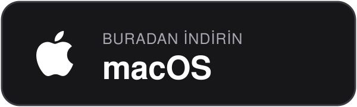</a>
  <a href="https://github.com/tashfeenahmed/freellmapi/releases/latest">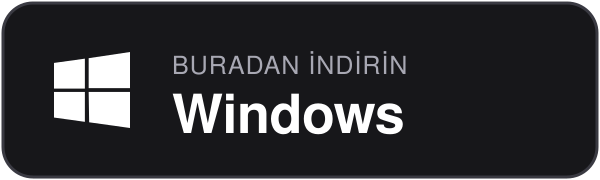</a>
  <a href="docs/en/install/01-install.md#docker-compose">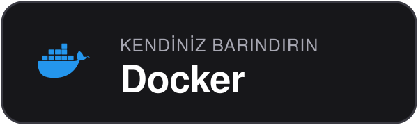</a>
  <a href="https://play.google.com/store/apps/details?id=co.freellmapi.app"></a>
  <a href="https://apps.apple.com/app/id6804648934">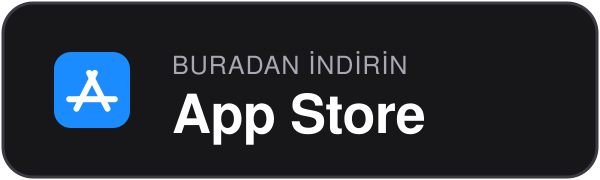</a>
</p>


Yönlendiriciniz model kataloğunu imzalı bir akıştan kendisi günceller: yeni ücretsiz modeller, kota değişiklikleri ve uyumluluk düzeltmeleri `git pull` gerekmeden gelir. Ücretsiz kurulumlar aylık anlık görüntüyü alır; modeller canlı akışa eklendikten 30 gün sonra bu kurulumlara ulaşır. Premium yönlendiriciler ise aynı gün alır.
**[freellmapi.co ile canlı kataloğa geçin](https://freellmapi.co/?utm_source=github&utm_medium=readme&utm_campaign=premium&utm_content=readme_top#pricing)** (yılda 19 ABD doları; istediğiniz zaman iptal edin).

</div>

---

## İçindekiler

- [Neden geliştirildi?](#why-this-exists)
- [Desteklenen sağlayıcılar](#supported-providers)
- [Uyumlu CLI’lar ve kodlama ajanları](#compatible-clis--coding-agents)
- [Diğer çözümlerle karşılaştırma](#how-it-compares)
- [Özellikler](#features)
- [Hızlı başlangıç](#quick-start)
- [Masaüstü uygulaması](#desktop-app)
- [OpenAI uyumlu istemcilerle kullanım](#works-with-openai-compatible-clients)
- [Diller](#languages)
- [Premium (canlı katalog)](#premium-live-catalog)
- [API kullanımı](#using-the-api)
- [Ekran görüntüleri](#screenshots)
- [Nasıl çalışır?](#how-it-works)
- [Sık sorulan sorular](#faq)
- [Sınırlamalar](#limitations)
- [Katkıda bulunma](#contributing)
- [Sorumluluk reddi](#disclaimer)

**Rehberler:** [Kurulum ve dağıtım](docs/en/install/01-install.md) · [API başvurusu](docs/en/api/01-rest-api.md) · [İstemciler ve kodlama ajanları](docs/en/clients/01-agent-clients.md) · [İstem sıkıştırma](docs/en/compression/01-compression-pipeline.md) · [Mimari ve iç işleyiş](docs/en/architecture/00-high-level-index.md) · [Belge dizini](docs/en/README.md) · [Katkı rehberi](CONTRIBUTING.md)

<a id="why-this-exists"></a>

## Neden geliştirildi?

Günümüzde önde gelen yapay zekâ laboratuvarları ayda birkaç milyon token, günde birkaç bin istek sunan ücretsiz planlar sağlıyor. Tek başlarına sınırlı olsalar da bir araya geldiklerinde, küçük ve hızlı modellerden oldukça yetenekli modellere kadar **736 model ailesi / 1.313 sağlayıcı uç noktası** üzerinden **ayda yaklaşık 10,1 milyar token** çıkarım kapasitesine ulaşıyorlar.

Bunları elle birleştirmek zahmetli: seksen yedi farklı SDK, seksen yedi farklı hız sınırı ve bir isteğin başarısız olabileceği seksen yedi ayrı yer. FreeLLMAPI hepsini OpenAI uyumlu tek bir uç noktada toplar. Herhangi bir OpenAI istemci kitaplığını yerel sunucunuza yönlendirin; istekler, anahtar eklediğiniz sağlayıcılar arasında istemciye yansımadan yönlendirilir.

Ücretsiz planlar da her hafta değişiyor: sağlayıcılar yeni modeller çıkarıyor, eskilerini kaldırıyor ve kotaları haber vermeden değiştiriyor. FreeLLMAPI bunları sizin için takip eder. Yönlendirici, imzalı model kataloğunu [freellmapi.co](https://freellmapi.co) üzerinden kendisi alır; kurulumunuz `git pull` gerekmeden güncel kalır. Güncellemelerin ne kadar hızlı geldiği için [Premium (canlı katalog)](#premium-live-catalog) bölümüne bakın.

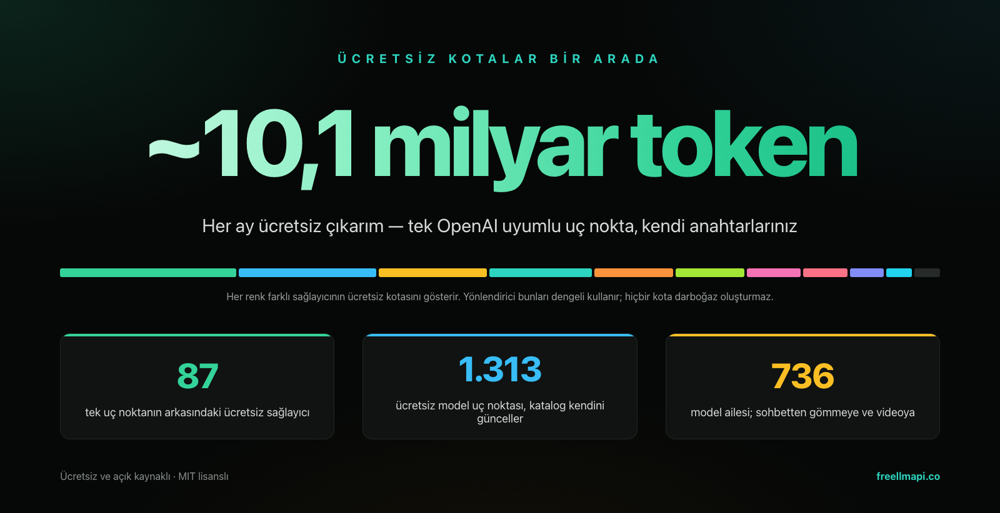

<a id="supported-providers"></a>

## Desteklenen sağlayıcılar

<div align="center">
<table>
<tr>
<td align="center" width="150"><br/><b>Google</b></td>
<td align="center" width="150"><picture><source media="(prefers-color-scheme: dark)" srcset="repo-assets/providers/groq-dark.png"></picture><br/><b>Groq</b></td>
<td align="center" width="150"><br/><b>Cerebras</b></td>
<td align="center" width="150"><picture><source media="(prefers-color-scheme: dark)" srcset="repo-assets/providers/opencode-dark.png"></picture><br/><b>OpenCode Zen</b></td>
</tr>
<tr>
<td align="center"><br/><b>Mistral</b></td>
<td align="center"><br/><b>OpenRouter</b></td>
<td align="center"><br/><b>Cloudflare</b></td>
<td align="center"><br/><b>Cohere</b></td>
</tr>
<tr>
<td align="center"><br/><b>Z.ai (Zhipu)</b></td>
<td align="center"><br/><b>NVIDIA</b></td>
<td align="center"><br/><b>HuggingFace</b></td>
</tr>
<tr>
<td align="center"><a href="https://modelscope.cn"><b>ModelScope</b><br/>Qwen3 · DeepSeek V4 · GLM-5 (Aliyun cn hesabıyla bağlantı gerekir)</a></td>
</tr>
</table>

<i>… ve 75 ücretsiz sağlayıcı daha</i>

</div>

Ayrıca **özel** sağlayıcı desteği vardır: Anahtarlar (Keys) sayfasından sohbet, gömme, görüntü veya ses modellerini herhangi bir OpenAI uyumlu uç noktaya yönlendirin (llama.cpp, LM Studio, vLLM, yerel Ollama veya uzak bir ağ geçidi).

Model bazında hız sınırları, bağlam pencereleri ve ücretsiz token bütçelerini içeren tam ve güncel liste **[freellmapi.co/models](https://freellmapi.co/models.html)** adresindedir.

<a id="compatible-clis--coding-agents"></a>

## Uyumlu CLI’lar ve kodlama ajanları

<div align="center">
<table>
<tr>
<td align="center" width="150"><br/><b>Claude Code</b></td>
<td align="center" width="150"><br/><b>Codex CLI</b></td>
<td align="center" width="150"><br/><b>Gemini CLI</b></td>
<td align="center" width="150"><br/><b>Cursor</b></td>
</tr>
<tr>
<td align="center"><br/><b>Cline</b></td>
<td align="center"><br/><b>Roo Code</b></td>
<td align="center"><br/><b>OpenCode</b></td>
<td align="center"><br/><b>Aider</b></td>
</tr>
</table>

<i>… ayrıca Continue, Goose, Qwen Code, Kilo Code, Crush, Zed, JetBrains AI, DeepSeek Harness, MiMo Code, AtomCode, OpenClaw, Hermes Agent, Pi, Reasonix, ZCode ve OpenAI uyumlu, Anthropic, Gemini veya Ollama istemcileri</i>

</div>

Çoğu ajan, canlı kataloğunuzu okuyup mevcut yapılandırmayı yedekleyen ve yeni ayarları onunla birleştiren tek bir komutla yapılandırılabilir:

```bash
npx freellmapi setup-claude --url http://localhost:3001 --api-key <unified-key>
```

**[Desteklenen tüm ajanlar ve kurulum komutları →](docs/en/clients/02-supported-agents.md)** · [Araçlara özel ayarlar, MCP sunucusu ve URL tokenları →](docs/en/clients/01-agent-clients.md)

<a id="how-it-compares"></a>

## Diğer çözümlerle karşılaştırma

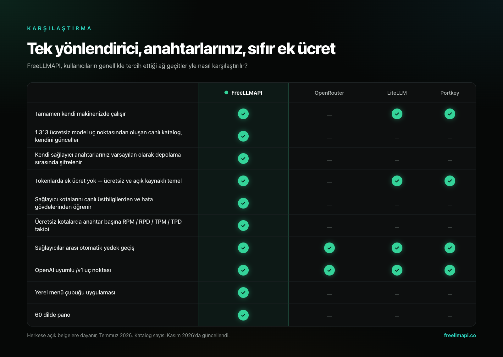

Temmuz 2026 tarihli herkese açık belgelere dayanır; düzeltmelerinizi bekliyoruz.

<a id="features"></a>

## Özellikler

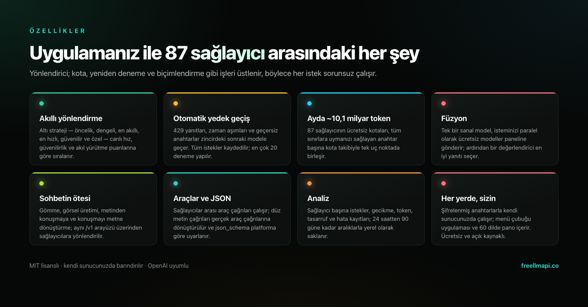

- **OpenAI tarzındaki tüm uç noktalar** — `/v1/chat/completions`, `/v1/responses` (Codex CLI için), `/v1/completions` (editörde satır içi otomatik tamamlama), `/v1/images/generations`, `/v1/videos/generations`, `/v1/audio/speech`, `/v1/audio/transcriptions`, `/v1/embeddings` ve `/v1/models`. Resmî SDK’larla veya OpenAI uyumlu istemcilerle akışlı ve akışsız çalışır. [API başvurusu →](docs/en/api/01-rest-api.md)
- **Anthropic Messages API** — `/v1/messages`, aynı yönlendirici üzerinden Anthropic iletişim biçimini kullanır. Böylece **Claude Code** ve resmî Anthropic SDK’ları ücretsiz model havuzunuzla çalışır. [Ayrıntılar →](docs/en/api/01-rest-api.md#anthropic--claude-clients)
- **Yerel Gemini ve Ollama arayüzleri** — Gemini CLI, `/v1beta` üzerinden `generateContent`, akış, token sayımı ve model listesini kullanabilir. İsteğe bağlı Ollama öykünmesi; Zed, JetBrains ve diğer yerel model istemcilerine NDJSON sohbet/üretim, etiket, üst veri ve gömme desteği sunar.
- **Fusion (çok modelli sentez)** — sanal `fusion` modelini istediğinizde yönlendirici, isteminizi farklı ücretsiz modellere paralel gönderir. Ardından bir değerlendirme modeli taslaklardan tek bir yanıt oluşturur. [Ayrıntılar →](docs/en/api/01-rest-api.md#fusion-multi-model-synthesis)
- **Görüntü, video ve konuşma üretimi** — `/v1/images/generations`, `/v1/videos/generations` ve `/v1/audio/speech`, ilgili medya modellerini sunan sağlayıcılara yönlendirilir. Görüntü ve konuşma için özel OpenAI uyumlu medya uç noktaları da kullanılabilir. Eşzamanlı ve kuyruklu sağlayıcıların video işleri ortak bir biçime dönüştürülür ve tamamlanmış MP4 döndürülür.
- **Araç çağırma ve yapılandırılmış çıktılar** — OpenAI tarzı `tools` çağrıları sağlayıcılar arasında aktarılır; düz metin olarak gelen araç çağrıları gerçek `tool_calls` nesnelerine dönüştürülür. `response_format`, `seed`, `logprobs`, cezalar ve diğer örnekleme parametreleri sağlayıcı bazında iletilir.
- **Akıllı yönlendirme, altı strateji** — modellerin canlı hız, yetenek ve güvenilirlik puanları zincirinizi sıralar. Otomatik yedek modele geçiş, 429/5xx hatalarında bekleme süreleri ve anahtar döndürmeyle sıradaki modeli dener. [Yönlendirme ayrıntıları →](docs/en/architecture/00-high-level-index.md#how-it-works)
- **Birleştirilmiş modeller ve profiller** — birden çok sağlayıcıdaki aynı model tek girdide toplanır; hata durumunda geçiş kesin olarak bu grup içinde yapılır. Adlandırılmış yedek zincir profilleri (kodlama veya görsel işleme zinciri gibi) panelden ya da istek başına `auto:<profile>` ile seçilebilir. Özel zincirler zincir yöneticisinden yeniden adlandırılabilir.
- **Anahtar bazında hız sınırı takibi** — her `(platform, model, key)` için RPM/RPD/TPM/TPD sayaçları, sağlayıcının bildirdiği üst sınırları öğrenerek yönlendirmenin kotaları aşmasını önler.
- **Kendini güncelleyen model kataloğu** — yönlendirici, freellmapi.co üzerinden imzalı kataloğu günde iki kez eşitler. Yeni modeller, kota değişiklikleri ve sağlayıcı uyumluluk düzeltmeleri otomatik gelir. Ücretsiz kurulumlar, modellerin canlı akışa katıldıktan 30 gün sonra eklendiği aylık görüntüyü izler; Premium aynı gün alır. [Premium →](#premium-live-catalog)
- **Modele bağlı oturumlar ve bağlam aktarımı** — konuşmalar 30 dakika boyunca aynı modelde kalır. Sohbet sırasında model değişirse isteğe bağlı kısa bir aktarım notu konuşmanın tutarlılığını korur. [Ayrıntılar →](docs/en/clients/01-agent-clients.md#context-handoff)
- **İstem sıkıştırma (isteğe bağlı)** — hata durumunda isteği engellemeden sürdüren ortak işlem hattı; önbellek araması ve yönlendirmeden önce yinelenen istemleri kaldırabilir, araç çıktısını filtreleyebilir, tekrarlanan JSON’u sıkıştırabilir ve eski bağlamı kısaltabilir. [Ayrıntılar →](docs/en/compression/01-compression-pipeline.md)
- **Şifreli anahtarlar, tek erişim tokenı** — sağlayıcı anahtarları SQLite içinde AES-256-GCM ile şifrelenir, her istek için bellekte çözülür. Uygulamalarınız yalnızca tek bir birleşik `freellmapi-…` bearer tokenı görür.
- **Yönetim paneli ve analizler** — anahtar yönetimi, zincir sıralaması, deneme alanı ve 24 saat–90 günlük dönemlerde p50/p95/TTFT analizleri için React arayüzü. Oturum açma koruması, açık/koyu temalar ve [60 dil](#languages).
- **ChatGPT uyumlu MCP sunucusu ve etkileşimli belgeler** — ChatGPT ve diğer MCP istemcileri FreeLLMAPI ile çıkarım yapabilir, kullanılabilir modelleri listeleyebilir, sağlayıcı sağlığı/kullanım/önbellek/yönlendirme üst verilerini inceleyebilir ve `/mcp` üzerinden stratejiyi yönetebilir. Bağımlılık gerektirmeyen OpenAPI görüntüleyicisi `/v1/docs` adresindedir. [ChatGPT ve kodlama ajanları →](docs/en/clients/01-agent-clients.md#mcp-server)
- **İşletimi kolaylaştıran özellikler** — isteğe bağlı yanıt önbelleği, şifreli veritabanı yedekleri, düzenli anahtar sağlık kontrolleri, toplu anahtar içe/dışa aktarımı ve bildirimsel başlangıç yapılandırması. [Kurulum ve dağıtım →](docs/en/install/01-install.md)
- **Node 20+ çalışan her yerde çalışır** — Windows, macOS, Linux sunucuları veya Raspberry Pi dâhil küçük ARM tek kart bilgisayarlar. PM2, systemd ya da tercih ettiğiniz süreç yöneticisiyle boşta yaklaşık 40 MB RSS bellek kullanımı.

Kapsam bilinçli olarak dar tutulmuştur; [henüz desteklenmeyen özelliklere](docs/en/architecture/00-high-level-index.md#not-yet-supported) bakın.

<a id="quick-start"></a>

## Hızlı başlangıç

**Tek satırda kurulum** (Docker gerekir; `~/freellmapi` dizinini hazırlar, şifreleme anahtarı oluşturur, imajı indirir ve konteyneri başlatır):

```bash
curl -fsSL https://freellmapi.co/install.sh | bash
```

Bash’e aktarmadan önce okumak ister misiniz? [Betik burada](https://freellmapi.co/install.sh). Yeniden çalıştırmak güvenlidir: `.env` dosyanız ve şifreleme anahtarınız korunur, konteyner `:latest` sürümüne güncellenir.

http://localhost:3001 adresini açın, **Anahtarlar (Keys)** sayfasına sağlayıcı anahtarlarınızı ekleyin, **Yedek Model Zinciri (Fallback Chain)** sırasını istediğiniz gibi düzenleyin ve **Anahtarlar** sayfasının üst kısmından birleşik API anahtarınızı alın. OpenAI SDK’nızda bu birleşik anahtarı kullanın.

Windows’ta en kolay yol, aşağıda açıklanan **[Releases bölümündeki `.exe` masaüstü yükleyicisidir](https://github.com/tashfeenahmed/freellmapi/releases/latest)**. Android için deneysel [Termux rehberine](docs/en/install/02-android-termux.md) bakın.

Docker Compose, yerel geliştirme, bildirimsel başlangıç yapılandırması, üretim derlemeleri, yerel ağ erişimi ve yedeklemeler için **[kurulum rehberine](docs/en/install/01-install.md)** bakın.

<a id="desktop-app"></a>

## Masaüstü uygulaması

[`desktop/`](./desktop) dizinindeki yerel menü çubuğu uygulaması, yönlendiriciyi ve yönetim panelini sistem tepsisinden çalıştırır; cam görünümlü açılır panelde canlı istek istatistiklerini gösterir.

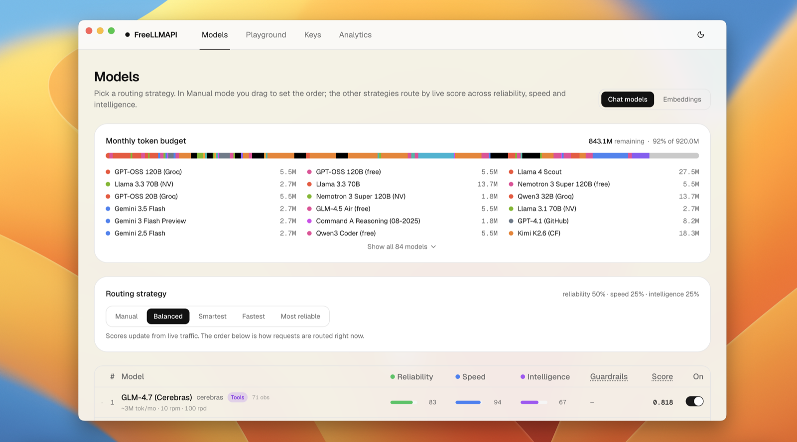

**[Releases bölümünden indirin](https://github.com/tashfeenahmed/freellmapi/releases/latest)** — her sürüme macOS `.dmg` ve Windows `.exe` yükleyicileri eklenir. Hesap veya parola oluşturmanız gerekmez; ihtiyacınız olan tek kimlik bilgisi tepsi panelindeki birleşik API anahtarıdır. Kaynaktan derleme adımları ve veri konumları: [masaüstü uygulaması rehberi](docs/en/install/01-install.md#desktop-app).

macOS 12 Monterey ve sonrası için **arm64 (Apple Silicon)** veya **x64 (Intel)** sürümünü seçin. Her iki Mac derlemesinin ZIP paketi de sunulur.

<a id="works-with-openai-compatible-clients"></a>

## OpenAI uyumlu istemcilerle kullanım

OpenAI uyumlu bir temel URL’ye bağlanabilen tüm istemciler çalışır: adresi `http://localhost:3001/v1` olarak ayarlayın ve paneldeki birleşik anahtarı kullanın. Tüm yapılandırma üreticileri `--dry-run` seçeneğini destekler. `npx freellmapi launch` (Claude Code) ve `launch-codex` (Codex), kimlik bilgilerini yapılandırma dosyalarına hiç yazmaz. Yönlendirici, ajanlarınızın oturum sırasında inceleyebileceği bir MCP sunucusu olarak da çalışır.

**ChatGPT**, özel bir Secure MCP Tunnel üzerinden aynı yerel yönlendiriciye bağlanır. `ask_freellmapi` MCP aracı, ChatGPT’nin istediği görevi `/v1/chat/completions` üzerinden yönlendirir; yanıtı kullanılan model, yedek modele geçiş, önbellek, yürütme ve token üst verileriyle döndürür. Temel URL ve bearer kimlik doğrulaması tünel istemcisinin yapılandırmasında tutulur. Varsayılan model `MCP_INFERENCE_DEFAULT_MODEL` ile ayarlanır (belirtilmezse `auto`). Anahtarları Git’e veya MCP URL’sine eklemeyin. **[ChatGPT kurulumu →](docs/en/clients/01-agent-clients.md#chatgpt-private-secure-mcp-tunnel)**

Sağlayıcı anahtarlarını panel oturum tokenıyla (`FREELLMAPI_DASHBOARD_TOKEN` veya `--token`) terminalden de yönetebilirsiniz: `npx freellmapi keys add|list|remove|test <platform>`. Buradaki `keys test`, kayıtlı anahtarları yeniden sınar. Bkz. [CLI rehberi](cli/README.md#provider-keys).

FreeLLMAPI, yerelde çalışmayı esas alan ve tek kullanıcı için tasarlanmış bir uygulamadır. Sağlayıcı anahtarlarınız SQLite veritabanınızda şifreli saklanır; istekler makinenizden etkinleştirdiğiniz sağlayıcılara gider.

<a id="languages"></a>

## Diller

Yönetim paneli **60 dilde**, masaüstü tepsi menüsü ise 6 dilde sunulur. Arayüz ilk açılışta tarayıcı/sistem dilinizi otomatik algılar. Dili istediğiniz zaman **⋯ → Ayarlar (Settings)** üzerinden değiştirebilirsiniz; seçiminiz hatırlanır. Sağdan sola yazılan dillerde (العربية, עברית, فارسی, اردو) tüm yerleşim otomatik olarak tersine döner. Yalnızca etkin dilin sözlüğü yüklenir; diğerleri bant genişliğinizi kullanmaz.

                                                 

Tam dil listesi [`client/src/i18n/locale-config.ts`](./client/src/i18n/locale-config.ts) dosyasındadır.

İlk altı dil insan denetiminden geçmiştir. Daha sonra eklenen diller makine çevirisidir ve ana dili konuşanların düzeltmeleriyle iyileşir. Tek bir metni düzelten PR bile iyi bir ilk katkıdır.

Çeviriler [`client/src/i18n/locales/`](./client/src/i18n/locales) dizininde düz JSON dosyaları olarak tutulur. Bir metni düzeltmek için ilgili dilin JSON dosyasındaki değeri düzenleyin. Yeni dil eklemek için `en.json` dosyasını kopyalayıp değerleri çevirin, dili `client/src/i18n/locale-config.ts` dosyasına kaydedin; tepsi metinleri için `desktop/src/i18n.ts` dosyasını da güncelleyin. `npm test`, her dilin anahtar ve yer tutucularının kaynakla eşleştiğini kontrol eder. PR’larınızı bekliyoruz.

<a id="premium-live-catalog"></a>

## Premium (canlı katalog)

Yönlendirici model kataloğunu kendisi güncel tutar: günde iki kez [freellmapi.co](https://freellmapi.co) üzerinden imzalı kataloğu alır, yeni modelleri, kota değişikliklerini ve sağlayıcılara özgü uyumluluk düzeltmelerini yerel veritabanınıza uygular. Etkinleştirme/devre dışı bırakma seçimleriniz ve özel sağlayıcılarınız değişmez. Her indirme uygulanmadan önce sabitlenmiş Ed25519 anahtarıyla doğrulanır.

Katalog şu anda **87 sağlayıcı**, **736 model ailesi**, **1.313 ücretsiz sağlayıcı/model uç noktası** (1.137 sohbet, 29 görsel, 41 ses, 68 gömme, 19 ses dökümü, 6 video, 13 karar) ve listelenen ücretsiz planlarda **ayda yaklaşık 10,1 milyar token** kapasitesini izler. Tam liste: **[freellmapi.co/models](https://freellmapi.co/models.html)**.

Ücretsiz kurulumlar aynı imzalı kataloğun aylık anlık görüntüsünü alır. Bir model, canlı akışa eklendikten 30 gün sonra bu görüntüye katılır; bu nedenle ücretsiz sürüm şu anda yaklaşık 303 model geridedir. Hiçbir şeyin süresi dolmaz ve hiçbir özellik kısıtlanmaz; modeller yalnızca daha geç gelir.

Premium, çalıştırdığınız tüm yönlendiricilerde imzalı kataloğu canlı tutar. Bir sağlayıcı güçlü bir ücretsiz model yayımladığında, kotasını sessizce daralttığında veya iletişim biçimini bozduğunda, canlı akışı kullanan yönlendiriciler düzeltmeyi yayımladığımız gün alır.

**[freellmapi.co ile canlı kataloğa geçin →](https://freellmapi.co/?utm_source=github&utm_medium=readme&utm_campaign=premium&utm_content=readme_bottom#pricing)**

- Yılda 19 ABD doları veya tek seferlik 49 ABD dolarıyla ömür boyu kullanım. Stripe üzerinden ödeme; istediğiniz zaman kendiniz iptal edebilirsiniz.
- Tek bir `fla_` anahtarı çalıştırdığınız tüm yönlendiricileri kapsar: masaüstü, ev sunucusu, Raspberry Pi.
- Panelde **Premium** bölümünden etkinleştirin; iptal ve faturalandırma işlemlerini [freellmapi.co/manage](https://freellmapi.co/manage) üzerinden kendiniz yönetin.
- Yönlendirici her zaman MIT lisanslı ve tamamen ücretsiz kalır. Premium yalnızca canlı katalog akışını kapsar; kataloğun çalışır kalmasını sağlayan günlük model testlerini ve bakımını finanse eder.

Katalog sunucusu istemlerinizi, model yanıtlarınızı veya sağlayıcı anahtarlarınızı hiçbir zaman görmez. Her iki durumda da yönlendirici tamamen sizin ortamınızda çalışır.

<a id="using-the-api"></a>

## API kullanımı

```python
from openai import OpenAI

client = OpenAI(
    base_url="http://localhost:3001/v1",
    api_key="freellmapi-your-unified-key",
)

resp = client.chat.completions.create(
    model="auto",  # let the router pick; or "auto:fast", "auto:smart", a profile, or a model id
    messages=[{"role": "user", "content": "Summarise the fall of Rome in one sentence."}],
)
print(resp.choices[0].message.content)
print("Routed via:", resp.headers.get("x-routed-via"))
```

Akışlı yanıtlar, `auto:*` yönlendirme stratejileri, araç çağırma, görsel girdiler, Gemini Google Search ile kaynaklandırma, gömmeler ve Anthropic Messages API’si için curl ve Python örnekleri **[API başvurusundadır](docs/en/api/01-rest-api.md)**. Her yanıt `X-Routed-Via: <platform>/<model>` başlığı taşır; böylece isteği hangi sağlayıcının karşıladığını görebilirsiniz.

<a id="screenshots"></a>

## Ekran görüntüleri

### Modeller

Bir yönlendirme stratejisi seçin ve tüm sağlayıcıların aylık token bütçesini izleyin. Her model için canlı güvenilirlik, hız ve yetenek puanları gösterilir. Aşağıdaki sıralama, isteklerin o anda izlediği yönlendirme sırasıdır.


### Anahtarlar

Sağlayıcı kimlik bilgilerini yönetin ve uygulamalarınızın bağlanırken kullanacağı birleşik API anahtarını alın. Her anahtarın durum göstergesi ve son sağlık kontrolünün zamanı gösterilir.

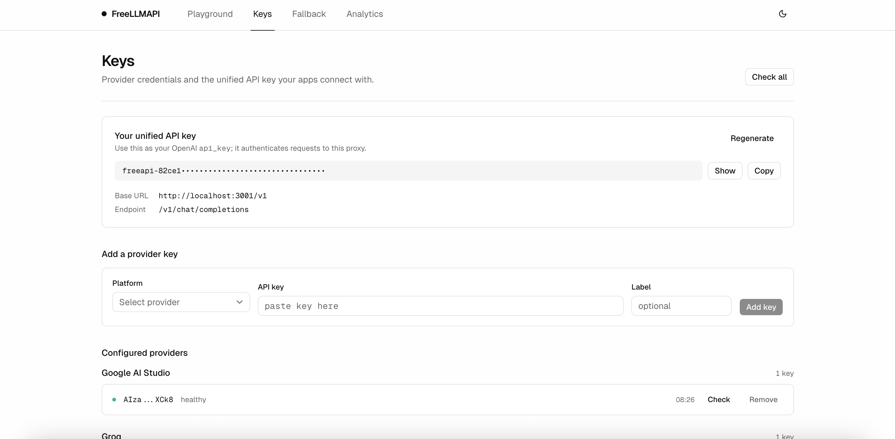

### Deneme alanı

Yönlendirici üzerinden bir sohbet isteği gönderin; isteği hangi sağlayıcının karşıladığını, model kimliğini ve gecikmeyi doğrudan mesaj üzerinde görün. Düğme, sürükleyip bırakma veya yapıştırmayla dosya ekleyin. Görseller (PNG/JPEG/WebP/GIF) tarayıcıda küçültülüp görsel işleyebilen bir modele görüntü içeriği olarak gönderilir. Metin dosyaları (TXT/MD/CSV/JSON/LOG) ise isteme kod blokları içinde eklenir.

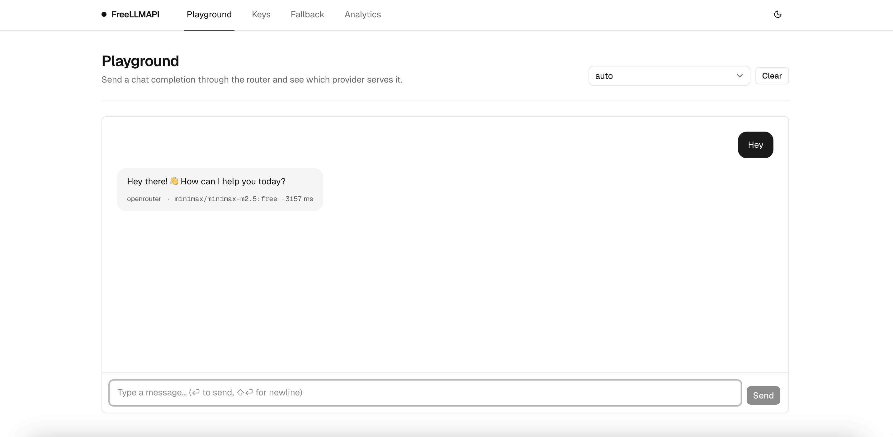

### Analiz

24 saat / 7 gün / 30 gün / 90 günlük dönemlerde istek hacmi, başarı oranı, giriş ve çıkış tokenları, ortalama gecikme ve sağlayıcı bazındaki dağılımlar.

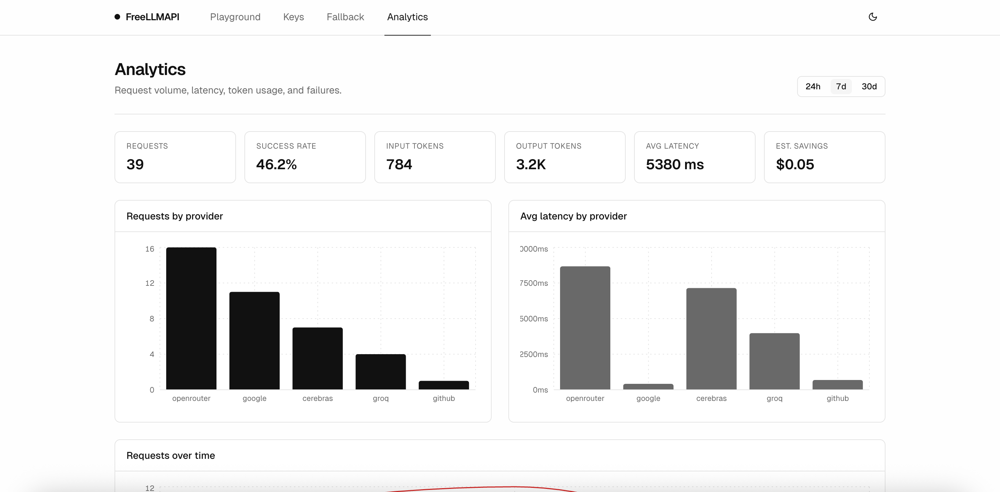

<a id="how-it-works"></a>

## Nasıl çalışır?

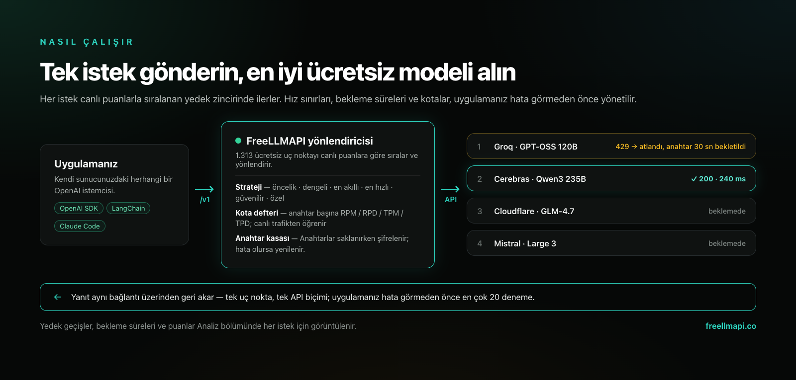

Tek istek, en iyi ücretsiz model: yönlendirici, geçerli bir anahtarı olan ve tüm hız sınırlarının altında kalan en yüksek öncelikli modeli seçer, anahtarın şifresini bellekte çözer ve sağlayıcıyı çağırır. 429/5xx hatasında bu anahtarı beklemeye alıp zincirdeki sıradaki modeli dener. Bileşenlerin açıklamaları, yönlendirmenin iç işleyişi ve işletim ayrıntıları **[mimari rehberindedir](docs/en/architecture/00-high-level-index.md)**.

<a id="faq"></a>

## Sık sorulan sorular

**Parola gerekiyor mu?** Masaüstü uygulamasında gerekmez. Panel gizli bir yerel hesapla otomatik oturum açar; oluşturmanız veya hatırlamanız gereken bir parola yoktur. Tepsi simgesi → **Paneli Aç (Open Dashboard)** yolunu kullanın ya da aynı bilgisayarda herhangi bir tarayıcıdan açın (örneğin http://127.0.0.1:31415); ikisi de otomatik giriş yapar. Yerel ağ üzerinden başka bir cihazla bağlanıldığında giriş formu gösterilir. Sunucu kurulumlarında (Docker, tek satırlık kurulum, `npm run dev`) e-posta ve parola kullanan bir hesap vardır.

**Sunucu kurulumundaki parolamı unuttum.** Giriş sayfasında **Parolamı unuttum (Forgot password?)** seçeneğine tıklayın. Bağlantı göndermek için e-posta hizmeti bulunmadığından tek kullanımlık kod sunucu günlüğüne yazılır. Kodu `docker compose logs -f freellmapi` ile, sunucunun çalıştığı terminalden veya masaüstü günlük dosyasından okuyup sıfırlama formuna girin. Kod 15 dakika geçerlidir.

**Günlükler nerede?** Docker kurulumunda konteyner günlüklerinde, kaynaktan çalıştırmada terminalde, masaüstünde ise `<data dir>/logs/freeapi.log` dosyasındadır. Masaüstünde tepsi menüsündeki **Günlük Klasörünü Aç (Open Logs Folder)** seçeneğiyle ulaşabilirsiniz.

**Nasıl kaldırırım?** Uygulamayı kaldırın (macOS’ta Çöp Sepeti, Windows’ta *Ayarlar → Uygulamalar*, Docker’da `docker compose down -v`), ardından veri dizinini silin: `%APPDATA%\FreeLLMAPI\`, `~/Library/Application Support/FreeLLMAPI/` veya `~/.config/FreeLLMAPI/`. Kaldırma işlemi bu klasörü kendiliğinden silmez.

Kurulum yöntemine göre ayrıntılı yanıtlar: **[parolalar, günlükler ve kaldırma](docs/en/install/01-install.md#faq-passwords-logs-uninstall)**.

<a id="limitations"></a>

## Sınırlamalar

Ücretsiz planları birleştirmenin bedelleri vardır: en ileri düzey modeller yoktur, gecikmeler değişkendir ve hizmet düzeyi garantisi (SLA) sunulmaz. En iyi modeller günlük kotalarına ulaştıkça uç noktanın yanıt kalitesi günün ilerleyen saatlerinde düşebilir; kotalar UTC gece yarısında sıfırlanır. Buna dayalı gerçek bir ürün geliştirmeden önce **[sınırlamalar listesini](docs/en/architecture/00-high-level-index.md#limitations)** okuyun.

<a id="contributing"></a>

## Katkıda bulunma

Katkılarınızı bekliyoruz! Geliştirme süreci, PR beklentileri ve AI/LLM destekli katkı politikası için [CONTRIBUTING.md](CONTRIBUTING.md) dosyasına bakın. Kısaca: bu katkılar kabul edilir ve diğer PR’larla aynı kalite ölçütlerine tabidir. İlk katkı önerileri:

- **Sağlayıcı ekleyin** — `server/src/providers/openai-compat.ts` dosyasını şablon olarak kopyalayın, `server/src/providers/index.ts` içine bağlayın, modellerini `server/src/db/index.ts` içinde tanımlayın ve `server/src/__tests__/providers/` dizinine test ekleyin.
- **Uç nokta ekleyin** — diğer OpenAI uyumlu arayüzler (örneğin `/v1/realtime`). Sağlayıcı temel sınıfına yeni yöntemler eklenebilir; bağdaştırıcılar hangilerini desteklediklerini bildirir.
- **Yönlendiriciyi iyileştirin** — maliyeti gözeten yönlendirme (ucuzluk, sağlık ve hız dengesi), gecikmeye göre daha iyi önceliklendirme, belirli bir bölgeye sabitleme.
- **Paneli iyileştirin** — Analiz sayfasına grafikler, anahtar döndürme deneyimi, `.env` üzerinden toplu anahtar aktarımı.
- **Belgelere katkıda bulunun** — daha fazla örnek, Go/Rust gibi diller için istemci kodları, Docker veya Fly için dağıtım tarifleri.

`npm install && npm run dev`, sunucuyu :3001 ve paneli :5173 üzerinde HMR desteğiyle başlatır. Tekrarlanabilir kurulum için Bash’te `./scripts/dev-bootstrap.sh`, PowerShell’de `.\scripts\dev-bootstrap.ps1` kullanın; ikisi de mevcut `.env` dosyasını korur. PR’lar test içermeli, mevcut testlerin geçmesini sağlamalı (`npm test`) ve depodaki `.editorconfig` / tsconfig varsayılanlarına uymalıdır. Veritabanı geçiş iş akışı ve tüm katkı süreci [CONTRIBUTING.md](./CONTRIBUTING.md) dosyasındadır.

### Katkıda bulunanlar

<a href="https://github.com/moaaz12-web"></a>
<a href="https://github.com/AdityaxDeore"></a>
<a href="https://github.com/lukasulc"></a>
<a href="https://github.com/VinhPhamAI"></a>
<a href="https://github.com/deadc"></a>
<a href="https://github.com/zhangyu1324"></a>
<a href="https://github.com/kentpan"></a>
<a href="https://github.com/stephenzwj"></a>
<a href="https://github.com/chongjiazhen"></a>
<a href="https://github.com/vjsai"></a>
<a href="https://github.com/long2ice"></a>
<a href="https://github.com/sadesguy"></a>
<a href="https://github.com/hodlmybeer69-bit"></a>
<a href="https://github.com/phoenixikkifullstack"></a>
<a href="https://github.com/jtbrennan-git"></a>
<a href="https://github.com/praveenkumarpranjal"></a>
<a href="https://github.com/nordbyte"></a>
<a href="https://github.com/mybropro"></a>
<a href="https://github.com/danscMax"></a>
<a href="https://github.com/jhash"></a>
<a href="https://github.com/JammyJames1234"></a>
<a href="https://github.com/coffcoe"></a>
<a href="https://github.com/Sumit4codes"></a>
<a href="https://github.com/meliani"></a>
<a href="https://github.com/thedavidweng"></a>
<a href="https://github.com/bharvey42"></a>
<a href="https://github.com/yuvrxj-afk"></a>
<a href="https://github.com/v0rtex1223"></a>
<a href="https://github.com/nicyoong"></a>
<a href="https://github.com/Aldo-f"></a>
<a href="https://github.com/Tazrif-Raim"></a>
<a href="https://github.com/m1nuzz"></a>
<a href="https://github.com/suantea"></a>
<a href="https://github.com/OhOkThisIsFine"></a>
<a href="https://github.com/LoneRifle"></a>
<a href="https://github.com/ita333"></a>
<a href="https://github.com/barbotkonv"></a>
<a href="https://github.com/Naster17"></a>
<a href="https://github.com/StealthTensor"></a>
<a href="https://github.com/EmranAhmed"></a>
<a href="https://github.com/itsfuad"></a>
<a href="https://github.com/RobinHoodO"></a>
<a href="https://github.com/hmm183"></a>
<a href="https://github.com/duemilionidieuro-bot"></a>
<a href="https://github.com/cagedbird043"></a>
<a href="https://github.com/jasnoorgill"></a>
<a href="https://github.com/Joey9024"></a>
<a href="https://github.com/AskingConical"></a>
<a href="https://github.com/ProAlit"></a>
<a href="https://github.com/hjhhoni"></a>
<a href="https://github.com/immanuelsavio"></a>
<a href="https://github.com/Slyker"></a>
<a href="https://github.com/wells1013"></a>
<a href="https://github.com/evgkrsk"></a>
<a href="https://github.com/aaronjmars"></a>
<a href="https://github.com/Robs87"></a>
<a href="https://github.com/dashitongzhi"></a>
<a href="https://github.com/QingJ01"></a>
<a href="https://github.com/3215"></a>
<a href="https://github.com/saifulaiub123"></a>
<a href="https://github.com/PietFourie"></a>
<a href="https://github.com/mhmdkrmabd"></a>
<a href="https://github.com/DemeulemeesterxMaxime"></a>
<a href="https://github.com/HoodBlah"></a>
<a href="https://github.com/SeanPedersen"></a>
<a href="https://github.com/andersmmg"></a>
<a href="https://github.com/chirag127"></a>
<a href="https://github.com/allababbot"></a>
<a href="https://github.com/johan-droid"></a>
<a href="https://github.com/redenfire"></a>
<a href="https://github.com/itzpingcat"></a>
<a href="https://github.com/kairwang01"></a>
<a href="https://github.com/gongjurenzhangwei"></a>
<a href="https://github.com/jsonring"></a>
<a href="https://github.com/1029734570"></a>
<a href="https://github.com/86TheCactus"></a>
<a href="https://github.com/AmiroKD"></a>
<a href="https://github.com/ecryptomillionaire-dev"></a>
<a href="https://github.com/4riful"></a>
<a href="https://github.com/fix2015"></a>
<a href="https://github.com/iisyw"></a>
<a href="https://github.com/xsfhacg"></a>
<a href="https://github.com/noobix"></a>
<a href="https://github.com/nandukmelath"></a>
<a href="https://github.com/NirvanaCh7"></a>
<a href="https://github.com/Mohamed3nan"></a>
<a href="https://github.com/Arman-Espiar"></a>
<a href="https://github.com/MetaMysteries8"></a>
<a href="https://github.com/lujun880726"></a>
<a href="https://github.com/qq97693453"></a>
<a href="https://github.com/emv33"></a>
<a href="https://github.com/ousamabenyounes"></a>
<a href="https://github.com/yfdyh000"></a>
<a href="https://github.com/s-uryansh"></a>
<a href="https://github.com/arsalanyavari"></a>
<a href="https://github.com/RoboMWM"></a>
<a href="https://github.com/gaurang-py"></a>
<a href="https://github.com/ddy4633"></a>
<a href="https://github.com/UrbsKali"></a>
<a href="https://github.com/hb-0"></a>
<a href="https://github.com/xyblue135"></a>
<a href="https://github.com/Icesenator"></a>
<a href="https://github.com/ZER0-auto"></a>
<a href="https://github.com/tashdroid"></a>
<a href="https://github.com/Patrickleondev"></a>
<a href="https://github.com/hiiamwaffledev"></a>
<a href="https://github.com/w0fv1"></a>
<a href="https://github.com/oppih"></a>
<a href="https://github.com/n3dhir"></a>
<a href="https://github.com/ksp2000"></a>
<a href="https://github.com/quabynahdavis"></a>
<a href="https://github.com/qinghuanandejiangshi"></a>
<a href="https://github.com/qatcod"></a>
<a href="https://github.com/CooperSheroy"></a>
<a href="https://github.com/shahidbeig-a11y"></a>
<a href="https://github.com/Kaban15"></a>
<a href="https://github.com/efcunha"></a>
<a href="https://github.com/sukaimi"></a>
<a href="https://github.com/rome-xi"></a>
<a href="https://github.com/bsi-bcp"></a>
<a href="https://github.com/rodion-gudz"></a>
<a href="https://github.com/bjornmage"></a>
<a href="https://github.com/kenanlabs"></a>
<a href="https://github.com/xzyj50609"></a>
<a href="https://github.com/Ahmedtahoon2"></a>
<a href="https://github.com/Inference1"></a>
<a href="https://github.com/yzhkali"></a>
<a href="https://github.com/levonk"></a>
<a href="https://github.com/tripstar6000"></a>
<a href="https://github.com/alkank"></a>
<a href="https://github.com/Yi-111-a"></a>
<a href="https://github.com/The88788"></a>
<a href="https://github.com/ac1982"></a>
<a href="https://github.com/agammann"></a>
<a href="https://github.com/Claven07"></a>
<a href="https://github.com/AymenJeddou"></a>
<a href="https://github.com/Thibaultjaigu"></a>
<a href="https://github.com/silvertakana"></a>
<a href="https://github.com/sidhunt"></a>
<a href="https://github.com/rubicon"></a>
<a href="https://github.com/JoAdo07"></a>
<a href="https://github.com/igormutton"></a>
<a href="https://github.com/georgeatparallel"></a>
<a href="https://github.com/BNTiyan"></a>
<a href="https://github.com/ChaosCom"></a>
<a href="https://github.com/Alexis12119"></a>
<a href="https://github.com/kevin9327"></a>
<a href="https://github.com/ilya-bogin-keenable"></a>
<a href="https://github.com/harsHdokyc"></a>
<a href="https://github.com/ALANDVO"></a>
<a href="https://github.com/HyperionBurn"></a>
<a href="https://github.com/emirhantasli"></a>
<a href="https://github.com/jayhemnani9910"></a>
<a href="https://github.com/ignamiranda"></a>
<a href="https://github.com/MoriDanWork"></a>
<a href="https://github.com/suvshox-oss"></a>
<a href="https://github.com/Swidan0"></a>
<a href="https://github.com/w21180239"></a>
<a href="https://github.com/kjgggggg"></a>
<a href="https://github.com/TheoCui-Saulcy"></a>
<a href="https://github.com/MatthewRobertDunn"></a>
<a href="https://github.com/nk-batman21"></a>
<a href="https://github.com/PowerTokens"></a>
<a href="https://github.com/navzo"></a>
<a href="https://github.com/motasimfuad"></a>
<a href="https://github.com/thedevil11255"></a>
<a href="https://github.com/kvianAR"></a>
<a href="https://github.com/TanmayShah29"></a>
<a href="https://github.com/heydryft"></a>
<a href="https://github.com/leucds2018-hub"></a>
<a href="https://github.com/zhangkom"></a>
<a href="https://github.com/noahkhomer18"></a>
<a href="https://github.com/mentallyunstable-lab"></a>

<a id="disclaimer"></a>

## Sorumluluk reddi

**Bu proje kişisel deneme ve öğrenme içindir; üretim ortamları için değildir.** Ücretsiz planlar geliştiricilerin prototip oluşturması için sunulur; kararlı ve destek garantisi olan bir çıkarım altyapısı değildir. FreeLLMAPI üzerine gerçek bir ürün geliştiriyorsanız yayımlamadan önce ücretli bir API’ye geçin. Sağlayıcılarla ilişkiniz, hesap oluştururken kabul ettiğiniz koşullara tabidir. Trafiği bu proje üzerinden yönlendirdiğinizde de bu koşullar geçerlidir ve bunlara uymak sizin sorumluluğunuzdadır.

Sağlayıcıların hizmet koşullarında kişisel, tek kullanıcılı bir vekil sunucunun nasıl değerlendirildiğine ilişkin Mayıs 2026 tarihli inceleme için [hizmet koşulları değerlendirmesine](docs/en/architecture/00-high-level-index.md#terms-of-service-review) bakın.

## Lisans

[MIT](./LICENSE)
