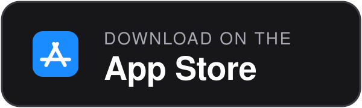
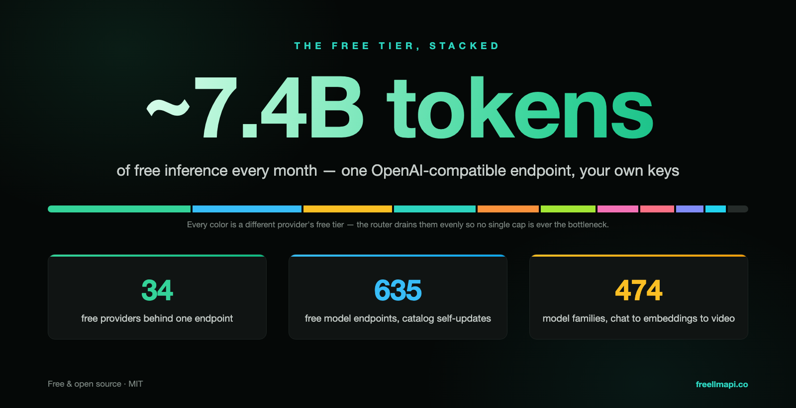
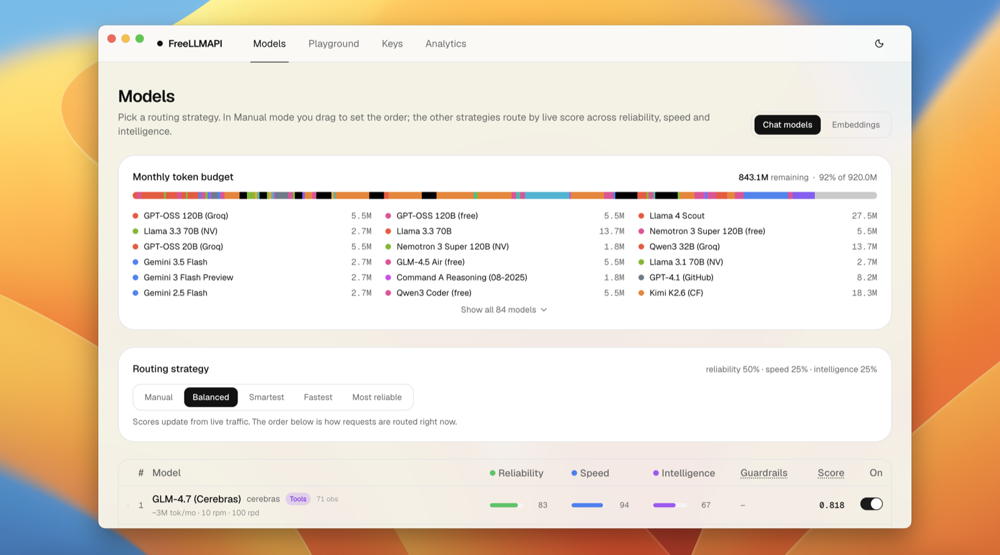
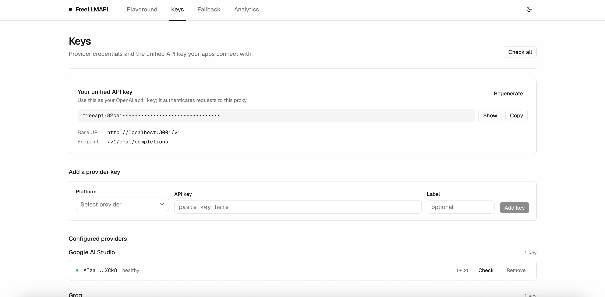
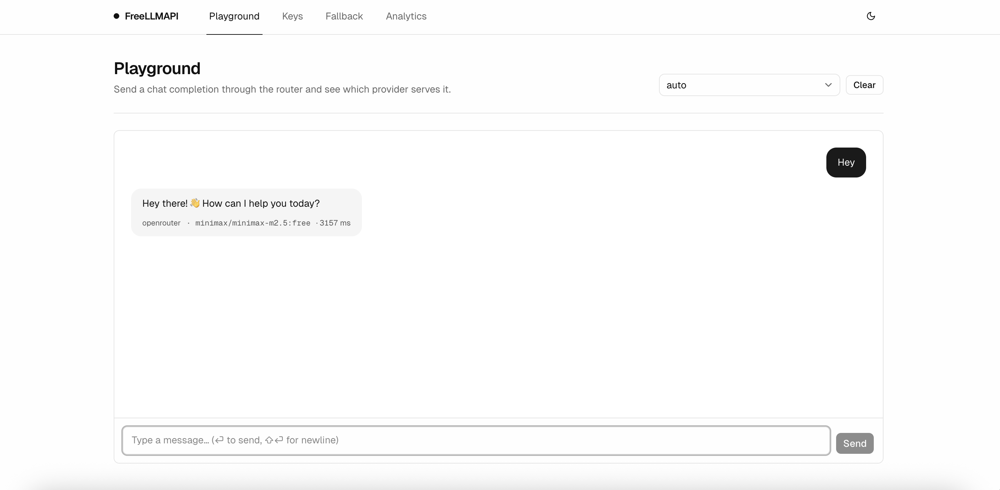
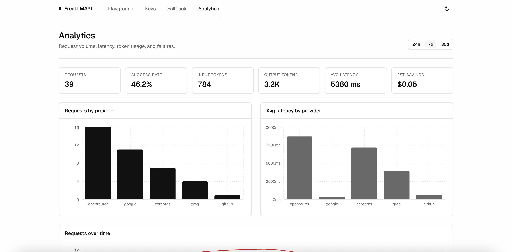

<div align="center">

# FreeLLMAPI

**Oyiga 7,4 milliard token. 34 ta bepul LLM provayderi. 635 ta bepul model endpointi. OpenAI bilan mos bitta endpoint.**

O'nlab provayderlarning bepul tariflarini, shuningdek, OpenAI bilan mos keladigan istalgan chat, embedding, rasm va audio endpointlaringizni bitta `/v1` API orqasida birlashtiring. Kalitlar shifrlangan holda saqlanadi. Router har bir so'rov uchun eng yaxshi mavjud modelni tanlaydi, provayder limitga yetganda keyingisiga o'tadi va har bir kalitning sarfini kuzatib boradi, shunda siz hech bir bepul tarif limitidan oshib ketmaysiz.

[](https://github.com/tashfeenahmed/freellmapi/actions/workflows/ci.yml)
[](https://github.com/tashfeenahmed/freellmapi/stargazers)
[](./LICENSE)
[](#hissa-qoshish)
[](https://github.com/tashfeenahmed/freellmapi/pkgs/container/freellmapi)
[](https://deepwiki.com/tashfeenahmed/freellmapi)

**[freellmapi.co](https://freellmapi.co/?utm_source=github&utm_medium=readme&utm_campaign=repository&utm_content=readme_top)** · to'liq katalogni ko'ring: 474 ta model oilasi, 635 ta bepul endpoint

[English](README.md) · [简体中文](README.zh-cn.md) · [Русский](README.ru.md) · **O'zbekcha**

Bu tarjima ortda qolishi mumkin. Eng so'nggi ma'lumot uchun inglizcha README'ga qarang.

<p align="center">
  <a href="https://github.com/tashfeenahmed/freellmapi/releases/latest"></a>
  <a href="https://github.com/tashfeenahmed/freellmapi/releases/latest"></a>
  <a href="docs/en/install/01-install.md#docker-compose"></a>
  <a href="https://play.google.com/store/apps/details?id=co.freellmapi.app"></a>
  <a href="https://apps.apple.com/app/id6804648934"></a>
</p>


Routeringiz model katalogini imzolangan manbadan o'zi yangilaydi: yangi bepul modellar, limit o'zgarishlari va moslik tuzatishlari `git pull` qilmasdan yetib keladi. Bepul o'rnatmalar oylik snapshotni oladi, ya'ni model jonli manbaga qo'shilganidan 30 kun o'tib ularga yetib boradi; premium routerlar uni o'sha kuniyoq oladi.
**[freellmapi.co'da jonli manbaga ulaning](https://freellmapi.co/?utm_source=github&utm_medium=readme&utm_campaign=premium&utm_content=readme_top#pricing)** (yiliga $19, istalgan vaqtda bekor qilish mumkin).

</div>

---

## Mundarija

- [Bu loyiha nega kerak](#bu-loyiha-nega-kerak)
- [Qo'llab-quvvatlanadigan provayderlar](#qollab-quvvatlanadigan-provayderlar)
- [Mos CLI'lar va kodlash agentlari](#mos-clilar-va-kodlash-agentlari)
- [Boshqalar bilan taqqoslash](#boshqalar-bilan-taqqoslash)
- [Imkoniyatlar](#imkoniyatlar)
- [Tez boshlash](#tez-boshlash)
- [Desktop ilova](#desktop-ilova)
- [OpenAI bilan mos klientlar](#openai-bilan-mos-klientlar)
- [Tillar](#tillar)
- [Premium (jonli katalog)](#premium-jonli-katalog)
- [API'dan foydalanish](#apidan-foydalanish)
- [Skrinshotlar](#skrinshotlar)
- [Qanday ishlaydi](#qanday-ishlaydi)
- [Ko'p beriladigan savollar](#kop-beriladigan-savollar)
- [Cheklovlar](#cheklovlar)
- [Hissa qo'shish](#hissa-qoshish)
- [Ogohlantirish](#ogohlantirish)

**Qo'llanmalar (ingliz tilida):** [O'rnatish va deploy](docs/en/install/01-install.md) · [API ma'lumotnomasi](docs/en/api/01-rest-api.md) · [Klientlar va kodlash agentlari](docs/en/clients/01-agent-clients.md) · [Promptni siqish](docs/en/compression/01-compression-pipeline.md) · [Arxitektura va ichki tuzilish](docs/en/architecture/00-high-level-index.md) · [Hujjatlar ro'yxati](docs/en/README.md) · [Hissa qo'shuvchilar uchun qo'llanma](CONTRIBUTING.md)

## Bu loyiha nega kerak

Bugun har bir jiddiy AI laboratoriyasi bepul tarif taklif qiladi: oyiga bir necha million token, kuniga bir necha ming so'rov. Alohida olinganda har bir tarif o'yinchoqdek gap. Lekin ularni birlashtirsangiz, oyiga taxminan **7,4 milliard token** ishchi inference quvvati hosil bo'ladi. Bu kichik va tezkor modellardan tortib ancha qobiliyatlilarigacha bo'lgan **474 ta model oilasi / 635 ta provayder endpointi**ni qamrab oladi.

Muammo shundaki, ularni qo'lda birlashtirish juda og'ir: o'ttiz to'rtta turli SDK, o'ttiz to'rtta turli limit, so'rov xato berishi mumkin bo'lgan o'ttiz to'rtta joy. FreeLLMAPI bularning hammasini OpenAI bilan mos bitta endpointga jamlaydi. Istalgan OpenAI klient kutubxonasini lokal serveringizga yo'naltiring, u esa so'rovlarni siz kalit qo'shgan provayderlar bo'ylab sezdirmasdan taqsimlaydi.

Bundan tashqari, bepul tariflar manzarasi har hafta o'zgaradi: provayderlar ogohlantirmasdan model chiqaradi, eskilarini o'chiradi va limitlarni o'zgartiradi. FreeLLMAPI bularning barchasini siz uchun kuzatib boradi. Router imzolangan model katalogini [freellmapi.co](https://freellmapi.co) dan o'zi tortib oladi, shuning uchun o'rnatmangiz `git pull` qilmasdan ham dolzarb bo'lib turadi. Qanchalik tez yangilanishi haqida [Premium (jonli katalog)](#premium-jonli-katalog) bo'limida o'qing.



## Qo'llab-quvvatlanadigan provayderlar

<div align="center">
<table>
<tr>
<td align="center" width="150"><br/><b>Google</b></td>
<td align="center" width="150"><picture><source media="(prefers-color-scheme: dark)" srcset="repo-assets/providers/groq-dark.png"></picture><br/><b>Groq</b></td>
<td align="center" width="150"><br/><b>Cerebras</b></td>
<td align="center" width="150"><picture><source media="(prefers-color-scheme: dark)" srcset="repo-assets/providers/opencode-dark.png"></picture><br/><b>OpenCode Zen</b></td>
</tr>
<tr>
<td align="center"><br/><b>Mistral</b></td>
<td align="center"><br/><b>OpenRouter</b></td>
<td align="center"><br/><b>Cloudflare</b></td>
<td align="center"><br/><b>Cohere</b></td>
</tr>
<tr>
<td align="center"><br/><b>Z.ai (Zhipu)</b></td>
<td align="center"><br/><b>NVIDIA</b></td>
<td align="center"><br/><b>HuggingFace</b></td>
</tr>
<tr>
<td align="center"><a href="https://modelscope.cn"><b>ModelScope</b><br/>Qwen3 · DeepSeek V4 · GLM-5 (needs Aliyun cn binding)</a></td>
</tr>
</table>

<i>… va yana 22 ta bepul provayder</i>

</div>

Bundan tashqari **custom** provayder ham bor: **Kalitlar** (Keys) sahifasida chat, embedding, rasm yoki audio modellarni OpenAI bilan mos istalgan endpointga (llama.cpp, LM Studio, vLLM, lokal Ollama yoki masofaviy gateway) yo'naltirishingiz mumkin.

To'liq va doim dolzarb ro'yxat **[freellmapi.co/models](https://freellmapi.co/models.html)** sahifasida: har bir model uchun limitlar, kontekst oynasi va bepul token hajmi bilan.

## Mos CLI'lar va kodlash agentlari

<div align="center">
<table>
<tr>
<td align="center" width="150"><br/><b>Claude Code</b></td>
<td align="center" width="150"><br/><b>Codex CLI</b></td>
<td align="center" width="150"><br/><b>Gemini CLI</b></td>
<td align="center" width="150"><br/><b>Cursor</b></td>
</tr>
<tr>
<td align="center"><br/><b>Cline</b></td>
<td align="center"><br/><b>Roo Code</b></td>
<td align="center"><br/><b>OpenCode</b></td>
<td align="center"><br/><b>Aider</b></td>
</tr>
</table>

<i>… shuningdek Continue, Goose, Qwen Code, Kilo Code, Crush, Zed, JetBrains AI, DeepSeek Harness, MiMo Code, AtomCode, OpenClaw, Hermes Agent, Pi, Reasonix, ZCode va OpenAI, Anthropic, Gemini yoki Ollama bilan mos istalgan klient</i>

</div>

Ko'pchilik agentlar bitta buyruq bilan sozlanadi: u jonli katalogingizni o'qiydi, mavjud konfiguratsiyaning zaxira nusxasini oladi va o'zgarishlarni unga qo'shadi:

```bash
npx freellmapi setup-claude --url http://localhost:3001 --api-key <unified-key>
```

**[Barcha qo'llab-quvvatlanadigan agentlar va ularni sozlash buyruqlari →](docs/en/clients/02-supported-agents.md)** · [Har bir vosita uchun retseptlar, MCP server va URL tokenlar →](docs/en/clients/01-agent-clients.md)

## Boshqalar bilan taqqoslash


Ochiq hujjatlar asosida, 2026-yil iyul. Tuzatishlar mamnuniyat bilan qabul qilinadi.

## Imkoniyatlar


- **OpenAI uslubidagi barcha endpointlar**: `/v1/chat/completions`, `/v1/responses` (Codex CLI uchun kerak), `/v1/completions` (muharrirdagi ghost-text avtoto'ldirish), `/v1/images/generations`, `/v1/videos/generations`, `/v1/audio/speech`, `/v1/audio/transcriptions`, `/v1/embeddings` va `/v1/models`. Streaming va oddiy rejimda, rasmiy SDK'lardan yoki OpenAI bilan mos istalgan klientdan ishlaydi. [API ma'lumotnomasi →](docs/en/api/01-rest-api.md)
- **Anthropic Messages API**: `/v1/messages` xuddi shu router ustida Anthropic formatida ishlaydi, shuning uchun **Claude Code** va rasmiy Anthropic SDK'lari bepul pulingizda ishlay oladi. [Batafsil →](docs/en/api/01-rest-api.md#anthropic--claude-clients)
- **Gemini va Ollama'ning o'z endpointlari**: Gemini CLI `/v1beta` dan foydalana oladi (`generateContent`, streaming, token sanash, modellar). Ixtiyoriy yoqiladigan Ollama emulyatsiyasi esa Zed, JetBrains va boshqa lokal model klientlari uchun NDJSON chat/generate, tags, metama'lumot va embeddinglarni taqdim etadi.
- **Fusion (bir nechta modeldan sintez)**: virtual `fusion` modelini so'rasangiz, router promptingizni turli bepul modellardan iborat guruhga parallel yuboradi, so'ng hakam model qoralamalardan bitta javob tuzib beradi. [Batafsil →](docs/en/api/01-rest-api.md#fusion-multi-model-synthesis)
- **Rasm, video va nutq generatsiyasi**: `/v1/images/generations`, `/v1/videos/generations` va `/v1/audio/speech` so'rovlarni media modellar taqdim etadigan provayderlarga yo'naltiradi. Rasm va nutq uchun OpenAI bilan mos o'z media endpointlaringizni ham ulash mumkin. Video vazifalari sinxron va navbatli provayderlar o'rtasida bir xil ko'rinishga keltiriladi va tayyor MP4 qaytaradi.
- **Tool calling va strukturali javoblar**: OpenAI uslubidagi `tools` provayderlar bo'ylab to'liq ishlaydi (oddiy matn ko'rinishidagi tool chaqiruvlari haqiqiy `tool_calls` ga aylantiriladi). Shuningdek `response_format`, `seed`, `logprobs`, penaltilar va boshqa sampling parametrlari har bir provayderga uzatiladi.
- **Aqlli routing, oltita strategiya**: har bir modelning jonli tezlik, qobiliyat va ishonchlilik ballari zanjiringizni tartiblaydi. 429/5xx xatolarida avtomatik ravishda keyingi model sinab ko'riladi, kalit "sovitiladi" va kalitlar almashtiriladi. [Routing batafsil →](docs/en/architecture/00-high-level-index.md#how-it-works)
- **Birlashtirilgan modellar va profillar**: bir nechta provayderdagi bir xil model bitta yozuvga birlashadi va guruh ichida qat'iy failover ishlaydi. Nomlangan fallback-zanjir profillari (masalan, kodlash zanjiri, vision zanjiri) dashboard'dan yoki har bir so'rovda `auto:<profile>` orqali almashtiriladi. O'z zanjirlaringizni zanjir menejerida joyida qayta nomlash mumkin.
- **Har bir kalit bo'yicha limitlarni kuzatish**: har bir `(platform, model, key)` uchun RPM/RPD/TPM/TPD hisoblagichlari provayderlar xabar bergan chegaralarni o'rganib boradi, shuning uchun routing doim barcha limitlardan past turadi.
- **O'zi yangilanadigan model katalogi**: router kuniga ikki marta freellmapi.co'dan imzolangan katalogni sinxronlaydi. Yangi modellar, limit o'zgarishlari va provayderlarga oid tuzatishlar avtomatik qo'llanadi. Bepul o'rnatmalar oylik snapshotni kuzatadi: model unga jonli manbada paydo bo'lganidan 30 kun o'tib qo'shiladi. Premium routerlar uni o'sha kuniyoq oladi. [Premium →](#premium-jonli-katalog)
- **Sticky sessiyalar va kontekstni uzatish**: suhbatlar 30 daqiqa davomida bitta modelda qoladi. Suhbat o'rtasida model almashsa, ixtiyoriy qisqa uzatish eslatmasi suhbat izchilligini saqlaydi. [Batafsil →](docs/en/clients/01-agent-clients.md#context-handoff)
- **Promptni siqish (ixtiyoriy)**: umumiy, xatoda so'rovni to'xtatmaydigan (fail-open) pipeline kesh tekshiruvi va routingdan oldin promptlardagi takrorlarni olib tashlashi, tool natijalarini filtrlashi, takrorlanuvchi JSON'ni ixchamlashi va eskirgan kontekstni qisqartirishi mumkin. [Batafsil →](docs/en/compression/01-compression-pipeline.md)
- **Shifrlangan kalitlar, tashqariga bitta token**: provayder kalitlari SQLite'da AES-256-GCM bilan shifrlangan va har bir so'rovda faqat xotirada ochiladi. Ilovalaringiz faqat bitta birlashtirilgan `freellmapi-…` bearer tokenni ko'radi.
- **Admin dashboard va analitika**: kalitlarni boshqarish, zanjirni qayta tartiblash, playground'da sinash va 24 soatdan 90 kungacha bo'lgan oraliqlarda p50/p95/TTFT analitikasini ko'rish uchun React interfeysi. Login bilan himoyalangan, qorong'i va yorug' mavzular, [60 ta til](#tillar).
- **ChatGPT'ga tayyor MCP server va interaktiv hujjatlar**: ChatGPT va boshqa MCP klientlari `/mcp` orqali FreeLLMAPI inference'ini chaqirishi, foydalanish mumkin bo'lgan modellar ro'yxatini olishi, provayder holati, sarf, kesh va routing metama'lumotlarini ko'rishi hamda routing strategiyasini boshqarishi mumkin. Tashqi bog'liqliklarsiz OpenAPI ko'ruvchisi `/v1/docs` manzilida. [ChatGPT va kodlash agentlari →](docs/en/clients/01-agent-clients.md#mcp-server)
- **Operatsion qulayliklar**: ixtiyoriy javob keshi, shifrlangan ma'lumotlar bazasi zaxiralari, kalitlarning muntazam holat tekshiruvi, kalitlarni ommaviy import/eksport qilish, deklarativ ishga tushirish konfiguratsiyasi. [O'rnatish va deploy →](docs/en/install/01-install.md)
- **Node 20+ ishlaydigan har qanday joyda ishlaydi**: Windows, macOS, Linux serverlar yoki kichik ARM bir platali kompyuter (Raspberry Pi ham). PM2, systemd yoki o'zingiz yoqtirgan supervisor ostida bo'sh turganda ~40 MB RSS egallaydi.

Loyiha ataylab tor doirada. [Hali qo'llab-quvvatlanmaydigan narsalar](docs/en/architecture/00-high-level-index.md#not-yet-supported) ro'yxatiga qarang.

## Tez boshlash

**Bitta buyruq** (Docker kerak; `~/freellmapi` papkasini tayyorlaydi, shifrlash kalitini yaratadi, image'ni yuklab oladi va konteynerni ishga tushiradi):

```bash
curl -fsSL https://freellmapi.co/install.sh | bash
```

bash'ga yuborishdan oldin o'qib chiqmoqchimisiz? [Skript shu yerda](https://freellmapi.co/install.sh). Uni qayta ishga tushirish xavfsiz: `.env` faylingiz (va shifrlash kaliti) saqlanib qoladi, konteyner esa `:latest` ga yangilanadi.

http://localhost:3001 ni oching, **Kalitlar** (Keys) sahifasida provayder kalitlaringizni qo'shing, **Fallback Chain** tartibini xohishingizga ko'ra o'zgartiring va **Kalitlar** sahifasining yuqori qismidan birlashtirilgan API kalitingizni oling. OpenAI SDK'ingizga aynan shu birlashtirilgan kalitni berasiz.

Windows'da eng oson yo'l: quyida tasvirlangan desktop ilovaning **[Releases'dagi `.exe` o'rnatuvchisi](https://github.com/tashfeenahmed/freellmapi/releases/latest)**. Android uchun tajriba bosqichidagi [Termux qo'llanmasiga](docs/en/install/02-android-termux.md) qarang.

Qolgan hamma narsa (Docker Compose, lokal ishlab chiqish, deklarativ ishga tushirish konfiguratsiyasi, production build'lar, LAN orqali kirish va zaxira nusxalar) **[docs/en/install/01-install.md](docs/en/install/01-install.md)** da.

## Desktop ilova

[`desktop/`](./desktop) papkasida menyu panelida ishlaydigan nativ ilova bor: butun router va dashboard trey'dan turib lokal ishlaydi, shishasimon popover esa so'rovlar statistikasini jonli ko'rsatadi.



**[Releases'dan yuklab oling](https://github.com/tashfeenahmed/freellmapi/releases/latest)**: har bir relizga macOS `.dmg` va Windows `.exe` o'rnatuvchisi biriktirilgan. Akkaunt yoki parol sozlash shart emas: sizga kerak bo'ladigan yagona maxfiy ma'lumot trey popoveridagi birlashtirilgan API kaliti. Manba koddan build qilish bosqichlari va ma'lumotlaringiz qayerda saqlanishi: [docs/en/install/01-install.md#desktop-app](docs/en/install/01-install.md#desktop-app).

macOS 12 Monterey yoki undan yangi versiyalar uchun **arm64 (Apple Silicon)** yoki **x64 (Intel)** ni tanlang. Ikkala Mac build'i ZIP ko'rinishida ham yuklab olinadi.

## OpenAI bilan mos klientlar

OpenAI bilan mos base URL'ga ulana oladigan har qanday dastur ishlaydi: uni dashboard'dagi birlashtirilgan kalit bilan `http://localhost:3001/v1` ga sozlang. Har bir generator `--dry-run` ni qo'llab-quvvatlaydi. `npx freellmapi launch` (Claude Code) va `launch-codex` (Codex) maxfiy ma'lumotlarni konfiguratsiya fayllariga umuman yozmaydi. Router bir vaqtning o'zida MCP server ham bo'lib xizmat qiladi, agentlaringiz sessiya davomida u orqali ma'lumot olishi mumkin.

**ChatGPT** xuddi shu lokal routerga xususiy Secure MCP Tunnel orqali ulanadi. `ask_freellmapi`
MCP vositasi ChatGPT so'ragan vazifani `/v1/chat/completions` orqali yo'naltiradi va javobni
xizmat ko'rsatgan model, fallback, kesh, bajarilish va token metama'lumotlari bilan qaytaradi.
Base URL va bearer autentifikatsiyasi tunnel-klient konfiguratsiyasida saqlanadi; standart model
`MCP_INFERENCE_DEFAULT_MODEL` orqali belgilanadi (berilmasa `auto`). Hech qanday kalit Git'da
yoki MCP URL'da bo'lmasligi kerak. **[ChatGPT'ni sozlash →](docs/en/clients/01-agent-clients.md#chatgpt-private-secure-mcp-tunnel)**

Provayder kalitlarini terminaldan ham boshqarish mumkin, buning uchun dashboard sessiya tokeni kerak (`FREELLMAPI_DASHBOARD_TOKEN` yoki `--token`): `npx freellmapi keys add|list|remove|test <platform>`, bunda `keys test` saqlangan kalitlarni qayta tekshiradi. [cli/README.md](cli/README.md#provider-keys) ga qarang.

FreeLLMAPI ataylab lokal va bir foydalanuvchili qilib yaratilgan. Provayder kalitlaringiz SQLite bazangizda shifrlangan holda qoladi, so'rovlar esa sizning kompyuteringizdan to'g'ridan-to'g'ri siz yoqqan provayderlarga boradi.

## Tillar

Dashboard **60 ta tilda** mavjud (desktop trey menyusi 6 ta tilda). Interfeys birinchi
ochilganda brauzer yoki tizim tilini o'zi aniqlaydi, uni istalgan vaqtda **⋯ → Sozlamalar**
(Settings) orqali almashtirishingiz mumkin; tanlovingiz eslab qolinadi. O'ngdan chapga
yoziladigan tillarda (العربية, עברית, فارسی, اردو) butun sahifa avtomatik ravishda teskari
joylashadi. Faqat faol tilning lug'ati yuklanadi, qolganlari trafigingizni sarflamaydi.

                                                 

Lokallarning to'liq ro'yxati
[`client/src/i18n/locale-config.ts`](./client/src/i18n/locale-config.ts) faylida.

Dastlabki oltita lokal odamlar tomonidan tekshirilgan; yangilari mashina tarjimasi bo'lib, ona
tilida so'zlashuvchilar tuzatish yuborgan sari yaxshilanib boradi. Bitta satrni tuzatuvchi PR
birinchi hissa uchun ajoyib tanlov.

Tarjimalar [`client/src/i18n/locales/`](./client/src/i18n/locales) papkasida tekis JSON
fayllar ko'rinishida saqlanadi. Biror satrni tuzatish uchun tegishli lokalning JSON faylidagi
qiymatni o'zgartiring. Yangi til qo'shish uchun `en.json` dan nusxa oling, qiymatlarni tarjima
qiling va lokalni `client/src/i18n/locale-config.ts` da (trey satrlari uchun `desktop/src/i18n.ts`
da ham) ro'yxatdan o'tkazing. `npm test` har bir lokalda kalitlar va placeholderlar mosligini
tekshiradi. PR'lar mamnuniyat bilan qabul qilinadi.

## Premium (jonli katalog)

Router model katalogini o'zi yangilab turadi: kuniga ikki marta
[freellmapi.co](https://freellmapi.co) dan imzolangan katalogni tortib oladi va yangi
modellar, limit o'zgarishlari hamda provayderlarga oid tuzatishlarni lokal bazangizga
qo'llaydi. Siz o'zingiz yoqqan yoki o'chirgan modellarga va o'z provayderlaringizga hech
qachon tegilmaydi. Har bir yuklab olingan fayl qo'llanishidan oldin qat'iy belgilangan
Ed25519 kaliti bilan tekshiriladi.

Hozir katalog **34 ta provayder**, **474 ta model oilasi**, **635 ta bepul provayder/model
endpointi** (584 ta chat, 41 ta embedding, 7 ta transkripsiya, 3 ta video) va ro'yxatga
olingan bepul tariflardagi oyiga taxminan **7,4 milliard token** quvvatni kuzatadi. To'liq
ro'yxatni **[freellmapi.co/models](https://freellmapi.co/models.html)** da ko'ring.

Bepul o'rnatmalar ham xuddi shu imzolangan katalogni oladi, lekin oylik snapshotdan: model
unga jonli manbada paydo bo'lganidan 30 kun o'tib qo'shiladi, shuning uchun bepul versiya
hozir taxminan 303 ta modelga ortda turadi. Hech narsa muddati tugamaydi va hech narsa
cheklanmaydi, shunchaki kechroq yetib keladi.

Premium esa siz ishlatadigan har bir routerda bu imzolangan katalogni jonli holda saqlaydi.
Provayder kuchli bepul model chiqarsa, limitni sezdirmasdan qisqartirsa yoki API formatini
buzsa, jonli manbaga ulangan routerlar yangilanishni biz uni chiqargan kuniyoq oladi.

**[freellmapi.co'da jonli manbaga ulaning →](https://freellmapi.co/?utm_source=github&utm_medium=readme&utm_campaign=premium&utm_content=readme_bottom#pricing)**

- Yiliga $19 yoki bir martalik $49 (umrbod). To'lov Stripe orqali; istalgan vaqtda o'zingiz bekor qila olasiz.
- Bitta `fla_` kalit siz ishlatadigan barcha routerlarni qamrab oladi: desktop, uy serveri, Raspberry Pi.
- Dashboard'dagi **Premium** bo'limida faollashtiring; obunani bekor qilish yoki to'lovlarni
  boshqarishni [freellmapi.co/manage](https://freellmapi.co/manage) da o'zingiz qilasiz.
- Routerning o'zi MIT litsenziyasi ostida qoladi va abadiy to'liq bepul. Premium faqat jonli
  manbadir va aynan u katalogni ishchi holatda ushlab turadigan kundalik model sinovlari va
  katalogga xizmat ko'rsatishni moliyalashtiradi.

Katalog serveri sizning promptlaringiz, javoblaringiz yoki provayder kalitlaringizni hech
qachon ko'rmaydi. Ikkala holatda ham router to'liq o'zingizning serveringizda ishlaydi.

## API'dan foydalanish

```python
from openai import OpenAI

client = OpenAI(
    base_url="http://localhost:3001/v1",
    api_key="freellmapi-your-unified-key",
)

resp = client.chat.completions.create(
    model="auto",  # router o'zi tanlaydi; yoki "auto:fast", "auto:smart", profil yoki model id
    messages=[{"role": "user", "content": "Rim imperiyasining qulashini bir gapda tushuntirib ber."}],
)
print(resp.choices[0].message.content)
print("Routed via:", resp.headers.get("x-routed-via"))
```

Streaming, `auto:*` routing strategiyalari, tool calling, rasm kiritish (vision), Gemini'ning Google Search grounding'i, embeddinglar va Anthropic Messages endpointi haqida, har biri uchun curl va Python misollari bilan, **[docs/en/api/01-rest-api.md](docs/en/api/01-rest-api.md)** da yozilgan. Har bir javobda `X-Routed-Via: <platform>/<model>` sarlavhasi bo'ladi, shuning uchun so'rovga aslida qaysi provayder xizmat ko'rsatganini ko'rishingiz mumkin.

## Skrinshotlar

### Modellar

Routing strategiyasini tanlang va butun provayderlar to'plami bo'ylab oylik token hajmi qanday to'layotganini kuzating. Har bir model jonli ishonchlilik, tezlik va intellekt ballarini ko'rsatadi. Quyidagi tartib so'rovlar ayni damda qanday yo'naltirilayotganini bildiradi.


### Kalitlar

Provayder kalitlarini boshqaring va ilovalaringiz ulanadigan birlashtirilgan API kalitini oling. Har bir kalit yonida holat nuqtasi va oxirgi marta qachon tekshirilgani ko'rsatiladi.



### Playground

Router orqali chat so'rovi yuboring va unga qaysi provayder xizmat ko'rsatganini ko'ring: model ID va kechikish vaqti xabarning o'zida ko'rsatiladi. Fayllarni tugma, sudrab tashlash yoki joylashtirish orqali biriktirishingiz mumkin: rasmlar (PNG/JPEG/WebP/GIF) brauzerda kichraytiriladi va vision qobiliyatli modelga rasm sifatida yuboriladi, matnli fayllar (TXT/MD/CSV/JSON/LOG) esa promptga kod bloklari ko'rinishida qo'shiladi.



### Analitika

So'rovlar soni, muvaffaqiyat darajasi, kirish va chiqish tokenlari, o'rtacha kechikish va provayderlar bo'yicha taqsimot, 24 soat / 7 kun / 30 kun / 90 kunlik oraliqlarda.



## Qanday ishlaydi


Bitta so'rov kiradi, eng yaxshi bepul model javob beradi: router barcha limitlardan past turgan, sog'lom kalitga ega eng yuqori ustuvorlikdagi modelni tanlaydi, kalitni xotirada ochadi va provayderni chaqiradi. 429/5xx xatosi kelsa, o'sha kalitni vaqtincha "sovitadi" va zanjirdagi keyingi modelni sinab ko'radi. Komponentlar sharhi, routingning ichki ishlashi va operatsion tafsilotlar **[docs/en/architecture/00-high-level-index.md](docs/en/architecture/00-high-level-index.md)** da.

## Ko'p beriladigan savollar

**Parol kerakmi?** Desktop ilova uchun kerak emas: dashboard yashirin lokal akkaunt bilan o'zi tizimga kiradi, shuning uchun sozlash ham, eslab qolish ham kerak emas. Uni trey belgisi → **Open Dashboard** orqali yoki o'sha kompyuterdagi istalgan brauzerda oching (masalan, http://127.0.0.1:31415); ikkala holatda ham o'zi tizimga kiradi. LAN orqali ulangan boshqa qurilmada esa kirish formasi ko'rinadi. Server o'rnatmalarida (Docker, bitta buyruqli o'rnatish, `npm run dev`) email va parolli akkaunt bo'ladi.

**Server o'rnatmasida parolni unutdim.** Kirish sahifasida **Parolni unutdingizmi?** tugmasini bosing. Havola yuboradigan email yo'q, shuning uchun bir martalik kod server logiga chiqariladi. Uni `docker compose logs -f freellmapi` bilan (yoki serverni ishga tushirgan terminalda, yoki desktop log faylida) o'qing va tiklash formasiga kiriting. Kod 15 daqiqa amal qiladi.

**Loglar qayerda?** Docker'da konteyner logida, manba koddan ishga tushirilganda terminalda, desktop ilovada esa `<data dir>/logs/freeapi.log` faylida. Unga trey menyusidagi **Open Logs Folder** orqali kirish mumkin.

**Qanday o'chiraman?** Ilovani o'chiring (macOS'da Trash'ga tashlang, Windows'da *Settings → Apps*, Docker uchun `docker compose down -v`), so'ng ma'lumotlar papkasini o'chiring: `%APPDATA%\FreeLLMAPI\`, `~/Library/Application Support/FreeLLMAPI/` yoki `~/.config/FreeLLMAPI/`. Ilovani o'chirish bu papkaga o'zi hech qachon tegmaydi.

Har bir o'rnatish usuli bo'yicha batafsil javoblar: **[docs/en/install/01-install.md#faq-passwords-logs-uninstall](docs/en/install/01-install.md#faq-passwords-logs-uninstall)**.

## Cheklovlar

Bepul tariflarni birlashtirishning o'z kamchiliklari bor: eng ilg'or (frontier) modellar yo'q, kechikish o'zgaruvchan, SLA yo'q. Bundan tashqari, kun oxiriga borib eng yaxshi modellar kunlik limitiga yetgani sari endpointning amaldagi "aqli" pasayadi, keyin UTC yarim tunida qayta tiklanadi. Jiddiy biror narsa qurishdan oldin **[docs/en/architecture/00-high-level-index.md#limitations](docs/en/architecture/00-high-level-index.md#limitations)** dagi ochiq ro'yxatni o'qing.

## Hissa qo'shish

Hissa qo'shuvchilarni juda mamnuniyat bilan kutamiz! Ishlab chiqish jarayoni, PR'larga qo'yiladigan talablar va AI/LLM yordamida yozilgan hissalar bo'yicha siyosat uchun [CONTRIBUTING.md](CONTRIBUTING.md) ga qarang (qisqasi: marhamat, lekin sifat talabi boshqa har qanday PR bilan bir xil). Birinchi PR uchun yaxshi g'oyalar:

- **Provayder qo'shish**: `server/src/providers/openai-compat.ts` ni shablon sifatida nusxalang, uni `server/src/providers/index.ts` ga ulang, modellarini `server/src/db/index.ts` da seed qiling va `server/src/__tests__/providers/` ga test qo'shing.
- **Endpoint qo'shish**: OpenAI bilan mos boshqa endpointlar (masalan, `/v1/realtime`). Provayder bazaviy klassiga yangi metodlar qo'shish mumkin; adapterlar qaysilarini qo'llab-quvvatlashini e'lon qiladi.
- **Routerni yaxshilash**: narxni hisobga oluvchi routing (eng arzon, sog'lom va tez variantlar o'rtasidagi muvozanat), kechikishni yaxshiroq hisobga oluvchi ustuvorlik, mintaqaga bog'lash.
- **Dashboard'ni sayqallash**: Analitika sahifasidagi grafiklar, kalitlarni almashtirish UX'i, `.env` dan kalitlarni ommaviy import qilish.
- **Hujjatlar**: ko'proq misollar, Go/Rust va boshqa tillar uchun klient kutubxonasi parchalari, Docker yoki Fly uchun deploy retsepti.

`npm install && npm run dev` serverni :3001 portida va dashboard'ni :5173 portida ishga tushiradi, ikkalasi ham HMR bilan. Takrorlanadigan sozlash uchun Bash'da `./scripts/dev-bootstrap.sh` yoki PowerShell'da `.\scripts\dev-bootstrap.ps1` dan foydalaning; ikkalasi ham mavjud `.env` ni saqlab qoladi. PR'larda test bo'lishi, mavjud testlar to'liq o'tishi (`npm test`) va repodagi `.editorconfig` / tsconfig sozlamalariga mos kelishi kerak. Ma'lumotlar bazasi migratsiyalari va hissa qo'shishning to'liq jarayoni [CONTRIBUTING.md](./CONTRIBUTING.md) da.

### Hissa qo'shganlar

<a href="https://github.com/moaaz12-web"></a>
<a href="https://github.com/lukasulc"></a>
<a href="https://github.com/VinhPhamAI"></a>
<a href="https://github.com/deadc"></a>
<a href="https://github.com/zhangyu1324"></a>
<a href="https://github.com/kentpan"></a>
<a href="https://github.com/stephenzwj"></a>
<a href="https://github.com/chongjiazhen"></a>
<a href="https://github.com/vjsai"></a>
<a href="https://github.com/long2ice"></a>
<a href="https://github.com/sadesguy"></a>
<a href="https://github.com/hodlmybeer69-bit"></a>
<a href="https://github.com/phoenixikkifullstack"></a>
<a href="https://github.com/jtbrennan-git"></a>
<a href="https://github.com/praveenkumarpranjal"></a>
<a href="https://github.com/nordbyte"></a>
<a href="https://github.com/mybropro"></a>
<a href="https://github.com/danscMax"></a>
<a href="https://github.com/jhash"></a>
<a href="https://github.com/JammyJames1234"></a>
<a href="https://github.com/coffcoe"></a>
<a href="https://github.com/Sumit4codes"></a>
<a href="https://github.com/meliani"></a>
<a href="https://github.com/thedavidweng"></a>
<a href="https://github.com/bharvey42"></a>
<a href="https://github.com/yuvrxj-afk"></a>
<a href="https://github.com/Tushar49"></a>
<a href="https://github.com/nicyoong"></a>
<a href="https://github.com/Aldo-f"></a>
<a href="https://github.com/Tazrif-Raim"></a>
<a href="https://github.com/m1nuzz"></a>
<a href="https://github.com/suantea"></a>
<a href="https://github.com/OhOkThisIsFine"></a>
<a href="https://github.com/LoneRifle"></a>
<a href="https://github.com/ita333"></a>
<a href="https://github.com/barbotkonv"></a>
<a href="https://github.com/Naster17"></a>
<a href="https://github.com/StealthTensor"></a>
<a href="https://github.com/EmranAhmed"></a>
<a href="https://github.com/itsfuad"></a>
<a href="https://github.com/RobinHoodO"></a>
<a href="https://github.com/hmm183"></a>
<a href="https://github.com/duemilionidieuro-bot"></a>
<a href="https://github.com/cagedbird043"></a>
<a href="https://github.com/jasnoorgill"></a>
<a href="https://github.com/Joey9024"></a>
<a href="https://github.com/AskingConical"></a>
<a href="https://github.com/ProAlit"></a>
<a href="https://github.com/hjhhoni"></a>
<a href="https://github.com/immanuelsavio"></a>
<a href="https://github.com/Slyker"></a>
<a href="https://github.com/wells1013"></a>
<a href="https://github.com/evgkrsk"></a>
<a href="https://github.com/aaronjmars"></a>
<a href="https://github.com/Robs87"></a>
<a href="https://github.com/dashitongzhi"></a>
<a href="https://github.com/QingJ01"></a>
<a href="https://github.com/3215"></a>
<a href="https://github.com/saifulaiub123"></a>
<a href="https://github.com/PietFourie"></a>
<a href="https://github.com/mhmdkrmabd"></a>
<a href="https://github.com/DemeulemeesterxMaxime"></a>
<a href="https://github.com/HoodBlah"></a>
<a href="https://github.com/SeanPedersen"></a>
<a href="https://github.com/andersmmg"></a>
<a href="https://github.com/chirag127"></a>
<a href="https://github.com/allababbot"></a>
<a href="https://github.com/johan-droid"></a>
<a href="https://github.com/redenfire"></a>
<a href="https://github.com/itzpingcat"></a>
<a href="https://github.com/kairwang01"></a>
<a href="https://github.com/gongjurenzhangwei"></a>
<a href="https://github.com/jsonring"></a>
<a href="https://github.com/1029734570"></a>
<a href="https://github.com/86TheCactus"></a>
<a href="https://github.com/AmiroKD"></a>
<a href="https://github.com/ecryptomillionaire-dev"></a>
<a href="https://github.com/4riful"></a>
<a href="https://github.com/fix2015"></a>
<a href="https://github.com/iisyw"></a>
<a href="https://github.com/xsfhacg"></a>
<a href="https://github.com/noobix"></a>
<a href="https://github.com/nandukmelath"></a>
<a href="https://github.com/NirvanaCh7"></a>
<a href="https://github.com/Mohamed3nan"></a>
<a href="https://github.com/Arman-Espiar"></a>
<a href="https://github.com/MetaMysteries8"></a>
<a href="https://github.com/lujun880726"></a>
<a href="https://github.com/qq97693453"></a>
<a href="https://github.com/emv33"></a>
<a href="https://github.com/ousamabenyounes"></a>
<a href="https://github.com/yfdyh000"></a>
<a href="https://github.com/s-uryansh"></a>
<a href="https://github.com/arsalanyavari"></a>
<a href="https://github.com/RoboMWM"></a>
<a href="https://github.com/gaurang-py"></a>
<a href="https://github.com/ddy4633"></a>
<a href="https://github.com/UrbsKali"></a>
<a href="https://github.com/hb-0"></a>
<a href="https://github.com/xyblue135"></a>
<a href="https://github.com/Icesenator"></a>
<a href="https://github.com/ZER0-auto"></a>
<a href="https://github.com/tashdroid"></a>
<a href="https://github.com/Patrickleondev"></a>
<a href="https://github.com/hiiamwaffledev"></a>
<a href="https://github.com/w0fv1"></a>
<a href="https://github.com/oppih"></a>
<a href="https://github.com/n3dhir"></a>
<a href="https://github.com/ksp2000"></a>
<a href="https://github.com/quabynahdavis"></a>
<a href="https://github.com/qinghuanandejiangshi"></a>
<a href="https://github.com/qatcod"></a>
<a href="https://github.com/CooperSheroy"></a>
<a href="https://github.com/shahidbeig-a11y"></a>
<a href="https://github.com/Kaban15"></a>
<a href="https://github.com/efcunha"></a>
<a href="https://github.com/sukaimi"></a>
<a href="https://github.com/rome-xi"></a>
<a href="https://github.com/bsi-bcp"></a>
<a href="https://github.com/rodion-gudz"></a>
<a href="https://github.com/bjornmage"></a>
<a href="https://github.com/kenanlabs"></a>
<a href="https://github.com/xzyj50609"></a>
<a href="https://github.com/Ahmedtahoon2"></a>
<a href="https://github.com/Inference1"></a>
<a href="https://github.com/yzhkali"></a>
<a href="https://github.com/levonk"></a>
<a href="https://github.com/tripstar6000"></a>
<a href="https://github.com/alkank"></a>
<a href="https://github.com/Yi-111-a"></a>
<a href="https://github.com/The88788"></a>
<a href="https://github.com/ac1982"></a>
<a href="https://github.com/agammann"></a>
<a href="https://github.com/Claven07"></a>
<a href="https://github.com/AymenJeddou"></a>
<a href="https://github.com/Thibaultjaigu"></a>
<a href="https://github.com/silvertakana"></a>
<a href="https://github.com/sidhunt"></a>
<a href="https://github.com/rubicon"></a>
<a href="https://github.com/JoAdo07"></a>
<a href="https://github.com/igormutton"></a>
<a href="https://github.com/georgeatparallel"></a>
<a href="https://github.com/BNTiyan"></a>
<a href="https://github.com/ChaosCom"></a>
<a href="https://github.com/Alexis12119"></a>
<a href="https://github.com/kevin9327"></a>
<a href="https://github.com/ilya-bogin-keenable"></a>
<a href="https://github.com/harsHdokyc"></a>
<a href="https://github.com/ALANDVO"></a>
<a href="https://github.com/HyperionBurn"></a>
<a href="https://github.com/emirhantasli"></a>
<a href="https://github.com/jayhemnani9910"></a>
<a href="https://github.com/ignamiranda"></a>
<a href="https://github.com/MoriDanWork"></a>
<a href="https://github.com/suvshox-oss"></a>
<a href="https://github.com/Swidan0"></a>
<a href="https://github.com/w21180239"></a>
<a href="https://github.com/kjgggggg"></a>
<a href="https://github.com/TheoCui-Saulcy"></a>
<a href="https://github.com/MatthewRobertDunn"></a>

## Ogohlantirish

**Bu loyiha production uchun emas, shaxsiy tajriba va o'rganish uchun.** Bepul tariflar dasturchilar ular ustida prototip yasashi uchun mavjud; ular barqaror, qo'llab-quvvatlanadigan inference asosi emas va shunday deb qaralmasligi kerak. Agar FreeLLMAPI ustida jiddiy biror narsa qursangiz, uni ishga tushirishdan oldin pullik API'ga o'ting. Har bir provayder bilan munosabatlaringiz akkaunt ochganingizda qabul qilgan shartlar bilan belgilanadi. Trafik ushbu loyiha orqali proksi qilinganda ham bu shartlar amal qiladi va ularga rioya qilish sizning zimmangizda.

Har bir provayderning foydalanish shartlari shaxsiy, bir foydalanuvchili proksiga qanday qarashi 2026-yil may oyida provayderma-provayder ko'rib chiqilgan, natijalari [docs/en/architecture/00-high-level-index.md#terms-of-service-review](docs/en/architecture/00-high-level-index.md#terms-of-service-review) da.

## Litsenziya

[MIT](./LICENSE)
