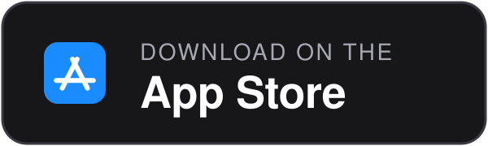
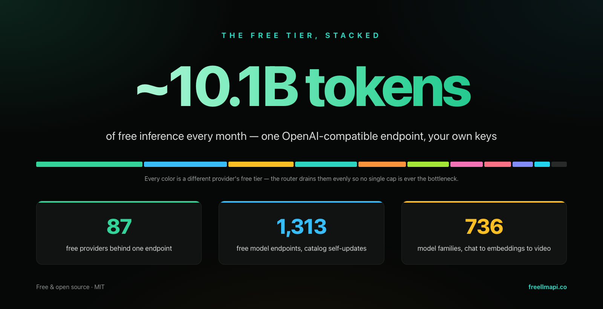
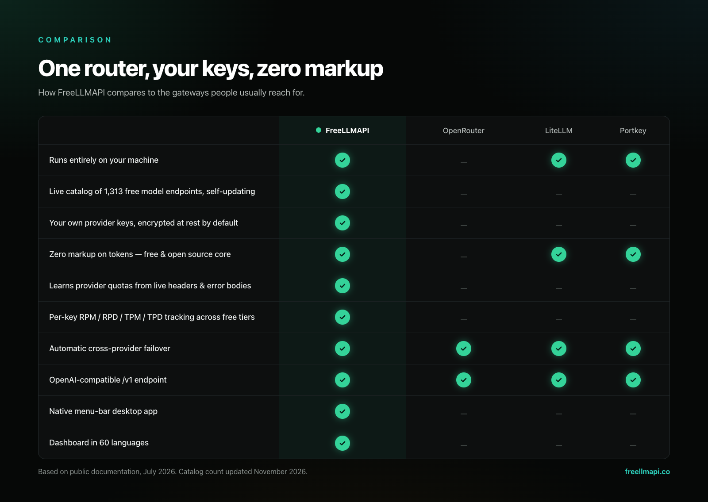
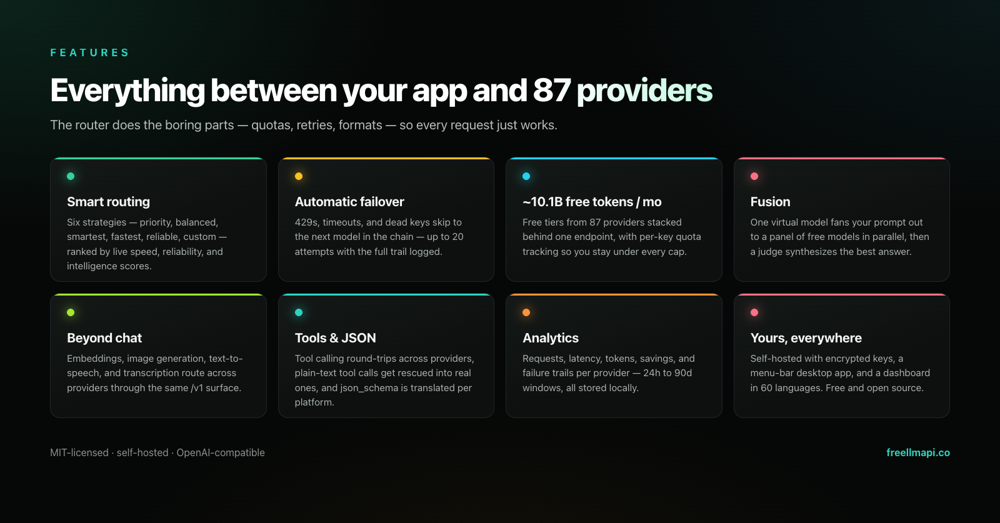
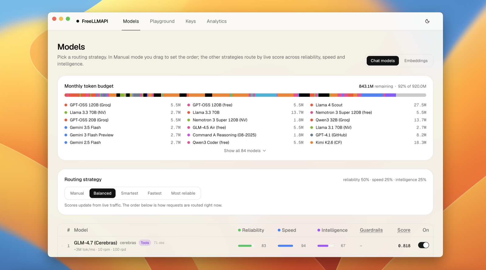
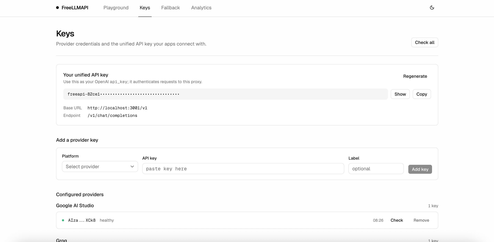
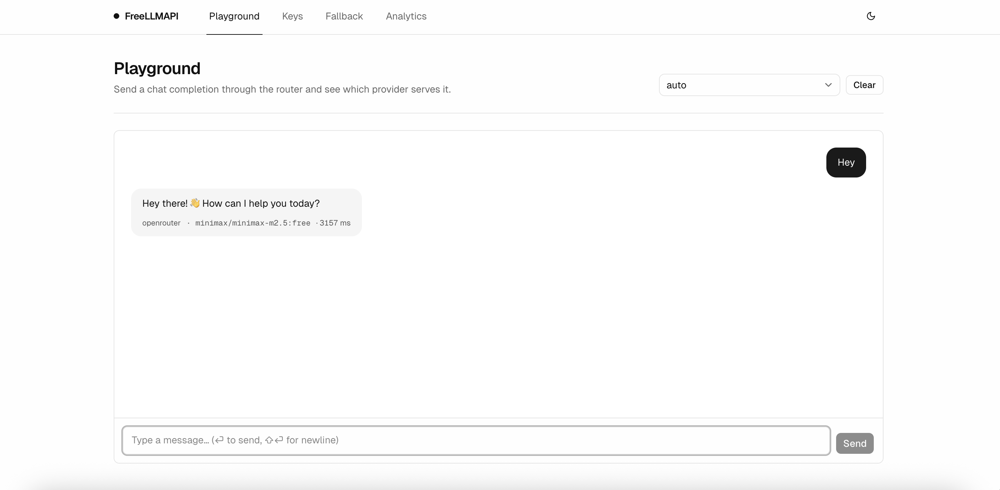
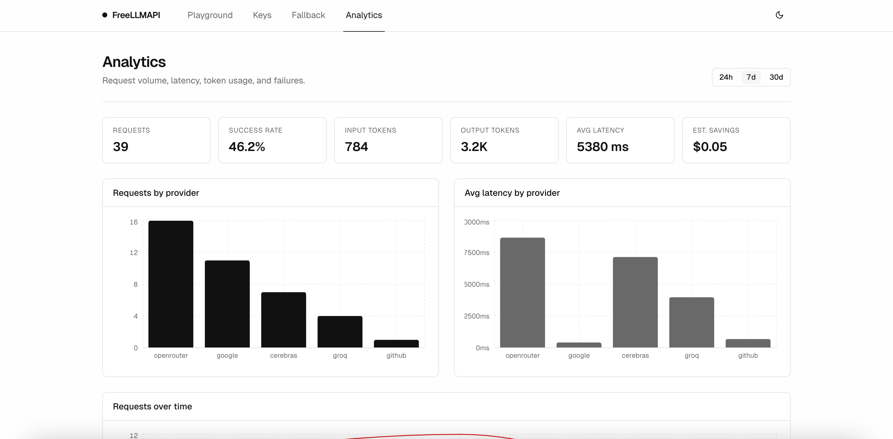
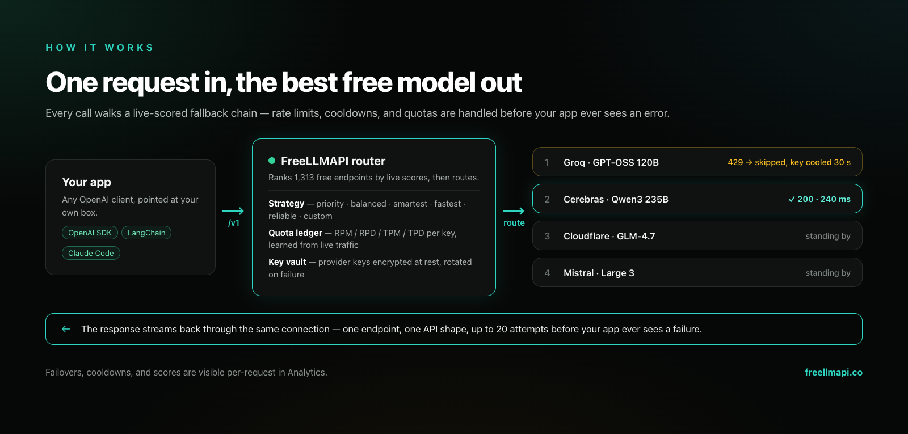

<div align="center">

# FreeLLMAPI

**10,1 tỷ token mỗi tháng. 87 nhà cung cấp LLM miễn phí. 1.313 endpoint mô hình miễn phí. Một endpoint duy nhất tương thích OpenAI.**

Gộp các gói miễn phí từ hàng chục nhà cung cấp, cùng các endpoint chat, embedding, hình ảnh và âm thanh tương thích OpenAI do bạn tự cấu hình, phía sau một API `/v1` duy nhất. Khóa được lưu trữ mã hóa. Bộ định tuyến chọn mô hình khả dụng tốt nhất cho mỗi yêu cầu, tự chuyển sang nhà cung cấp tiếp theo khi một nhà cung cấp bị giới hạn tốc độ, và theo dõi mức sử dụng theo từng khóa để bạn luôn nằm dưới mọi giới hạn của gói miễn phí.

[](https://github.com/tashfeenahmed/freellmapi/actions/workflows/ci.yml)
[](https://github.com/tashfeenahmed/freellmapi/stargazers)
[](./LICENSE)
[](#đóng-góp)
[](https://github.com/tashfeenahmed/freellmapi/pkgs/container/freellmapi)
[](https://deepwiki.com/tashfeenahmed/freellmapi)

**[freellmapi.co](https://freellmapi.co/?utm_source=github&utm_medium=readme&utm_campaign=repository&utm_content=readme_top)** · duyệt toàn bộ catalog: 736 họ mô hình, 1.313 endpoint miễn phí

[English](README.md) · [Türkçe](README.tr.md) · [简体中文](README.zh-cn.md) · [Русский](README.ru.md) · [O'zbekcha](README.uz.md) · [한국어](README.ko.md) · [日本語](README.ja.md) · **Tiếng Việt**

<p align="center">
  <a href="https://github.com/tashfeenahmed/freellmapi/releases/latest"></a>
  <a href="https://apps.microsoft.com/detail/9PBN6G8K2B7F"></a>
  <a href="docs/en/install/01-install.md#docker-compose"></a>
  <a href="https://play.google.com/store/apps/details?id=co.freellmapi.app"></a>
  <a href="https://apps.apple.com/app/id6804648934"></a>
</p>


Bộ định tuyến của bạn tự cập nhật catalog mô hình từ một nguồn cấp đã ký: mô hình miễn phí mới, thay đổi hạn mức và các bản sửa tương thích đều đến nơi mà không cần `git pull`. Bản cài đặt miễn phí nhận bản chụp hằng tháng, nên một mô hình sẽ đến tay chúng 30 ngày sau khi gia nhập nguồn cấp trực tiếp; bộ định tuyến premium nhận được ngay trong ngày.
**[Dùng bản trực tiếp tại freellmapi.co](https://freellmapi.co/?utm_source=github&utm_medium=readme&utm_campaign=premium&utm_content=readme_top#pricing)** ($19/năm, hủy bất cứ lúc nào).

</div>

---

## Mục lục

- [Vì sao dự án này tồn tại](#vì-sao-dự-án-này-tồn-tại)
- [Các nhà cung cấp được hỗ trợ](#các-nhà-cung-cấp-được-hỗ-trợ)
- [CLI và agent lập trình tương thích](#cli-và-agent-lập-trình-tương-thích)
- [So sánh với các giải pháp khác](#so-sánh-với-các-giải-pháp-khác)
- [Tính năng](#tính-năng)
- [Bắt đầu nhanh](#bắt-đầu-nhanh)
- [Ứng dụng desktop](#ứng-dụng-desktop)
- [Dùng với các client tương thích OpenAI](#dùng-với-các-client-tương-thích-openai)
- [Ngôn ngữ](#ngôn-ngữ)
- [Premium (catalog trực tiếp)](#premium-catalog-trực-tiếp)
- [Sử dụng API](#sử-dụng-api)
- [Ảnh chụp màn hình](#ảnh-chụp-màn-hình)
- [Cách hoạt động](#cách-hoạt-động)
- [Câu hỏi thường gặp](#câu-hỏi-thường-gặp)
- [Hạn chế](#hạn-chế)
- [Đóng góp](#đóng-góp)
- [Tuyên bố miễn trừ trách nhiệm](#tuyên-bố-miễn-trừ-trách-nhiệm)

**Hướng dẫn:** [Cài đặt & triển khai](docs/en/install/01-install.md) · [Tài liệu API](docs/en/api/01-rest-api.md) · [Client & agent lập trình](docs/en/clients/01-agent-clients.md) · [Nén prompt](docs/en/compression/01-compression-pipeline.md) · [Kiến trúc & cơ chế bên trong](docs/en/architecture/00-high-level-index.md) · [Mục lục tài liệu](docs/en/README.md) · [Hướng dẫn đóng góp](CONTRIBUTING.md)

## Vì sao dự án này tồn tại

Mọi phòng lab AI nghiêm túc hiện nay đều có một gói miễn phí: vài triệu token mỗi tháng, vài nghìn yêu cầu mỗi ngày. Đứng riêng lẻ, mỗi gói chỉ như món đồ chơi. Nhưng gộp tất cả lại, chúng cộng dồn thành khoảng **10,1 tỷ token mỗi tháng** năng lực suy luận thực sự dùng được, trải trên **736 họ mô hình / 1.313 endpoint nhà cung cấp**, từ nhỏ-và-nhanh đến khá mạnh.

Vấn đề là gộp chúng bằng tay rất cực: tám mươi bảy SDK khác nhau, tám mươi bảy giới hạn tốc độ khác nhau, tám mươi bảy nơi một yêu cầu có thể hỏng. FreeLLMAPI nén tất cả thành một endpoint tương thích OpenAI duy nhất. Chỉ cần trỏ bất kỳ thư viện client OpenAI nào vào máy chủ local của bạn, và nó sẽ định tuyến trong suốt qua mọi nhà cung cấp bạn đã thêm khóa.

Và bức tranh gói miễn phí thay đổi hằng tuần: nhà cung cấp ra mắt mô hình, khai tử chúng và thay đổi hạn mức mà không báo trước. FreeLLMAPI theo dõi tất cả thay bạn. Bộ định tuyến tự kéo một catalog mô hình đã ký từ [freellmapi.co](https://freellmapi.co), nên bản cài đặt của bạn luôn cập nhật mà không cần `git pull`. Xem [Premium (catalog trực tiếp)](#premium-catalog-trực-tiếp) để biết nó theo kịp nhanh đến đâu.



## Các nhà cung cấp được hỗ trợ

<div align="center">
<table>
<tr>
<td align="center" width="150"><br/><b>Google</b></td>
<td align="center" width="150"><picture><source media="(prefers-color-scheme: dark)" srcset="repo-assets/providers/groq-dark.png"></picture><br/><b>Groq</b></td>
<td align="center" width="150"><br/><b>Cerebras</b></td>
<td align="center" width="150"><picture><source media="(prefers-color-scheme: dark)" srcset="repo-assets/providers/opencode-dark.png"></picture><br/><b>OpenCode Zen</b></td>
</tr>
<tr>
<td align="center"><br/><b>Mistral</b></td>
<td align="center"><br/><b>OpenRouter</b></td>
<td align="center"><br/><b>Cloudflare</b></td>
<td align="center"><br/><b>Cohere</b></td>
</tr>
<tr>
<td align="center"><br/><b>Z.ai (Zhipu)</b></td>
<td align="center"><br/><b>NVIDIA</b></td>
<td align="center"><br/><b>HuggingFace</b></td>
</tr>
<tr>
<td align="center"><a href="https://modelscope.cn"><b>ModelScope</b><br/>Qwen3 · DeepSeek V4 · GLM-5 (needs Aliyun cn binding)</a></td>
</tr>
</table>

<i>… và 75 nhà cung cấp miễn phí nữa</i>

</div>

Cộng thêm một nhà cung cấp **tùy chỉnh** — trỏ các mô hình chat, embedding, hình ảnh hoặc âm thanh vào bất kỳ endpoint tương thích OpenAI nào (llama.cpp, LM Studio, vLLM, một Ollama local, hoặc một gateway từ xa) ngay từ trang Keys.

Danh sách đầy đủ, luôn cập nhật, nằm tại **[freellmapi.co/models](https://freellmapi.co/models.html)** kèm giới hạn tốc độ, cửa sổ ngữ cảnh và ngân sách token miễn phí cho từng mô hình.

## CLI và agent lập trình tương thích

<div align="center">
<table>
<tr>
<td align="center" width="150"><br/><b>Claude Code</b></td>
<td align="center" width="150"><br/><b>Codex CLI</b></td>
<td align="center" width="150"><br/><b>Gemini CLI</b></td>
<td align="center" width="150"><br/><b>Cursor</b></td>
</tr>
<tr>
<td align="center"><br/><b>Cline</b></td>
<td align="center"><br/><b>Roo Code</b></td>
<td align="center"><br/><b>OpenCode</b></td>
<td align="center"><br/><b>Aider</b></td>
</tr>
</table>

<i>… cùng Continue, Goose, Qwen Code, Kilo Code, Crush, Zed, JetBrains AI, DeepSeek Harness, MiMo Code, AtomCode, OpenClaw, Hermes Agent, Pi, Reasonix, ZCode và mọi client tương thích OpenAI, Anthropic, Gemini hoặc Ollama</i>

</div>

Hầu hết các agent tự cấu hình chỉ bằng một lệnh duy nhất: lệnh này đọc catalog trực tiếp của bạn, sao lưu cấu hình hiện có và gộp vào đó:

```bash
npx freellmapi setup-claude --url http://localhost:3001 --api-key <unified-key>
```

**[Tất cả agent được hỗ trợ và lệnh thiết lập của chúng →](docs/en/clients/02-supported-agents.md)** · [Công thức theo từng công cụ, máy chủ MCP và token URL →](docs/en/clients/01-agent-clients.md)

## So sánh với các giải pháp khác



Dựa trên tài liệu công khai, tháng 7/2026 — hoan nghênh mọi góp ý sửa sai.

## Tính năng



- **Mọi bề mặt kiểu OpenAI** — `/v1/chat/completions`, `/v1/responses` (thứ Codex CLI cần), `/v1/completions` (tự hoàn thành ghost-text trong editor), `/v1/images/generations`, `/v1/videos/generations`, `/v1/audio/speech`, `/v1/audio/transcriptions`, `/v1/embeddings` và `/v1/models` — cả streaming lẫn non-streaming, từ SDK chính thức hoặc bất kỳ client tương thích OpenAI nào. [Tài liệu API →](docs/en/api/01-rest-api.md)
- **Anthropic Messages API** — `/v1/messages` nói đúng định dạng wire của Anthropic trên cùng một bộ định tuyến, nên **Claude Code** và các SDK Anthropic chính thức chạy được trên kho miễn phí của bạn. [Chi tiết →](docs/en/api/01-rest-api.md#anthropic--claude-clients)
- **Bề mặt Gemini + Ollama nguyên bản** — Gemini CLI dùng được `/v1beta` (`generateContent`, streaming, đếm token, models), trong khi giả lập Ollama (bật tùy chọn) phục vụ chat/generate dạng NDJSON, tags, metadata và embeddings cho Zed, JetBrains và các client mô hình local khác.
- **Fusion (tổng hợp đa mô hình)** — yêu cầu mô hình ảo `fusion` và bộ định tuyến sẽ tỏa prompt của bạn song song tới một hội đồng các mô hình miễn phí đa dạng, rồi một mô hình giám khảo tổng hợp thành một đáp án duy nhất từ các bản nháp. [Chi tiết →](docs/en/api/01-rest-api.md#fusion-multi-model-synthesis)
- **Tạo hình ảnh, video & giọng nói** — `/v1/images/generations`, `/v1/videos/generations` và `/v1/audio/speech` định tuyến qua các nhà cung cấp phục vụ mô hình media; hình ảnh và giọng nói còn chấp nhận endpoint media tương thích OpenAI tùy chỉnh. Các job video được chuẩn hóa giữa nhà cung cấp đồng bộ và nhà cung cấp xếp hàng, và trả về một file MP4 hoàn chỉnh.
- **Gọi công cụ & đầu ra có cấu trúc** — `tools` kiểu OpenAI đi vòng qua các nhà cung cấp (các lời gọi công cụ dạng văn bản thuần được cứu thành `tool_calls` thật), cộng thêm `response_format`, `seed`, `logprobs`, các mức phạt và phần còn lại của tham số sampling được chuyển tiếp theo từng nhà cung cấp.
- **Định tuyến thông minh, sáu chiến lược** — điểm tốc độ/năng lực/độ tin cậy trực tiếp của từng mô hình xếp hạng chuỗi của bạn; cơ chế fallover tự động thử lại mô hình tiếp theo khi gặp 429/5xx, kèm thời gian chờ nguội và luân chuyển khóa. [Định tuyến chi tiết →](docs/en/architecture/00-high-level-index.md#how-it-works)
- **Mô hình & hồ sơ hợp nhất** — cùng một mô hình trên nhiều nhà cung cấp được gộp thành một mục duy nhất với failover nghiêm ngặt trong nhóm; các hồ sơ chuỗi dự phòng có tên (một chuỗi cho lập trình, một chuỗi cho thị giác) chuyển đổi được từ bảng điều khiển hoặc theo từng yêu cầu qua `auto:<profile>`, và các chuỗi tùy chỉnh đổi tên tại chỗ được ngay trong trình quản lý chuỗi.
- **Theo dõi tốc độ theo từng khóa** — bộ đếm RPM/RPD/TPM/TPD theo từng `(platform, model, key)` tự học các trần mà nhà cung cấp công bố, nên việc định tuyến luôn nằm dưới mọi giới hạn.
- **Catalog mô hình tự cập nhật** — bộ định tuyến đồng bộ một catalog đã ký từ freellmapi.co hai lần mỗi ngày: mô hình mới, thay đổi hạn mức và bản sửa các điểm kỳ quặc của nhà cung cấp đều tự động đến nơi. Bản cài đặt miễn phí theo bản chụp hằng tháng, nơi mỗi mô hình gia nhập 30 ngày sau khi vào nguồn cấp trực tiếp; bộ định tuyến premium nhận ngay trong ngày. [Premium →](#premium-catalog-trực-tiếp)
- **Phiên dính & bàn giao ngữ cảnh** — cuộc hội thoại ở yên trên một mô hình trong 30 phút; một ghi chú bàn giao gọn nhẹ tùy chọn giữ mạch hội thoại liền lạc khi buộc phải đổi mô hình giữa chừng. [Chi tiết →](docs/en/clients/01-agent-clients.md#context-handoff)
- **Nén prompt (tùy chọn bật)** — một pipeline yêu cầu dùng chung, fail-open, có thể khử trùng lặp prompt, lọc đầu ra của công cụ, nén JSON lặp lại và cắt ngữ cảnh cũ trước khi tra cache và định tuyến. [Chi tiết →](docs/en/compression/01-compression-pipeline.md)
- **Khóa mã hóa, một token duy nhất ra ngoài** — khóa nhà cung cấp được mã hóa AES-256-GCM trong SQLite và giải mã trong bộ nhớ theo từng yêu cầu; ứng dụng của bạn chỉ bao giờ thấy một bearer token hợp nhất duy nhất dạng `freellmapi-…`.
- **Bảng điều khiển quản trị & phân tích** — giao diện React để quản lý khóa, sắp xếp lại chuỗi, chạy playground, và đọc số liệu phân tích p50/p95/TTFT trên các cửa sổ 24 giờ–90 ngày; có cổng đăng nhập, theme tối/sáng, [60 ngôn ngữ](#ngôn-ngữ).
- **Máy chủ MCP sẵn sàng cho ChatGPT & tài liệu tương tác** — ChatGPT và các client MCP khác có thể gọi suy luận của FreeLLMAPI, liệt kê mô hình dùng được, kiểm tra sức khỏe/mức dùng/cache/metadata định tuyến của nhà cung cấp, và quản lý chiến lược định tuyến qua `/mcp`; một trình xem OpenAPI không phụ thuộc thư viện nằm tại `/v1/docs`. [ChatGPT và agent lập trình →](docs/en/clients/01-agent-clients.md#mcp-server)
- **Tiện ích vận hành** — cache phản hồi tùy chọn bật, sao lưu DB mã hóa, kiểm tra sức khỏe khóa định kỳ, nhập/xuất khóa hàng loạt, cấu hình khởi động khai báo. [Cài đặt & triển khai →](docs/en/install/01-install.md)
- **Chạy ở mọi nơi Node 20+ chạy** — Windows, macOS, máy chủ Linux, hoặc một SBC ARM nhỏ (kể cả Raspberry Pi). ~40 MB RSS khi nhàn rỗi phía sau PM2 / systemd / bất kỳ trình giám sát nào bạn thích.

Phạm vi được giữ hẹp có chủ đích — xem [những gì chưa được hỗ trợ](docs/en/architecture/00-high-level-index.md#not-yet-supported).

## Bắt đầu nhanh

**Một dòng lệnh** (cần Docker — thiết lập `~/freellmapi`, tạo khóa mã hóa, kéo image và khởi động container):

```bash
curl -fsSL https://freellmapi.co/install.sh | bash
```

Muốn đọc trước khi pipe vào bash? [Script nằm ở đây](https://freellmapi.co/install.sh). Chạy lại nó là an toàn: `.env` của bạn (và khóa mã hóa) được giữ nguyên và container cập nhật lên `:latest`.

Mở http://localhost:3001, thêm khóa nhà cung cấp của bạn ở trang **Keys**, sắp xếp lại **Fallback Chain** theo ý thích, và lấy khóa API hợp nhất của bạn ở phần đầu trang **Keys**. Khóa hợp nhất đó chính là thứ bạn trỏ OpenAI SDK của mình vào.

Trên Windows, đường dễ nhất là ứng dụng desktop từ **[Microsoft Store](https://apps.microsoft.com/detail/9PBN6G8K2B7F)**: nó đã được ký (nên Smart App Control cho phép chạy) và tự cập nhật. Bộ cài `.exe` trên [Releases](https://github.com/tashfeenahmed/freellmapi/releases/latest) là cùng một ứng dụng, bản chưa ký (xem bên dưới). Trên Android, xem [hướng dẫn Termux](docs/en/install/02-android-termux.md) đang thử nghiệm.

Mọi thứ còn lại — Docker Compose, phát triển local, cấu hình khởi động khai báo, bản build production, truy cập LAN và sao lưu — nằm trong **[docs/en/install/01-install.md](docs/en/install/01-install.md)**.

## Ứng dụng desktop

Một ứng dụng menu-bar nguyên bản nằm trong [`desktop/`](./desktop): toàn bộ bộ định tuyến + bảng điều khiển chạy local ngay từ khay hệ thống của bạn, với một popover kính hiển thị thống kê yêu cầu trực tiếp.



**[Tải từ Releases](https://github.com/tashfeenahmed/freellmapi/releases/latest)** — file `.dmg` cho macOS và bộ cài `.exe` cho Windows được đính kèm trong mọi bản phát hành. Trên Windows, hãy ưu tiên bản **[Microsoft Store](https://apps.microsoft.com/detail/9PBN6G8K2B7F)**: nó đã được ký nên Smart App Control không chặn, và Store giữ nó luôn cập nhật. Không cần tài khoản hay mật khẩu để thiết lập: thông tin xác thực duy nhất bạn cần là khóa API hợp nhất từ popover trên khay. Các bước build từ mã nguồn và nơi dữ liệu của bạn nằm: [docs/en/install/01-install.md#desktop-app](docs/en/install/01-install.md#desktop-app).

Với macOS 12 Monterey trở lên, chọn **arm64 (Apple Silicon)** hoặc **x64 (Intel)**. Cả hai bản build Mac đều có kèm bản tải ZIP.

## Dùng với các client tương thích OpenAI

Bất cứ thứ gì trỏ được vào một base URL tương thích OpenAI đều dùng được: đặt nó thành `http://localhost:3001/v1` cùng khóa hợp nhất từ bảng điều khiển. Mọi trình tạo đều hỗ trợ `--dry-run`; `npx freellmapi launch` (Claude Code) và `launch-codex` (Codex) giữ thông tin xác thực hoàn toàn ngoài các file cấu hình. Bộ định tuyến đồng thời là một máy chủ MCP để các agent của bạn có thể nội soi ngay giữa phiên.

**ChatGPT** kết nối tới cùng bộ định tuyến local này qua một Secure MCP Tunnel riêng tư. Công cụ MCP
`ask_freellmapi` định tuyến một tác vụ do ChatGPT yêu cầu qua `/v1/chat/completions` và
trả về đáp án kèm metadata về mô hình đã phục vụ, fallback, cache, thực thi và token. Base
URL và xác thực bearer nằm trong cấu hình tunnel-client; mô hình mặc định được đặt bằng
`MCP_INFERENCE_DEFAULT_MODEL` (`auto` khi không đặt). Không khóa nào được phép nằm trong Git hay trong
URL của MCP. **[Thiết lập ChatGPT →](docs/en/clients/01-agent-clients.md#chatgpt-private-secure-mcp-tunnel)**

Khóa nhà cung cấp cũng quản lý được từ terminal, bằng token phiên của bảng điều khiển (`FREELLMAPI_DASHBOARD_TOKEN` hoặc `--token`): `npx freellmapi keys add|list|remove|test <platform>`, trong đó `keys test` kiểm tra lại các khóa đã lưu. Xem [cli/README.md](cli/README.md#provider-keys).

FreeLLMAPI được thiết kế local-first và đơn người dùng. Khóa nhà cung cấp của bạn ở yên trong cơ sở dữ liệu SQLite của bạn, mã hóa khi lưu trữ, và các yêu cầu đi từ máy của bạn tới các nhà cung cấp upstream bạn đã bật.

## Ngôn ngữ

Bảng điều khiển có sẵn **60 ngôn ngữ** (menu khay của desktop có 6). Giao diện
tự phát hiện ngôn ngữ trình duyệt/hệ thống của bạn ở lần tải đầu tiên và bạn có thể chuyển bất cứ
lúc nào từ **⋯ → Settings**; lựa chọn sẽ được ghi nhớ. Các ngôn ngữ viết từ phải sang trái
(العربية, עברית, فارسی, اردو) tự động lật toàn bộ bố cục, và chỉ từ điển của
ngôn ngữ đang dùng mới được tải — phần còn lại không bao giờ chạm vào băng thông của bạn.

                                                 

Danh sách đầy đủ các locale nằm trong
[`client/src/i18n/locale-config.ts`](./client/src/i18n/locale-config.ts).

Sáu locale gốc được người thật rà soát; các locale mới hơn được dịch máy
và sẽ tốt dần lên khi người bản ngữ gửi bản sửa — một PR chỉ sửa một chuỗi cũng là
một đóng góp đầu tiên tuyệt vời.

Bản dịch nằm trong [`client/src/i18n/locales/`](./client/src/i18n/locales) dưới dạng
các file JSON phẳng. Để sửa một chuỗi, hãy sửa giá trị trong file JSON của locale đó. Để
thêm một ngôn ngữ, hãy sao chép `en.json`, dịch các giá trị, và đăng ký locale trong
`client/src/i18n/locale-config.ts` (và `desktop/src/i18n.ts` cho các chuỗi trên khay);
`npm test` kiểm tra mọi locale về tính tương đương khóa/placeholder — hoan nghênh các PR.

## Premium (catalog trực tiếp)

Bộ định tuyến tự giữ catalog mô hình của nó luôn mới: nó kéo một catalog đã ký
từ [freellmapi.co](https://freellmapi.co) hai lần mỗi ngày và áp dụng mô hình mới,
thay đổi hạn mức, và các bản sửa điểm kỳ quặc của nhà cung cấp vào DB local của bạn. Các lựa chọn
bật/tắt của riêng bạn và các nhà cung cấp tùy chỉnh không bao giờ bị đụng tới, và mọi
bản tải xuống đều được kiểm chứng với một khóa Ed25519 đã ghim trước khi áp dụng.

Catalog hiện theo dõi **87 nhà cung cấp**, **736 họ mô hình**, **1.313
endpoint nhà cung cấp/mô hình miễn phí** (1.137 chat, 29 hình ảnh, 41 âm thanh, 68 embeddings,
19 chuyển ghi, 6 video, 13 quyết định), và khoảng **10,1 tỷ token mỗi
tháng** năng lực gói miễn phí được liệt kê. Duyệt toàn bộ tại
**[freellmapi.co/models](https://freellmapi.co/models.html)**.

Bản cài đặt miễn phí kéo cùng catalog đã ký đó, nhưng từ bản chụp hằng tháng: một
mô hình gia nhập nó 30 ngày sau khi vào nguồn cấp trực tiếp, nên bản build miễn phí
hiện chậm hơn khoảng 303 mô hình. Không có gì hết hạn và không có gì bị
cắt xén — nó chỉ đến muộn hơn.

Premium giữ catalog đã ký đó luôn trực tiếp trên mọi bộ định tuyến bạn chạy. Khi một nhà cung cấp
ra mắt một mô hình miễn phí mạnh, âm thầm siết hạn mức, hoặc phá vỡ một định dạng wire,
các bộ định tuyến dùng nguồn cấp trực tiếp sẽ nhận bản cập nhật ngay trong ngày chúng tôi phát hành.

**[Dùng bản trực tiếp tại freellmapi.co →](https://freellmapi.co/?utm_source=github&utm_medium=readme&utm_campaign=premium&utm_content=readme_bottom#pricing)**

- $19/năm hoặc $49 một lần, trọn đời. Thanh toán qua Stripe; hủy bất cứ lúc nào, tự phục vụ.
- Một khóa `fla_` bao phủ mọi bộ định tuyến bạn chạy: desktop, homelab, Raspberry Pi.
- Kích hoạt trong bảng điều khiển tại mục **Premium**; hủy hoặc quản lý thanh toán
  tự phục vụ tại [freellmapi.co/manage](https://freellmapi.co/manage).
- Bản thân bộ định tuyến vẫn mang giấy phép MIT và hoàn toàn miễn phí, mãi mãi. Premium chỉ là
  nguồn cấp trực tiếp, và nó là thứ tài trợ cho việc kiểm thử mô hình hằng ngày cùng công tác bảo trì catalog
  giúp catalog luôn hoạt động.

Máy chủ catalog không bao giờ thấy prompt, completion hay khóa nhà cung cấp của bạn — bộ
định tuyến vẫn hoàn toàn tự host theo cả hai cách.

## Sử dụng API

```python
from openai import OpenAI

client = OpenAI(
    base_url="http://localhost:3001/v1",
    api_key="freellmapi-your-unified-key",
)

response = client.chat.completions.with_raw_response.create(
    model="auto",  # let the router pick; or "auto:fast", "auto:smart", a profile, or a model id
    messages=[{"role": "user", "content": "Summarise the fall of Rome in one sentence."}],
)
completion = response.parse()
print(completion.choices[0].message.content)
print("Routed via:", response.headers.get("x-routed-via"))
```

Streaming, các chiến lược định tuyến `auto:*`, gọi công cụ, đầu vào thị giác, grounding bằng Google Search của Gemini, embeddings, và bề mặt Anthropic Messages — kèm ví dụ curl và Python cho từng mục — tất cả nằm trong **[docs/en/api/01-rest-api.md](docs/en/api/01-rest-api.md)**. Mọi phản hồi đều mang header `X-Routed-Via: <platform>/<model>` để bạn thấy nhà cung cấp nào thực sự đã phục vụ nó.

## Ảnh chụp màn hình

### Mô hình

Chọn một chiến lược định tuyến và xem ngân sách token hằng tháng đầy dần trên toàn bộ đội ngũ nhà cung cấp. Mỗi mô hình hiển thị điểm độ tin cậy, tốc độ và trí tuệ trực tiếp — thứ tự dưới đây là cách các yêu cầu đang được định tuyến ngay lúc này.


### Khóa

Quản lý thông tin xác thực của nhà cung cấp và lấy khóa API hợp nhất mà ứng dụng của bạn kết nối bằng nó. Mỗi khóa hiển thị một chấm trạng thái và thời điểm nó được kiểm tra sức khỏe gần nhất.



### Playground

Gửi một chat completion qua bộ định tuyến và xem nhà cung cấp nào đã phục vụ nó, với ID mô hình và độ trễ in ngay trên tin nhắn. Đính kèm file bằng nút bấm, kéo-thả, hoặc dán: hình ảnh (PNG/JPEG/WebP/GIF) được thu nhỏ trong trình duyệt và gửi dưới dạng phần nội dung hình ảnh tới một mô hình có khả năng thị giác, còn file văn bản (TXT/MD/CSV/JSON/LOG) được nhúng thẳng vào prompt dưới dạng khối fenced.



### Thống kê phân tích

Khối lượng yêu cầu, tỉ lệ thành công, token vào và ra, độ trễ trung bình, và số liệu tách theo từng nhà cung cấp trên các cửa sổ 24 giờ / 7 ngày / 30 ngày / 90 ngày.



## Cách hoạt động



Một yêu cầu vào, mô hình miễn phí tốt nhất ra: bộ định tuyến chọn mô hình ưu tiên cao nhất có khóa khỏe mạnh và đang nằm dưới mọi giới hạn tốc độ của nó, giải mã khóa trong bộ nhớ, và gọi nhà cung cấp — khi gặp 429/5xx, nó cho khóa đó chờ nguội và thử lại mô hình tiếp theo trong chuỗi của bạn. Phần dẫn qua từng thành phần, cơ chế định tuyến bên trong và chi tiết vận hành nằm trong **[docs/en/architecture/00-high-level-index.md](docs/en/architecture/00-high-level-index.md)**.

## Câu hỏi thường gặp

**Tôi có cần mật khẩu không?** Không cần với ứng dụng desktop — bảng điều khiển tự đăng nhập bằng một tài khoản local ẩn, nên không có gì phải thiết lập và không có gì để quên. Mở nó từ biểu tượng trên khay → **Open Dashboard**, hoặc trong bất kỳ trình duyệt nào trên cùng máy tính (ví dụ http://127.0.0.1:31415); cả hai đều tự đăng nhập. Một thiết bị khác truy cập ứng dụng qua LAN vẫn sẽ thấy biểu mẫu đăng nhập. Bản cài đặt máy chủ (Docker, một dòng lệnh, `npm run dev`) thì có tài khoản email + mật khẩu.

**Tôi quên mật khẩu trên một bản cài đặt máy chủ.** Nhấn **Forgot password?** ở trang đăng nhập. Không có email nào để gửi liên kết tới, nên mã dùng một lần được in ra log của máy chủ — đọc nó bằng `docker compose logs -f freellmapi` (hoặc trong terminal đang chạy máy chủ, hoặc trong file log của desktop), rồi nhập vào biểu mẫu đặt lại. Mã có hiệu lực 15 phút.

**Log nằm ở đâu?** Trong log container đối với Docker, trong terminal đối với bản chạy từ mã nguồn, và trong `<data dir>/logs/freeapi.log` đối với ứng dụng desktop — tới được từ mục **Open Logs Folder** trong menu khay.

**Làm sao để gỡ cài đặt?** Xóa ứng dụng (Trash trên macOS, *Settings → Apps* trên Windows, `docker compose down -v` đối với Docker), rồi xóa thư mục dữ liệu: `%APPDATA%\FreeLLMAPI\`, `~/Library/Application Support/FreeLLMAPI/`, hoặc `~/.config/FreeLLMAPI/`. Việc gỡ cài đặt không bao giờ tự đụng vào thư mục đó.

Câu trả lời dài hơn, theo từng phương thức cài đặt: **[docs/en/install/01-install.md#faq-passwords-logs-uninstall](docs/en/install/01-install.md#faq-passwords-logs-uninstall)**.

## Hạn chế

Gộp các gói miễn phí có những đánh đổi thật: không có mô hình tiên phong (frontier), độ trễ thất thường, không có SLA — và trí tuệ hiệu dụng của endpoint giảm dần về cuối ngày khi các mô hình hàng đầu chạm trần hằng ngày của chúng, rồi đặt lại vào nửa đêm UTC. Hãy đọc danh sách trung thực trong **[docs/en/architecture/00-high-level-index.md#limitations](docs/en/architecture/00-high-level-index.md#limitations)** trước khi xây bất cứ thứ gì nghiêm túc trên nền tảng này.

## Đóng góp

Rất hoan nghênh người đóng góp! Xem [CONTRIBUTING.md](CONTRIBUTING.md) để biết vòng lặp phát triển, kỳ vọng với PR, và chính sách về đóng góp có hỗ trợ của AI/LLM (bản ngắn: hoan nghênh, cùng một thước đo chất lượng như mọi PR khác). Các PR đầu tiên tốt:

- **Thêm một nhà cung cấp** — sao chép `server/src/providers/openai-compat.ts` làm mẫu, nối nó vào `server/src/providers/index.ts`, gieo dữ liệu mô hình của nó trong `server/src/db/index.ts`, thêm một test trong `server/src/__tests__/providers/`.
- **Thêm một endpoint** — các bề mặt tương thích OpenAI khác (ví dụ `/v1/realtime`). Lớp cơ sở của nhà cung cấp có thể mọc thêm phương thức mới; các adapter khai báo chúng hỗ trợ những gì.
- **Cải thiện bộ định tuyến** — định tuyến có ý thức về chi phí (cân bằng rẻ nhất-khỏe nhất-nhanh nhất), ưu tiên theo trọng số độ trễ tốt hơn, ghim theo khu vực.
- **Đánh bóng bảng điều khiển** — biểu đồ trên trang Analytics, trải nghiệm luân chuyển khóa, nhập khóa hàng loạt từ `.env`.
- **Tài liệu** — thêm ví dụ, đoạn mã thư viện client cho Go/Rust/v.v., một công thức triển khai cho Docker hoặc Fly.

`npm install && npm run dev` cho bạn máy chủ trên :3001 và bảng điều khiển trên :5173, cả hai đều có HMR. Để có một thiết lập lặp lại được, dùng `./scripts/dev-bootstrap.sh` trên Bash hoặc `.\scripts\dev-bootstrap.ps1` trên PowerShell; cả hai đều giữ nguyên `.env` hiện có. PR nên kèm một test, giữ bộ test hiện tại xanh (`npm test`), và khớp với các mặc định `.editorconfig` / tsconfig đã có trong repo. Quy trình migration cơ sở dữ liệu và toàn bộ vòng lặp đóng góp nằm trong [CONTRIBUTING.md](./CONTRIBUTING.md).

### Những người đóng góp

Cảm ơn [@mamehi](https://github.com/mamehi) đã dịch [README sang tiếng Hàn](README.ko.md), và [@eltociear](https://github.com/eltociear) đã dịch nó [sang tiếng Nhật](README.ja.md).

<a href="https://github.com/moaaz12-web"></a>
<a href="https://github.com/AdityaxDeore"></a>
<a href="https://github.com/lukasulc"></a>
<a href="https://github.com/VinhPhamAI"></a>
<a href="https://github.com/deadc"></a>
<a href="https://github.com/zhangyu1324"></a>
<a href="https://github.com/kentpan"></a>
<a href="https://github.com/stephenzwj"></a>
<a href="https://github.com/chongjiazhen"></a>
<a href="https://github.com/vjsai"></a>
<a href="https://github.com/long2ice"></a>
<a href="https://github.com/sadesguy"></a>
<a href="https://github.com/hodlmybeer69-bit"></a>
<a href="https://github.com/phoenixikkifullstack"></a>
<a href="https://github.com/jtbrennan-git"></a>
<a href="https://github.com/praveenkumarpranjal"></a>
<a href="https://github.com/nordbyte"></a>
<a href="https://github.com/mybropro"></a>
<a href="https://github.com/danscMax"></a>
<a href="https://github.com/jhash"></a>
<a href="https://github.com/JammyJames1234"></a>
<a href="https://github.com/coffcoe"></a>
<a href="https://github.com/Sumit4codes"></a>
<a href="https://github.com/meliani"></a>
<a href="https://github.com/thedavidweng"></a>
<a href="https://github.com/bharvey42"></a>
<a href="https://github.com/yuvrxj-afk"></a>
<a href="https://github.com/v0rtex1223"></a>
<a href="https://github.com/nicyoong"></a>
<a href="https://github.com/Aldo-f"></a>
<a href="https://github.com/Tazrif-Raim"></a>
<a href="https://github.com/m1nuzz"></a>
<a href="https://github.com/suantea"></a>
<a href="https://github.com/OhOkThisIsFine"></a>
<a href="https://github.com/LoneRifle"></a>
<a href="https://github.com/ita333"></a>
<a href="https://github.com/barbotkonv"></a>
<a href="https://github.com/Naster17"></a>
<a href="https://github.com/StealthTensor"></a>
<a href="https://github.com/EmranAhmed"></a>
<a href="https://github.com/itsfuad"></a>
<a href="https://github.com/RobinHoodO"></a>
<a href="https://github.com/hmm183"></a>
<a href="https://github.com/duemilionidieuro-bot"></a>
<a href="https://github.com/cagedbird043"></a>
<a href="https://github.com/jasnoorgill"></a>
<a href="https://github.com/Joey9024"></a>
<a href="https://github.com/AskingConical"></a>
<a href="https://github.com/ProAlit"></a>
<a href="https://github.com/hjhhoni"></a>
<a href="https://github.com/immanuelsavio"></a>
<a href="https://github.com/Slyker"></a>
<a href="https://github.com/wells1013"></a>
<a href="https://github.com/evgkrsk"></a>
<a href="https://github.com/aaronjmars"></a>
<a href="https://github.com/Robs87"></a>
<a href="https://github.com/dashitongzhi"></a>
<a href="https://github.com/QingJ01"></a>
<a href="https://github.com/3215"></a>
<a href="https://github.com/saifulaiub123"></a>
<a href="https://github.com/PietFourie"></a>
<a href="https://github.com/mhmdkrmabd"></a>
<a href="https://github.com/DemeulemeesterxMaxime"></a>
<a href="https://github.com/HoodBlah"></a>
<a href="https://github.com/SeanPedersen"></a>
<a href="https://github.com/andersmmg"></a>
<a href="https://github.com/chirag127"></a>
<a href="https://github.com/allababbot"></a>
<a href="https://github.com/johan-droid"></a>
<a href="https://github.com/redenfire"></a>
<a href="https://github.com/itzpingcat"></a>
<a href="https://github.com/kairwang01"></a>
<a href="https://github.com/gongjurenzhangwei"></a>
<a href="https://github.com/jsonring"></a>
<a href="https://github.com/1029734570"></a>
<a href="https://github.com/86TheCactus"></a>
<a href="https://github.com/AmiroKD"></a>
<a href="https://github.com/ecryptomillionaire-dev"></a>
<a href="https://github.com/4riful"></a>
<a href="https://github.com/fix2015"></a>
<a href="https://github.com/iisyw"></a>
<a href="https://github.com/xsfhacg"></a>
<a href="https://github.com/noobix"></a>
<a href="https://github.com/nandukmelath"></a>
<a href="https://github.com/NirvanaCh7"></a>
<a href="https://github.com/Mohamed3nan"></a>
<a href="https://github.com/Arman-Espiar"></a>
<a href="https://github.com/MetaMysteries8"></a>
<a href="https://github.com/lujun880726"></a>
<a href="https://github.com/qq97693453"></a>
<a href="https://github.com/emv33"></a>
<a href="https://github.com/ousamabenyounes"></a>
<a href="https://github.com/yfdyh000"></a>
<a href="https://github.com/s-uryansh"></a>
<a href="https://github.com/arsalanyavari"></a>
<a href="https://github.com/RoboMWM"></a>
<a href="https://github.com/gaurang-py"></a>
<a href="https://github.com/ddy4633"></a>
<a href="https://github.com/UrbsKali"></a>
<a href="https://github.com/hb-0"></a>
<a href="https://github.com/xyblue135"></a>
<a href="https://github.com/Icesenator"></a>
<a href="https://github.com/ZER0-auto"></a>
<a href="https://github.com/tashdroid"></a>
<a href="https://github.com/Patrickleondev"></a>
<a href="https://github.com/hiiamwaffledev"></a>
<a href="https://github.com/w0fv1"></a>
<a href="https://github.com/oppih"></a>
<a href="https://github.com/n3dhir"></a>
<a href="https://github.com/ksp2000"></a>
<a href="https://github.com/quabynahdavis"></a>
<a href="https://github.com/qinghuanandejiangshi"></a>
<a href="https://github.com/qatcod"></a>
<a href="https://github.com/CooperSheroy"></a>
<a href="https://github.com/shahidbeig-a11y"></a>
<a href="https://github.com/Kaban15"></a>
<a href="https://github.com/efcunha"></a>
<a href="https://github.com/sukaimi"></a>
<a href="https://github.com/rome-xi"></a>
<a href="https://github.com/bsi-bcp"></a>
<a href="https://github.com/rodion-gudz"></a>
<a href="https://github.com/bjornmage"></a>
<a href="https://github.com/kenanlabs"></a>
<a href="https://github.com/xzyj50609"></a>
<a href="https://github.com/Ahmedtahoon2"></a>
<a href="https://github.com/Inference1"></a>
<a href="https://github.com/yzhkali"></a>
<a href="https://github.com/levonk"></a>
<a href="https://github.com/tripstar6000"></a>
<a href="https://github.com/alkank"></a>
<a href="https://github.com/Yi-111-a"></a>
<a href="https://github.com/The88788"></a>
<a href="https://github.com/ac1982"></a>
<a href="https://github.com/agammann"></a>
<a href="https://github.com/Claven07"></a>
<a href="https://github.com/AymenJeddou"></a>
<a href="https://github.com/Thibaultjaigu"></a>
<a href="https://github.com/silvertakana"></a>
<a href="https://github.com/sidhunt"></a>
<a href="https://github.com/rubicon"></a>
<a href="https://github.com/JoAdo07"></a>
<a href="https://github.com/igormutton"></a>
<a href="https://github.com/georgeatparallel"></a>
<a href="https://github.com/BNTiyan"></a>
<a href="https://github.com/ChaosCom"></a>
<a href="https://github.com/Alexis12119"></a>
<a href="https://github.com/kevin9327"></a>
<a href="https://github.com/ilya-bogin-keenable"></a>
<a href="https://github.com/harsHdokyc"></a>
<a href="https://github.com/ALANDVO"></a>
<a href="https://github.com/HyperionBurn"></a>
<a href="https://github.com/emirhantasli"></a>
<a href="https://github.com/jayhemnani9910"></a>
<a href="https://github.com/ignamiranda"></a>
<a href="https://github.com/MoriDanWork"></a>
<a href="https://github.com/suvshox-oss"></a>
<a href="https://github.com/Swidan0"></a>
<a href="https://github.com/w21180239"></a>
<a href="https://github.com/kjgggggg"></a>
<a href="https://github.com/TheoCui-Saulcy"></a>
<a href="https://github.com/MatthewRobertDunn"></a>
<a href="https://github.com/nk-batman21"></a>
<a href="https://github.com/PowerTokens"></a>
<a href="https://github.com/navzo"></a>
<a href="https://github.com/motasimfuad"></a>
<a href="https://github.com/thedevil11255"></a>
<a href="https://github.com/kvianAR"></a>
<a href="https://github.com/TanmayShah29"></a>
<a href="https://github.com/heydryft"></a>
<a href="https://github.com/leucds2018-hub"></a>
<a href="https://github.com/zhangkom"></a>
<a href="https://github.com/noahkhomer18"></a>
<a href="https://github.com/mentallyunstable-lab"></a>
<a href="https://github.com/indraoverflow"></a>
<a href="https://github.com/KHKRUTIK"></a>
<a href="https://github.com/lxymvl"></a>
<a href="https://github.com/eltociear"></a>

## Tuyên bố miễn trừ trách nhiệm

**Dự án này dành cho thử nghiệm và học tập cá nhân, không dành cho production.** Các gói miễn phí tồn tại để nhà phát triển dựng prototype trên chúng; chúng không phải một nền tảng suy luận ổn định, được hỗ trợ, và không nên được đối xử như vậy. Nếu bạn xây thứ gì thật trên FreeLLMAPI, hãy đổi sang một API trả phí trước khi phát hành. Quan hệ của bạn với mỗi nhà cung cấp upstream được điều chỉnh bởi các điều khoản bạn đã chấp nhận khi tạo tài khoản — những điều khoản đó vẫn áp dụng khi lưu lượng được proxy qua dự án này, và bạn chịu trách nhiệm tuân thủ chúng.

Cách ToS của từng nhà cung cấp nhìn nhận một proxy cá nhân, đơn người dùng — được rà soát theo từng nhà cung cấp vào tháng 5/2026 — nằm trong [docs/en/architecture/00-high-level-index.md#terms-of-service-review](docs/en/architecture/00-high-level-index.md#terms-of-service-review).

## Giấy phép

[MIT](./LICENSE)
