**English**

# State Machines — Registry

> **Source:** each entry names its owner file. Terms and the house pattern: [GLOSSARY.md § State machines](../../../GLOSSARY.md#state-machines).

## 1. How to use this file

This file lists the values in the code that move through named phases on events: key health, cooldown benches, the stream commit point, the auth gate, update flows and the rest. Read a machine's entry before you change the code it names. When a change adds a state, a writer or a test, update the entry in the same PR.

Every entry has the same fields, in the same order:

| Field | Meaning |
| --- | --- |
| Owner | The file that holds the state, plus the named type or transition function when one exists. |
| Class | `lifecycle`: a thing that lives and changes (a key, a bench). `workflow`: a run with a start and an end (a sync, a form save). `protocol`: a wire exchange (an SSE stream). |
| Persisted | Where the state lives: `memory`, `db` (with `table.column`), `localStorage` (with the key), or `file`. |
| States | The literal values in code. Implicit states (loose flags) are named in plain words, and the prose says so. |
| Mutated only via | Every function that writes the state. A new writer belongs on this line. |
| Tests | Test files that cover the machine. |
| Status | `explicit`: a named union with a single writer or a pure transition function. `types-only`: a named union with several writers. `documented-only`: flags or strings with no union, so this entry is the only map. |

In the prose, **Open:** marks a known gap that is not fixed yet. The [high-level index](00-high-level-index.md) and the other deep-dives cover how each subsystem works; this file covers only which states exist and who changes them.

Diagrams use Mermaid `stateDiagram-v2`. A state id replaces `-` with `_`; the States line keeps the literal value. Modes and derived values are not machines; they are listed in [§10](#10-excluded-modes-and-derived-values) so nobody flags them again.

## 2. Index

| ID | Machine | Class | Status | Owner |
| --- | --- | --- | --- | --- |
| M01 | [API key health](#m01-api-key-health) | lifecycle | types-only | `server/src/services/health.ts` |
| M02 | [Cooldown bench and ladder](#m02-cooldown-bench-and-ladder) | lifecycle | explicit | `server/src/services/ratelimit.ts` |
| M03 | [Cooldown probe pacing](#m03-cooldown-probe-pacing) | lifecycle | documented-only | `server/src/services/cooldown-probe.ts` |
| M04 | [Route benches inside failover](#m04-route-benches-inside-failover) | lifecycle | documented-only | `server/src/lib/fallback-loop.ts` |
| M05 | [Monthly key budget](#m05-monthly-key-budget) | lifecycle | documented-only | `server/src/services/key-budget.ts` |
| M06 | [Degraded mode](#m06-degraded-mode) | lifecycle | explicit | `server/src/services/degradation.ts` |
| M07 | [Provider quota snapshot](#m07-provider-quota-snapshot) | lifecycle | explicit | `server/src/services/provider-quota.ts` |
| M08 | [Catalog model lifecycle](#m08-catalog-model-lifecycle) | lifecycle | types-only | `server/src/services/model-state.ts` |
| M09 | [Custom model tombstone](#m09-custom-model-tombstone) | lifecycle | documented-only | `server/src/services/custom-model-tombstone.ts` |
| M10 | [Chain membership](#m10-chain-membership) | lifecycle | documented-only | `server/src/services/model-state.ts` |
| M11 | [Catalog sync run](#m11-catalog-sync-run) | workflow | types-only | `server/src/services/catalog-sync.ts` |
| M12 | [Request failover loop](#m12-request-failover-loop) | workflow | types-only | `server/src/lib/fallback-loop.ts` |
| M13 | [Stream commit point](#m13-stream-commit-point) | protocol | explicit | `server/src/lib/stream-commit.ts` |
| M14 | [Provider SSE readers](#m14-provider-sse-readers) | protocol | documented-only | `server/src/providers/base.ts` |
| M15 | [Web-search SSE lifecycles](#m15-web-search-sse-lifecycles) | protocol | documented-only | `server/src/lib/responses-web-search.ts` |
| M16 | [Idempotency claim](#m16-idempotency-claim) | lifecycle | types-only | `server/src/services/idempotency.ts` |
| M17 | [Response cache entry](#m17-response-cache-entry) | lifecycle | documented-only | `server/src/services/cache.ts` |
| M18 | [Request outcome status](#m18-request-outcome-status) | lifecycle | explicit | `server/src/lib/request-log.ts` |
| M19 | [Modality failover loops](#m19-modality-failover-loops) | workflow | explicit | `server/src/lib/failover-chain.ts` |
| M20 | [Async upstream job polling](#m20-async-upstream-job-polling) | workflow | explicit | `server/src/providers/sail.ts` |
| M21 | [Fusion and iterative critique runs](#m21-fusion-and-iterative-critique-runs) | workflow | documented-only | `server/src/services/fusion.ts` |
| M22 | [Auth codes](#m22-auth-codes) | lifecycle | documented-only | `server/src/lib/setup-code.ts` |
| M23 | [Auth throttles and lockouts](#m23-auth-throttles-and-lockouts) | lifecycle | documented-only | `server/src/routes/auth.ts` |
| M24 | [Sessions, URL tokens and client profiles](#m24-sessions-url-tokens-and-client-profiles) | lifecycle | documented-only | `server/src/services/auth.ts` |
| M25 | [Client AuthGate](#m25-client-authgate) | workflow | explicit | `client/src/lib/auth-gate-state.ts` |
| M26 | [Playground exchange](#m26-playground-exchange) | workflow | documented-only | `client/src/pages/PlaygroundPage.tsx` |
| M27 | [Conversation binding](#m27-conversation-binding) | lifecycle | documented-only | `client/src/pages/PlaygroundPage.tsx` |
| M28 | [Artifact panel](#m28-artifact-panel) | lifecycle | documented-only | `client/src/pages/PlaygroundPage.tsx` |
| M29 | [Dictation](#m29-dictation) | lifecycle | explicit | `client/src/components/playground/dictation-button.tsx` |
| M30 | [Keys page row dialog](#m30-keys-page-row-dialog) | lifecycle | types-only | `client/src/components/keys/provider-list.tsx` |
| M31 | [Re-auth secret dialog](#m31-re-auth-secret-dialog) | workflow | documented-only | `client/src/hooks/use-reauth-secret.ts` |
| M32 | [Add key and add model flows](#m32-add-key-and-add-model-flows) | workflow | documented-only | `client/src/components/keys/add-key-dialog.tsx` |
| M33 | [Draft-then-save forms](#m33-draft-then-save-forms) | workflow | documented-only | `client/src/hooks/use-draft.ts` |
| M42 | [Toasts](#m42-toasts) | lifecycle | documented-only | `client/src/lib/toast.ts` |
| M34 | [Server update check](#m34-server-update-check) | lifecycle | types-only | `server/src/routes/update.ts` |
| M35 | [Desktop updater](#m35-desktop-updater) | lifecycle | explicit | `desktop/src/update-support.ts` |
| M36 | [Docker self-update](#m36-docker-self-update) | workflow | explicit | `client/src/lib/docker-update.ts` |
| M37 | [Client update UX](#m37-client-update-ux) | lifecycle | documented-only | `client/src/components/updates-dialog.tsx` |
| M38 | [Desktop windows, tray and startup](#m38-desktop-windows-tray-and-startup) | lifecycle | documented-only | `desktop/src/main.ts` |
| M39 | [Server process lifecycle and jobs](#m39-server-process-lifecycle-and-jobs) | lifecycle | documented-only | `server/src/lib/graceful-shutdown.ts` |
| M40 | [Mutable singletons with TTL](#m40-mutable-singletons-with-ttl) | lifecycle | documented-only | `server/src/lib/proxy.ts` |
| M41 | [CLI flows](#m41-cli-flows) | workflow | documented-only | `cli/src/config-files.ts` |
| X1 | [Think-tag stream filter](#x1-think-tag-stream-filter) | protocol | explicit | `server/src/lib/think-tags.ts` |
| X2 | [Migrations runner](#x2-migrations-runner) | lifecycle | types-only | `server/src/db/migrate/runner.ts` |

## 3. Keys, quota and health

### M01 API key health

- Owner: `server/src/services/health.ts` (type `KeyStatus` in `shared/types.ts`, function `checkKeyHealth`); shared rules in `server/src/services/key-state.ts`
- Class: lifecycle
- Persisted: db (`api_keys.status`, `api_keys.enabled`, `api_keys.last_health_error`, `api_keys.last_checked_at`); memory (invalid streak, transport-failure count)
- States: `unknown`, `healthy`, `invalid`, `error` (`rate_limited` is in the `KeyStatus` union but no code writes it to `api_keys.status`)
- Mutated only via: `server/src/services/health.ts` `checkKeyHealth()`, `recordTransportFailure()`, `recordInvalidFailure()`, `markKeyHealthyFromRequest()`; `server/src/services/router.ts` `selectKeyForModel()`; `server/src/routes/keys.ts` `insertImportedKey()`, POST `/` handler, PATCH `/:id` handler, PATCH `/platform/:platform` handler; `server/src/services/custom-endpoint.ts` `insertKey()`, `touch()`, `resolveCustomEndpointKey()`; `server/src/services/declarative-config.ts` `upsertApiKey()`; migration `server/src/db/migrations/20261017_000001_llmtr_reenable_keys.ts`
- Tests: `server/src/__tests__/services/key-state.test.ts`, `server/src/__tests__/services/health-error.test.ts`, `server/src/__tests__/services/health-transport-park.test.ts`, `server/src/__tests__/services/health-transport-preserve.test.ts`, `server/src/__tests__/services/health-unverifiable-provider.test.ts`, `server/src/__tests__/routes/keys-llmtr-unchecked.test.ts`
- Status: types-only

A key serves traffic only when `enabled = 1` and the status is `healthy` or `unknown`; use `isUsableKey()` or `USABLE_KEY_SQL`, never a copy of that test. Registering or replacing a credential must use `KEY_FRESH_START_SQL` and `resetInvalidStreak()`. Three confirmed-invalid probes in a row set `enabled = 0` (the status stays `invalid`); the streak is memory-only and starts over after a restart. Open: re-enabling an auto-disabled key does not reset `status`, so it stays `invalid` until a probe passes; a decrypt failure in `selectKeyForModel()` writes `error` with no `last_health_error`; a replaced key's in-flight probe can still write the old key's verdict.

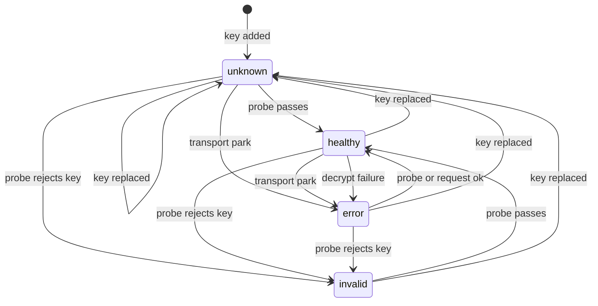

### M02 Cooldown bench and ladder

- Owner: `server/src/services/ratelimit.ts` (type `CooldownSource`, function `setCooldown`)
- Class: lifecycle
- Persisted: db (`rate_limit_cooldowns.expires_at_ms`, `rate_limit_cooldowns.source`, `rate_limit_cooldowns.set_at_ms`); memory (expiry map, escalation ladder `cooldownHits`, null-limit hit windows `nullLimitHits`)
- States: `none` (implicit: no row), `heuristic`, `authoritative`, `credit`, `tier` (each active until `expires_at_ms`)
- Mutated only via: `server/src/services/ratelimit.ts` `setCooldown()` (also through `setRetryAfterCooldown()`), `isOnCooldown()` (lazy delete of an expired row), `cleanupExpiredCooldowns()`, `clearCooldownsForKey()`, `clearAllCooldowns()`, `clearCooldownEarly()`; `setCooldown()` is the only INSERT
- Tests: `server/src/__tests__/services/ratelimit-cooldown-merge.test.ts`, `server/src/__tests__/services/ratelimit-cooldown-ceiling.test.ts`, `server/src/__tests__/services/ratelimit.test.ts`, `server/src/__tests__/routes/keys-cooldowns.test.ts`, `server/src/__tests__/services/cooldown-probe.test.ts`
- Status: explicit

Every bench goes through `setCooldown()`, which merges with an active bench: the later expiry wins, and a provider fact (`authoritative`, `credit`, `tier`) is never downgraded to `heuristic`. A Retry-After from a provider is written as `authoritative`; only `heuristic` benches can be probed early. Open: `clearCooldownsForKey()` leaves `nullLimitHits` and the ladder hits of routes that were not in memory; the ladder and null-limit counters are memory-only; cooldown rows have no foreign key to `api_keys`, so a deleted key's rows last until expiry.

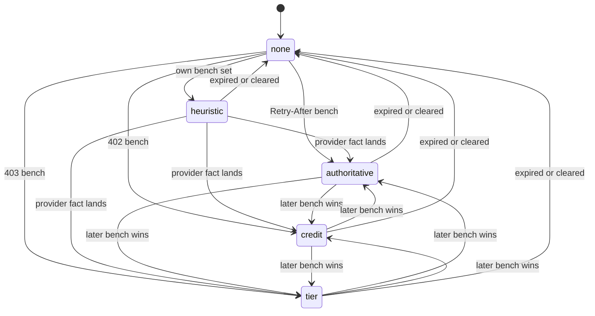

### M03 Cooldown probe pacing

- Owner: `server/src/services/cooldown-probe.ts` (no named type; state is `KeyProbeState`, function `runCooldownProbePass`)
- Class: lifecycle
- Persisted: memory
- States: `none` (implicit: no map entry), `scheduled` (entry with `failures` 0), `backoff` (entry with `failures` 1 or more; waits 2m, 4m, 8m, then 15m)
- Mutated only via: `server/src/services/cooldown-probe.ts` `runCooldownProbePass()`, `resetCooldownProbeState()` (tests only)
- Tests: `server/src/__tests__/services/cooldown-probe.test.ts`
- Status: documented-only

The per-key `keyState` map is written only inside the probe pass: a key's first ripe sighting schedules a jittered probe, a failed or inconclusive probe lengthens the wait, a passed probe deletes the entry. A probe never extends a bench and never counts toward the M01 invalid streak. Open: an operator clearing a key's cooldowns does not reset its entry, so a new bench inherits the old backoff until the pass finds no probeable cooldown for that key.

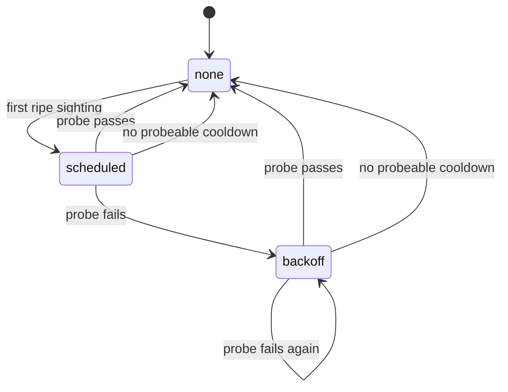

### M04 Route benches inside failover

- Owner: `server/src/lib/fallback-loop.ts` (no named type; function `recordRetryableFailure`); helpers in `server/src/lib/tool-capability.ts` and `server/src/lib/output-cap.ts`
- Class: lifecycle
- Persisted: memory (streak maps, failure windows, tool bench, learned output caps); the benches they set are written to db (`rate_limit_cooldowns`) through M02
- States: `clear`, `counting`, `benched` (implicit; each counter has its own limit and window; the tool bench calls them rejected and deferred)
- Mutated only via: `server/src/lib/fallback-loop.ts` `recordRetryableFailure()`, `consumeSkipBenchExemption()`, `noteModelFailure()`, `clearModelFailure()`, `clearModelFailureWindows()`, `benchKeyAcrossPlatform()`, `recordAuthFailure()`, `recordUpstreamSuccess()`, `runFallbackLoopAttempts()` (late in-band error bench), `resetTruncationStreaks()`, `resetEmptyCompletionStreaks()`, `resetModelFailureWindows()`; `server/src/lib/tool-capability.ts` `noteToolRejection()`, `benchForTools()`, `clearToolRejections()`, `resetToolCapability()`; `server/src/lib/output-cap.ts` `learnOutputCapFromError()`, `resetLearnedOutputCaps()`
- Tests: `server/src/__tests__/lib/fallback-loop.test.ts`, `server/src/__tests__/lib/fallback-loop-model-bench.test.ts`, `server/src/__tests__/lib/fallback-loop-issue-1230.test.ts`, `server/src/__tests__/lib/output-cap.test.ts`, `server/src/__tests__/routes/tool-rejection-e2e-1230.test.ts`
- Status: documented-only

Four counters share one shape: three truncated streams in a row bench a route for 5 minutes; three failures of one model in 15 minutes bench it on every key for 10 minutes; three empty completions in a row lift the skip-bench exemption; three tool rejections of distinct requests in an hour defer the model for tool requests for 6 hours. A served request clears each counter (a tool request clears the tool bench). The rule not to break: every bench must go through `setCooldown()`, so M02 keeps the longer expiry. Open: the truncation and empty-completion streaks have no timestamp, so failures far apart still add up; the learned output cap only falls and is forgotten at restart; no operator action clears streaks, the tool bench or output caps (`clearAllCooldowns()` plus `clearModelFailureWindows()` clear only the cooldowns and failure windows).

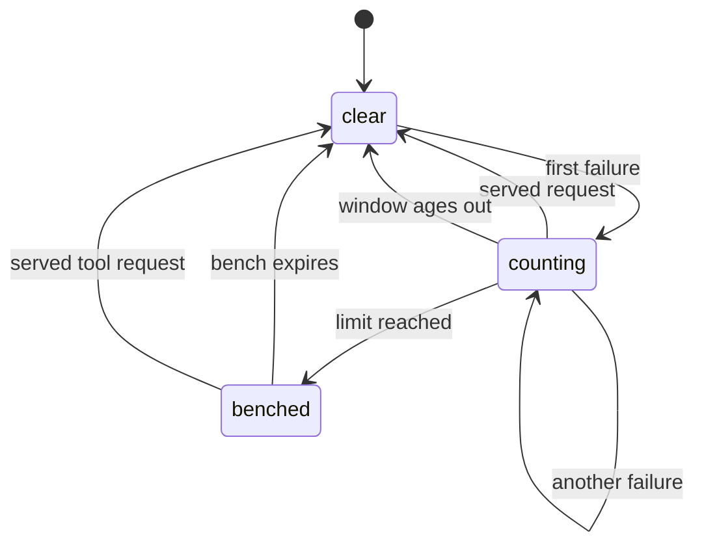

### M05 Monthly key budget

- Owner: `server/src/services/key-budget.ts` (type `BudgetVerdict`, function `checkMonthlyBudget`)
- Class: lifecycle
- Persisted: db (`api_keys.monthly_request_cap`, `api_keys.monthly_token_cap`, `key_monthly_usage.requests`, `key_monthly_usage.tokens`); memory (in-flight reservations)
- States: `unlimited` (both caps 0), `under_cap`, `at_cap` (all derived on each check, not stored)
- Mutated only via: caps: `server/src/routes/keys.ts` PATCH `/:id` handler, `server/src/services/key-budget.ts` `setMonthlyBudgetCaps()` (no production caller); ledger: SQL trigger `requests_key_monthly_usage` on `requests` (migration `server/src/db/migrations/20260914_000001_key_monthly_usage.ts`); reservations: `server/src/services/key-budget.ts` `reserveMonthlyBudget()` and the `release` it returns (called from `server/src/services/router.ts` and `server/src/services/provider-credential.ts`)
- Tests: `server/src/__tests__/services/key-budget.test.ts`, `server/src/__tests__/routes/key-monthly-budget.test.ts`, `server/src/__tests__/routes/keys-monthly-usage.test.ts`, `server/src/__tests__/services/router-keycount-budget.test.ts`
- Status: documented-only

A key is `at_cap` when this UTC month's successful usage plus in-flight reservations reaches a cap; the ledger row is keyed by month, so the next month starts under the cap with no write. Check and reserve must happen in one synchronous step, and every terminal path must call `release`. Open: only successful requests count; a replaced credential with the same key id inherits the old ledger; ledger rows of deleted keys are never pruned; not every abort path was checked for a leaked reservation.

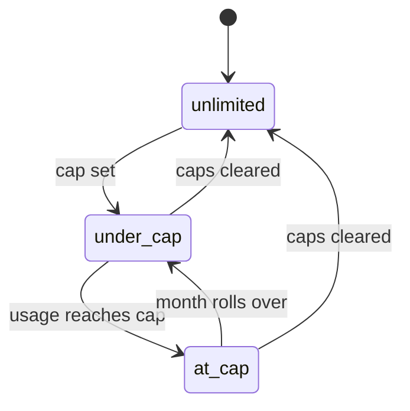

### M06 Degraded mode

- Owner: `server/src/services/degradation.ts` (type `DegradationState`, function `updateDegradationState`)
- Class: lifecycle
- Persisted: memory
- States: `normal`, `degraded`
- Mutated only via: `server/src/services/degradation.ts` `updateDegradationState()` (called after each health pass by `checkAllKeys()` in `server/src/services/health.ts`), `resetDegradationState()` (tests only)
- Tests: `server/src/__tests__/services/degradation.test.ts`
- Status: explicit

The gateway enters `degraded` when fewer than half of enabled providers have a usable key for 60 seconds, and leaves it after 2 minutes at or above half; with fewer than 3 providers it is always `normal`. Only the router reads it, to turn off bandit exploration. Full description: [04-degraded-mode-and-failover.md](04-degraded-mode-and-failover.md). Open: `resetDegradationState()` has no production caller, so the post-start re-probe named in its code comment does not exist.

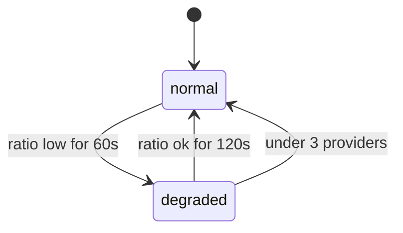

### M07 Provider quota snapshot

- Owner: `server/src/services/provider-quota.ts` (type `QuotaObservationSource` in `shared/types.ts`, function `recordQuotaObservation`)
- Class: lifecycle
- Persisted: db (`provider_quota_state.source`, `provider_quota_state.confidence`, `provider_quota_state.remaining_value`, `provider_quota_state.reset_at`; history in `provider_quota_observations`); memory (5 second headroom cache)
- States: `header`, `quota_api`, `error_body`, `local_usage`, `documentation`, `probe` (the `source` of the current row, with a confidence per source; a row whose `reset_at` has passed is read as a full budget, implicit)
- Mutated only via: `server/src/services/provider-quota.ts` `recordQuotaObservation()` (reached through `recordQuotaObservationsFromResponse()` and `server/src/providers/openai-compat.ts`); migration `server/src/db/migrations/20260915_000001_quota_snapshot_freshness.ts`
- Tests: `server/src/__tests__/services/provider-quota.test.ts`, `server/src/__tests__/providers/quota-api-poll.test.ts`, `server/src/__tests__/services/health-quota-poll.test.ts`, `server/src/__tests__/services/quota-outlook.test.ts`
- Status: explicit

One row per (platform, key, pool, metric); the newest observation with a non-null `remaining` replaces it, and an observation with no `remaining` cannot replace an existing row. Routing uses only rows with confidence 0.7 or more, and only to sort keys. Open: no code deletes `provider_quota_state` rows, so a replaced or deleted key keeps its old reading; a 429 or 402 `error_body` row (remaining 0, no reset time) replaces a header reading and never ages out; the `reset_at` expiry rule is written twice, in `getKeyQuotaHeadroom()` and `getQuotaStateForKeys()`.

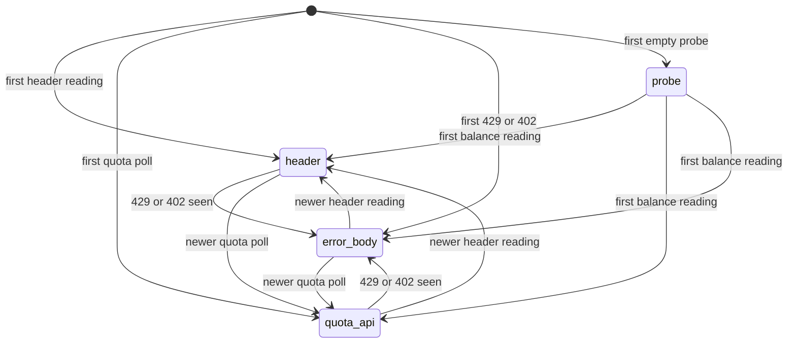

## 4. Catalog and fallback chains

### M08 Catalog model lifecycle

- Owner: `server/src/services/model-state.ts` (type `CatalogTombstoneSource`, functions `retireCatalogModelUpstream`, `reinstateUpstreamRetiredCatalogModel`)
- Class: lifecycle
- Persisted: db (`catalog_model_tombstones.source`, `catalog_model_tombstones.chain_snapshot`, `models.enabled`, `models.source`, `model_overrides.overrides_json`)
- States: `live` (no tombstone), `retired` (`upstream_eol`), `deleted` (`user`)
- Mutated only via: `server/src/services/model-state.ts` `recordCatalogModelTombstone()`, `clearCatalogModelTombstone()`, `retireCatalogModelUpstream()`, `reinstateUpstreamRetiredCatalogModel()`, `setChainEnabled()`, `deleteTombstonedCatalogModels()`; `server/src/routes/models.ts` model create (`clearCatalogModelTombstone`), PATCH `/:id` (`models.enabled`) and DELETE `/:id` (`recordCatalogModelTombstone`); `server/src/services/model-retirement.ts` (calls `retireCatalogModelUpstream`); `server/src/services/catalog-sync.ts` `applyCatalog()` (reinstate, `models.enabled`, row prune); `server/src/services/builtin-model-discovery.ts` `registerDiscoveredModels()` (explicit pick clears the tombstone); `server/src/services/declarative-config.ts` `upsertModel()` (clears the tombstone); `server/src/db/migrations/20260728_000001_tombstone_provenance.ts` (deletes `upstream_eol` rows)
- Tests: `server/src/__tests__/services/model-chain-lifecycle.test.ts`, `server/src/__tests__/services/model-retirement.test.ts`, `server/src/__tests__/services/catalog-sync.test.ts`, `server/src/__tests__/services/model-state-overrides.test.ts`, `server/src/__tests__/routes/models-management.test.ts`
- Status: types-only

The states are implicit: the model row, `models.enabled`, the chain flags and the tombstone move independently, and the tombstone source is the only named union. Retirement does not touch `models.enabled`; it saves the chain flags in `chain_snapshot`, writes an `upstream_eol` tombstone, and turns the chain flags off. Do not make a user tombstone block lifting a retirement, and do not let reinstate restore more than the saved flags (rows with no snapshot still switch every chain entry on). Open: pruning a catalog row does not clear its `upstream_eol` tombstone; a catalog `enabled=false` stays sticky because the sync does not record who disabled the row.

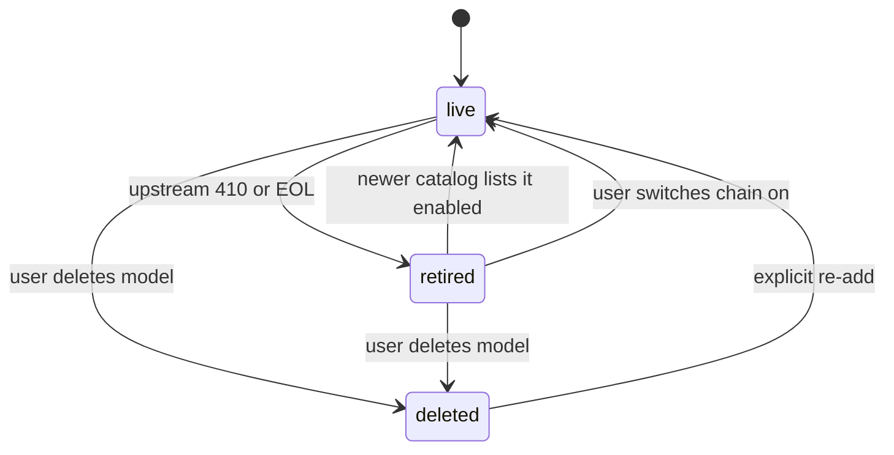

### M09 Custom model tombstone

- Owner: `server/src/services/custom-model-tombstone.ts` (no named type)
- Class: lifecycle
- Persisted: db (`custom_model_tombstones.endpoint_scope`, `custom_model_tombstones.model_id`)
- States: `absent`, `tombstoned` (implicit: a row exists for `(endpoint_scope, model_id)`)
- Mutated only via: `server/src/services/custom-model-tombstone.ts` `recordCustomModelTombstone()`, `clearCustomModelTombstone()`; callers: `server/src/routes/models.ts` DELETE `/:id` and the custom-model delete route (record), `server/src/routes/models.ts` model create (clear), `server/src/routes/keys.ts` key delete (record for every model the key owned), `server/src/services/custom-model-register.ts` `registerCustomModels()` (clear)
- Tests: `server/src/__tests__/services/custom-model-sync.test.ts`, `server/src/__tests__/db/migrate/custom-model-tombstones.test.ts`
- Status: documented-only

The scheduled sync (`runCustomModelSync` in `custom-model-sync.ts`) reads the tombstone with `isCustomModelTombstoned()` and skips the model. Only an explicit registration clears it. Do not clear a tombstone from the scheduled sync. This is the #926 behaviour: deleting a key tombstones all its models, so adding the same key again does not bring them back on the next sync; the operator must register them explicitly (for example with "Fetch models"). Open: nothing lists or expires tombstones, and the skip is counted in `result.tombstoned` only.

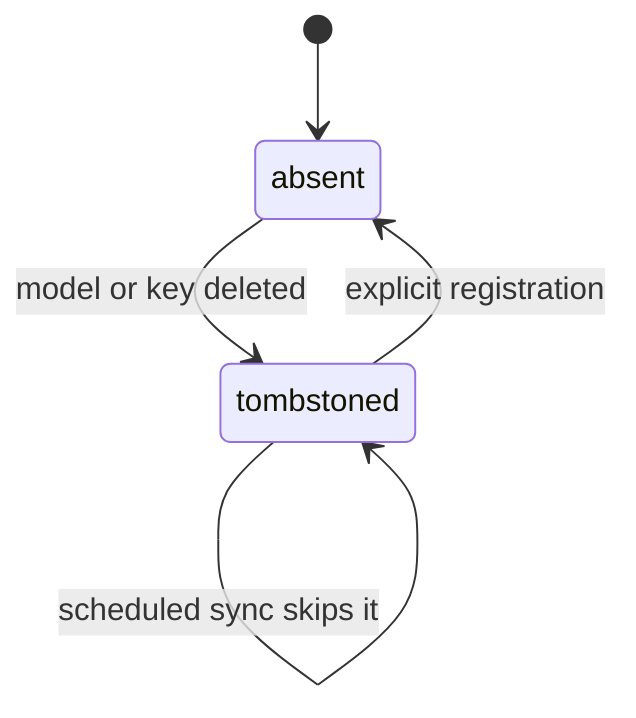

### M10 Chain membership

- Owner: `server/src/services/model-state.ts` (no named state type; function `setChainEnabled`)
- Class: lifecycle
- Persisted: db (`fallback_config.enabled`, `profile_models.enabled`, `profiles.auto_include_new_models`)
- States: `absent` (no chain row), `enabled`, `disabled`; one state per model per chain (the global chain and each profile), implicit in `enabled` 0/1
- Mutated only via: `server/src/services/model-state.ts` `setChainEnabled()`, `reinstateUpstreamRetiredCatalogModel()` (restores saved flags); `server/src/routes/models.ts` PATCH `/:id` (`setChainEnabled`, plus a direct `UPDATE profile_models SET enabled = 0` on disable); `server/src/routes/fallback.ts` PUT `/` (writes `fallback_config` or upserts `profile_models`); `server/src/routes/profiles.ts` profile chain PUT, create, reset and duplicate (insert or replace `profile_models`) and PATCH `/:id` (`auto_include_new_models`); `server/src/services/declarative-config.ts` `ensureFallbackRow()`, `applyFallback()`; `server/src/services/profile-models.ts` `ensureModelInProfiles()`, `ensureAllModelsInProfiles()` (insert rows for profiles with `auto_include_new_models = 1`); row inserts when a model is added: `server/src/services/catalog-sync.ts` `applyCatalog()`, `server/src/services/builtin-model-discovery.ts` `registerDiscoveredModels()`, `server/src/services/custom-model-register.ts` `registerCustomModels()`, `server/src/routes/models.ts` model create
- Tests: `server/src/__tests__/services/model-chain-lifecycle.test.ts`, `server/src/__tests__/routes/profiles-chains.test.ts`, `server/src/__tests__/routes/models-management.test.ts`, `server/src/__tests__/services/model-retirement.test.ts`
- Status: documented-only

`setChainEnabled()` is the one writer for a model's on/off flag from a model event (dashboard switch, disable, retirement). It is not the only writer of chain rows: chain edits, profile edits, declarative config and model creation write them directly. Switching a model on through `setChainEnabled()` also clears an `upstream_eol` tombstone; it never touches a user tombstone. Open: a chain-wide PUT from a stale client can overwrite a retirement; a profile with `auto_include_new_models = 0` never receives new models.

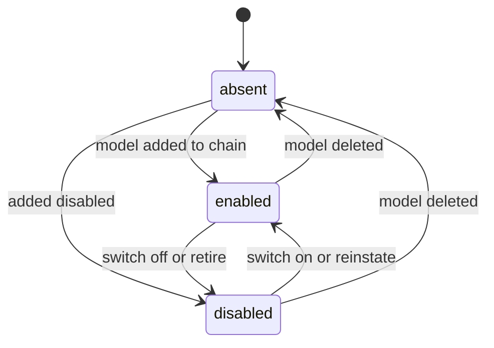

### M11 Catalog sync run

- Owner: `server/src/services/catalog-sync.ts` (type `SyncResult`, function `syncCatalog`)
- Class: workflow
- Persisted: memory (`inFlight`, `queuedForce`); db outcome (`settings`: applied version, applied tier, applied JSON, last sync time, last error)
- States: `idle`, `running`, `queued_force` (a forced run waits behind the running one); run outcomes `applied`, `up_to_date`, `skipped_older`, `error` (`SyncResult.action`)
- Mutated only via: `server/src/services/catalog-sync.ts` `syncCatalog()`, `startSync()`, `runSync()`; callers of `syncCatalog`: `catalog-sync.ts` `startCatalogSync()` (12 h tick and boot timer), `server/src/routes/premium.ts` (`syncCatalog(true)` on license change and manual sync), `server/src/services/declarative-config.ts` (`syncCatalog(true)`); also `catalog-sync.ts` `reapplyCachedCatalog()` (calls `applyCatalog` at boot, outside the run)
- Tests: `server/src/__tests__/services/catalog-sync-concurrency.test.ts`, `server/src/__tests__/services/catalog-sync.test.ts`, `server/src/__tests__/services/catalog-sync-scheduler.test.ts`
- Status: types-only

At most one run is in flight. A plain caller that arrives during a run shares its promise; a forced caller gets one extra forced run queued behind it, shared by all forced callers that arrive meanwhile (the running one read the license key before the change). Do not start `runSync` except through `syncCatalog`. Builtin model discovery (`server/src/services/builtin-model-discovery.ts`, `triggerBuiltinModelDiscovery`) has its own guard: one in-flight pass per platform, and a `healthy` trigger runs only when the platform has no models and the last event run was over 1 hour ago; a `key_added` trigger skips the 1 hour gap. Open: `skipped_older` is not shown to the user, and `reapplyCachedCatalog()` can run an apply outside the shared run.

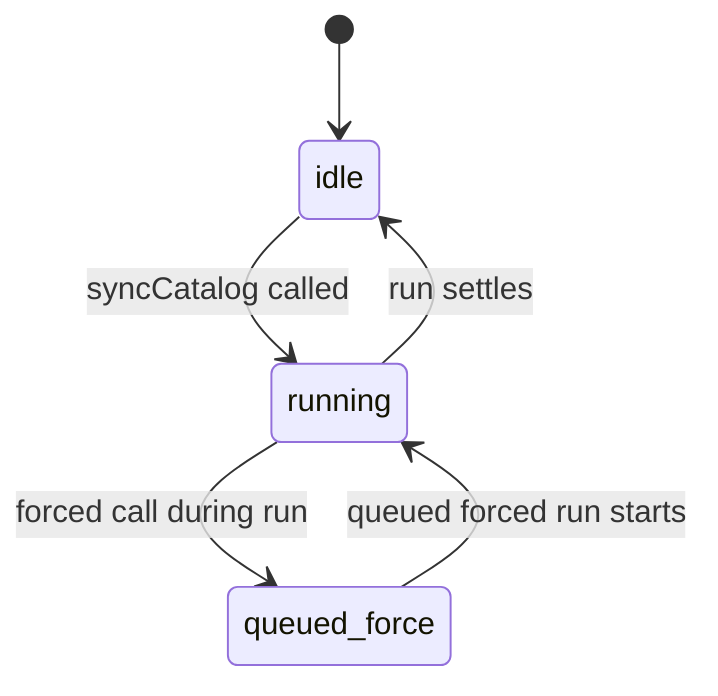

## 5. Requests, streams and caches

### M12 Request failover loop

- Owner: `server/src/lib/fallback-loop.ts` (type `AttemptErrorClass`, function `runFallbackLoop`)
- Class: workflow
- Persisted: memory (per-request locals), db (`request_attempts` rows written once after the loop returns; `requests.status` `canceled` row on a client abort)
- States: `routing`, `dispatching` (both implicit loop positions); per-attempt outcomes `ok`, `committed`, `client_abort`, plus the 14 `AttemptErrorClass` values `auth`, `out_of_credits`, `daily_quota_exhausted`, `model_not_found`, `forbidden`, `context_too_large`, `provider_bad_request`, `empty_completion`, `format_ignored`, `invalid_tool_arguments`, `timeout`, `rate_limited`, `upstream_error`, `error`
- Mutated only via: `server/src/lib/fallback-loop.ts` `runFallbackLoopAttempts()`, `classifyAttemptError()`, `recordRetryableFailure()`, `recordAuthFailure()`; `server/src/lib/error-classify.ts` `newClientAbortError()`, `newHedgeAbortError()`
- Tests: `server/src/__tests__/lib/fallback-loop.test.ts`, `server/src/__tests__/lib/fallback-loop-client-abort.test.ts`, `server/src/__tests__/lib/fallback-loop-hedge.test.ts`, `server/src/__tests__/lib/exhaustion-statuses.test.ts`, `server/src/__tests__/lib/fallback-loop-ttfb-budget.test.ts`, `server/src/__tests__/lib/fallback-loop-late-inband.test.ts`
- Status: types-only

One loop runs every surface's attempts: pick a route, dispatch, classify the failure, fail over. See `03-streaming-pipeline.md` and `04-degraded-mode-and-failover.md` for the budget, hedge and breaker details. The rule an editor must not break: a client abort (`isClientAbortError`: the `clientAbort` flag on the error or its `cause` chain, or our whole abort sentence) and the `clientGone` check stop the loop with no cooldown, no penalty and no further attempt; upstream error text must never read as a client abort. `route()` throwing something without a numeric `status` (a bug, a DB error) renders a 500 `internal_error`, never "no providers". A hedge abort or a late in-band error benches the route only when the attempt was silent for at least 0.75 of the budget. Open: circuit-breaker state is per request, with no half-open step.

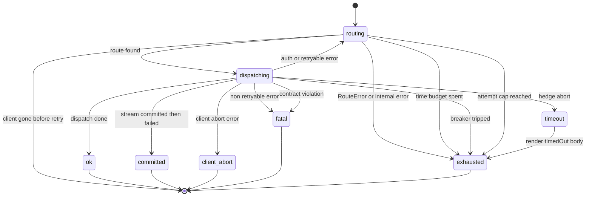

### M13 Stream commit point

- Owner: `server/src/lib/stream-commit.ts` (type `StreamPhase`, function `failedStreamPhase`)
- Class: protocol
- Persisted: memory (per-attempt locals; the phase is derived, not stored)
- States: `held`, `committed`, `finished`, `abandoned`; hold-window sub-states for inline tool-call dialect `undecided`, `passthrough`, `dialect` (type `DialectHoldMode` in `server/src/lib/tool-call-rescue.ts`)
- Mutated only via: `server/src/lib/stream-commit.ts` `failedStreamPhase()`, `throwIfAbandoned()`; the commit flag is set once per surface in `server/src/routes/proxy.ts` (`headerSent`, in the `/v1/chat/completions` and `/v1/completions` dispatch hooks), `server/src/routes/responses.ts` (`streamStarted`), `server/src/routes/anthropic.ts` `streamCompletion()` (`messageStarted`), `server/src/lib/inbound-chat.ts` `runInboundChat()` (`committed`); `finished` comes from `res.writableEnded`
- Tests: `server/src/__tests__/routes/stream-client-gone.test.ts`, `server/src/__tests__/routes/stream-post-end-bookkeeping.test.ts`, `server/src/__tests__/lib/tool-call-rescue.test.ts`
- Status: explicit

Every streaming surface (chat, legacy completions, responses, messages, and inbound-chat behind Gemini and Ollama) runs each attempt through the same four phases, and each catch is a `switch` over `failedStreamPhase()`. The rules an editor must not break: nothing may be written to the response in `finished` (a write after `res.end()` raises `ERR_STREAM_WRITE_AFTER_END`, fatal under the process safety net), and a client hang-up must throw through `throwIfAbandoned()` so the shared loop logs one `canceled` row, not `success` or `error`. Open: each surface keeps its own commit flag and its own first-payload rule (responses commits on the first tool call delta); the chat route keeps a local four-value hold mode that adds `json` and does not use `DialectHoldMode`.

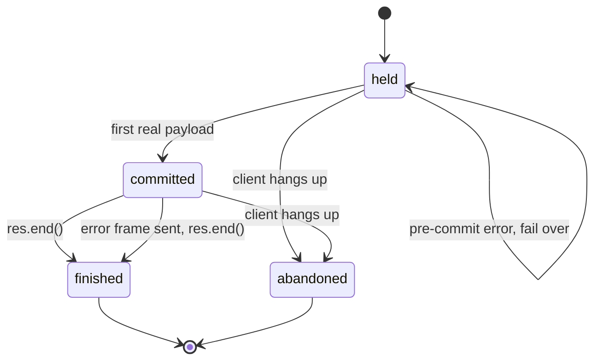

The dialect hold window, before the first byte reaches the client:

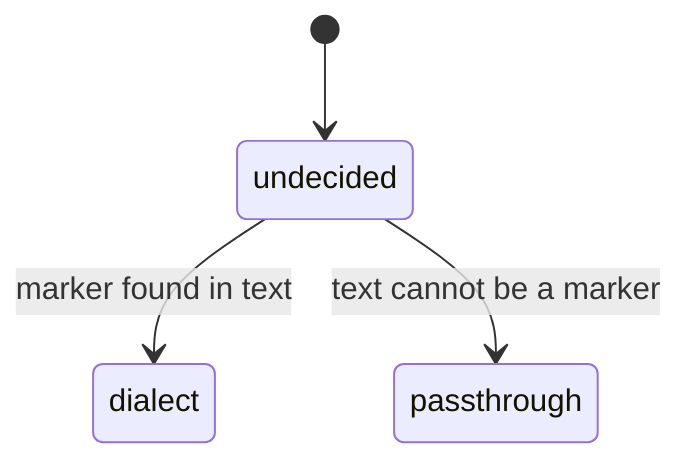

### M14 Provider SSE readers

- Owner: `server/src/providers/base.ts` (no named type; `BaseProvider.readSseFrames`)
- Class: protocol
- Persisted: memory
- States: `awaiting_first_byte`, `streaming`, `finished`, `failed` (all implicit; flags `awaitingFirstByte`, `sawFinishReason` in base.ts, `emittedFinish` in google.ts)
- Mutated only via: `server/src/providers/base.ts` `readSseFrames()`; `server/src/providers/google.ts` `streamChatCompletion()`; `server/src/providers/moondream.ts` `streamChatCompletion()` (checks its own `finished` flag on top of `readSseStream()`)
- Tests: `server/src/__tests__/providers/read-sse-frames.test.ts`, `server/src/__tests__/providers/google.test.ts`, `server/src/__tests__/providers/moondream.test.ts`, `server/src/__tests__/providers/stream-first-byte.test.ts`
- Status: documented-only

Each read has a deadline: a first-byte budget for the first read, then the stall budget. At EOF the unterminated last line is parsed like any other line. The rule an editor must not break: a body that ends with neither `[DONE]` nor a finish reason is a truncation and throws a retryable error, never a silent end or a synthetic `stop`. Google reads the body itself, throws a Gemini in-band `{error}` frame as an HTTP-style error (a 429 classifies as rate limiting), and returns right after the first finish chunk. Open: adapters that do not use `readSseStream` or the Google reader may lack stall timers; the in-band error is an untyped `googleHttpError`, not a shared type.

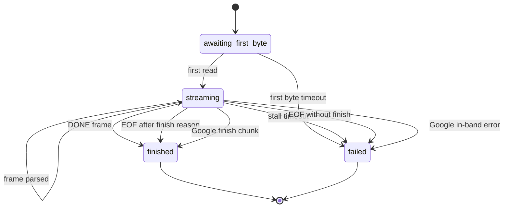

### M15 Web-search SSE lifecycles

- Owner: `server/src/lib/responses-web-search.ts` (no named type; class `ResponsesSse`, function `maybeServeResponsesWebSearch`) and `server/src/lib/anthropic-web-search.ts` (class `AnthropicSse`, function `maybeServeAnthropicWebSearch`)
- Class: protocol
- Persisted: memory
- States: `buffered`, `committed`, `ended` (implicit; the private `started` boolean and `res.writableEnded`)
- Mutated only via: `server/src/lib/responses-web-search.ts` `ResponsesSse.start()`, `complete()`, `fail()`; `server/src/lib/anthropic-web-search.ts` `AnthropicSse.start()`, `finish()`, `fail()`
- Tests: `server/src/__tests__/routes/agent-web-search.test.ts`, `server/src/__tests__/routes/responses.test.ts`
- Status: documented-only

A streaming web-search request runs inner non-streaming model turns and replays them as SSE. Before the stream starts, an inner error goes out as plain HTTP with its real status; after it starts, the error goes out as `response.failed` (Responses) or an `error` event (Messages). The rule an editor must not break: `write()` is a no-op once `res.writableEnded` or `res.destroyed`, and the heartbeat timer is cleared on every exit. Responses starts the stream by itself after 3 seconds if the first turn is slow (`STREAM_COMMIT_AFTER_MS`); Messages has no such timer and starts only when the first turn returns. Open: neither file checks `res.destroyed` right after `performWebSearch()`, so a client that left during a search still triggers the next inner turn.

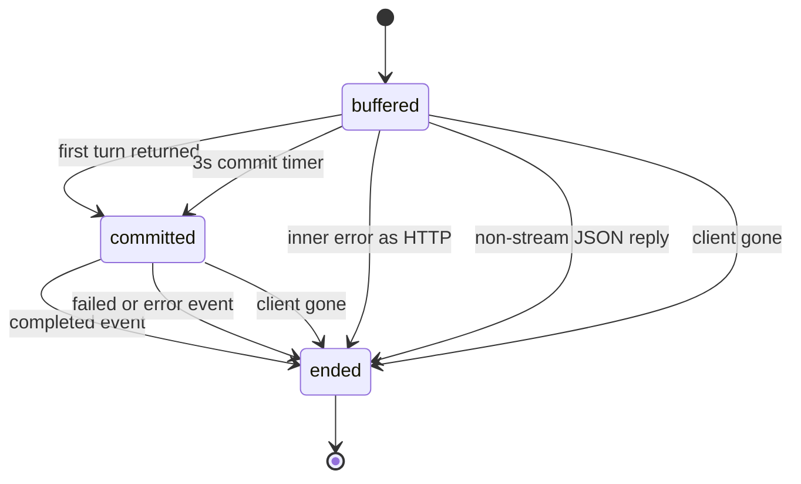

### M16 Idempotency claim

- Owner: `server/src/services/idempotency.ts` (type `IdempotencyClaimResult`, functions `lookupIdempotencyReplay`, `storeIdempotencyResult`)
- Class: lifecycle
- Persisted: db (`idempotency_claims.key_hash`, `idempotency_claims.request_fingerprint`, `idempotency_claims.response_status`, `idempotency_claims.response_body`, `idempotency_claims.expires_at_ms`)
- States: `none`, `stored`, `expired` (implicit: `expires_at_ms` is in the past; reads ignore it). The lookup result is `miss`, `replay`, `conflict`.
- Mutated only via: `server/src/services/idempotency.ts` `storeIdempotencyResult()`, `clearIdempotencyResult()` (no caller outside tests); `server/src/services/request-retention.ts` `pruneExpiredClaims()`; the only production caller of the store is `server/src/routes/proxy.ts` (non-streaming chat)
- Tests: `server/src/__tests__/services/idempotency.test.ts`, `server/src/__tests__/db/idempotency.test.ts`, `server/src/__tests__/routes/proxy-cache.test.ts`, `server/src/__tests__/services/request-retention.test.ts`
- Status: types-only

A claim exists only after a request finished: the row needs a response status and body, so there is no in-flight state. A second request with the same key while the first runs is not deduplicated; both reach a provider and the later store replaces the earlier row. Do not store a response whose `finish_reason` is `length`, and do not store streams. A same-key request with a different fingerprint gets a 409 until the claim expires (24 hours by default, `IDEMPOTENCY_TTL_MS`). Open: no in-flight guard; a replay writes no `requests` or usage row.

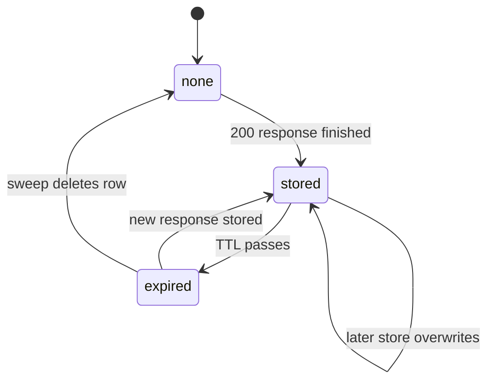

### M17 Response cache entry

- Owner: `server/src/services/cache.ts` (no named state type; functions `storeCachedResponse`, `getCachedResponse`)
- Class: lifecycle
- Persisted: memory (LRU map `store`, stream map `streamStore`, write queue `pendingWrites`); db (`response_cache.cache_key`, `response_cache.body_json`, `response_cache.hit_count`, `response_cache.expires_at_ms`)
- States: `absent`, `live` (in memory, and in `response_cache` when persistence is on), `expired` (age over TTL, removed on the next read), `evicted`
- Mutated only via: `server/src/services/cache.ts` `storeCachedResponse()`, `storeCachedStreamResponse()`, `getCachedResponse()` (lazy expiry, hit count), `getCachedStreamResponse()`, `enforceCombinedCap()` (internal LRU eviction), `loadCacheFromDb()` (boot purge and hydrate), `clearCache()`; `server/src/services/request-retention.ts` `pruneExpiredClaims()` (deletes expired rows only); callers: `server/src/routes/proxy.ts`, `server/src/routes/cache.ts`, `server/src/routes/mcp.ts`
- Tests: `server/src/__tests__/services/cache.test.ts`, `server/src/__tests__/routes/proxy-cache.test.ts`, `server/src/__tests__/services/request-retention.test.ts`
- Status: documented-only

Memory is the source of truth for reads. Rows are written behind: `schedulePersist()` queues each write and runs it on the next tick, hit counts flush after 2 seconds, and a failed write is dropped (the cache falls back to memory only). Stream entries are never written to disk. Do not read the table on the request path. Open: there is no drain on shutdown, so queued writes and up to 2 seconds of hit counts are lost on a crash or exit; turning persistence off leaves existing rows until the sweep or the next boot purge.

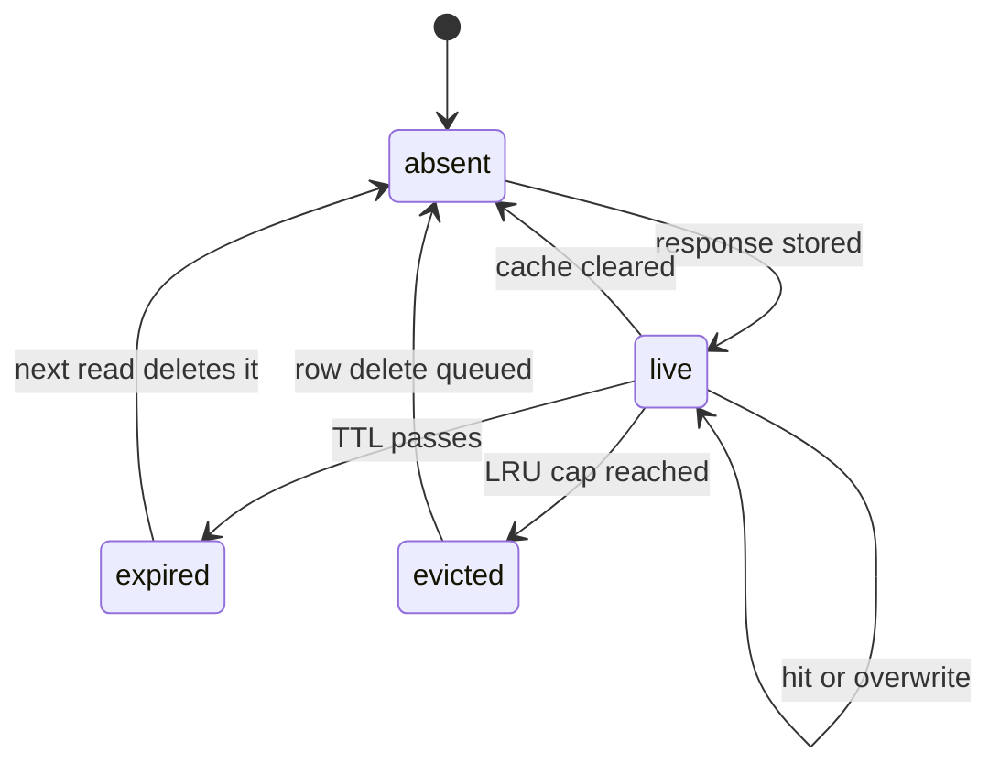

### M18 Request outcome status

- Owner: `server/src/lib/request-log.ts` (type `RequestStatus` from `shared/types.ts`, function `logRequest`)
- Class: lifecycle
- Persisted: db (`requests.status`)
- States: `success`, `error`, `canceled`
- Mutated only via: `server/src/lib/request-log.ts` `logRequest()`; `server/src/scripts/routing-sim.ts` (dev script, raw INSERT)
- Tests: `server/src/__tests__/lib/request-log-writers.test.ts`, `server/src/__tests__/lib/fallback-loop-client-abort.test.ts`, `server/src/__tests__/routes/analytics.test.ts`, `server/src/__tests__/routes/analytics-requests.test.ts`, `server/src/__tests__/routes/modality-client-gone.test.ts`
- Status: explicit

A `requests` row is written once with its final status and never updated. `canceled` means the client hung up: it counts toward totals but toward neither success nor error, so rates must read success/(success+error), never success/total. Open: the `status` column has no CHECK constraint, and `RequestStatus` is only a TypeScript type, so nothing at the database level rejects another value. The monthly-usage trigger and the `request_hourly` counters count only `success` and `error` rows.

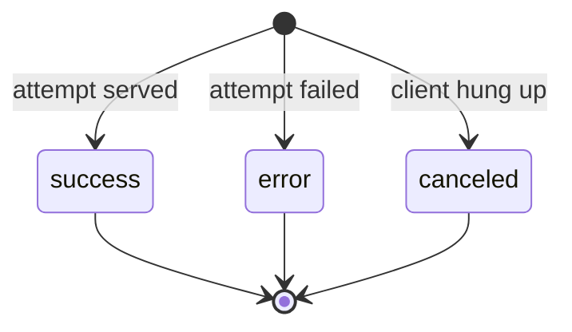

### M19 Modality failover loops

- Owner: `server/src/lib/failover-chain.ts` (type `AttemptOutcome`, function `runFailoverChain`)
- Class: workflow
- Persisted: memory
- States: `success`, `error`, `canceled` (per-attempt outcome); the walk itself has implicit states: next row, no credential (skip), attempting, done, client gone
- Mutated only via: `server/src/lib/failover-chain.ts` `runFailoverChain()`; callers `server/src/services/embeddings.ts`, `server/src/services/rerank.ts`, `server/src/services/moderation.ts`, `server/src/services/media.ts`; separate loops in `server/src/services/decision.ts` and `server/src/services/search.ts`
- Tests: `server/src/__tests__/lib/failover-chain.test.ts`, `server/src/__tests__/routes/modality-client-gone.test.ts`
- Status: explicit

`runFailoverChain` walks the rows in order, reserves a credential that is not benched, and logs each attempt as `success`, `error` or `canceled`. If the client signal aborts, it logs `canceled`, throws 499, and neither benches the key nor tries the next row. A 429 error benches that key for that (platform, model) through `setRetryAfterCooldown`. Open: decision and search keep their own loops and do not use `runFailoverChain`; search checks the client signal, and in `decision.ts` no abort check was found.

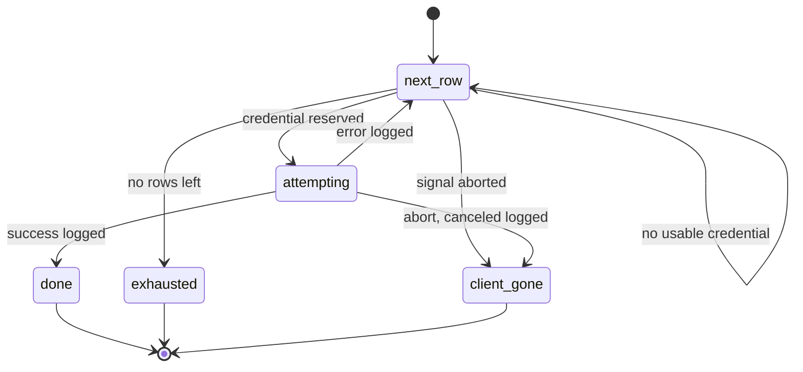

### M20 Async upstream job polling

- Owner: `server/src/providers/sail.ts` (type `SailStatus`, method `SailProvider.runResponse`); `server/src/services/media.ts` (function `callHuggingFaceVideo`)
- Class: workflow
- Persisted: memory
- States: sail `queued`, `in_progress`, `completed`, `incomplete`, `failed`, `cancelled`; Hugging Face video `IN_QUEUE`, `COMPLETED`, `FAILED`, `CANCELLED` (any other status string keeps polling)
- Mutated only via: `server/src/providers/sail.ts` `SailProvider.runResponse()`; `server/src/services/media.ts` `callHuggingFaceVideo()`
- Tests: `server/src/__tests__/providers/sail.test.ts`, `server/src/__tests__/services/media.test.ts`, `server/src/__tests__/routes/video-generations.test.ts`
- Status: explicit

Sail has a named `SailStatus` union and one polling loop; HF video status is a plain string read from the upstream reply, so its states are implicit. Rule: once an HF video job is submitted (and billed), a transient status-poll failure (network, 429, 5xx) is retried with backoff until the deadline and never ends the call, since failing would send the chain to the next provider and pay for a second generation; a 4xx error ends it. Open: sail polls on a fixed interval and any poll HTTP error ends the call (no transient retry), unlike HF.

```mermaid
stateDiagram-v2
  [*] --> queued: sail submitted
  queued --> in_progress: poll
  queued --> completed: poll
  in_progress --> completed: poll
  in_progress --> incomplete: poll
  queued --> failed: poll
  in_progress --> failed: poll
  queued --> cancelled: poll
  in_progress --> cancelled: poll
  completed --> [*]
  incomplete --> [*]
  failed --> [*]: throws
  cancelled --> [*]: throws
  [*] --> IN_QUEUE: HF submitted
  IN_QUEUE --> IN_QUEUE: poll, or retry transient error
  IN_QUEUE --> COMPLETED: poll
  IN_QUEUE --> FAILED: poll
  IN_QUEUE --> CANCELLED: poll
  COMPLETED --> [*]: fetch result
  FAILED --> [*]: throws
  CANCELLED --> [*]: throws
```

### M21 Fusion and iterative critique runs

- Owner: `server/src/services/fusion.ts` (no named type)
- Class: workflow
- Persisted: memory
- States: `(not yet traced)`
- Mutated only via: `(not yet traced)`
- Tests: `(not yet traced)`
- Status: documented-only

Not traced: the owner files have uncommitted work. Trace it once that work lands.

## 6. Auth

### M22 Auth codes

- Owner: `server/src/lib/setup-code.ts` and `server/src/lib/reset-code.ts` (no named type; both wrap `createOneTimeCode()` from `server/src/lib/one-time-code.ts`, interface `OneTimeCode`)
- Class: lifecycle
- Persisted: memory
- States: setup code: `none`, `active` (implicit: `current` is null or a string); reset code: `none`, `live`, `expired` (implicit: a code is held and `mintedAtMs` is within or past 15 minutes)
- Mutated only via: `server/src/lib/setup-code.ts` `generateSetupCode()`, `clearSetupCode()`; `server/src/lib/reset-code.ts` `generateResetCode()`, `clearResetCode()`, `resetCodeMatches()` (clears lazily when expired); `server/src/lib/one-time-code.ts` `generate()`, `clear()`. Callers: `server/src/index.ts` (boot, 0 users), `server/src/routes/auth.ts` POST `/setup`, `/forgot-password`, `/reset-password`
- Tests: `server/src/__tests__/routes/auth-setup-code.test.ts`, `server/src/__tests__/routes/auth-reset-password.test.ts`, `server/src/__tests__/lib/loopback.test.ts`
- Status: documented-only

The setup code is minted at boot only when there are zero users, and cleared when an account exists. A request skips the setup code only if `isLocalRequest()` (`server/src/lib/loopback.ts`) says it is local: the socket is loopback and no forwarded hop, forwarded header or `TRUST_PROXY` says otherwise. The rule an editor must not break: a forwarded header may only withdraw locality, never grant it, and `generateResetCode()` must reuse a live code so an anonymous caller cannot void the operator's code. Open: no per-code attempt cap on `/reset-password`; a `/setup` or reset request that fails validation or finds no account keeps its code.

```mermaid
stateDiagram-v2
  state "Setup code" as Setup {
    [*] --> setup_none
    setup_none --> setup_active: boot with 0 users
    setup_active --> setup_none: account created
    setup_active --> setup_none: setup with users present
  }
  state "Reset code" as Reset {
    [*] --> reset_none
    reset_none --> reset_live: forgot-password
    reset_live --> reset_live: forgot-password reuses code
    reset_live --> reset_expired: 15 minutes pass
    reset_expired --> reset_live: forgot-password mints new
    reset_expired --> reset_none: reset tried, cleared
    reset_live --> reset_none: reset succeeds
  }
```

### M23 Auth throttles and lockouts

- Owner: `server/src/routes/auth.ts` (no named type; map `attempts`, functions `recordFailure`, `lockoutRetryAfterSec`)
- Class: lifecycle
- Persisted: memory
- States: login bucket (per address+IP, and per address): `fresh`, `locked`, `expired_lock` (implicit: a count plus `lockedUntil`); password-change counter: `strikes_0`, `strikes_1`, `strikes_2`, then signed out; reset-code request gap: `open`, `cooling` (10 s per IP); model test gap: `open`, `cooling` (5 s per model)
- Mutated only via: `server/src/routes/auth.ts` `recordFailure()`, `clearFailures()`, `clearAccountLockouts()`, handlers POST `/change-email` and `/change-password` (`failedPasswordAttempts`), POST `/forgot-password` (`lastResetCodeAt`); `server/src/routes/models.ts` the model test handler (`modelTestCooldowns`); `server/src/middleware/rateLimit.ts` `createProxyRateLimiter()`, `createAdminRateLimiter()` (per-IP fixed windows in closures)
- Tests: `server/src/__tests__/routes/auth-login-throttle.test.ts`, `server/src/__tests__/routes/auth-reset-password.test.ts`, `server/src/__tests__/routes/admin-rate-limit.test.ts`, `server/src/__tests__/routes/proxy-rate-limit.test.ts`, `server/src/__tests__/routes/models-provider-actions.test.ts`
- Status: documented-only

Every failed login counts in two buckets: address plus client IP (5 tries, locks one guesser) and address alone (50 tries, caps a guesser who rotates IPs); both lock for 15 minutes and carry `Retry-After`. The rule an editor must not break: the bucket key must use `normalizeEmail()`, the same spelling `verifyCredentials()` looks up, or padded addresses get fresh buckets. A successful reset clears every lock on the account. Open: `failedPasswordAttempts` has no expiry and no reset except success; `attempts` pruning removes only expired locks, so more than 10,000 locked keys is a linear scan per failure; each proxy mount has its own limiter, so the total can exceed the RPM; the login lockout and model-test throttle states are not tested for the 3-strike sign-out or the model test cooldown directly (only the 429 text appears in `models-provider-actions.test.ts`).

```mermaid
stateDiagram-v2
  [*] --> fresh
  fresh --> fresh: bad password, under max
  fresh --> locked: max bad passwords
  locked --> locked: login gets 429
  locked --> expired_lock: 15 minutes pass
  expired_lock --> fresh: next failure new window
  fresh --> [*]: good password
  locked --> [*]: password reset
  [*] --> strikes_0
  strikes_0 --> strikes_1: wrong current password
  strikes_1 --> strikes_2: wrong current password
  strikes_2 --> signed_out: wrong current password
  strikes_0 --> [*]: correct password
  strikes_1 --> strikes_0: correct password
  strikes_2 --> strikes_0: correct password
  [*] --> reset_open
  reset_open --> reset_cooling: forgot-password
  reset_cooling --> reset_open: 10 seconds pass
```

### M24 Sessions, URL tokens and client profiles

- Owner: `server/src/services/auth.ts` (sessions), `server/src/services/url-tokens.ts` (URL tokens), `server/src/routes/client-profiles.ts` (client profiles); no named types
- Class: lifecycle
- Persisted: db (`sessions.token_hash`, `sessions.expires_at_ms`, `url_tokens.revoked_at`, `url_tokens.last_used_at`, `client_profiles.enabled`, `client_profiles.token_hash`)
- States: session: `valid`, `expired` (row present, past `expires_at_ms`), `session_deleted` (row gone); URL token: `active`, `revoked` (`revoked_at` set); client profile: `enabled`, `disabled`, `profile_deleted` (row gone)
- Mutated only via: `server/src/services/auth.ts` `createSession()`, `validateSession()` (deletes an expired row it is shown), `deleteSession()`, `updatePassword()`, `resetUserPassword()` (both delete all of the user's sessions), `desktopSessionToken()` (calls `createSession()`); `server/src/services/url-tokens.ts` `mintUrlToken()`, `revokeUrlToken()`, `validateUrlToken()` (writes `last_used_at` only); `server/src/routes/client-profiles.ts` handlers POST `/`, PATCH `/:id`, POST `/:id/rotate`, DELETE `/:id`
- Tests: `server/src/__tests__/routes/auth.test.ts`, `server/src/__tests__/routes/auth-desktop-session.test.ts`, `server/src/__tests__/routes/url-tokens.test.ts`, `server/src/__tests__/routes/client-profiles.test.ts`
- Status: documented-only

A session lasts 30 days and is deleted on logout, on the third wrong password in `/change-email` or `/change-password` (the current token only), and on a successful password change or reset (all of the user's sessions). A URL token never expires: only `revoke` ends it. A disabled client profile is rejected at proxy auth like an unknown key (`server/src/lib/system-prompt.ts`). The rule an editor must not break: raw tokens are never stored, only hashes. Backups leave out `users`, `sessions` and `url_tokens` on purpose (`server/src/services/backups.ts`). Open: expired session rows are removed only when their token is presented, so nothing sweeps them; `/change-email` keeps all sessions.

```mermaid
stateDiagram-v2
  state "Session" as Session {
    [*] --> valid: createSession
    valid --> session_deleted: logout or 3 strikes
    valid --> session_deleted: password change or reset
    valid --> expired: 30 days pass
    expired --> session_deleted: token presented
  }
  state "URL token" as UrlToken {
    [*] --> active: mintUrlToken
    active --> revoked: revokeUrlToken
  }
  state "Client profile" as Profile {
    [*] --> enabled: create
    enabled --> disabled: PATCH enabled false
    disabled --> enabled: PATCH enabled true
    enabled --> profile_deleted: DELETE
    disabled --> profile_deleted: DELETE
  }
```

### M25 Client AuthGate

- Owner: `client/src/lib/auth-gate-state.ts` (type `Gate`, functions `deriveGate`, `repairTransition`) and `client/src/components/auth-gate.tsx` (`AuthGate`)
- Class: workflow
- Persisted: memory (the repair phase and status query); the session token is in localStorage (`freellmapi_dashboard_token`) but is not the gate state
- States: `loading`, `unreachable`, `desktopRepairing`, `desktopRepairFailed`, `setup`, `login`, `app`; repair phase: `idle`, `running`, `failed`
- Mutated only via: `client/src/lib/auth-gate-state.ts` `deriveGate()` (pure, computes the gate each render), `repairTransition()` (the `useReducer` reducer; events `start`, `succeeded`, `failed`, `retry`); `client/src/components/auth-gate.tsx` `AuthGate` (the only dispatcher of repair events and the only `refetch()` caller for the status query), `withTimeout()` in `client/src/lib/auth-gate-state.ts` ends a hung desktop bridge after 15 s
- Tests: `client/src/lib/auth-gate-state.test.ts`, `client/src/components/auth-gate.desktop.test.tsx`, `client/src/components/auth-gate.desktop-browser.test.tsx`, `client/src/components/auth-gate.login-identifier.test.tsx`, `client/src/components/auth-gate.reset-signs-in.test.tsx`
- Status: explicit

The gate is one value derived from the `/api/auth/status` query and the repair phase. The rule an editor must not break: a failed background refetch keeps the last good status, so `unreachable` shows only when status never loaded; and a `failed` repair stays until the user presses retry, so a rejected session cannot loop. On a desktop install with no valid session the gate goes to `desktopRepairing` and asks the shell (or `POST /api/auth/desktop-session` in a browser tab) for a token. Open: the forgot-password wizard (`request`, `reset`, `done`) and the `AuthForm` flags (`busy`, `error`, `attempted`, `codeRequired`) are local component state, not part of `Gate`, and Back from the wizard loses its step.

```mermaid
stateDiagram-v2
  [*] --> loading
  loading --> unreachable: status never loaded
  loading --> setup: needs setup
  loading --> login: not authenticated
  loading --> app: authenticated
  loading --> desktopRepairing: desktop and no session
  unreachable --> loading: retry
  desktopRepairing --> app: new session accepted
  desktopRepairing --> desktopRepairFailed: bridge fails or times out
  desktopRepairFailed --> desktopRepairing: retry
  setup --> app: account created
  login --> app: sign in
  app --> login: 401 event
  app --> desktopRepairing: 401 event on desktop
```

## 7. Dashboard

### M26 Playground exchange

- Owner: `client/src/pages/PlaygroundPage.tsx` (no named type, function `handleSend`)
- Class: workflow
- Persisted: memory (`loading` state, `abortRef`); the finished transcript goes to the server through M27
- States: `idle`, `sending`, `streaming`, `persisting`, `error_bubble` (implicit: `loading` flag plus `abortRef`)
- Mutated only via: `client/src/pages/PlaygroundPage.tsx` `handleSend()`, `streamFusion()`, `streamChat()`, `resetConversationState()`, `openConversation()`
- Tests: `client/src/lib/playground-stream.test.ts`
- Status: documented-only

One send is one exchange. `handleSend` sets `loading`, optionally runs a web search, streams the reply, saves the transcript, then clears `loading` in `finally`. An abort (New chat, switching conversation, unmount) is silent. Rule: nothing may call `setMessages` or save for an exchange that was aborted. Open: stale send, because `abortRef` is set only after the web-search fetch, so New chat or a switch during the search aborts nothing and the reply lands in the wrong conversation. Open: partial reply lost, because a failure while reading the stream replaces the transcript with the question plus an error bubble. Open: an aborted bubble keeps `streaming: true` if `openConversation` then fails.

```mermaid
stateDiagram-v2
  [*] --> idle
  idle --> sending: send
  sending --> streaming: SSE headers ok
  sending --> persisting: error or JSON reply
  sending --> idle: abort
  streaming --> persisting: stream ends
  streaming --> error_bubble: reader throws
  streaming --> idle: abort
  error_bubble --> persisting: save error
  persisting --> idle: loading cleared
```

### M27 Conversation binding

- Owner: `client/src/pages/PlaygroundPage.tsx` (no named type, function `conversationIdFor`)
- Class: lifecycle
- Persisted: db (`playground_conversations` via `server/src/routes/conversations.ts`); localStorage (active conversation id, via `writeActiveConversationId`)
- States: `unbound`, `creating`, `bound`, `opening` (implicit: `conversationIdRef`, `createRef`, a pending `getConversation`)
- Mutated only via: `client/src/pages/PlaygroundPage.tsx` `conversationIdFor()`, `adoptConversation()`, `resetConversationState()`, `openConversation()`, `handleDeleteConversation()`
- Tests: `client/src/lib/playground-conversations.test.ts`, `server/src/__tests__/routes/conversations.test.ts`
- Status: documented-only

The page writes to one server row. No row exists until the first message; the create is memoised in `createRef` so two saves cannot make two rows. Rule: a create that finishes after a reset or switch must not become the bound conversation. Open: zombie bind, because `resetConversationState` and `openConversation` null `createRef`, but the pending create's `.then` still calls `adoptConversation`, binding the blank chat to the old row. Open: `persistConversation` saves the model and system prompt from the render that started the send.

```mermaid
stateDiagram-v2
  [*] --> unbound
  unbound --> creating: first send
  creating --> bound: create ok
  creating --> unbound: create fails
  creating --> unbound: reset
  bound --> unbound: new chat or delete
  bound --> opening: select other
  opening --> bound: load ok
  opening --> bound: load fails, keeps old
```

### M28 Artifact panel

- Owner: `client/src/pages/PlaygroundPage.tsx` (no named type, functions `showArtifact`, `closeArtifact`)
- Class: lifecycle
- Persisted: memory (`artifact`, `artifactOpen`, `closeTimer`); localStorage (`ARTIFACT_WIDTH_STORAGE_KEY`, width only)
- States: `closed`, `open`, `closing` (implicit: `artifact` and `artifactOpen`, with `closeTimer` for the exit animation)
- Mutated only via: `client/src/pages/PlaygroundPage.tsx` `showArtifact()`, `closeArtifact()`, `openArtifact()`, the auto-open effect on `loading`
- Tests: `client/src/lib/artifacts.test.ts`, `client/src/lib/artifact-panel-size.test.ts`
- Status: documented-only

A reply that finishes with an artifact opens the first one once; a card click opens one by hand. Close slides the panel out and drops the artifact after `ARTIFACT_PANEL_TRANSITION_MS`. Rule: reopening during the exit clears the timer first. Open: `resetConversationState` and `openConversation` never touch the artifact, so one conversation's panel stays over the next. Open: the auto-open effect runs when `loading` ends, so an aborted reply that holds a complete fence can still open the panel.

```mermaid
stateDiagram-v2
  [*] --> closed
  closed --> open: card click or reply done
  open --> open: other artifact
  open --> closing: close
  closing --> closed: timer ends
  closing --> open: reopen
```

### M29 Dictation

- Owner: `client/src/components/playground/dictation-button.tsx` (type `DictationPhase`, function `setPhase`)
- Class: lifecycle
- Persisted: memory
- States: `idle`, `requesting`, `recording`, `transcribing`
- Mutated only via: `client/src/components/playground/dictation-button.tsx` `setPhase()`, called from `start()` and `transcribe()`
- Tests: `client/src/components/playground/dictation-button.test.tsx`, `client/src/components/playground/liquid-composer.test.tsx`, `client/src/lib/transcription.test.ts`
- Status: explicit

`requesting` covers the browser's mic prompt, and the button is disabled in it, so a second click cannot open a second recorder. Rule: every path that opened the mic must close it, including a failed `MediaRecorder` construction and unmount (`mountedRef` drops late results). Open: `transcribing` has no timeout or abort on the upload; `recorder.onerror` is not handled.

```mermaid
stateDiagram-v2
  [*] --> idle
  idle --> requesting: click
  requesting --> recording: mic granted
  requesting --> idle: denied or recorder fails
  recording --> transcribing: stop
  transcribing --> idle: text or error
```

### M30 Keys page row dialog

- Owner: `client/src/components/keys/provider-list.tsx` (type `RowDialog`, state `dialog`)
- Class: lifecycle
- Persisted: memory
- States: `none`, `edit`, `discover`, `addEndpointKey`, `copy`, `scope`, `editModels`, `test`, `addModel` (the `kind` values; `none` is `dialog === null`)
- Mutated only via: `client/src/components/keys/provider-list.tsx` `setDialog()` (row and group menu click handlers, `closeDialog()`, and the render-time prune of a dialog whose key is gone)
- Tests: `client/src/components/keys/provider-list-dialogs.test.tsx`
- Status: types-only

The Providers tab holds one `RowDialog` value, so opening a dialog replaces the last. Rule: a dialog that names a `keyId` closes when that key leaves the list (or the list empties), so it cannot reopen later on a reused id. Writers are many inline `setDialog` calls, not one function. Dialogs outside this list (Add key, Export, the update pill) are separate state.

```mermaid
stateDiagram-v2
  [*] --> none
  none --> edit: open dialog
  none --> copy: open dialog
  none --> scope: open dialog
  none --> test: open dialog
  edit --> none: close
  copy --> none: close
  scope --> none: close
  test --> none: close
  edit --> none: key gone
  copy --> none: key gone
  scope --> none: key gone
  edit --> copy: open other
```

### M31 Re-auth secret dialog

- Owner: `client/src/hooks/use-reauth-secret.ts` (no named state type, function `useReauthSecret`)
- Class: workflow
- Persisted: memory
- States: `entering`, `busy`, `failed` (implicit: `busy`, `error`, `password`, `inFlight` ref); the export dialog adds a `Step` of `options` or `password`
- Mutated only via: `client/src/hooks/use-reauth-secret.ts` `run()`, `cancel()`, `setPassword()`, `setError()`; `client/src/components/keys/copy-key-dialog.tsx` `submit()`; `client/src/components/keys/export-keys-dialog.tsx` `handleExport()`
- Tests: `client/src/components/keys/copy-key-dialog.test.tsx`, `client/src/components/keys/export-keys-dialog.test.tsx`
- Status: documented-only

`run` sends the password and returns `{ ok: false }` on failure or cancel. Rule: cancel or unmount aborts the request in flight and drops its result, so a closed dialog never copies the key or downloads the file. A wrong password clears the field and shows the error in place. Open: the copy dialog shows the key on screen when the clipboard refuses, with no timeout.

```mermaid
stateDiagram-v2
  [*] --> entering
  entering --> busy: submit
  busy --> failed: request fails
  busy --> [*]: success, dialog closes
  busy --> entering: cancel
  failed --> busy: submit again
  failed --> entering: cancel
```

### M32 Add key and add model flows

- Owner: `client/src/components/keys/add-key-dialog.tsx` (type `Pane`, function `finishAdd`)
- Class: workflow
- Persisted: memory
- States: `closed`, `editing`, `pending`, `scope_offer` (implicit: `open`, the mutations' `isPending`, `scopeOffer`; `editing` has panes `provider`, `import`, `custom`)
- Mutated only via: `client/src/components/keys/add-key-dialog.tsx` `finishAdd()`, `close()`; `client/src/components/keys/add-key-form.tsx` `addKey`, `addSeveral`; `client/src/components/keys/add-model-dialog.tsx` `addModelMutation`
- Tests: `client/src/components/keys/add-key-dialog.test.tsx`, `client/src/components/keys/add-key-form.test.tsx`, `client/src/components/keys/add-model-dialog.test.tsx`
- Status: documented-only

The add mutation outlives the form. Rule: if the user dismissed the dialog while the add was pending, the key is still added but the scope picker stays closed (`openRef` check in `finishAdd`). Editing a field clears the last add error. Open: the add-model dialog has no such guard; its `onOpenChange` goes straight to the dialog, so a request in flight still finishes and shows its toast after a close.

```mermaid
stateDiagram-v2
  [*] --> closed
  closed --> editing: open
  editing --> pending: submit
  pending --> editing: error
  pending --> scope_offer: ok, dialog still open
  pending --> closed: ok, dialog dismissed
  editing --> closed: close
  scope_offer --> closed: dismiss
```

### M33 Draft-then-save forms

- Owner: `client/src/hooks/use-draft.ts` (type `Draft`, function `useDraft`)
- Class: workflow
- Persisted: memory
- States: `clean`, `dirty` (implicit: `staged` draft compared with the server value by `deepEqual`)
- Mutated only via: `client/src/hooks/use-draft.ts` `edit()`, `discard()`, `settle()`, and the render-time drop on a scope change
- Tests: `client/src/hooks/use-draft.test.tsx`, `client/src/components/chain-manager.test.ts`
- Status: documented-only

`useDraft(server, scope)` shows the draft while it differs from the server value, and `settle(saved)` drops it only if it is still the saved value, so an edit made during a save survives. A draft belongs to its scope and is dropped when the scope changes. Adopted in `client/src/pages/FallbackPage.tsx` and `client/src/pages/EmbeddingsPage.tsx`. Open: still on the old pattern are `client/src/pages/FusionPage.tsx` (seven `useState` fields, `JSON.stringify` dirty check, `setQueryData` on save), `client/src/pages/ModelDetailPage.tsx` (form reseeded by an effect on `source`), `client/src/components/settings-dialog.tsx` (compression form with its own `busy` of `load`, `save`, `preview`), `client/src/components/keys/backups-section.tsx` (schedule form keyed on the schedule), `client/src/components/custom-weights-popover.tsx` (own `dirty` flag), `client/src/components/keys/edit-key-dialog.tsx` (per-field compare).

```mermaid
stateDiagram-v2
  [*] --> clean
  clean --> dirty: edit
  dirty --> clean: undo edit
  dirty --> clean: discard
  dirty --> clean: settle saved value
  dirty --> clean: scope changes
```

### M42 Toasts

- Owner: `client/src/lib/toast.ts` (type `ToastItem`, functions `push`, `dismissToast`)
- Class: lifecycle
- Persisted: memory
- States: `visible`, `paused`, `dismissed` (implicit: membership in the module's `items` list; `paused` is a hold count in `client/src/lib/toast-timer.ts`)
- Mutated only via: `client/src/lib/toast.ts` `push()` (through `toast.success`, `toast.error`, `toast.info`), `dismissToast()`; `client/src/lib/toast-timer.ts` `startToastTimer()` (`pause()`, `resume()`, `cancel()`); `client/src/components/toaster.tsx` (timer and dismiss button); `client/src/components/confirm-button.tsx` (separate `armed` state)
- Tests: `client/src/lib/toast.test.ts`, `client/src/lib/toast-timer.test.ts`
- Status: documented-only

`push` adds a toast, replaces an identical kind and message, and keeps at most four, evicting the oldest non-error first. Success and info expire after 5000 ms; errors are sticky until dismissed. Rule: the timer runs only when every hold (hover, window blur) is released. `ConfirmButton` is a separate two-state machine: first click arms (`armed`), a second click inside `timeout` (3000 ms default) confirms, and Escape or the timeout disarms. `confirm-button.tsx` and `toaster.tsx` have no test file.

```mermaid
stateDiagram-v2
  [*] --> visible
  visible --> paused: hover or blur
  paused --> visible: all holds released
  visible --> dismissed: timer expires
  visible --> dismissed: dismiss click
  paused --> dismissed: dismiss click
  visible --> dismissed: evicted by cap
  visible --> dismissed: replaced by duplicate
  dismissed --> [*]
```

## 8. Updates, desktop, process and CLI

### M34 Server update check

- Owner: `server/src/routes/update.ts` (type `CheckStatus`, function `createUpdateRouter`)
- Class: lifecycle
- Persisted: memory
- States: `idle`, `current`, `available`, `ahead`, `diverged`, `unknown`, `unsupported`, `disabled`
- Mutated only via: `server/src/routes/update.ts` `check()`, `performCheck()`, `parseAtomFallback()`, `latestRelease()`, and the `GET /check` and `GET /status` handlers (`disabled`, `unsupported`, `idle`)
- Tests: `server/src/__tests__/routes/update.test.ts`, `server/src/__tests__/routes/update-release.test.ts`
- Status: types-only

`CheckStatus` is the answer a check returns, not a stored field. `idle` appears only in `GET /status`, before any check has run. Results are cached for 5 minutes (`CACHE_TTL_MS`); the latest-release lookup is cached for 6 hours; a failed call is remembered for 45 seconds (`failedAt`, `releaseFailedAt`) and answers 502. One call per cache is in flight at a time (`inFlight`, `releaseInFlight`); an editor must keep that, or a box that cannot reach GitHub re-dials on every click. Desktop and Docker installs compare against the latest release tag, never `main`, and do not fall back to the Atom feed. Open: the three status values `unsupported`, `disabled` and `idle` are set in the route handlers, not in `performCheck()`, so there is no single transition function.

```mermaid
stateDiagram-v2
  [*] --> disabled: update check off
  [*] --> unsupported: no commit SHA
  [*] --> idle: no check yet
  idle --> current: compare identical
  idle --> available: remote is ahead
  idle --> ahead: local is ahead
  idle --> diverged: histories diverge
  idle --> unknown: 404 or no release
  current --> available: new upstream commits
  unknown --> current: later check succeeds
```

### M35 Desktop updater

- Owner: `desktop/src/update-support.ts` (type `UpdateState`); driven by `desktop/src/updater.ts` (function `setState`)
- Class: lifecycle
- Persisted: memory
- States: `unsupported`, `idle`, `checking`, `current`, `available`, `downloading`, `ready`, `error`
- Mutated only via: `desktop/src/updater.ts` `setState()`, `initUpdater()` (sets the first `unsupported` value directly), and through them `checkForUpdates()`, `downloadUpdate()`, `installUpdate()`; the electron-updater event handlers registered in `initUpdater()` call `setState()`
- Tests: `desktop/src/__tests__/update-support.test.ts`, `desktop/src/__tests__/updater-backup.test.ts`
- Status: explicit

Electron-updater events and the three exported actions move the phase; every change goes through `setState()`, which also pushes the state to the dashboard windows and the tray. Never install over data that was not backed up: a failed backup sets `autoUpdater.autoInstallOnAppQuit = false` and moves to `error` with `during: 'install'`, and the next `update-downloaded` re-arms it. A downloaded update stays staged (`staged`, `backedUp`) even when a later `error` event moves the phase off `ready`, so the quit-time install still takes a backup. Open: the macOS quit path cannot be stopped by the flag once Squirrel.Mac holds the update (see the `shortcut:` comment in `initUpdater()`); the client keeps its own copy of the type, `DesktopUpdateState` in `client/src/lib/desktop-updater.ts`, where `during` is optional.

```mermaid
stateDiagram-v2
  [*] --> unsupported: dev or package build
  [*] --> idle: supported build
  idle --> checking: check starts
  current --> checking: check starts
  available --> checking: check starts
  error --> checking: check starts
  checking --> current: no update
  checking --> available: update found
  checking --> error: check fails
  available --> downloading: download starts
  downloading --> downloading: progress
  downloading --> ready: download done
  downloading --> error: download fails
  ready --> error: backup fails
  ready --> error: updater error
  ready --> [*]: quit and install
```

### M36 Docker self-update

- Owner: `client/src/lib/docker-update.ts` (type `DockerUpdatePhase`, function `useDockerUpdate`)
- Class: workflow
- Persisted: memory
- States: `idle`, `starting`, `waiting`, `failed`, `timeout`
- Mutated only via: `client/src/lib/docker-update.ts` `start()`, `reset()` (both inside `useDockerUpdate()`, through `setPhase`)
- Tests: `client/src/lib/new-build.test.ts` (covers the `isNewBuild` and `fetchLatestIndex` helpers only; the hook has no direct test)
- Status: explicit

`start()` asks the server to call its Watchtower sidecar (`POST /api/update/apply`), then polls for `index.html` every 3 seconds for up to 5 minutes. The page reloads, and the hook ends, once a new build appears or the server was seen down and came back. Do not add a phase that persists across the reload: the update replaces the very process that serves this page. A `failed` or `timeout` phase leaves only `reset()` to return to `idle`; the Updates dialog calls it from its retry button.

```mermaid
stateDiagram-v2
  [*] --> idle
  idle --> starting: Update now
  starting --> waiting: apply accepted
  starting --> failed: apply request fails
  waiting --> [*]: new build, reload
  waiting --> timeout: 5 minutes pass
  failed --> idle: retry
  timeout --> idle: retry
```

### M37 Client update UX

- Owner: `client/src/components/updates-dialog.tsx` (no named type; `CheckResult` is the server answer it holds); reminder pill in `client/src/components/update-reminder.tsx`
- Class: lifecycle
- Persisted: localStorage (`freellmapi.update_reminder`)
- States: dialog `closed`, `checking`, `desktop`, `result`, `failed`; pill `pill_hidden`, `pill_shown`, `pill_dismissed`
- Mutated only via: `client/src/components/updates-dialog.tsx` `UpdatesContent()` (the check effect and `retry()`); `client/src/lib/desktop-updater.ts` `startDesktopUpdateCheck()`, `useDesktopUpdater()`; `client/src/components/update-reminder.tsx` `UpdateReminder()` (its check effect and `dismiss()`), `writeStored()`
- Tests: `client/src/components/updates-dialog.test.tsx`
- Status: documented-only

The states are implicit (React `useState` flags: `checking`, `failed`, `result`; the pill's `release` and `dismissed`). The dialog starts a fresh check each time it opens. On a desktop build it uses the in-app updater (M35); when `startDesktopUpdateCheck()` returns false (no bridge, `unsupported`, or a bridge that cannot report) it asks the server (`GET /api/update/check`, M34) instead of spinning. A Docker install that can update itself hands over to M36. The pill is shown only when a newer release exists; dismissal is stored per release tag, survives reloads, and must not clear when the opt-in is switched off (the stored `dismissedTag` is kept). The browser asks `GET /api/update/release` at most once a day unless the opt-in is toggled. Open: the pill and the dialog have no shared state, so a dismissed pill does not change what the dialog shows; `update-reminder.tsx` has no test file.

```mermaid
stateDiagram-v2
  [*] --> closed
  closed --> checking: dialog opens
  checking --> desktop: desktop updater started
  checking --> result: server check answers
  checking --> failed: server check fails
  failed --> checking: Try again
  desktop --> closed: dialog closes
  result --> closed: dialog closes
  failed --> closed: dialog closes
  [*] --> pill_hidden
  pill_hidden --> pill_shown: newer release found
  pill_shown --> pill_dismissed: x clicked
  pill_shown --> pill_hidden: opt-in switched off
  pill_dismissed --> pill_shown: newer tag released
```

### M38 Desktop windows, tray and startup

- Owner: `desktop/src/main.ts` (no named type; startup is the `app.whenReady()` handler)
- Class: lifecycle
- Persisted: file (`<userData>/config.json`: `port`, `theme`, `locale`, `lanAccess`, `showInDock`, `launchDashboardShown`, `trayHiddenNoticeVersion`)
- States: `starting`, `running`, `running_no_tray`, `quitting`
- Mutated only via: `desktop/src/main.ts` the `app.whenReady()` handler, `toggleLanAccess()`, `toggleShowInDock()`, `reportHiddenTray()`; `desktop/src/window.ts` `openDashboard()`; `desktop/src/popover.ts` `togglePopover()`; `desktop/src/tray.ts` `buildTray()`; `desktop/src/config.ts` `saveConfig()`; `app.quit()` calls in `main.ts` and `tray.ts` (the tray menu Quit item)
- Tests: `desktop/src/__tests__/tray-platform.test.ts`, `desktop/src/__tests__/tray-visibility.test.ts`, `desktop/src/__tests__/window-chrome.test.ts`, `desktop/src/__tests__/server-host-boot.test.ts`, `desktop/src/__tests__/logger.test.ts`
- Status: documented-only

The states are implicit (module variables and Electron objects). The app holds one single-instance lock; a second launch sends `second-instance` and opens the dashboard instead. Closing every window never quits (`window-all-closed` is a no-op): the tray is the way in, so a failed tray build must fall back to the dashboard window and must not stop startup. The dashboard is one window at a time (absent or open) and the popover is hidden or visible; both are implicit sub-states of `running`. Toggling LAN access writes `lanAccess`, calls `app.relaunch()` and quits, because the bind host is fixed at server start. A server that fails to start shows an error box and quits. Open: on macOS the tray can be built yet not drawn (#807); the app only logs it and offers a dialog once per version.

```mermaid
stateDiagram-v2
  [*] --> starting: lock acquired
  [*] --> quitting: lock refused
  starting --> running: server up, tray built
  starting --> running_no_tray: server up, tray failed
  starting --> quitting: server failed to start
  running --> quitting: Quit
  running_no_tray --> quitting: Quit
  running --> quitting: LAN toggle relaunch
  running_no_tray --> quitting: LAN toggle relaunch
  quitting --> [*]
```

### M39 Server process lifecycle and jobs

- Owner: `server/src/lib/graceful-shutdown.ts` (no named type; function `installGracefulShutdown`)
- Class: lifecycle
- Persisted: memory (the daily backup gate also writes `settings` key `backup_last_run_day`)
- States: `running`, `stopping`, `exited`
- Mutated only via: `server/src/lib/graceful-shutdown.ts` `shutdown()` (inside `installGracefulShutdown()`); `server/src/lib/scheduler.ts` `NodeScheduler.stopAll()`, `every()`, `after()`; `server/src/lib/wake-detect.ts` `startWakeDetect()`, `stopWakeDetect()`; `server/src/services/backups.ts` `startBackupScheduler()`; `server/src/index.ts` `main()` (the `server.on('error')` exit)
- Tests: `server/src/__tests__/lib/graceful-shutdown.test.ts`, `server/src/__tests__/lib/scheduler.test.ts`, `server/src/__tests__/lib/wake-detect.test.ts`, `server/src/__tests__/services/backup-scheduler.test.ts`
- Status: documented-only

The states are implicit (the `stopping` closure flag, the scheduler's `stopped` flag, the wake detector's `installed` flag). On SIGTERM or SIGINT the process first calls `stopJobs` (`scheduler.stopAll()` and `stopWakeDetect()`), then closes the servers, then closes the database, then exits; a stuck request cannot hold it past `graceMs` (8 seconds), when it closes the database and exits with code 1. Do not close the database before the jobs are stopped. After `stopAll()` the scheduler refuses new timers. The wake detector fires a recovery pass on more than 30 seconds of clock drift or on SIGCONT/SIGUSR2, at most once every 15 seconds. The daily backup gate compares the local date (not the UTC date) with `backup_last_run_day`. Open: `stopAll()` cancels timers only; a job body that is already running is not awaited before the database closes.

```mermaid
stateDiagram-v2
  [*] --> running: boot
  running --> running: wake detected
  running --> stopping: SIGTERM or SIGINT
  running --> exited: listen error
  stopping --> exited: servers closed, code 0
  stopping --> exited: grace expired, code 1
  exited --> [*]
```

### M40 Mutable singletons with TTL

- Owner: `server/src/lib/proxy.ts` (no named type; module variables `cached` and `perKeyCached`, function `flushProxyCache`)
- Class: lifecycle
- Persisted: memory
- States: per cache entry: `absent`, `live`, `failed_cached`, `expired`
- Mutated only via: `server/src/lib/proxy.ts` `resolveDispatcher()`, `resolvePerKeyDispatcher()`, `rememberPerKeyDispatcher()`, `applyProxyUrl()`, `flushProxyCache()`; `server/src/routes/proxy.ts` `setStickyModel()`, `getStickyModel()`, `rememberReasoning()`, `clearReasoningMemory()`; `server/src/lib/server-logs.ts` `recordLogEntry()`, `ensureSeeded()` (`seedNow()`), `clearLogs()`; `server/src/providers/google.ts` `rememberThoughtSigKey()`, `recallThoughtSigKey()`
- Tests: `server/src/__tests__/lib/proxy.test.ts`, `server/src/__tests__/lib/server-logs-rate-cap.test.ts`, `server/src/__tests__/providers/google.test.ts`
- Status: documented-only

This entry covers a family of in-memory caches that share one shape: an entry is built on demand, reused while fresh, and dropped on expiry, eviction or an explicit flush. The states are implicit. The global dispatcher (`cached`) lives 30 seconds and is cleared by `applyProxyUrl()`. A per-key dispatcher (`perKeyCached`, at most 32, oldest evicted first) never expires once built; a failed build is cached for 30 seconds. `flushProxyCache()` (called on wake) clears both and swaps Node's global fetch dispatcher; it drops dispatchers and does not close them, so requests in flight finish. Sticky sessions and the remembered reasoning trace expire after 30 minutes and are capped at 1000 entries; the Google thought-signature cache expires after 30 minutes and holds 5000 entries, oldest inserted first. The server-log ring guards against re-entry with the `mirroring`, `persisting` and `seeding` flags: a log line written while the logger writes must not be recorded again. Open: `seedNow()` empties the ring before it reads the database, so a failure in between loses the lines logged before boot finished; a sticky entry is not removed when its model is disabled (`resolveStickyPreference()` filters it on read).

```mermaid
stateDiagram-v2
  [*] --> absent
  absent --> live: build ok
  absent --> failed_cached: build fails
  live --> expired: TTL passes
  live --> absent: flush or evict
  failed_cached --> absent: flush
  failed_cached --> expired: 30 seconds pass
  expired --> absent: dropped on read
```

### M41 CLI flows

- Owner: `cli/src/config-files.ts` (no named type; function `applyGeneratedFiles`); child runner and key prompt in `cli/src/index.ts`
- Class: workflow
- Persisted: file (the generated config files, their `.backup-<timestamp>` copies and `.freellmapi-<pid>.tmp` temporary files)
- States: apply `planned`, `committed`, `failed`; child `child_running`, `child_exited`; prompt `prompting`, `prompt_muted`, `prompt_done`, `prompt_cancelled`
- Mutated only via: `cli/src/config-files.ts` `applyGeneratedFiles()`, `applyGeneratedFile()`, `planGeneratedFile()`, `commitPlannedWrite()`; `cli/src/index.ts` `runChild()`, `promptForKey()`
- Tests: `cli/src/config-files.test.ts`, `cli/src/index.test.ts`
- Status: documented-only

The states are implicit. Apply is two-phase: every target file is read and merged first (`planGeneratedFile()`), so a merge failure aborts the batch before anything is written; then each file is backed up, written to a temporary file and renamed (`commitPlannedWrite()`). A dry run stops after planning. `runChild()` runs `claude` or `codex` with inherited stdio, ignores SIGINT in the wrapper, forwards SIGTERM, and returns the child's exit code (128 plus the signal number when it was killed). `promptForKey()` mutes echo while the user types and restores it in `finally`. Open: `commitPlannedWrite()` has no `try/finally`, so a failed write or rename leaves the temporary file behind; a failure on file N leaves files 1 to N-1 already changed; SIGHUP is not forwarded to the child.

```mermaid
stateDiagram-v2
  [*] --> planned: files read and merged
  planned --> [*]: dry run or unchanged
  planned --> committed: backup, write, rename
  planned --> failed: write or rename fails
  committed --> [*]
  failed --> [*]
  [*] --> child_running: spawn
  child_running --> child_exited: exit or signal
  child_running --> child_exited: spawn error
  child_exited --> [*]
  [*] --> prompting: TTY, no key given
  prompting --> prompt_muted: user types
  prompt_muted --> prompt_done: Enter, key not empty
  prompt_muted --> prompt_cancelled: Ctrl-C or close
  prompting --> prompt_cancelled: Ctrl-C or close
  prompt_done --> [*]
  prompt_cancelled --> [*]
```

## 9. Other explicit machines

### X1 Think-tag stream filter

- Owner: `server/src/lib/think-tags.ts` (type `FilterState`, class `ThinkTagStreamFilter`)
- Class: protocol
- Persisted: memory
- States: `lead`, `thinking`, `afterClose`, `passthrough`
- Mutated only via: `server/src/lib/think-tags.ts` `ThinkTagStreamFilter.push()`, `ThinkTagStreamFilter.flush()`
- Tests: `server/src/__tests__/lib/think-tags.test.ts`
- Status: explicit

The filter splits a leading `<think>...</think>` block out of a text stream into reasoning, and passes the rest through as content. It decides on the first non-whitespace text: anything that is not a `<think>` open tag is content for the whole stream. Held bytes (`pending`) are a partial tag only; the lead hold is capped at 512 characters. `flush()` always ends in `passthrough`; an unclosed `<think>` flushes as reasoning.

```mermaid
stateDiagram-v2
  [*] --> lead
  lead --> lead: whitespace or tag prefix
  lead --> thinking: open tag seen
  lead --> passthrough: not a think block
  lead --> passthrough: hold over 512
  thinking --> afterClose: close tag seen
  afterClose --> passthrough: answer text starts
  lead --> passthrough: flush
  thinking --> passthrough: flush
  afterClose --> passthrough: flush
  passthrough --> [*]
```

### X2 Migrations runner

- Owner: `server/src/db/migrate/runner.ts` (type `MigrationState`, functions `runMigrations`, `runMigrationsSync`)
- Class: lifecycle
- Persisted: db (`migrations.filename`, `migrations.applied_at`)
- States: `pending`, `applied`
- Mutated only via: `server/src/db/migrate/runner.ts` `runPendingMigrations()`, `runPendingMigrationsSync()`, `runLatestDownMigration()`, `runLatestDownMigrationSync()`; `server/src/db/migrate/cli.ts` `runFresh()` (drops every table, then runs `up`); startup through `server/src/db/index.ts` `initDb()`
- Tests: `server/src/__tests__/db/migrate/runner.test.ts`, `server/src/__tests__/db/migrate/roundtrip.test.ts`, `server/src/__tests__/db/migrate/endpoint-identity.test.ts`
- Status: types-only

A migration is `applied` when its filename has a row in `migrations`, and `pending` otherwise; `MigrationState` is only what `getMigrationStatuses()` reports. `up` applies every pending file in filename order, each in one transaction with its ledger insert. `down` reverts only the latest applied row, in one transaction with the ledger delete. The sync and async runners are separate copies of the same logic; keep them in step. Open: `fresh` bypasses the ledger by dropping tables, and is refused only by an `NODE_ENV=production` check in the CLI.

```mermaid
stateDiagram-v2
  [*] --> pending: file added
  pending --> applied: up
  applied --> pending: down, latest only
  applied --> [*]: fresh drops tables
  pending --> [*]: fresh drops tables
```

## 10. Excluded: modes and derived values

These look like state but are not machines. A **mode** is a setting that does not move on its own; a **derived value** is computed from other state and never stored as a phase; a **local parser** is a self-contained scanner best left as it is. Do not add them above unless one starts moving through phases on events.

### Modes

- Local endpoint cooldown exemption — `server/src/services/ratelimit.ts` — Local or non-local branch; no state beyond the check.
- Operator cooldown ceiling — `server/src/services/ratelimit.ts` — Set or unset operator setting; no lifecycle.
- Context handoff mode — `server/src/services/context-handoff.ts` — Off or on-model-switch setting; no lifecycle.
- Compression engine flags and mode — `server/src/services/compression/config.ts` — Config flags read at runtime; no lifecycle.
- Process error policy and install-once guard — `server/src/lib/process-safety-net.ts` — Install-once guard with fixed swallow or fatal policy.
- Console redaction install-once — `server/src/lib/log-redaction.ts` — Install-once switch; no runtime transitions.
- Response format type — `server/src/lib/sampling-params.ts` — Two fixed format values; no lifecycle.
- Ollama emulation mode — `server/src/routes/ollama.ts` — Stored setting with three values; client keeps a copy.
- Routing strategy union — `server/src/routes/mcp.ts` — Fixed strategy list; zod enum in fallback.ts repeats it.
- Endpoint scope column — `server/src/db/migrations/20260729_000001_custom_model_endpoint_identity.ts` — Two-value column; no transitions of its own.
- Monthly key caps column — `server/src/db/migrations/20260904_000001_key_monthly_budget.ts` — Zero or positive cap; no lifecycle.
- Key model scope column — `server/src/db/migrations/20260805_000001_key_model_scope.ts` — Null or JSON value; no transitions of its own.
- MCP enabled default — `server/src/db/migrations/20260903_000001_mcp_enabled_default.ts` — One-time default for a setting; no lifecycle.
- Active profile setting — `server/src/db/migrations/20260101_000000_legacy_baseline.ts` — Single id or absent; no transitions of its own.
- Server log level column — `server/src/db/migrations/20260823_000001_server_logs.ts` — Two-value level column; no transitions.
- Rate-limit usage kind column — `server/src/db/migrations/20260101_000000_legacy_baseline.ts` — Two-value kind column; no transitions.
- Sidebar rail open state — `client/src/pages/PlaygroundPage.tsx` — Open or closed toggle; forced closed on narrow screens.
- Trace disclosure open state — `client/src/pages/PlaygroundPage.tsx` — Open or closed toggle with a user-touched lock.
- Web search toggle — `client/src/pages/PlaygroundPage.tsx` — On or off toggle, gated by engine availability.
- Column sort cycle — `client/src/lib/table-sort.ts` — Null, ascending, descending cycle; no lifecycle.
- Analytics time range — `client/src/pages/AnalyticsPage.tsx` — One of four stored range choices.
- Recent-calls filters — `client/src/pages/AnalyticsPage.tsx` — Filter selections and drill-down id; no lifecycle.
- More-options disclosure — `client/src/pages/FallbackPage.tsx` — Collapsed or expanded toggle; no lifecycle.
- Keys status filter — `client/src/components/keys/provider-list.tsx` — Filter selection and group override; no lifecycle.
- Custom endpoint type selector — `client/src/components/keys/custom-provider-section.tsx` — Five-value selector; repeats a shared type.
- Add-key pane — `client/src/components/keys/add-key-dialog.tsx` — Pane choice; only open and close.
- Add-key form — `client/src/components/keys/add-key-form.tsx` — Platform choice and form flags; no lifecycle.
- Ollama mode in key settings — `client/src/components/keys/agent-compatibility-section.tsx` — Three-value setting; copy of the server mode.
- Proxy mode — `client/src/components/keys/proxy-settings-section.tsx` — Forward or fetch-relay setting; token change gate only.
- Model scope all or explicit — `client/src/components/keys/edit-models-dialog.tsx` — Two-way scope switch; no lifecycle.
- Chain manager collapse and rename — `client/src/components/chain-manager.tsx` — Collapse toggle and inline rename; no lifecycle.
- Command palette overlay — `client/src/components/command-palette.tsx` — Open flag and query; only open and close.
- Model combobox open state — `client/src/components/model-combobox.tsx` — Open, query and active index; no lifecycle.
- Per-platform tray table — `desktop/src/tray-platform.ts` — Static table keyed by OS; no transitions.
- API key model kind — `shared/types.ts` — Five-value type copied into the client; no transitions.

Watch: playground model sentinels (`auto`, `fusion`, `iterative-critique`, `auto:<chain>`) are an implicit union of magic strings; candidate for a typed union, not a machine.

### Derived values

- Cooldown probe outcome — `server/src/services/health.ts` — Result of one probe; computed, not stored.
- Cooldown duration decision — `server/src/services/ratelimit.ts` — Picks a duration from other state; stores nothing.
- Compression stats counters — `server/src/services/compression/stats.ts` — Counters only; no phase.
- Filter rule cache — `server/src/services/compression/engines/custom-filters.ts` — Cache of parsed rules; empty or filled.
- Must-keep memo — `server/src/services/compression/engines/toolfilter.ts` — Memo of a computed set; no phase.
- Pool status — `server/src/services/quota-outlook.ts` — Computed from quota data; no stored phase.
- Forecast nullable fields — `server/src/services/quota-forecast.ts` — Nullable output fields; computed, not stored.
- Router TTL caches — `server/src/services/router.ts` — Five caches rebuilt from source data on expiry.
- Round-robin key cursor — `server/src/services/router.ts` — Plain index into a key list; no phase.
- Window usage snapshot — `server/src/services/ratelimit.ts` — Five-second cache of usage numbers.
- Attempt error classes — `server/src/lib/fallback-loop.ts` — Pure classifier of failures; no stored state.
- Token budget pre-flight — `server/src/lib/guardrails.ts` — Per-request size check; nothing carried between requests.
- TTFB stats cache — `server/src/lib/ttfb-budget.ts` — Cache over computed latency statistics.
- Proxy request type — `server/src/lib/proxy.ts` — Ten-value type; no state.
- Exhaustion body kind map — `server/src/lib/fallback-loop.ts` — Maps seven kinds to HTTP responses.
- Routing diagnostic class — `server/src/lib/fallback-loop.ts` — Labels a routing failure; computed on the spot.
- Retirement classifier — `server/src/lib/error-classify.ts` — Pure function from error text to verdict.
- Web search error code map — `server/src/lib/web-search-tool.ts` — Fixed five-code mapping; no state.
- Address class — `server/src/lib/url-guard.ts` — Five-value classifier of a URL host.
- Provider size kind — `server/src/lib/provider-size-parser.ts` — Input or total label copied onto fallback state.
- Task type — `server/src/lib/task-type.ts` — Code, chat or auto; computed from the request.
- Cached master key — `server/src/lib/crypto.ts` — Lazy cache of a derived key.
- Cached app version — `server/src/lib/app-version.ts` — Lazy read of the version string.
- Cached owner id — `server/src/lib/file-permissions.ts` — Lazy read of the file owner id.
- Validator cache — `server/src/lib/tool-validate.ts` — Compiled validators or a failure marker; pure cache.
- Warn-once set — `server/src/lib/provider-timeout.ts` — Set of names already logged.
- Status and message predicate ladder — `server/src/lib/error-classify.ts` — Pure predicates; no state.
- Provider status rollup — `server/src/routes/status.ts` — Computed rollup of key states on read.
- Retry hint extraction — `server/src/providers/base.ts` — Pure parser of retry delay hints.
- Key validity verdict maps — `server/src/providers/base.ts` — Per-provider status-to-verdict maps; no stored state.
- Quota observation reset column — `server/src/db/migrations/20260101_000000_legacy_baseline.ts` — Null or set reset time, taken from responses.
- Search request status — `server/src/db/migrations/20261013_000001_search_engines.ts` — Two-value status written once per call.
- Decision request status — `server/src/db/migrations/20261016_000001_decision_requests.ts` — Two-value status written once per call.
- Licensed or upsell derivation — `client/src/hooks/use-premium.ts` — Computed from license data.
- Composer grown and dictation mirror — `client/src/components/playground/liquid-composer.tsx` — Computed from the dictation phase.
- Edit key validity — `client/src/components/keys/edit-key-dialog.tsx` — Computed form validity; no stored phase.
- Doctor verdict ladder — `cli/src/doctor.ts` — Computed verdict from checks; no stored phase.
- CLI key status normalization — `cli/src/keys.ts` — Maps values onto a status union; copy of a shared type.
- Key status display tables — `client/src/components/keys/shared.tsx` — Display labels per status; copy of a shared type.
- Provider health status type — `shared/types.ts` — Type only; the client does not use it.
- Key status union — `shared/types.ts` — Five-value type re-mapped in the CLI and client.

### Local parsers

- Tool-call rescue scanner — `server/src/lib/tool-call-rescue.ts` — Self-contained balanced-JSON scanner; leave as is.
- Key-list tokenizer — `server/src/lib/key-parser.ts` — Self-contained quote-aware tokenizer; leave as is.
- Ollama NDJSON frames — `server/src/routes/ollama.ts` — Self-contained stream framing; leave as is.
- Zhipu two-host probe — `server/src/providers/zhipu.ts` — Self-contained probe; leave as is.
- Validation probe queue — `server/src/providers/llmtr.ts` — Self-contained queue; check key health if status changes.

### Low value

- Lazy sharp load — `server/src/lib/image-normalize.ts` — Load-once switch; document only if touched.
- Floating bar exit delay — `client/src/components/floating-bar.tsx` — Fixed 300 ms unmount delay; document only if touched.
- Logs search debounce — `client/src/pages/LogsPage.tsx` — Debounce on search text; document only if touched.
- Logs live tail — `client/src/pages/LogsPage.tsx` — Follow, detach and pause; candidate if Logs bugs appear.
- Migration marker — `server/src/db/migrations/20261017_000001_llmtr_reenable_keys.ts` — One-time record of re-enabled key ids.

## Navigation

- ← [Architecture overview](OVERVIEW.md)
- ↑ [High-level architecture index](00-high-level-index.md)
