[English](../../en/architecture/07-state-machines.md) · **简体中文**

# 状态机 —— 登记表

> **来源：** 每个条目都标明其所有者文件。术语与固定写法见 [GLOSSARY.md § State machines](../../../GLOSSARY.md#state-machines)。

## 1. 如何使用本文件

本文件列出代码中按事件在具名阶段间流转的值：密钥健康、冷却停用、流的提交点、鉴权关口、更新流程等。修改某台状态机所指的代码前，请先读它的条目。当改动新增了状态、写入方或测试时，请在同一个 PR 中更新对应条目。

每个条目的字段相同，顺序相同：

| 字段 | 含义 |
| --- | --- |
| 所有者 | 持有该状态的文件，以及存在时的具名类型或转移函数。 |
| 类别 | `lifecycle`：会存续并变化的对象（密钥、停用）。`workflow`：有起点和终点的一次运行（一次同步、一次表单保存）。`protocol`：线上的一次交换（SSE 流）。 |
| 持久化 | 状态存放处：`memory`、`db`（附 `table.column`）、`localStorage`（附键名）或 `file`。 |
| 状态 | 代码中的字面值。隐式状态（零散标志）用白话命名，并在正文中说明。 |
| 仅由以下修改 | 所有写入该状态的函数。新增写入方应加入此行。 |
| 测试 | 覆盖该状态机的测试文件。 |
| 现状 | `explicit`：具名联合类型，且只有单一写入方或一个纯转移函数。`types-only`：具名联合类型，但有多个写入方。`documented-only`：只有标志或字符串，没有联合类型，因此本条目是唯一的地图。 |

正文中，**未解决：** 标记已知但尚未修复的缺口。[高层索引](00-high-level-index.md)和其他深度剖析说明各子系统如何工作；本文件只说明存在哪些状态以及由谁改变它们。

图使用 Mermaid `stateDiagram-v2`。状态 id 把 `-` 换成 `_`；“状态”行保留字面值。模式与派生值不是状态机；它们列在 [§10](#10-排除项-模式与派生值)，免得再有人把它们当作遗漏提出。

## 2. 索引

| ID | 状态机 | 类别 | 现状 | 所有者 |
| --- | --- | --- | --- | --- |
| M01 | [API 密钥健康](#m01-api-密钥健康) | lifecycle | types-only | `server/src/services/health.ts` |
| M02 | [冷却停用与阶梯](#m02-冷却停用与阶梯) | lifecycle | explicit | `server/src/services/ratelimit.ts` |
| M03 | [冷却探测节奏](#m03-冷却探测节奏) | lifecycle | documented-only | `server/src/services/cooldown-probe.ts` |
| M04 | [故障转移中的路由停用](#m04-故障转移中的路由停用) | lifecycle | documented-only | `server/src/lib/fallback-loop.ts` |
| M05 | [密钥月度预算](#m05-密钥月度预算) | lifecycle | documented-only | `server/src/services/key-budget.ts` |
| M06 | [降级模式](#m06-降级模式) | lifecycle | explicit | `server/src/services/degradation.ts` |
| M07 | [提供方额度快照](#m07-提供方额度快照) | lifecycle | explicit | `server/src/services/provider-quota.ts` |
| M08 | [目录模型生命周期](#m08-目录模型生命周期) | lifecycle | types-only | `server/src/services/model-state.ts` |
| M09 | [自定义模型墓碑](#m09-自定义模型墓碑) | lifecycle | documented-only | `server/src/services/custom-model-tombstone.ts` |
| M10 | [回退链成员](#m10-回退链成员) | lifecycle | documented-only | `server/src/services/model-state.ts` |
| M11 | [目录同步运行](#m11-目录同步运行) | workflow | types-only | `server/src/services/catalog-sync.ts` |
| M12 | [请求故障转移循环](#m12-请求故障转移循环) | workflow | types-only | `server/src/lib/fallback-loop.ts` |
| M13 | [流提交点](#m13-流提交点) | protocol | explicit | `server/src/lib/stream-commit.ts` |
| M14 | [提供方 SSE 读取器](#m14-提供方-sse-读取器) | protocol | documented-only | `server/src/providers/base.ts` |
| M15 | [联网搜索 SSE 生命周期](#m15-联网搜索-sse-生命周期) | protocol | documented-only | `server/src/lib/responses-web-search.ts` |
| M16 | [幂等性声明](#m16-幂等性声明) | lifecycle | types-only | `server/src/services/idempotency.ts` |
| M17 | [响应缓存条目](#m17-响应缓存条目) | lifecycle | documented-only | `server/src/services/cache.ts` |
| M18 | [请求结果状态](#m18-请求结果状态) | lifecycle | explicit | `server/src/lib/request-log.ts` |
| M19 | [模态故障转移循环](#m19-模态故障转移循环) | workflow | explicit | `server/src/lib/failover-chain.ts` |
| M20 | [异步上游任务轮询](#m20-异步上游任务轮询) | workflow | explicit | `server/src/providers/sail.ts` |
| M21 | [融合与迭代批判运行](#m21-融合与迭代批判运行) | workflow | documented-only | `server/src/services/fusion.ts` |
| M22 | [认证码](#m22-认证码) | lifecycle | documented-only | `server/src/lib/setup-code.ts` |
| M23 | [认证节流与锁定](#m23-认证节流与锁定) | lifecycle | documented-only | `server/src/routes/auth.ts` |
| M24 | [会话 URL 令牌与客户端配置](#m24-会话-url-令牌与客户端配置) | lifecycle | documented-only | `server/src/services/auth.ts` |
| M25 | [客户端 AuthGate](#m25-客户端-authgate) | workflow | explicit | `client/src/lib/auth-gate-state.ts` |
| M26 | [试验台交换](#m26-试验台交换) | workflow | documented-only | `client/src/pages/PlaygroundPage.tsx` |
| M27 | [对话绑定](#m27-对话绑定) | lifecycle | documented-only | `client/src/pages/PlaygroundPage.tsx` |
| M28 | [产物面板](#m28-产物面板) | lifecycle | documented-only | `client/src/pages/PlaygroundPage.tsx` |
| M29 | [听写](#m29-听写) | lifecycle | explicit | `client/src/components/playground/dictation-button.tsx` |
| M30 | [密钥页行对话框](#m30-密钥页行对话框) | lifecycle | types-only | `client/src/components/keys/provider-list.tsx` |
| M31 | [重新认证密码对话框](#m31-重新认证密码对话框) | workflow | documented-only | `client/src/hooks/use-reauth-secret.ts` |
| M32 | [添加密钥与添加模型流程](#m32-添加密钥与添加模型流程) | workflow | documented-only | `client/src/components/keys/add-key-dialog.tsx` |
| M33 | [先草稿后保存表单](#m33-先草稿后保存表单) | workflow | documented-only | `client/src/hooks/use-draft.ts` |
| M42 | [Toast 提示](#m42-toast-提示) | lifecycle | documented-only | `client/src/lib/toast.ts` |
| M34 | [服务端更新检查](#m34-服务端更新检查) | lifecycle | types-only | `server/src/routes/update.ts` |
| M35 | [桌面端更新器](#m35-桌面端更新器) | lifecycle | explicit | `desktop/src/update-support.ts` |
| M36 | [Docker 自更新](#m36-docker-自更新) | workflow | explicit | `client/src/lib/docker-update.ts` |
| M37 | [客户端更新交互](#m37-客户端更新交互) | lifecycle | documented-only | `client/src/components/updates-dialog.tsx` |
| M38 | [桌面端窗口 托盘与启动](#m38-桌面端窗口-托盘与启动) | lifecycle | documented-only | `desktop/src/main.ts` |
| M39 | [服务端进程生命周期与任务](#m39-服务端进程生命周期与任务) | lifecycle | documented-only | `server/src/lib/graceful-shutdown.ts` |
| M40 | [带 TTL 的可变单例](#m40-带-ttl-的可变单例) | lifecycle | documented-only | `server/src/lib/proxy.ts` |
| M41 | [CLI 流程](#m41-cli-流程) | workflow | documented-only | `cli/src/config-files.ts` |
| X1 | [think 标签流过滤器](#x1-think-标签流过滤器) | protocol | explicit | `server/src/lib/think-tags.ts` |
| X2 | [迁移运行器](#x2-迁移运行器) | lifecycle | types-only | `server/src/db/migrate/runner.ts` |

## 3. 密钥、额度与健康

### M01 API 密钥健康

- 所有者：`server/src/services/health.ts`（类型 `KeyStatus` 位于 `shared/types.ts`，函数 `checkKeyHealth`）；共享规则位于 `server/src/services/key-state.ts`
- 类别：`lifecycle`
- 持久化：`db`（`api_keys.status`、`api_keys.enabled`、`api_keys.last_health_error`、`api_keys.last_checked_at`）；`memory`（失效连续次数、传输失败计数）
- 状态：`unknown`、`healthy`、`invalid`、`error`（`rate_limited` 在 `KeyStatus` 联合类型中，但没有代码把它写入 `api_keys.status`）
- 仅由以下修改：`server/src/services/health.ts` `checkKeyHealth()`、`recordTransportFailure()`、`recordInvalidFailure()`、`markKeyHealthyFromRequest()`；`server/src/services/router.ts` `selectKeyForModel()`；`server/src/routes/keys.ts` `insertImportedKey()`、POST `/` 处理器、PATCH `/:id` 处理器、PATCH `/platform/:platform` 处理器；`server/src/services/custom-endpoint.ts` `insertKey()`、`touch()`、`resolveCustomEndpointKey()`；`server/src/services/declarative-config.ts` `upsertApiKey()`；迁移 `server/src/db/migrations/20261017_000001_llmtr_reenable_keys.ts`
- 测试：`server/src/__tests__/services/key-state.test.ts`、`server/src/__tests__/services/health-error.test.ts`、`server/src/__tests__/services/health-transport-park.test.ts`、`server/src/__tests__/services/health-transport-preserve.test.ts`、`server/src/__tests__/services/health-unverifiable-provider.test.ts`、`server/src/__tests__/routes/keys-llmtr-unchecked.test.ts`
- 现状：`types-only`

密钥只有在 `enabled = 1` 且状态为 `healthy` 或 `unknown` 时才承载流量；请使用 `isUsableKey()` 或 `USABLE_KEY_SQL`，不要复制这一判断。登记或替换凭据时必须使用 `KEY_FRESH_START_SQL` 和 `resetInvalidStreak()`。连续三次确认失效的探测会设置 `enabled = 0`（状态仍为 `invalid`）；该连续次数只存在于内存，重启后重新计数。未解决：重新启用被自动停用的密钥不会重置 `status`，因此在探测通过之前它仍是 `invalid`；`selectKeyForModel()` 中的解密失败会写入 `error` 却不写 `last_health_error`；被替换密钥正在进行的探测仍可能写入旧密钥的结论。

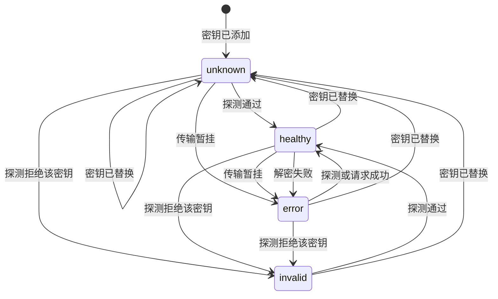

### M02 冷却停用与阶梯

- 所有者：`server/src/services/ratelimit.ts`（类型 `CooldownSource`，函数 `setCooldown`）
- 类别：`lifecycle`
- 持久化：`db`（`rate_limit_cooldowns.expires_at_ms`、`rate_limit_cooldowns.source`、`rate_limit_cooldowns.set_at_ms`）；`memory`（到期映射、升级阶梯 `cooldownHits`、无限额命中窗口 `nullLimitHits`）
- 状态：`none`（隐式：没有行）、`heuristic`、`authoritative`、`credit`、`tier`（各自在 `expires_at_ms` 之前一直生效）
- 仅由以下修改：`server/src/services/ratelimit.ts` `setCooldown()`（也经由 `setRetryAfterCooldown()`）、`isOnCooldown()`（惰性删除已过期的行）、`cleanupExpiredCooldowns()`、`clearCooldownsForKey()`、`clearAllCooldowns()`、`clearCooldownEarly()`；`setCooldown()` 是唯一的 INSERT
- 测试：`server/src/__tests__/services/ratelimit-cooldown-merge.test.ts`、`server/src/__tests__/services/ratelimit-cooldown-ceiling.test.ts`、`server/src/__tests__/services/ratelimit.test.ts`、`server/src/__tests__/routes/keys-cooldowns.test.ts`、`server/src/__tests__/services/cooldown-probe.test.ts`
- 现状：`explicit`

每次停用都经过 `setCooldown()`，它会与生效中的停用合并：到期更晚者胜出，且提供方给出的事实（`authoritative`、`credit`、`tier`）绝不会被降为 `heuristic`。提供方的 Retry-After 以 `authoritative` 写入；只有 `heuristic` 停用可以被提前探测。未解决：`clearCooldownsForKey()` 会遗留 `nullLimitHits`，以及不在内存中的路由的阶梯命中；阶梯和无限额计数器只存在于内存；冷却行没有指向 `api_keys` 的外键，因此已删除密钥的行会一直保留到到期。

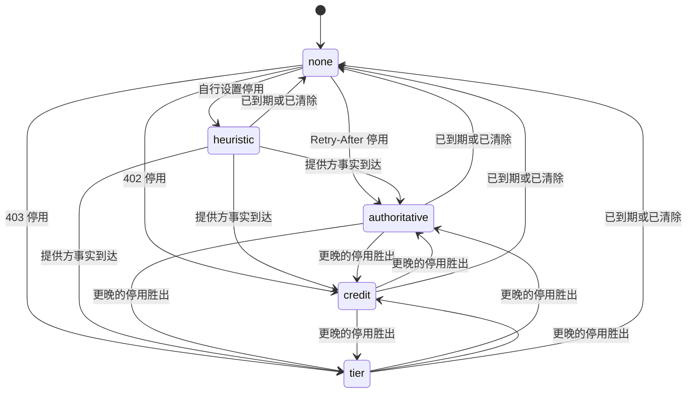

### M03 冷却探测节奏

- 所有者：`server/src/services/cooldown-probe.ts`（无具名类型；状态为 `KeyProbeState`，函数 `runCooldownProbePass`）
- 类别：`lifecycle`
- 持久化：`memory`
- 状态：`none`（隐式：映射中没有条目）、`scheduled`（`failures` 为 0 的条目）、`backoff`（`failures` 为 1 或更多的条目；等待 2 分钟、4 分钟、8 分钟，之后 15 分钟）
- 仅由以下修改：`server/src/services/cooldown-probe.ts` `runCooldownProbePass()`、`resetCooldownProbeState()`（仅测试）
- 测试：`server/src/__tests__/services/cooldown-probe.test.ts`
- 现状：`documented-only`

每个密钥的 `keyState` 映射只在探测巡检内部写入：密钥首次被发现到期时会安排一次带抖动的探测，探测失败或无结论会拉长等待，探测通过则删除该条目。探测从不延长停用，也从不计入 M01 的失效连续次数。未解决：运维人员清除某密钥的冷却时不会重置其条目，因此新的停用会继承旧的退避，直到巡检发现该密钥再无可探测的冷却。

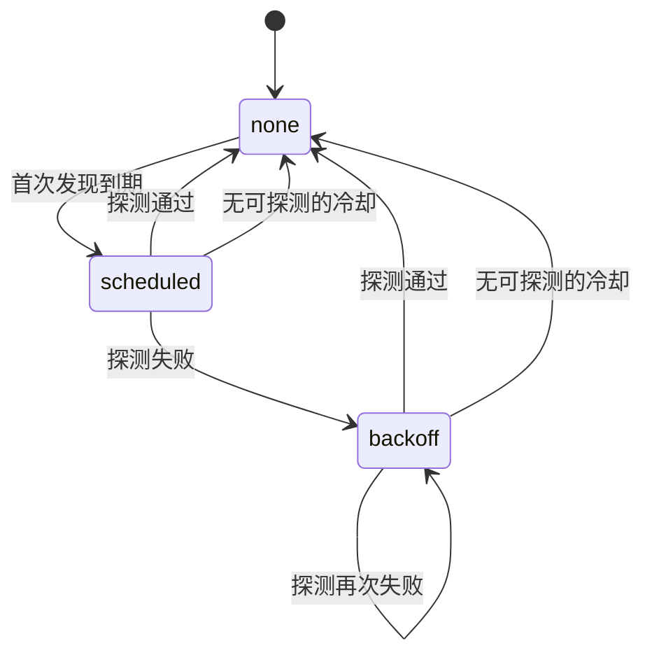

### M04 故障转移中的路由停用

- 所有者：`server/src/lib/fallback-loop.ts`（无具名类型；函数 `recordRetryableFailure`）；辅助函数位于 `server/src/lib/tool-capability.ts` 和 `server/src/lib/output-cap.ts`
- 类别：`lifecycle`
- 持久化：`memory`（连续次数映射、失败窗口、工具停用、学到的输出上限）；它们设置的停用经由 M02 写入 `db`（`rate_limit_cooldowns`）
- 状态：`clear`、`counting`、`benched`（隐式；每个计数器有各自的上限和窗口；工具停用称之为 rejected 和 deferred）
- 仅由以下修改：`server/src/lib/fallback-loop.ts` `recordRetryableFailure()`、`consumeSkipBenchExemption()`、`noteModelFailure()`、`clearModelFailure()`、`clearModelFailureWindows()`、`benchKeyAcrossPlatform()`、`recordAuthFailure()`、`recordUpstreamSuccess()`、`runFallbackLoopAttempts()`（较晚的带内错误停用）、`resetTruncationStreaks()`、`resetEmptyCompletionStreaks()`、`resetModelFailureWindows()`；`server/src/lib/tool-capability.ts` `noteToolRejection()`、`benchForTools()`、`clearToolRejections()`、`resetToolCapability()`；`server/src/lib/output-cap.ts` `learnOutputCapFromError()`、`resetLearnedOutputCaps()`
- 测试：`server/src/__tests__/lib/fallback-loop.test.ts`、`server/src/__tests__/lib/fallback-loop-model-bench.test.ts`、`server/src/__tests__/lib/fallback-loop-issue-1230.test.ts`、`server/src/__tests__/lib/output-cap.test.ts`、`server/src/__tests__/routes/tool-rejection-e2e-1230.test.ts`
- 现状：`documented-only`

四个计数器形态相同：连续三次流被截断，则停用该路由 5 分钟；同一模型在 15 分钟内失败三次，则在所有密钥上停用它 10 分钟；连续三次空补全，则取消跳过停用的豁免；一小时内有三次互不相同的请求被工具拒绝，则该模型在工具请求上被推迟 6 小时。一次成功服务的请求会清零各计数器（工具请求会清除工具停用）。不能破坏的规则：每次停用都必须经过 `setCooldown()`，这样 M02 才能保留更晚的到期时间。未解决：截断和空补全的连续次数没有时间戳，因此相隔很久的失败仍会累加；学到的输出上限只降不升，重启后即遗忘；没有任何运维操作可以清除连续次数、工具停用或输出上限（`clearAllCooldowns()` 加 `clearModelFailureWindows()` 只清除冷却和失败窗口）。

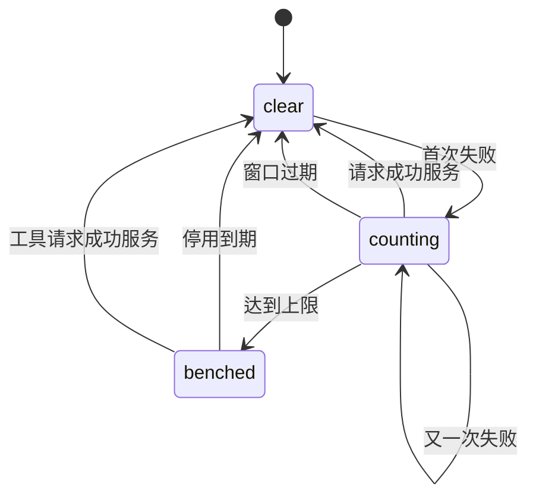

### M05 密钥月度预算

- 所有者：`server/src/services/key-budget.ts`（类型 `BudgetVerdict`，函数 `checkMonthlyBudget`）
- 类别：`lifecycle`
- 持久化：`db`（`api_keys.monthly_request_cap`、`api_keys.monthly_token_cap`、`key_monthly_usage.requests`、`key_monthly_usage.tokens`）；`memory`（进行中的预留）
- 状态：`unlimited`（两个上限均为 0）、`under_cap`、`at_cap`（均在每次检查时派生，不存储）
- 仅由以下修改：上限：`server/src/routes/keys.ts` PATCH `/:id` 处理器、`server/src/services/key-budget.ts` `setMonthlyBudgetCaps()`（无生产调用方）；账本：`requests` 上的 SQL 触发器 `requests_key_monthly_usage`（迁移 `server/src/db/migrations/20260914_000001_key_monthly_usage.ts`）；预留：`server/src/services/key-budget.ts` `reserveMonthlyBudget()` 及其返回的 `release`（由 `server/src/services/router.ts` 和 `server/src/services/provider-credential.ts` 调用）
- 测试：`server/src/__tests__/services/key-budget.test.ts`、`server/src/__tests__/routes/key-monthly-budget.test.ts`、`server/src/__tests__/routes/keys-monthly-usage.test.ts`、`server/src/__tests__/services/router-keycount-budget.test.ts`
- 现状：`documented-only`

当本 UTC 月的成功用量加上进行中的预留达到某个上限时，密钥即为 `at_cap`；账本行以月份为键，因此下个月无需任何写入即从上限以下开始。检查与预留必须在同一个同步步骤内完成，且每条终止路径都必须调用 `release`。未解决：只有成功的请求会计入；使用相同密钥 id 的被替换凭据会继承旧账本；已删除密钥的账本行从不清理；并非每条中止路径都检查过是否泄漏预留。

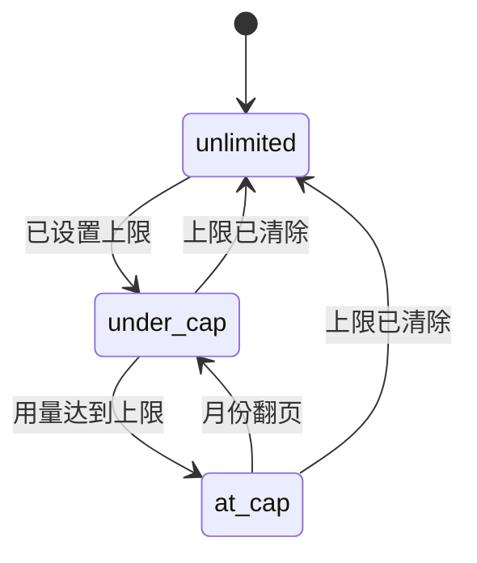

### M06 降级模式

- 所有者：`server/src/services/degradation.ts`（类型 `DegradationState`，函数 `updateDegradationState`）
- 类别：`lifecycle`
- 持久化：`memory`
- 状态：`normal`、`degraded`
- 仅由以下修改：`server/src/services/degradation.ts` `updateDegradationState()`（每次健康巡检后由 `server/src/services/health.ts` 中的 `checkAllKeys()` 调用）、`resetDegradationState()`（仅测试）
- 测试：`server/src/__tests__/services/degradation.test.ts`
- 现状：`explicit`

当拥有可用密钥的已启用提供方不足一半并持续 60 秒时，网关进入 `degraded`；在达到或高于一半并持续 2 分钟后退出；提供方少于 3 个时始终为 `normal`。只有路由器读取它，用来关闭老虎机探索。完整说明见 [04-degraded-mode-and-failover.md](04-degraded-mode-and-failover.md)。未解决：`resetDegradationState()` 没有生产调用方，因此其代码注释中提到的启动后重新探测并不存在。

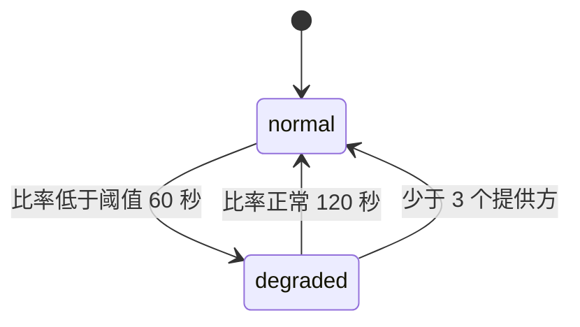

### M07 提供方额度快照

- 所有者：`server/src/services/provider-quota.ts`（类型 `QuotaObservationSource` 位于 `shared/types.ts`，函数 `recordQuotaObservation`）
- 类别：`lifecycle`
- 持久化：`db`（`provider_quota_state.source`、`provider_quota_state.confidence`、`provider_quota_state.remaining_value`、`provider_quota_state.reset_at`；历史记录在 `provider_quota_observations`）；`memory`（5 秒余量缓存）
- 状态：`header`、`quota_api`、`error_body`、`local_usage`、`documentation`、`probe`（当前行的 `source`，每种来源有各自的置信度；`reset_at` 已过的行按满额预算读取，隐式）
- 仅由以下修改：`server/src/services/provider-quota.ts` `recordQuotaObservation()`（经由 `recordQuotaObservationsFromResponse()` 和 `server/src/providers/openai-compat.ts` 到达）；迁移 `server/src/db/migrations/20260915_000001_quota_snapshot_freshness.ts`
- 测试：`server/src/__tests__/services/provider-quota.test.ts`、`server/src/__tests__/providers/quota-api-poll.test.ts`、`server/src/__tests__/services/health-quota-poll.test.ts`、`server/src/__tests__/services/quota-outlook.test.ts`
- 现状：`explicit`

每个（平台、密钥、池、指标）一行；`remaining` 非空的最新观测会替换该行，而没有 `remaining` 的观测不能替换已有的行。路由只使用置信度为 0.7 或更高的行，并且只用来给密钥排序。未解决：没有任何代码删除 `provider_quota_state` 行，因此被替换或被删除的密钥仍保留旧读数；429 或 402 的 `error_body` 行（remaining 为 0，无重置时间）会替换 header 读数，且永不过期；`reset_at` 的过期规则被写了两遍，分别在 `getKeyQuotaHeadroom()` 和 `getQuotaStateForKeys()` 中。

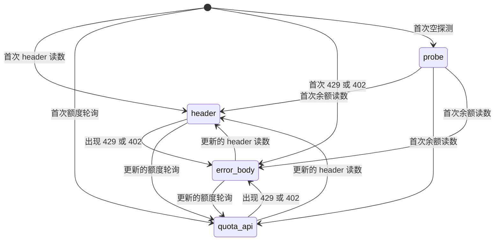

## 4. 目录与回退链

### M08 目录模型生命周期

- 所有者：`server/src/services/model-state.ts`（类型 `CatalogTombstoneSource`，函数 `retireCatalogModelUpstream`、`reinstateUpstreamRetiredCatalogModel`）
- 类别：`lifecycle`
- 持久化：`db`（`catalog_model_tombstones.source`、`catalog_model_tombstones.chain_snapshot`、`models.enabled`、`models.source`、`model_overrides.overrides_json`）
- 状态：`live`（无墓碑）、`retired`（`upstream_eol`）、`deleted`（`user`）
- 仅由以下修改：`server/src/services/model-state.ts` `recordCatalogModelTombstone()`、`clearCatalogModelTombstone()`、`retireCatalogModelUpstream()`、`reinstateUpstreamRetiredCatalogModel()`、`setChainEnabled()`、`deleteTombstonedCatalogModels()`；`server/src/routes/models.ts` 模型创建（`clearCatalogModelTombstone`）、PATCH `/:id`（`models.enabled`）和 DELETE `/:id`（`recordCatalogModelTombstone`）；`server/src/services/model-retirement.ts`（调用 `retireCatalogModelUpstream`）；`server/src/services/catalog-sync.ts` `applyCatalog()`（恢复、`models.enabled`、行清理）；`server/src/services/builtin-model-discovery.ts` `registerDiscoveredModels()`（显式选择会清除墓碑）；`server/src/services/declarative-config.ts` `upsertModel()`（清除墓碑）；`server/src/db/migrations/20260728_000001_tombstone_provenance.ts`（删除 `upstream_eol` 行）
- 测试：`server/src/__tests__/services/model-chain-lifecycle.test.ts`、`server/src/__tests__/services/model-retirement.test.ts`、`server/src/__tests__/services/catalog-sync.test.ts`、`server/src/__tests__/services/model-state-overrides.test.ts`、`server/src/__tests__/routes/models-management.test.ts`
- 现状：`types-only`

这些状态是隐式的：模型行、`models.enabled`、回退链标志和墓碑各自独立变化，墓碑来源是唯一的具名联合类型。下线不会动 `models.enabled`；它把回退链标志保存到 `chain_snapshot`，写入一条 `upstream_eol` 墓碑，并关闭回退链标志。不要让用户墓碑阻止撤销下线，也不要让恢复还原超出已保存标志的内容（没有快照的行仍会把每个回退链条目全部打开）。未解决：清理目录行不会清除它的 `upstream_eol` 墓碑；目录中的 `enabled=false` 会一直保持，因为同步不记录是谁停用了该行。

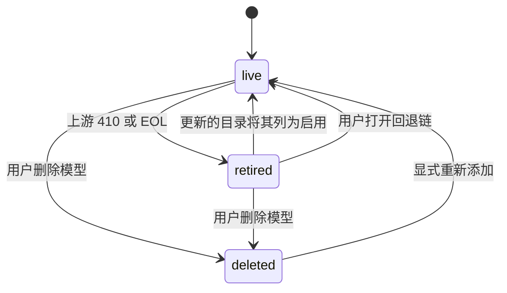

### M09 自定义模型墓碑

- 所有者：`server/src/services/custom-model-tombstone.ts`（无具名类型）
- 类别：`lifecycle`
- 持久化：`db`（`custom_model_tombstones.endpoint_scope`、`custom_model_tombstones.model_id`）
- 状态：`absent`、`tombstoned`（隐式：存在 `(endpoint_scope, model_id)` 对应的行）
- 仅由以下修改：`server/src/services/custom-model-tombstone.ts` `recordCustomModelTombstone()`、`clearCustomModelTombstone()`；调用方：`server/src/routes/models.ts` DELETE `/:id` 和自定义模型删除路由（记录）、`server/src/routes/models.ts` 模型创建（清除）、`server/src/routes/keys.ts` 密钥删除（为该密钥拥有的每个模型记录）、`server/src/services/custom-model-register.ts` `registerCustomModels()`（清除）
- 测试：`server/src/__tests__/services/custom-model-sync.test.ts`、`server/src/__tests__/db/migrate/custom-model-tombstones.test.ts`
- 现状：`documented-only`

定时同步（`custom-model-sync.ts` 中的 `runCustomModelSync`）用 `isCustomModelTombstoned()` 读取墓碑并跳过该模型。只有显式登记才会清除它。不要在定时同步中清除墓碑。这就是 #926 的行为：删除密钥会为它的所有模型留下墓碑，因此重新添加同一个密钥，下一次同步也不会把它们带回来；运维人员必须显式登记它们（例如使用“Fetch models”）。未解决：没有任何东西列出或过期墓碑，且跳过只在 `result.tombstoned` 中计数。

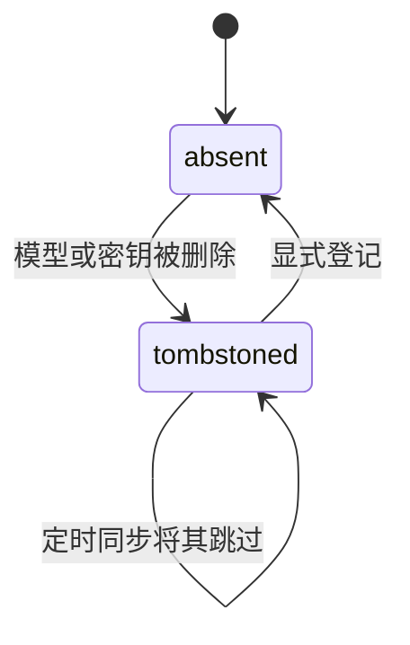

### M10 回退链成员

- 所有者：`server/src/services/model-state.ts`（无具名状态类型；函数 `setChainEnabled`）
- 类别：`lifecycle`
- 持久化：`db`（`fallback_config.enabled`、`profile_models.enabled`、`profiles.auto_include_new_models`）
- 状态：`absent`（无回退链行）、`enabled`、`disabled`；每个模型在每条回退链（全局回退链和每个配置档）中各有一个状态，隐式体现在 `enabled` 的 0/1 中
- 仅由以下修改：`server/src/services/model-state.ts` `setChainEnabled()`、`reinstateUpstreamRetiredCatalogModel()`（还原已保存的标志）；`server/src/routes/models.ts` PATCH `/:id`（`setChainEnabled`，另外在停用时直接执行 `UPDATE profile_models SET enabled = 0`）；`server/src/routes/fallback.ts` PUT `/`（写入 `fallback_config` 或对 `profile_models` 做 upsert）；`server/src/routes/profiles.ts` 配置档回退链 PUT、创建、重置和复制（插入或替换 `profile_models`）以及 PATCH `/:id`（`auto_include_new_models`）；`server/src/services/declarative-config.ts` `ensureFallbackRow()`、`applyFallback()`；`server/src/services/profile-models.ts` `ensureModelInProfiles()`、`ensureAllModelsInProfiles()`（为 `auto_include_new_models = 1` 的配置档插入行）；添加模型时的行插入：`server/src/services/catalog-sync.ts` `applyCatalog()`、`server/src/services/builtin-model-discovery.ts` `registerDiscoveredModels()`、`server/src/services/custom-model-register.ts` `registerCustomModels()`、`server/src/routes/models.ts` 模型创建
- 测试：`server/src/__tests__/services/model-chain-lifecycle.test.ts`、`server/src/__tests__/routes/profiles-chains.test.ts`、`server/src/__tests__/routes/models-management.test.ts`、`server/src/__tests__/services/model-retirement.test.ts`
- 现状：`documented-only`

对于由模型事件触发的单个模型开关标志（仪表盘开关、停用、下线），`setChainEnabled()` 是唯一的写入方。但它并非回退链行的唯一写入方：回退链编辑、配置档编辑、声明式配置和模型创建都会直接写入这些行。通过 `setChainEnabled()` 打开模型时也会清除 `upstream_eol` 墓碑；它从不触碰用户墓碑。未解决：来自过期客户端的整条回退链 PUT 可能覆盖一次下线；`auto_include_new_models = 0` 的配置档永远收不到新模型。

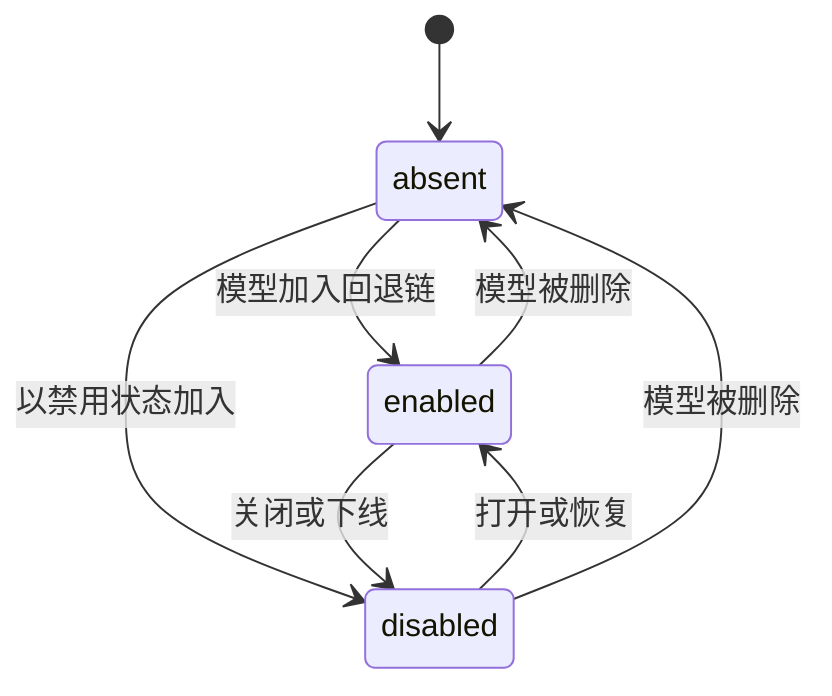

### M11 目录同步运行

- 所有者：`server/src/services/catalog-sync.ts`（类型 `SyncResult`，函数 `syncCatalog`）
- 类别：`workflow`
- 持久化：`memory`（`inFlight`、`queuedForce`）；`db` 结果（`settings`：已应用版本、已应用档位、已应用 JSON、上次同步时间、上次错误）
- 状态：`idle`、`running`、`queued_force`（强制运行排在当前运行之后等待）；运行结果 `applied`、`up_to_date`、`skipped_older`、`error`（`SyncResult.action`）
- 仅由以下修改：`server/src/services/catalog-sync.ts` `syncCatalog()`、`startSync()`、`runSync()`；`syncCatalog` 的调用方：`catalog-sync.ts` `startCatalogSync()`（12 小时定时和启动定时器）、`server/src/routes/premium.ts`（许可证变更和手动同步时的 `syncCatalog(true)`）、`server/src/services/declarative-config.ts`（`syncCatalog(true)`）；另有 `catalog-sync.ts` `reapplyCachedCatalog()`（启动时调用 `applyCatalog`，在运行之外）
- 测试：`server/src/__tests__/services/catalog-sync-concurrency.test.ts`、`server/src/__tests__/services/catalog-sync.test.ts`、`server/src/__tests__/services/catalog-sync-scheduler.test.ts`
- 现状：`types-only`

任一时刻最多有一次运行在进行。运行期间到达的普通调用方共享它的 promise；强制调用方则在其后排入一次额外的强制运行，期间到达的所有强制调用方共享这一次（正在运行的那次是在许可证变更之前读取的许可证密钥）。除通过 `syncCatalog` 外，不要启动 `runSync`。内置模型发现（`server/src/services/builtin-model-discovery.ts`，`triggerBuiltinModelDiscovery`）有自己的防护：每个平台同时只有一次进行中的巡检，`healthy` 触发只在该平台没有模型且上次事件运行距今超过 1 小时时才运行；`key_added` 触发则跳过这 1 小时的间隔。未解决：`skipped_older` 不会展示给用户，且 `reapplyCachedCatalog()` 可能在共享运行之外执行一次应用。

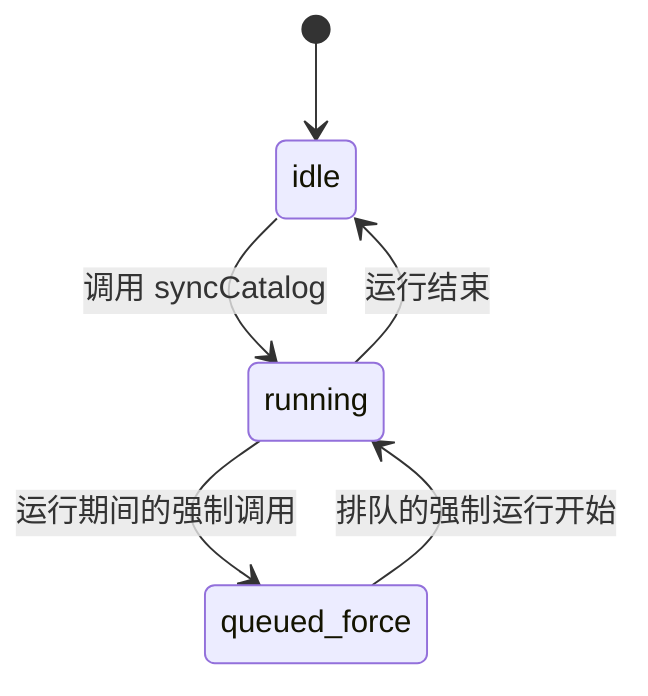

## 5. 请求、流与缓存

### M12 请求故障转移循环

- 所有者：`server/src/lib/fallback-loop.ts`（类型 `AttemptErrorClass`，函数 `runFallbackLoop`）
- 类别：`workflow`
- 持久化：`memory`（每请求局部变量），`db`（循环返回后一次性写入的 `request_attempts` 行；客户端中止时写入 `requests.status` 为 `canceled` 的行）
- 状态：`routing`、`dispatching`（均为隐式循环位置）；每次尝试的结果 `ok`、`committed`、`client_abort`，外加 14 个 `AttemptErrorClass` 值 `auth`、`out_of_credits`、`daily_quota_exhausted`、`model_not_found`、`forbidden`、`context_too_large`、`provider_bad_request`、`empty_completion`、`format_ignored`、`invalid_tool_arguments`、`timeout`、`rate_limited`、`upstream_error`、`error`
- 仅由以下修改：`server/src/lib/fallback-loop.ts` `runFallbackLoopAttempts()`、`classifyAttemptError()`、`recordRetryableFailure()`、`recordAuthFailure()`；`server/src/lib/error-classify.ts` `newClientAbortError()`、`newHedgeAbortError()`
- 测试：`server/src/__tests__/lib/fallback-loop.test.ts`、`server/src/__tests__/lib/fallback-loop-client-abort.test.ts`、`server/src/__tests__/lib/fallback-loop-hedge.test.ts`、`server/src/__tests__/lib/exhaustion-statuses.test.ts`、`server/src/__tests__/lib/fallback-loop-ttfb-budget.test.ts`、`server/src/__tests__/lib/fallback-loop-late-inband.test.ts`
- 现状：`types-only`

一个循环跑完所有接口的尝试：选路由、分发、对失败分类、故障转移。预算、对冲和熔断器的细节见 `03-streaming-pipeline.md` 和 `04-degraded-mode-and-failover.md`。编辑者不得破坏的规则：客户端中止（`isClientAbortError`：错误或其 `cause` 链上的 `clientAbort` 标志，或我们完整的中止语句）和 `clientGone` 检查会终止循环，不冷却、不惩罚、不再尝试；上游错误文本绝不能被读成客户端中止。`route()` 抛出不带数值 `status` 的错误（程序缺陷、数据库错误）时，渲染 500 `internal_error`，绝不报“no providers”。仅当尝试静默时长达到预算的 0.75 以上时，对冲中止或迟到的带内错误才会停用该路由。未解决：熔断器状态按请求保存，没有半开步骤。

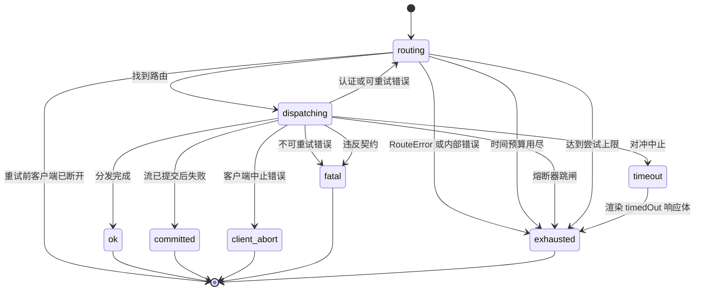

### M13 流提交点

- 所有者：`server/src/lib/stream-commit.ts`（类型 `StreamPhase`，函数 `failedStreamPhase`）
- 类别：`protocol`
- 持久化：`memory`（每次尝试的局部变量；阶段由推导得出，不存储）
- 状态：`held`、`committed`、`finished`、`abandoned`；内联工具调用方言的暂存窗口子状态 `undecided`、`passthrough`、`dialect`（类型 `DialectHoldMode`，位于 `server/src/lib/tool-call-rescue.ts`）
- 仅由以下修改：`server/src/lib/stream-commit.ts` `failedStreamPhase()`、`throwIfAbandoned()`；提交标志在每个接口中只设置一次，位于 `server/src/routes/proxy.ts`（`headerSent`，在 `/v1/chat/completions` 和 `/v1/completions` 的分发钩子中）、`server/src/routes/responses.ts`（`streamStarted`）、`server/src/routes/anthropic.ts` `streamCompletion()`（`messageStarted`）、`server/src/lib/inbound-chat.ts` `runInboundChat()`（`committed`）；`finished` 来自 `res.writableEnded`
- 测试：`server/src/__tests__/routes/stream-client-gone.test.ts`、`server/src/__tests__/routes/stream-post-end-bookkeeping.test.ts`、`server/src/__tests__/lib/tool-call-rescue.test.ts`
- 现状：`explicit`

每个流式接口（chat、旧版 completions、responses、messages，以及 Gemini 和 Ollama 背后的 inbound-chat）都让每次尝试经过同样的四个阶段，每个 catch 都是对 `failedStreamPhase()` 的 `switch`。编辑者不得破坏的规则：处于 `finished` 时不得向响应写入任何内容（`res.end()` 之后写入会抛出 `ERR_STREAM_WRITE_AFTER_END`，在进程安全网下属致命错误），客户端断开必须经 `throwIfAbandoned()` 抛出，这样共享循环只记一行 `canceled`，而不是 `success` 或 `error`。未解决：每个接口各自保留自己的提交标志和自己的首个载荷规则（responses 在首个工具调用增量时提交）；chat 路由保留一个本地的四值暂存模式，多出 `json`，并且不使用 `DialectHoldMode`。

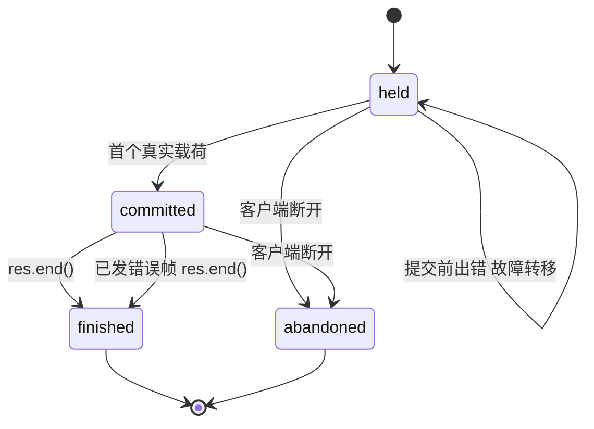

方言暂存窗口，位于第一个字节到达客户端之前：

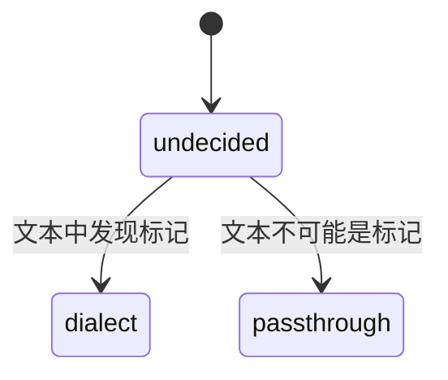

### M14 提供方 SSE 读取器

- 所有者：`server/src/providers/base.ts`（无具名类型；`BaseProvider.readSseFrames`）
- 类别：`protocol`
- 持久化：`memory`
- 状态：`awaiting_first_byte`、`streaming`、`finished`、`failed`（均为隐式；标志 `awaitingFirstByte`、`sawFinishReason` 在 base.ts 中，`emittedFinish` 在 google.ts 中）
- 仅由以下修改：`server/src/providers/base.ts` `readSseFrames()`；`server/src/providers/google.ts` `streamChatCompletion()`；`server/src/providers/moondream.ts` `streamChatCompletion()`（在 `readSseStream()` 之上检查自己的 `finished` 标志）
- 测试：`server/src/__tests__/providers/read-sse-frames.test.ts`、`server/src/__tests__/providers/google.test.ts`、`server/src/__tests__/providers/moondream.test.ts`、`server/src/__tests__/providers/stream-first-byte.test.ts`
- 现状：`documented-only`

每次读取都有截止时间：首次读取用首字节预算，之后用停滞预算。到 EOF 时，未结束的最后一行与其他行一样被解析。编辑者不得破坏的规则：正文既没有 `[DONE]` 也没有结束原因就结束，属于截断，要抛出可重试错误，绝不能静默结束，也不能合成 `stop`。Google 自己读取正文，把 Gemini 带内的 `{error}` 帧当作 HTTP 风格的错误抛出（429 归类为限流），并在第一个结束块之后立即返回。未解决：不使用 `readSseStream` 或 Google 读取器的适配器可能缺少停滞计时器；带内错误是无类型的 `googleHttpError`，不是共享类型。

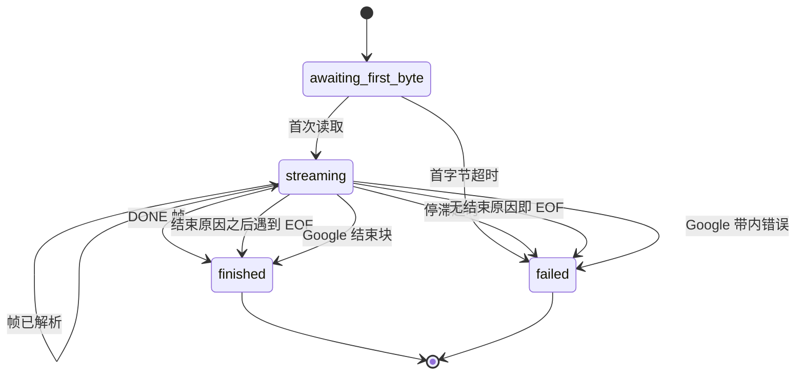

### M15 联网搜索 SSE 生命周期

- 所有者：`server/src/lib/responses-web-search.ts`（无具名类型；类 `ResponsesSse`，函数 `maybeServeResponsesWebSearch`）和 `server/src/lib/anthropic-web-search.ts`（类 `AnthropicSse`，函数 `maybeServeAnthropicWebSearch`）
- 类别：`protocol`
- 持久化：`memory`
- 状态：`buffered`、`committed`、`ended`（隐式；私有布尔值 `started` 和 `res.writableEnded`）
- 仅由以下修改：`server/src/lib/responses-web-search.ts` `ResponsesSse.start()`、`complete()`、`fail()`；`server/src/lib/anthropic-web-search.ts` `AnthropicSse.start()`、`finish()`、`fail()`
- 测试：`server/src/__tests__/routes/agent-web-search.test.ts`、`server/src/__tests__/routes/responses.test.ts`
- 现状：`documented-only`

流式联网搜索请求会运行内部的非流式模型轮次，并把它们作为 SSE 重放。流开始之前，内部错误以带真实状态码的普通 HTTP 返回；流开始之后，错误以 `response.failed`（Responses）或 `error` 事件（Messages）返回。编辑者不得破坏的规则：一旦 `res.writableEnded` 或 `res.destroyed`，`write()` 即为空操作，并且心跳计时器在每个退出路径上都要清除。如果第一轮很慢，Responses 会在 3 秒后自行启动流（`STREAM_COMMIT_AFTER_MS`）；Messages 没有这种计时器，只在第一轮返回时才启动。未解决：两个文件都不在 `performWebSearch()` 之后立即检查 `res.destroyed`，所以搜索期间离开的客户端仍会触发下一个内部轮次。

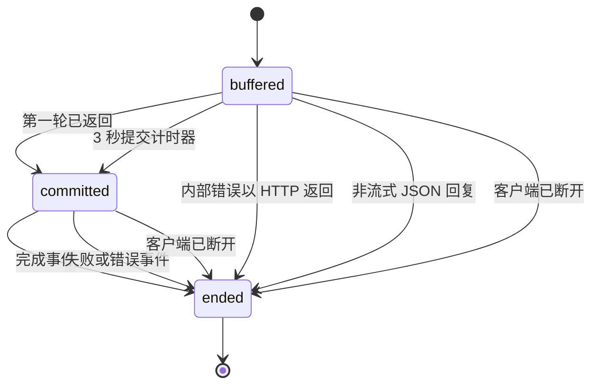

### M16 幂等性声明

- 所有者：`server/src/services/idempotency.ts`（类型 `IdempotencyClaimResult`，函数 `lookupIdempotencyReplay`、`storeIdempotencyResult`）
- 类别：`lifecycle`
- 持久化：`db`（`idempotency_claims.key_hash`、`idempotency_claims.request_fingerprint`、`idempotency_claims.response_status`、`idempotency_claims.response_body`、`idempotency_claims.expires_at_ms`）
- 状态：`none`、`stored`、`expired`（隐式：`expires_at_ms` 已过去；读取时忽略它）。查找结果为 `miss`、`replay`、`conflict`。
- 仅由以下修改：`server/src/services/idempotency.ts` `storeIdempotencyResult()`、`clearIdempotencyResult()`（测试之外无调用方）；`server/src/services/request-retention.ts` `pruneExpiredClaims()`；存储的唯一生产调用方是 `server/src/routes/proxy.ts`（非流式 chat）
- 测试：`server/src/__tests__/services/idempotency.test.ts`、`server/src/__tests__/db/idempotency.test.ts`、`server/src/__tests__/routes/proxy-cache.test.ts`、`server/src/__tests__/services/request-retention.test.ts`
- 现状：`types-only`

声明只在请求完成之后才存在：该行需要响应状态和正文，所以没有进行中状态。第一个请求运行期间，带相同密钥的第二个请求不会被去重；两者都会到达提供方，后一次存储会替换前一行。不要存储 `finish_reason` 为 `length` 的响应，也不要存储流。带相同密钥但指纹不同的请求会得到 409，直到声明过期（默认 24 小时，`IDEMPOTENCY_TTL_MS`）。未解决：没有进行中保护；重放不写入 `requests` 或用量行。

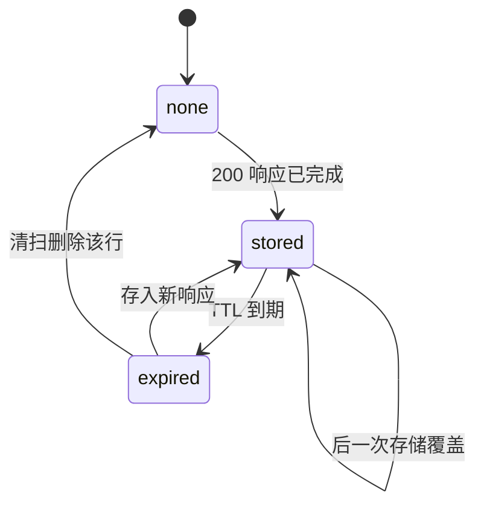

### M17 响应缓存条目

- 所有者：`server/src/services/cache.ts`（无具名状态类型；函数 `storeCachedResponse`、`getCachedResponse`）
- 类别：`lifecycle`
- 持久化：`memory`（LRU 映射 `store`、流映射 `streamStore`、写入队列 `pendingWrites`），`db`（`response_cache.cache_key`、`response_cache.body_json`、`response_cache.hit_count`、`response_cache.expires_at_ms`）
- 状态：`absent`、`live`（在内存中，开启持久化时也在 `response_cache` 中）、`expired`（存在时间超过 TTL，下次读取时移除）、`evicted`
- 仅由以下修改：`server/src/services/cache.ts` `storeCachedResponse()`、`storeCachedStreamResponse()`、`getCachedResponse()`（惰性过期、命中计数）、`getCachedStreamResponse()`、`enforceCombinedCap()`（内部 LRU 淘汰）、`loadCacheFromDb()`（启动时清理并加载）、`clearCache()`；`server/src/services/request-retention.ts` `pruneExpiredClaims()`（只删除过期行）；调用方：`server/src/routes/proxy.ts`、`server/src/routes/cache.ts`、`server/src/routes/mcp.ts`
- 测试：`server/src/__tests__/services/cache.test.ts`、`server/src/__tests__/routes/proxy-cache.test.ts`、`server/src/__tests__/services/request-retention.test.ts`
- 现状：`documented-only`

读取以内存为准。行是后写的：`schedulePersist()` 把每次写入排入队列，在下一个 tick 执行，命中计数在 2 秒后刷新，写入失败则丢弃（缓存回退为仅内存）。流条目从不写入磁盘。不要在请求路径上读取该表。未解决：关闭时没有排空，所以崩溃或退出时，排队中的写入和最多 2 秒的命中计数会丢失；关闭持久化后，已有的行会保留到清扫或下次启动清理。

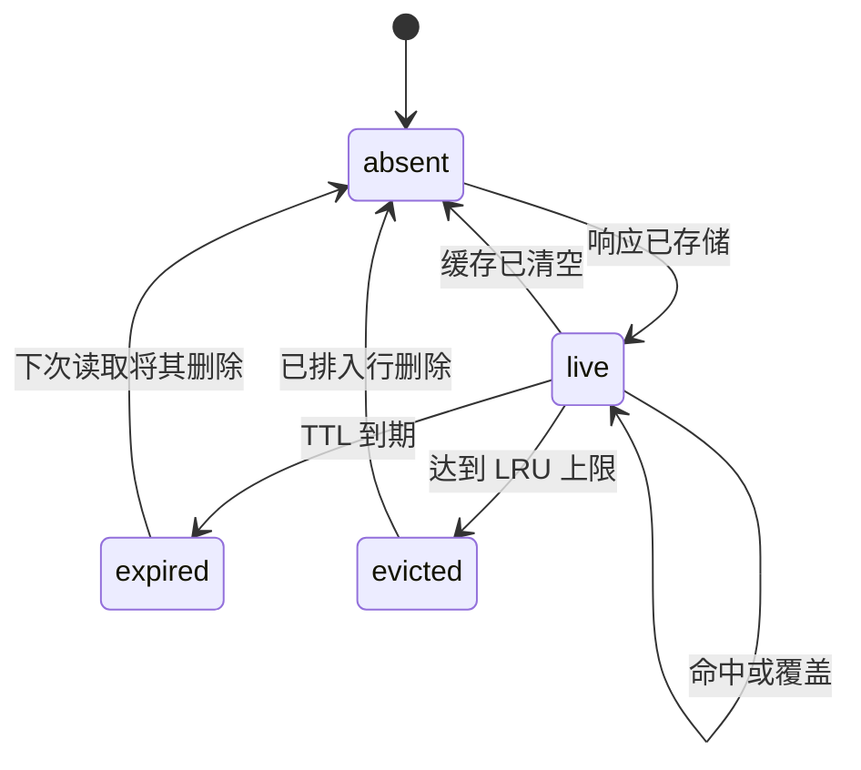

### M18 请求结果状态

- 所有者：`server/src/lib/request-log.ts`（类型 `RequestStatus`，来自 `shared/types.ts`，函数 `logRequest`）
- 类别：`lifecycle`
- 持久化：`db`（`requests.status`）
- 状态：`success`、`error`、`canceled`
- 仅由以下修改：`server/src/lib/request-log.ts` `logRequest()`；`server/src/scripts/routing-sim.ts`（开发脚本，原始 INSERT）
- 测试：`server/src/__tests__/lib/request-log-writers.test.ts`、`server/src/__tests__/lib/fallback-loop-client-abort.test.ts`、`server/src/__tests__/routes/analytics.test.ts`、`server/src/__tests__/routes/analytics-requests.test.ts`、`server/src/__tests__/routes/modality-client-gone.test.ts`
- 现状：`explicit`

`requests` 行只写一次，带最终状态，之后不再更新。`canceled` 表示客户端断开：它计入总数，但既不算成功也不算错误，所以比率必须按 success/(success+error) 计算，绝不能按 success/total。未解决：`status` 列没有 CHECK 约束，`RequestStatus` 只是 TypeScript 类型，所以数据库层面没有任何东西会拒绝其他取值。月度用量触发器和 `request_hourly` 计数器只统计 `success` 和 `error` 行。

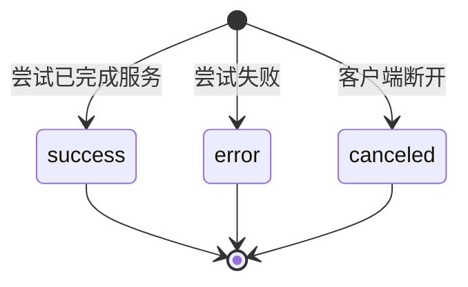

### M19 模态故障转移循环

- 所有者：`server/src/lib/failover-chain.ts`（类型 `AttemptOutcome`，函数 `runFailoverChain`）
- 类别：`workflow`
- 持久化：`memory`
- 状态：`success`、`error`、`canceled`（每次尝试的结果）；遍历本身有隐式状态：下一行、无凭据（跳过）、尝试中、完成、客户端已断开
- 仅由以下修改：`server/src/lib/failover-chain.ts` `runFailoverChain()`；调用方 `server/src/services/embeddings.ts`、`server/src/services/rerank.ts`、`server/src/services/moderation.ts`、`server/src/services/media.ts`；`server/src/services/decision.ts` 和 `server/src/services/search.ts` 中有各自独立的循环
- 测试：`server/src/__tests__/lib/failover-chain.test.ts`、`server/src/__tests__/routes/modality-client-gone.test.ts`
- 现状：`explicit`

`runFailoverChain` 按顺序遍历各行，预留一个未被停用的凭据，并把每次尝试记为 `success`、`error` 或 `canceled`。如果客户端信号中止，它记 `canceled`，抛出 499，既不停用密钥，也不尝试下一行。429 错误会通过 `setRetryAfterCooldown` 在该（平台，模型）下停用该密钥。未解决：decision 和 search 保留各自的循环，不使用 `runFailoverChain`；search 检查客户端信号，而在 `decision.ts` 中没有发现中止检查。

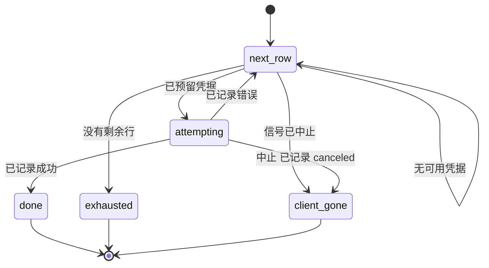

### M20 异步上游任务轮询

- 所有者：`server/src/providers/sail.ts`（类型 `SailStatus`，方法 `SailProvider.runResponse`）；`server/src/services/media.ts`（函数 `callHuggingFaceVideo`）
- 类别：`workflow`
- 持久化：`memory`
- 状态：sail 的 `queued`、`in_progress`、`completed`、`incomplete`、`failed`、`cancelled`；Hugging Face 视频的 `IN_QUEUE`、`COMPLETED`、`FAILED`、`CANCELLED`（任何其他状态字符串都继续轮询）
- 仅由以下修改：`server/src/providers/sail.ts` `SailProvider.runResponse()`；`server/src/services/media.ts` `callHuggingFaceVideo()`
- 测试：`server/src/__tests__/providers/sail.test.ts`、`server/src/__tests__/services/media.test.ts`、`server/src/__tests__/routes/video-generations.test.ts`
- 现状：`explicit`

Sail 有具名的 `SailStatus` 联合类型和一个轮询循环；HF 视频状态是从上游回复中读出的普通字符串，所以其状态是隐式的。规则：HF 视频任务一旦提交（并已计费），状态轮询的瞬时失败（网络、429、5xx）就带退避重试直到截止时间，绝不会结束调用，因为失败会让回退链转到下一个提供方，并为第二次生成付费；4xx 错误则结束调用。未解决：sail 按固定间隔轮询，任何轮询 HTTP 错误都会结束调用（没有瞬时重试），与 HF 不同。

```mermaid
stateDiagram-v2
  [*] --> queued: sail 已提交
  queued --> in_progress: 轮询
  queued --> completed: 轮询
  in_progress --> completed: 轮询
  in_progress --> incomplete: 轮询
  queued --> failed: 轮询
  in_progress --> failed: 轮询
  queued --> cancelled: 轮询
  in_progress --> cancelled: 轮询
  completed --> [*]
  incomplete --> [*]
  failed --> [*]: 抛出错误
  cancelled --> [*]: 抛出错误
  [*] --> IN_QUEUE: HF 已提交
  IN_QUEUE --> IN_QUEUE: 轮询或重试瞬时错误
  IN_QUEUE --> COMPLETED: 轮询
  IN_QUEUE --> FAILED: 轮询
  IN_QUEUE --> CANCELLED: 轮询
  COMPLETED --> [*]: 获取结果
  FAILED --> [*]: 抛出错误
  CANCELLED --> [*]: 抛出错误
```

### M21 融合与迭代批判运行

- 所有者：`server/src/services/fusion.ts`（无具名类型）
- 类别：`workflow`
- 持久化：`memory`
- 状态：`(not yet traced)`
- 仅由以下修改：`(not yet traced)`
- 测试：`(not yet traced)`
- 现状：`documented-only`

未追踪：所有者文件有未提交的改动。等这些改动落地后再追踪。

## 6. 认证

### M22 认证码

- 所有者：`server/src/lib/setup-code.ts` 和 `server/src/lib/reset-code.ts`（无具名类型；二者都封装 `server/src/lib/one-time-code.ts` 的 `createOneTimeCode()`，接口为 `OneTimeCode`）
- 类别：`lifecycle`
- 持久化：`memory`
- 状态：设置码：`none`、`active`（隐式：`current` 为 null 或字符串）；重置码：`none`、`live`、`expired`（隐式：持有一个码，且 `mintedAtMs` 在 15 分钟之内或已超过）
- 仅由以下修改：`server/src/lib/setup-code.ts` 的 `generateSetupCode()`、`clearSetupCode()`；`server/src/lib/reset-code.ts` 的 `generateResetCode()`、`clearResetCode()`、`resetCodeMatches()`（过期时惰性清除）；`server/src/lib/one-time-code.ts` 的 `generate()`、`clear()`。调用方：`server/src/index.ts`（启动，0 个用户）、`server/src/routes/auth.ts` 的 POST `/setup`、`/forgot-password`、`/reset-password`
- 测试：`server/src/__tests__/routes/auth-setup-code.test.ts`、`server/src/__tests__/routes/auth-reset-password.test.ts`、`server/src/__tests__/lib/loopback.test.ts`
- 现状：`documented-only`

设置码仅在启动时用户数为 0 才生成，账户存在后清除。只有当 `isLocalRequest()`（`server/src/lib/loopback.ts`）判定请求为本地请求时，请求才可跳过设置码：套接字为环回，且没有转发跳数、转发头或 `TRUST_PROXY` 表明并非如此。编辑者不得破坏的规则：转发头只能撤销本地性，绝不能授予本地性；`generateResetCode()` 必须复用仍有效的码，这样匿名调用方就无法作废运维人员的码。未解决：`/reset-password` 没有按码计的尝试次数上限；`/setup` 或重置请求若校验失败或找不到账户，则保留其码。

```mermaid
stateDiagram-v2
  state "设置码" as Setup {
    [*] --> setup_none
    setup_none --> setup_active: 启动时 0 个用户
    setup_active --> setup_none: 账户已创建
    setup_active --> setup_none: 已有用户时的设置请求
  }
  state "重置码" as Reset {
    [*] --> reset_none
    reset_none --> reset_live: 忘记密码
    reset_live --> reset_live: 忘记密码复用该码
    reset_live --> reset_expired: 15 分钟已过
    reset_expired --> reset_live: 忘记密码生成新码
    reset_expired --> reset_none: 尝试重置并清除
    reset_live --> reset_none: 重置成功
  }
```

### M23 认证节流与锁定

- 所有者：`server/src/routes/auth.ts`（无具名类型；映射 `attempts`，函数 `recordFailure`、`lockoutRetryAfterSec`）
- 类别：`lifecycle`
- 持久化：`memory`
- 状态：登录桶（按地址加 IP，以及仅按地址）：`fresh`、`locked`、`expired_lock`（隐式：一个计数加 `lockedUntil`）；改密计数器：`strikes_0`、`strikes_1`、`strikes_2`，然后登出；重置码请求间隔：`open`、`cooling`（每个 IP 10 秒）；模型测试间隔：`open`、`cooling`（每个模型 5 秒）
- 仅由以下修改：`server/src/routes/auth.ts` 的 `recordFailure()`、`clearFailures()`、`clearAccountLockouts()`，处理器 POST `/change-email` 和 `/change-password`（`failedPasswordAttempts`），POST `/forgot-password`（`lastResetCodeAt`）；`server/src/routes/models.ts` 的模型测试处理器（`modelTestCooldowns`）；`server/src/middleware/rateLimit.ts` 的 `createProxyRateLimiter()`、`createAdminRateLimiter()`（闭包中按 IP 的固定窗口）
- 测试：`server/src/__tests__/routes/auth-login-throttle.test.ts`、`server/src/__tests__/routes/auth-reset-password.test.ts`、`server/src/__tests__/routes/admin-rate-limit.test.ts`、`server/src/__tests__/routes/proxy-rate-limit.test.ts`、`server/src/__tests__/routes/models-provider-actions.test.ts`
- 现状：`documented-only`

每次登录失败都会计入两个桶：地址加客户端 IP（5 次尝试，锁住单个猜测者）和仅地址（50 次尝试，限制轮换 IP 的猜测者）；两者都锁定 15 分钟并携带 `Retry-After`。编辑者不得破坏的规则：桶键必须使用 `normalizeEmail()`，即与 `verifyCredentials()` 查找时相同的拼写，否则带填充的地址会得到全新的桶。一次成功的重置会清除该账户的所有锁。未解决：`failedPasswordAttempts` 没有过期，除成功外也无法重置；`attempts` 的清理只移除已过期的锁，因此超过 10,000 个被锁定的键时，每次失败都要线性扫描；每个代理挂载点都有自己的限流器，因此总量可能超过 RPM；登录锁定和模型测试节流状态没有直接测试 3 次失败登出或模型测试冷却（`models-provider-actions.test.ts` 中只出现 429 文本）。

```mermaid
stateDiagram-v2
  [*] --> fresh
  fresh --> fresh: 密码错误 未达上限
  fresh --> locked: 密码错误达上限
  locked --> locked: 登录收到 429
  locked --> expired_lock: 15 分钟已过
  expired_lock --> fresh: 下次失败开启新窗口
  fresh --> [*]: 密码正确
  locked --> [*]: 密码已重置
  [*] --> strikes_0
  strikes_0 --> strikes_1: 当前密码错误
  strikes_1 --> strikes_2: 当前密码错误
  strikes_2 --> signed_out: 当前密码错误
  strikes_0 --> [*]: 密码正确
  strikes_1 --> strikes_0: 密码正确
  strikes_2 --> strikes_0: 密码正确
  [*] --> reset_open
  reset_open --> reset_cooling: 忘记密码
  reset_cooling --> reset_open: 10 秒已过
```

### M24 会话 URL 令牌与客户端配置

- 所有者：`server/src/services/auth.ts`（会话）、`server/src/services/url-tokens.ts`（URL 令牌）、`server/src/routes/client-profiles.ts`（客户端配置）；无具名类型
- 类别：`lifecycle`
- 持久化：`db`（`sessions.token_hash`、`sessions.expires_at_ms`、`url_tokens.revoked_at`、`url_tokens.last_used_at`、`client_profiles.enabled`、`client_profiles.token_hash`）
- 状态：会话：`valid`、`expired`（行仍在，已过 `expires_at_ms`）、`session_deleted`（行已删除）；URL 令牌：`active`、`revoked`（已设置 `revoked_at`）；客户端配置：`enabled`、`disabled`、`profile_deleted`（行已删除）
- 仅由以下修改：`server/src/services/auth.ts` 的 `createSession()`、`validateSession()`（删除它所见到的已过期行）、`deleteSession()`、`updatePassword()`、`resetUserPassword()`（二者都会删除该用户的所有会话）、`desktopSessionToken()`（调用 `createSession()`）；`server/src/services/url-tokens.ts` 的 `mintUrlToken()`、`revokeUrlToken()`、`validateUrlToken()`（只写 `last_used_at`）；`server/src/routes/client-profiles.ts` 的处理器 POST `/`、PATCH `/:id`、POST `/:id/rotate`、DELETE `/:id`
- 测试：`server/src/__tests__/routes/auth.test.ts`、`server/src/__tests__/routes/auth-desktop-session.test.ts`、`server/src/__tests__/routes/url-tokens.test.ts`、`server/src/__tests__/routes/client-profiles.test.ts`
- 现状：`documented-only`

会话有效期 30 天，在登出时、在 `/change-email` 或 `/change-password` 中第三次输错密码时（仅当前令牌）、以及密码修改或重置成功时（该用户的所有会话）被删除。URL 令牌永不过期：只有 `revoke` 能终止它。被停用的客户端配置在代理认证处会像未知密钥一样被拒绝（`server/src/lib/system-prompt.ts`）。编辑者不得破坏的规则：绝不存储原始令牌，只存哈希。备份有意不包含 `users`、`sessions` 和 `url_tokens`（`server/src/services/backups.ts`）。未解决：过期的会话行只在出示其令牌时才被移除，因此没有任何清扫；`/change-email` 保留所有会话。

```mermaid
stateDiagram-v2
  state "会话" as Session {
    [*] --> valid: createSession
    valid --> session_deleted: 登出或 3 次失败
    valid --> session_deleted: 密码修改或重置
    valid --> expired: 30 天已过
    expired --> session_deleted: 出示令牌
  }
  state "URL 令牌" as UrlToken {
    [*] --> active: mintUrlToken
    active --> revoked: revokeUrlToken
  }
  state "客户端配置" as Profile {
    [*] --> enabled: 创建
    enabled --> disabled: PATCH enabled false
    disabled --> enabled: PATCH enabled true
    enabled --> profile_deleted: DELETE
    disabled --> profile_deleted: DELETE
  }
```

### M25 客户端 AuthGate

- 所有者：`client/src/lib/auth-gate-state.ts`（类型 `Gate`，函数 `deriveGate`、`repairTransition`）和 `client/src/components/auth-gate.tsx`（`AuthGate`）
- 类别：`workflow`
- 持久化：`memory`（修复阶段和状态查询）；会话令牌在 `localStorage` 中（`freellmapi_dashboard_token`），但不是门控状态
- 状态：`loading`、`unreachable`、`desktopRepairing`、`desktopRepairFailed`、`setup`、`login`、`app`；修复阶段：`idle`、`running`、`failed`
- 仅由以下修改：`client/src/lib/auth-gate-state.ts` 的 `deriveGate()`（纯函数，每次渲染计算门控）、`repairTransition()`（`useReducer` 的 reducer；事件 `start`、`succeeded`、`failed`、`retry`）；`client/src/components/auth-gate.tsx` 的 `AuthGate`（修复事件的唯一派发者，也是状态查询 `refetch()` 的唯一调用方），`client/src/lib/auth-gate-state.ts` 的 `withTimeout()` 在 15 秒后终止卡住的桌面桥接
- 测试：`client/src/lib/auth-gate-state.test.ts`、`client/src/components/auth-gate.desktop.test.tsx`、`client/src/components/auth-gate.desktop-browser.test.tsx`、`client/src/components/auth-gate.login-identifier.test.tsx`、`client/src/components/auth-gate.reset-signs-in.test.tsx`
- 现状：`explicit`

门控是由 `/api/auth/status` 查询和修复阶段推导出的单一值。编辑者不得破坏的规则：后台重新获取失败时保留上一次成功的状态，因此只有状态从未加载过时才显示 `unreachable`；`failed` 的修复会一直保持，直到用户点击重试，这样被拒绝的会话就不会循环。在没有有效会话的桌面安装上，门控进入 `desktopRepairing`，并向外壳（在浏览器标签页中则是 `POST /api/auth/desktop-session`）请求令牌。未解决：忘记密码向导（`request`、`reset`、`done`）和 `AuthForm` 标志（`busy`、`error`、`attempted`、`codeRequired`）是组件本地状态，不属于 `Gate`，从向导点击返回会丢失其步骤。

```mermaid
stateDiagram-v2
  [*] --> loading
  loading --> unreachable: 状态从未加载
  loading --> setup: 需要设置
  loading --> login: 未认证
  loading --> app: 已认证
  loading --> desktopRepairing: 桌面端且无会话
  unreachable --> loading: 重试
  desktopRepairing --> app: 新会话被接受
  desktopRepairing --> desktopRepairFailed: 桥接失败或超时
  desktopRepairFailed --> desktopRepairing: 重试
  setup --> app: 账户已创建
  login --> app: 登录
  app --> login: 401 事件
  app --> desktopRepairing: 桌面端 401 事件
```

## 7. 仪表盘

### M26 试验台交换

- 所有者：`client/src/pages/PlaygroundPage.tsx`（无具名类型，函数 `handleSend`）
- 类别：`workflow`
- 持久化：`memory`（`loading` 状态、`abortRef`）；完成的对话记录经由 M27 写入服务器
- 状态：`idle`、`sending`、`streaming`、`persisting`、`error_bubble`（隐式：`loading` 标志加 `abortRef`）
- 仅由以下修改：`client/src/pages/PlaygroundPage.tsx` 的 `handleSend()`、`streamFusion()`、`streamChat()`、`resetConversationState()`、`openConversation()`
- 测试：`client/src/lib/playground-stream.test.ts`
- 现状：`documented-only`

一次发送就是一次交换。`handleSend` 设置 `loading`，可选地运行网络搜索，以流的方式接收回复，保存对话记录，然后在 `finally` 中清除 `loading`。中止（新对话、切换对话、卸载）是静默的。规则：任何代码都不得为已中止的交换调用 `setMessages` 或保存。未解决：过期发送，因为 `abortRef` 只在网络搜索请求之后才设置，所以在搜索期间新建对话或切换对话不会中止任何东西，回复会落入错误的对话。未解决：部分回复丢失，因为读取流时失败会把对话记录替换为问题加一个错误气泡。未解决：若 `openConversation` 随后失败，被中止的气泡会保持 `streaming: true`。

```mermaid
stateDiagram-v2
  [*] --> idle
  idle --> sending: 发送
  sending --> streaming: SSE 头正常
  sending --> persisting: 错误或 JSON 回复
  sending --> idle: 中止
  streaming --> persisting: 流结束
  streaming --> error_bubble: 读取器抛出异常
  streaming --> idle: 中止
  error_bubble --> persisting: 保存错误
  persisting --> idle: loading 已清除
```

### M27 对话绑定

- 所有者：`client/src/pages/PlaygroundPage.tsx`（无具名类型，函数 `conversationIdFor`）
- 类别：`lifecycle`
- 持久化：`db`（经由 `server/src/routes/conversations.ts` 的 `playground_conversations`）；`localStorage`（活动对话 id，经由 `writeActiveConversationId`）
- 状态：`unbound`、`creating`、`bound`、`opening`（隐式：`conversationIdRef`、`createRef`、一个待决的 `getConversation`）
- 仅由以下修改：`client/src/pages/PlaygroundPage.tsx` 的 `conversationIdFor()`、`adoptConversation()`、`resetConversationState()`、`openConversation()`、`handleDeleteConversation()`
- 测试：`client/src/lib/playground-conversations.test.ts`、`server/src/__tests__/routes/conversations.test.ts`
- 现状：`documented-only`

页面写入同一条服务器行。在第一条消息之前不存在行；创建操作在 `createRef` 中被记忆化，因此两次保存不会产生两行。规则：在重置或切换之后才完成的创建，不得成为已绑定的对话。未解决：僵尸绑定，因为 `resetConversationState` 和 `openConversation` 会把 `createRef` 置空，但待决创建的 `.then` 仍会调用 `adoptConversation`，把空白对话绑定到旧行上。未解决：`persistConversation` 保存的是发起该次发送的那次渲染中的模型和系统提示词。

```mermaid
stateDiagram-v2
  [*] --> unbound
  unbound --> creating: 首次发送
  creating --> bound: 创建成功
  creating --> unbound: 创建失败
  creating --> unbound: 重置
  bound --> unbound: 新对话或删除
  bound --> opening: 选择其他对话
  opening --> bound: 加载成功
  opening --> bound: 加载失败 保留旧对话
```

### M28 产物面板

- 所有者：`client/src/pages/PlaygroundPage.tsx`（无具名类型，函数 `showArtifact`、`closeArtifact`）
- 类别：`lifecycle`
- 持久化：`memory`（`artifact`、`artifactOpen`、`closeTimer`）；`localStorage`（`ARTIFACT_WIDTH_STORAGE_KEY`，仅宽度）
- 状态：`closed`、`open`、`closing`（隐式：`artifact` 和 `artifactOpen`，另有 `closeTimer` 用于退出动画）
- 仅由以下修改：`client/src/pages/PlaygroundPage.tsx` 的 `showArtifact()`、`closeArtifact()`、`openArtifact()`、`loading` 上的自动打开 effect
- 测试：`client/src/lib/artifacts.test.ts`、`client/src/lib/artifact-panel-size.test.ts`
- 现状：`documented-only`

以产物结尾的回复会自动打开第一个产物一次；点击卡片则手动打开一个。关闭时面板滑出，并在 `ARTIFACT_PANEL_TRANSITION_MS` 之后丢弃该产物。规则：在退出期间重新打开时，先清除计时器。未解决：`resetConversationState` 和 `openConversation` 从不触碰产物，因此一个对话的面板会停留在下一个对话之上。未解决：自动打开 effect 在 `loading` 结束时运行，因此持有完整代码围栏的被中止回复仍可能打开面板。

```mermaid
stateDiagram-v2
  [*] --> closed
  closed --> open: 点击卡片或回复完成
  open --> open: 其他产物
  open --> closing: 关闭
  closing --> closed: 计时器结束
  closing --> open: 重新打开
```

### M29 听写

- 所有者：`client/src/components/playground/dictation-button.tsx`（类型 `DictationPhase`，函数 `setPhase`）
- 类别：`lifecycle`
- 持久化：`memory`
- 状态：`idle`、`requesting`、`recording`、`transcribing`
- 仅由以下修改：`client/src/components/playground/dictation-button.tsx` 的 `setPhase()`，由 `start()` 和 `transcribe()` 调用
- 测试：`client/src/components/playground/dictation-button.test.tsx`、`client/src/components/playground/liquid-composer.test.tsx`、`client/src/lib/transcription.test.ts`
- 现状：`explicit`

`requesting` 涵盖浏览器的麦克风授权提示，且按钮在此阶段被禁用，因此第二次点击无法打开第二个录音器。规则：每条打开过麦克风的路径都必须将其关闭，包括 `MediaRecorder` 构造失败和卸载（`mountedRef` 丢弃迟到的结果）。未解决：`transcribing` 对上传没有超时或中止；`recorder.onerror` 未被处理。

```mermaid
stateDiagram-v2
  [*] --> idle
  idle --> requesting: 点击
  requesting --> recording: 麦克风已授权
  requesting --> idle: 被拒绝或录音器失败
  recording --> transcribing: 停止
  transcribing --> idle: 文本或错误
```

### M30 密钥页行对话框

- 所有者：`client/src/components/keys/provider-list.tsx`（类型 `RowDialog`，状态 `dialog`）
- 类别：`lifecycle`
- 持久化：`memory`
- 状态：`none`、`edit`、`discover`、`addEndpointKey`、`copy`、`scope`、`editModels`、`test`、`addModel`（即 `kind` 的取值；`none` 即 `dialog === null`）
- 仅由以下修改：`client/src/components/keys/provider-list.tsx` 的 `setDialog()`（行菜单和分组菜单的点击处理器、`closeDialog()`，以及渲染时对其密钥已不存在的对话框的清理）
- 测试：`client/src/components/keys/provider-list-dialogs.test.tsx`
- 现状：`types-only`

提供方标签页只持有一个 `RowDialog` 值，因此打开一个对话框会替换上一个。规则：命名了 `keyId` 的对话框在该密钥离开列表（或列表清空）时关闭，这样它之后就不会在被复用的 id 上重新打开。写入者是许多内联的 `setDialog` 调用，而不是单个函数。此列表之外的对话框（添加密钥、导出、更新提示）是独立状态。

```mermaid
stateDiagram-v2
  [*] --> none
  none --> edit: 打开对话框
  none --> copy: 打开对话框
  none --> scope: 打开对话框
  none --> test: 打开对话框
  edit --> none: 关闭
  copy --> none: 关闭
  scope --> none: 关闭
  test --> none: 关闭
  edit --> none: 密钥已不存在
  copy --> none: 密钥已不存在
  scope --> none: 密钥已不存在
  edit --> copy: 打开其他对话框
```

### M31 重新认证密码对话框

- 所有者：`client/src/hooks/use-reauth-secret.ts`（无具名状态类型，函数 `useReauthSecret`）
- 类别：`workflow`
- 持久化：`memory`
- 状态：`entering`、`busy`、`failed`（隐式：`busy`、`error`、`password`、`inFlight` ref）；导出对话框另有取值为 `options` 或 `password` 的 `Step`
- 仅由以下修改：`client/src/hooks/use-reauth-secret.ts` 的 `run()`、`cancel()`、`setPassword()`、`setError()`；`client/src/components/keys/copy-key-dialog.tsx` 的 `submit()`；`client/src/components/keys/export-keys-dialog.tsx` 的 `handleExport()`
- 测试：`client/src/components/keys/copy-key-dialog.test.tsx`、`client/src/components/keys/export-keys-dialog.test.tsx`
- 现状：`documented-only`

`run` 发送密码，并在失败或取消时返回 `{ ok: false }`。规则：取消或卸载会中止进行中的请求并丢弃其结果，因此已关闭的对话框绝不会复制密钥或下载文件。密码错误会清空输入框并就地显示错误。未解决：当剪贴板拒绝时，复制对话框会把密钥显示在屏幕上，且没有超时。

```mermaid
stateDiagram-v2
  [*] --> entering
  entering --> busy: 提交
  busy --> failed: 请求失败
  busy --> [*]: 成功 对话框关闭
  busy --> entering: 取消
  failed --> busy: 再次提交
  failed --> entering: 取消
```

### M32 添加密钥与添加模型流程

- 所有者：`client/src/components/keys/add-key-dialog.tsx`（类型 `Pane`，函数 `finishAdd`）
- 类别：`workflow`
- 持久化：`memory`
- 状态：`closed`、`editing`、`pending`、`scope_offer`（隐式：`open`、各变更的 `isPending`、`scopeOffer`；`editing` 有窗格 `provider`、`import`、`custom`）
- 仅由以下修改：`client/src/components/keys/add-key-dialog.tsx` 的 `finishAdd()`、`close()`；`client/src/components/keys/add-key-form.tsx` 的 `addKey`、`addSeveral`；`client/src/components/keys/add-model-dialog.tsx` 的 `addModelMutation`
- 测试：`client/src/components/keys/add-key-dialog.test.tsx`、`client/src/components/keys/add-key-form.test.tsx`、`client/src/components/keys/add-model-dialog.test.tsx`
- 现状：`documented-only`

添加变更的生命周期比表单更长。规则：若用户在添加进行中关闭了对话框，密钥仍会被添加，但范围选择器保持关闭（`finishAdd` 中的 `openRef` 检查）。编辑字段会清除上一次添加的错误。未解决：添加模型对话框没有这样的保护；其 `onOpenChange` 直接交给对话框，因此进行中的请求仍会完成，并在关闭后显示其 toast。

```mermaid
stateDiagram-v2
  [*] --> closed
  closed --> editing: 打开
  editing --> pending: 提交
  pending --> editing: 错误
  pending --> scope_offer: 成功 对话框仍打开
  pending --> closed: 成功 对话框已关闭
  editing --> closed: 关闭
  scope_offer --> closed: 忽略
```

### M33 先草稿后保存表单

- 所有者：`client/src/hooks/use-draft.ts`（类型 `Draft`，函数 `useDraft`）
- 类别：`workflow`
- 持久化：`memory`
- 状态：`clean`、`dirty`（隐式：暂存的 `staged` 草稿经 `deepEqual` 与服务器值比较）
- 仅由以下修改：`client/src/hooks/use-draft.ts` 的 `edit()`、`discard()`、`settle()`，以及作用域变化时在渲染期间的丢弃
- 测试：`client/src/hooks/use-draft.test.tsx`、`client/src/components/chain-manager.test.ts`
- 现状：`documented-only`

`useDraft(server, scope)` 在草稿与服务器值不同时显示草稿，而 `settle(saved)` 只在草稿仍等于已保存值时才丢弃它，因此保存期间所做的编辑得以保留。草稿归属于其作用域，作用域变化时被丢弃。已在 `client/src/pages/FallbackPage.tsx` 和 `client/src/pages/EmbeddingsPage.tsx` 中采用。未解决：仍沿用旧模式的有 `client/src/pages/FusionPage.tsx`（七个 `useState` 字段、`JSON.stringify` 脏检查、保存时 `setQueryData`）、`client/src/pages/ModelDetailPage.tsx`（表单由 `source` 上的 effect 重新填充）、`client/src/components/settings-dialog.tsx`（压缩表单，带有取值为 `load`、`save`、`preview` 的自有 `busy`）、`client/src/components/keys/backups-section.tsx`（以计划为键的计划表单）、`client/src/components/custom-weights-popover.tsx`（自有的 `dirty` 标志）、`client/src/components/keys/edit-key-dialog.tsx`（逐字段比较）。

```mermaid
stateDiagram-v2
  [*] --> clean
  clean --> dirty: 编辑
  dirty --> clean: 撤销编辑
  dirty --> clean: 丢弃
  dirty --> clean: 已保存值落定
  dirty --> clean: 作用域变化
```

### M42 Toast 提示

- 所有者：`client/src/lib/toast.ts`（类型 `ToastItem`，函数 `push`、`dismissToast`）
- 类别：`lifecycle`
- 持久化：`memory`
- 状态：`visible`、`paused`、`dismissed`（隐式：是否属于该模块的 `items` 列表；`paused` 是 `client/src/lib/toast-timer.ts` 中的持有计数）
- 仅由以下修改：`client/src/lib/toast.ts` 的 `push()`（经由 `toast.success`、`toast.error`、`toast.info`）、`dismissToast()`；`client/src/lib/toast-timer.ts` 的 `startToastTimer()`（`pause()`、`resume()`、`cancel()`）；`client/src/components/toaster.tsx`（计时器和关闭按钮）；`client/src/components/confirm-button.tsx`（独立的 `armed` 状态）
- 测试：`client/src/lib/toast.test.ts`、`client/src/lib/toast-timer.test.ts`
- 现状：`documented-only`

`push` 添加一条 toast，替换种类和消息都相同的那条，并且最多保留四条，优先逐出最旧的非错误项。成功和信息类 5000 ms 后过期；错误类会一直保持，直到被关闭。规则：只有当所有持有（悬停、窗口失焦）都被释放时，计时器才运行。`ConfirmButton` 是一个独立的两态状态机：第一次点击进入待确认（`armed`），在 `timeout`（默认 3000 ms）内的第二次点击确认，Escape 或超时则解除。`confirm-button.tsx` 和 `toaster.tsx` 没有测试文件。

```mermaid
stateDiagram-v2
  [*] --> visible
  visible --> paused: 悬停或失焦
  paused --> visible: 所有持有已释放
  visible --> dismissed: 计时器到期
  visible --> dismissed: 点击关闭
  paused --> dismissed: 点击关闭
  visible --> dismissed: 因数量上限被逐出
  visible --> dismissed: 被重复项替换
  dismissed --> [*]
```

## 8. 更新、桌面端、进程与 CLI

### M34 服务端更新检查

- 所有者：`server/src/routes/update.ts`（类型 `CheckStatus`，函数 `createUpdateRouter`）
- 类别：`lifecycle`
- 持久化：`memory`
- 状态：`idle`、`current`、`available`、`ahead`、`diverged`、`unknown`、`unsupported`、`disabled`
- 仅由以下修改：`server/src/routes/update.ts` 的 `check()`、`performCheck()`、`parseAtomFallback()`、`latestRelease()`，以及 `GET /check` 和 `GET /status` 处理器（`disabled`、`unsupported`、`idle`）
- 测试：`server/src/__tests__/routes/update.test.ts`、`server/src/__tests__/routes/update-release.test.ts`
- 现状：`types-only`

`CheckStatus` 是一次检查返回的答案，而不是存储的字段。`idle` 只出现在 `GET /status` 中，即尚未运行任何检查时。结果缓存 5 分钟（`CACHE_TTL_MS`）；最新发行版查询缓存 6 小时；失败的调用会被记住 45 秒（`failedAt`、`releaseFailedAt`）并返回 502。每个缓存同一时间只有一个调用在途（`inFlight`、`releaseInFlight`）；修改者必须保持这一点，否则连不上 GitHub 的机器会在每次点击时重新拨号。桌面端和 Docker 安装与最新发行版标签比较，绝不与 `main` 比较，也不会回退到 Atom 订阅源。未解决：`unsupported`、`disabled` 和 `idle` 这三个状态值是在路由处理器中设置的，而不是在 `performCheck()` 中，因此没有单一的转换函数。

```mermaid
stateDiagram-v2
  [*] --> disabled: 更新检查关闭
  [*] --> unsupported: 无提交 SHA
  [*] --> idle: 尚未检查
  idle --> current: 比较结果一致
  idle --> available: 远端领先
  idle --> ahead: 本地领先
  idle --> diverged: 历史分叉
  idle --> unknown: 404 或无发行版
  current --> available: 上游有新提交
  unknown --> current: 之后检查成功
```

### M35 桌面端更新器

- 所有者：`desktop/src/update-support.ts`（类型 `UpdateState`）；由 `desktop/src/updater.ts`（函数 `setState`）驱动
- 类别：`lifecycle`
- 持久化：`memory`
- 状态：`unsupported`、`idle`、`checking`、`current`、`available`、`downloading`、`ready`、`error`
- 仅由以下修改：`desktop/src/updater.ts` 的 `setState()`、`initUpdater()`（直接设置第一个 `unsupported` 值），以及通过它们调用的 `checkForUpdates()`、`downloadUpdate()`、`installUpdate()`；在 `initUpdater()` 中注册的 electron-updater 事件处理器会调用 `setState()`
- 测试：`desktop/src/__tests__/update-support.test.ts`、`desktop/src/__tests__/updater-backup.test.ts`
- 现状：`explicit`

electron-updater 事件和三个导出的操作推动阶段变化；每次变化都经过 `setState()`，它还会把状态推送给仪表盘窗口和托盘。绝不在未备份的数据上安装：备份失败会设置 `autoUpdater.autoInstallOnAppQuit = false` 并转入 `error`，带 `during: 'install'`，下一次 `update-downloaded` 会重新启用它。已下载的更新保持暂存（`staged`、`backedUp`），即使之后的 `error` 事件让阶段离开了 `ready`，因此退出时的安装仍会先做备份。未解决：一旦 Squirrel.Mac 持有更新，macOS 的退出路径就无法被该标志阻止（见 `initUpdater()` 中的 `shortcut:` 注释）；客户端保留自己的类型副本，即 `client/src/lib/desktop-updater.ts` 中的 `DesktopUpdateState`，其中 `during` 是可选的。

```mermaid
stateDiagram-v2
  [*] --> unsupported: 开发或打包构建
  [*] --> idle: 受支持的构建
  idle --> checking: 开始检查
  current --> checking: 开始检查
  available --> checking: 开始检查
  error --> checking: 开始检查
  checking --> current: 无更新
  checking --> available: 发现更新
  checking --> error: 检查失败
  available --> downloading: 开始下载
  downloading --> downloading: 进度
  downloading --> ready: 下载完成
  downloading --> error: 下载失败
  ready --> error: 备份失败
  ready --> error: 更新器出错
  ready --> [*]: 退出并安装
```

### M36 Docker 自更新

- 所有者：`client/src/lib/docker-update.ts`（类型 `DockerUpdatePhase`，函数 `useDockerUpdate`）
- 类别：`workflow`
- 持久化：`memory`
- 状态：`idle`、`starting`、`waiting`、`failed`、`timeout`
- 仅由以下修改：`client/src/lib/docker-update.ts` 的 `start()`、`reset()`（都在 `useDockerUpdate()` 内，经由 `setPhase`）
- 测试：`client/src/lib/new-build.test.ts`（只覆盖 `isNewBuild` 和 `fetchLatestIndex` 辅助函数；该 hook 没有直接测试）
- 现状：`explicit`

`start()` 请求服务端调用其 Watchtower 边车（`POST /api/update/apply`），然后每 3 秒轮询一次 `index.html`，最长 5 分钟。一旦出现新构建，或服务端被发现宕机后又恢复，页面就会重新加载，hook 随之结束。不要添加跨重新加载持久存在的阶段：更新替换的正是提供本页面的那个进程。处于 `failed` 或 `timeout` 阶段时，只有 `reset()` 能回到 `idle`；更新对话框通过重试按钮调用它。

```mermaid
stateDiagram-v2
  [*] --> idle
  idle --> starting: 立即更新
  starting --> waiting: 应用请求被接受
  starting --> failed: 应用请求失败
  waiting --> [*]: 新构建 重新加载
  waiting --> timeout: 5 分钟已过
  failed --> idle: 重试
  timeout --> idle: 重试
```

### M37 客户端更新交互

- 所有者：`client/src/components/updates-dialog.tsx`（无命名类型；`CheckResult` 是它持有的服务端答案）；提醒药丸在 `client/src/components/update-reminder.tsx`
- 类别：`lifecycle`
- 持久化：`localStorage`（`freellmapi.update_reminder`）
- 状态：对话框 `closed`、`checking`、`desktop`、`result`、`failed`；药丸 `pill_hidden`、`pill_shown`、`pill_dismissed`
- 仅由以下修改：`client/src/components/updates-dialog.tsx` 的 `UpdatesContent()`（检查 effect 和 `retry()`）；`client/src/lib/desktop-updater.ts` 的 `startDesktopUpdateCheck()`、`useDesktopUpdater()`；`client/src/components/update-reminder.tsx` 的 `UpdateReminder()`（其检查 effect 和 `dismiss()`）、`writeStored()`
- 测试：`client/src/components/updates-dialog.test.tsx`
- 现状：`documented-only`

状态是隐式的（React `useState` 标志：`checking`、`failed`、`result`；药丸的 `release` 和 `dismissed`）。对话框每次打开都会发起一次全新的检查。在桌面构建上，它使用应用内更新器（M35）；当 `startDesktopUpdateCheck()` 返回 false（没有桥接、`unsupported`，或桥接无法报告）时，它改为询问服务端（`GET /api/update/check`，M34），而不是一直转圈。能够自行更新的 Docker 安装会交给 M36。只有存在更新的发行版时才显示药丸；忽略状态按发行版标签存储，在重新加载后保留，并且在关闭选择加入时不得清除（存储的 `dismissedTag` 会保留）。除非切换选择加入，浏览器每天最多请求一次 `GET /api/update/release`。未解决：药丸和对话框没有共享状态，因此被忽略的药丸不会改变对话框显示的内容；`update-reminder.tsx` 没有测试文件。

```mermaid
stateDiagram-v2
  [*] --> closed
  closed --> checking: 对话框打开
  checking --> desktop: 桌面更新器已启动
  checking --> result: 服务端检查有答复
  checking --> failed: 服务端检查失败
  failed --> checking: 重试
  desktop --> closed: 对话框关闭
  result --> closed: 对话框关闭
  failed --> closed: 对话框关闭
  [*] --> pill_hidden
  pill_hidden --> pill_shown: 发现更新的发行版
  pill_shown --> pill_dismissed: 点击 x
  pill_shown --> pill_hidden: 选择加入已关闭
  pill_dismissed --> pill_shown: 发布了更新的标签
```

### M38 桌面端窗口 托盘与启动

- 所有者：`desktop/src/main.ts`（无命名类型；启动是 `app.whenReady()` 处理器）
- 类别：`lifecycle`
- 持久化：`file`（`<userData>/config.json`：`port`、`theme`、`locale`、`lanAccess`、`showInDock`、`launchDashboardShown`、`trayHiddenNoticeVersion`）
- 状态：`starting`、`running`、`running_no_tray`、`quitting`
- 仅由以下修改：`desktop/src/main.ts` 的 `app.whenReady()` 处理器、`toggleLanAccess()`、`toggleShowInDock()`、`reportHiddenTray()`；`desktop/src/window.ts` 的 `openDashboard()`；`desktop/src/popover.ts` 的 `togglePopover()`；`desktop/src/tray.ts` 的 `buildTray()`；`desktop/src/config.ts` 的 `saveConfig()`；`main.ts` 和 `tray.ts` 中的 `app.quit()` 调用（托盘菜单的退出项）
- 测试：`desktop/src/__tests__/tray-platform.test.ts`、`desktop/src/__tests__/tray-visibility.test.ts`、`desktop/src/__tests__/window-chrome.test.ts`、`desktop/src/__tests__/server-host-boot.test.ts`、`desktop/src/__tests__/logger.test.ts`
- 现状：`documented-only`

状态是隐式的（模块变量和 Electron 对象）。应用持有一个单实例锁；第二次启动会发送 `second-instance` 并改为打开仪表盘。关闭所有窗口绝不会退出（`window-all-closed` 是空操作）：托盘是入口，因此托盘构建失败时必须回退到仪表盘窗口，且不得中止启动。仪表盘同一时间只有一个窗口（不存在或已打开），弹出面板则是隐藏或可见；两者都是 `running` 的隐式子状态。切换局域网访问会写入 `lanAccess`、调用 `app.relaunch()` 并退出，因为绑定主机在服务端启动时就已固定。启动失败的服务端会显示错误框并退出。未解决：在 macOS 上，托盘可能已构建却不显示（#807）；应用只记录日志，并且每个版本只弹一次对话框。

```mermaid
stateDiagram-v2
  [*] --> starting: 获得锁
  [*] --> quitting: 锁被拒绝
  starting --> running: 服务端已启动 托盘已构建
  starting --> running_no_tray: 服务端已启动 托盘失败
  starting --> quitting: 服务端启动失败
  running --> quitting: 退出
  running_no_tray --> quitting: 退出
  running --> quitting: 局域网切换后重启
  running_no_tray --> quitting: 局域网切换后重启
  quitting --> [*]
```

### M39 服务端进程生命周期与任务

- 所有者：`server/src/lib/graceful-shutdown.ts`（无命名类型；函数 `installGracefulShutdown`）
- 类别：`lifecycle`
- 持久化：`memory`（每日备份门限还会写入 `settings` 键 `backup_last_run_day`）
- 状态：`running`、`stopping`、`exited`
- 仅由以下修改：`server/src/lib/graceful-shutdown.ts` 的 `shutdown()`（在 `installGracefulShutdown()` 内）；`server/src/lib/scheduler.ts` 的 `NodeScheduler.stopAll()`、`every()`、`after()`；`server/src/lib/wake-detect.ts` 的 `startWakeDetect()`、`stopWakeDetect()`；`server/src/services/backups.ts` 的 `startBackupScheduler()`；`server/src/index.ts` 的 `main()`（`server.on('error')` 退出）
- 测试：`server/src/__tests__/lib/graceful-shutdown.test.ts`、`server/src/__tests__/lib/scheduler.test.ts`、`server/src/__tests__/lib/wake-detect.test.ts`、`server/src/__tests__/services/backup-scheduler.test.ts`
- 现状：`documented-only`

状态是隐式的（`stopping` 闭包标志、调度器的 `stopped` 标志、唤醒检测器的 `installed` 标志）。收到 SIGTERM 或 SIGINT 时，进程先调用 `stopJobs`（`scheduler.stopAll()` 和 `stopWakeDetect()`），再关闭服务器，再关闭数据库，然后退出；卡住的请求拖不过 `graceMs`（8 秒），到时它会关闭数据库并以退出码 1 退出。不要在任务停止之前关闭数据库。`stopAll()` 之后，调度器拒绝新的定时器。唤醒检测器在时钟漂移超过 30 秒或收到 SIGCONT/SIGUSR2 时触发一次恢复巡检，最多每 15 秒一次。每日备份门限比较的是本地日期（而不是 UTC 日期）与 `backup_last_run_day`。未解决：`stopAll()` 只取消定时器；已在运行的任务主体在数据库关闭前不会被等待。

```mermaid
stateDiagram-v2
  [*] --> running: 启动
  running --> running: 检测到唤醒
  running --> stopping: SIGTERM 或 SIGINT
  running --> exited: 监听出错
  stopping --> exited: 服务器已关闭 退出码 0
  stopping --> exited: 宽限期届满 退出码 1
  exited --> [*]
```

### M40 带 TTL 的可变单例

- 所有者：`server/src/lib/proxy.ts`（无命名类型；模块变量 `cached` 和 `perKeyCached`，函数 `flushProxyCache`）
- 类别：`lifecycle`
- 持久化：`memory`
- 状态：每个缓存条目：`absent`、`live`、`failed_cached`、`expired`
- 仅由以下修改：`server/src/lib/proxy.ts` 的 `resolveDispatcher()`、`resolvePerKeyDispatcher()`、`rememberPerKeyDispatcher()`、`applyProxyUrl()`、`flushProxyCache()`；`server/src/routes/proxy.ts` 的 `setStickyModel()`、`getStickyModel()`、`rememberReasoning()`、`clearReasoningMemory()`；`server/src/lib/server-logs.ts` 的 `recordLogEntry()`、`ensureSeeded()`（`seedNow()`）、`clearLogs()`；`server/src/providers/google.ts` 的 `rememberThoughtSigKey()`、`recallThoughtSigKey()`
- 测试：`server/src/__tests__/lib/proxy.test.ts`、`server/src/__tests__/lib/server-logs-rate-cap.test.ts`、`server/src/__tests__/providers/google.test.ts`
- 现状：`documented-only`

本条目涵盖一族形状相同的内存缓存：条目按需构建，新鲜时复用，并在过期、驱逐或显式刷新时丢弃。状态是隐式的。全局分发器（`cached`）存活 30 秒，由 `applyProxyUrl()` 清除。单密钥分发器（`perKeyCached`，最多 32 个，最旧的先被驱逐）一旦构建就永不过期；构建失败会缓存 30 秒。`flushProxyCache()`（在唤醒时调用）清除两者并替换 Node 的全局 fetch 分发器；它丢弃分发器而不关闭它们，因此在途请求可以完成。粘性会话和记住的推理轨迹在 30 分钟后过期，上限 1000 条；Google 思维签名缓存在 30 分钟后过期，容量 5000 条，最先插入的先被驱逐。服务端日志环用 `mirroring`、`persisting` 和 `seeding` 标志防止重入：日志器写入时产生的日志行不得再次被记录。未解决：`seedNow()` 在读取数据库之前就清空了环，因此中间出现失败会丢失启动完成之前记录的日志行；粘性条目在其模型被停用时不会被移除（`resolveStickyPreference()` 在读取时过滤它）。

```mermaid
stateDiagram-v2
  [*] --> absent
  absent --> live: 构建成功
  absent --> failed_cached: 构建失败
  live --> expired: TTL 已过
  live --> absent: 刷新或驱逐
  failed_cached --> absent: 刷新
  failed_cached --> expired: 30 秒已过
  expired --> absent: 读取时丢弃
```

### M41 CLI 流程

- 所有者：`cli/src/config-files.ts`（无命名类型；函数 `applyGeneratedFiles`）；子进程运行器和密钥提示在 `cli/src/index.ts`
- 类别：`workflow`
- 持久化：`file`（生成的配置文件、它们的 `.backup-<timestamp>` 副本和 `.freellmapi-<pid>.tmp` 临时文件）
- 状态：应用 `planned`、`committed`、`failed`；子进程 `child_running`、`child_exited`；提示 `prompting`、`prompt_muted`、`prompt_done`、`prompt_cancelled`
- 仅由以下修改：`cli/src/config-files.ts` 的 `applyGeneratedFiles()`、`applyGeneratedFile()`、`planGeneratedFile()`、`commitPlannedWrite()`；`cli/src/index.ts` 的 `runChild()`、`promptForKey()`
- 测试：`cli/src/config-files.test.ts`、`cli/src/index.test.ts`
- 现状：`documented-only`

状态是隐式的。应用分两阶段：先读取并合并每个目标文件（`planGeneratedFile()`），因此合并失败会在写入任何内容之前中止整批；然后每个文件先备份，再写入临时文件并重命名（`commitPlannedWrite()`）。试运行在规划之后停止。`runChild()` 以继承的标准输入输出运行 `claude` 或 `codex`，在包装器中忽略 SIGINT，转发 SIGTERM，并返回子进程的退出码（被信号杀死时为 128 加信号编号）。`promptForKey()` 在用户输入时关闭回显，并在 `finally` 中恢复。未解决：`commitPlannedWrite()` 没有 `try/finally`，因此写入或重命名失败会留下临时文件；第 N 个文件失败时，第 1 到 N-1 个文件已被改动；SIGHUP 不会转发给子进程。

```mermaid
stateDiagram-v2
  [*] --> planned: 文件已读取并合并
  planned --> [*]: 试运行或无变化
  planned --> committed: 备份 写入 重命名
  planned --> failed: 写入或重命名失败
  committed --> [*]
  failed --> [*]
  [*] --> child_running: 启动子进程
  child_running --> child_exited: 退出或信号
  child_running --> child_exited: 启动出错
  child_exited --> [*]
  [*] --> prompting: 有 TTY 未给出密钥
  prompting --> prompt_muted: 用户输入
  prompt_muted --> prompt_done: 回车 密钥非空
  prompt_muted --> prompt_cancelled: Ctrl-C 或关闭
  prompting --> prompt_cancelled: Ctrl-C 或关闭
  prompt_done --> [*]
  prompt_cancelled --> [*]
```

## 9. 其他显式状态机

### X1 think 标签流过滤器

- 所有者：`server/src/lib/think-tags.ts`（类型 `FilterState`，类 `ThinkTagStreamFilter`）
- 类别：`protocol`
- 持久化：`memory`
- 状态：`lead`、`thinking`、`afterClose`、`passthrough`
- 仅由以下修改：`server/src/lib/think-tags.ts` 的 `ThinkTagStreamFilter.push()`、`ThinkTagStreamFilter.flush()`
- 测试：`server/src/__tests__/lib/think-tags.test.ts`
- 现状：`explicit`

该过滤器把文本流开头的 `<think>...</think>` 块拆分为推理内容，其余部分作为正文直接放行。它在第一段非空白文本上做出决定：凡不是 `<think>` 开始标签的，整个流都视为正文。被扣留的字节（`pending`）只是不完整的标签；开头的扣留上限为 512 个字符。`flush()` 总是以 `passthrough` 结束；未闭合的 `<think>` 会作为推理内容冲出。

```mermaid
stateDiagram-v2
  [*] --> lead
  lead --> lead: 空白或标签前缀
  lead --> thinking: 见到开始标签
  lead --> passthrough: 不是 think 块
  lead --> passthrough: 扣留超过 512
  thinking --> afterClose: 见到结束标签
  afterClose --> passthrough: 答案文本开始
  lead --> passthrough: 冲出
  thinking --> passthrough: 冲出
  afterClose --> passthrough: 冲出
  passthrough --> [*]
```

### X2 迁移运行器

- 所有者：`server/src/db/migrate/runner.ts`（类型 `MigrationState`，函数 `runMigrations`、`runMigrationsSync`）
- 类别：`lifecycle`
- 持久化：`db`（`migrations.filename`、`migrations.applied_at`）
- 状态：`pending`、`applied`
- 仅由以下修改：`server/src/db/migrate/runner.ts` 的 `runPendingMigrations()`、`runPendingMigrationsSync()`、`runLatestDownMigration()`、`runLatestDownMigrationSync()`；`server/src/db/migrate/cli.ts` 的 `runFresh()`（删除所有表，然后运行 `up`）；以及启动时通过 `server/src/db/index.ts` 的 `initDb()`
- 测试：`server/src/__tests__/db/migrate/runner.test.ts`、`server/src/__tests__/db/migrate/roundtrip.test.ts`、`server/src/__tests__/db/migrate/endpoint-identity.test.ts`
- 现状：`types-only`

迁移的文件名在 `migrations` 中有一行时为 `applied`，否则为 `pending`；`MigrationState` 只是 `getMigrationStatuses()` 报告的内容。`up` 按文件名顺序应用每个待处理文件，每个文件与其台账插入同在一个事务中。`down` 只回退最新的已应用行，与台账删除同在一个事务中。同步和异步运行器是同一逻辑的两份独立副本；请保持同步。未解决：`fresh` 通过删除表绕过台账，只有 CLI 中的 `NODE_ENV=production` 检查会拒绝它。

```mermaid
stateDiagram-v2
  [*] --> pending: 文件已添加
  pending --> applied: up
  applied --> pending: down 仅最新一条
  applied --> [*]: fresh 删除表
  pending --> [*]: fresh 删除表
```

## 10. 排除项 模式与派生值

这些看起来像状态，但不是状态机。**模式**是不会自行变化的设置；**派生值**由其他状态计算而来，从不作为阶段存储；**本地解析器**是自成一体的扫描器，最好保持原样。除非其中某一项开始随事件在各阶段之间移动，否则不要把它们加到上面。

### 模式

- 本地端点冷却豁免 — `server/src/services/ratelimit.ts` — 本地或非本地分支；除检查之外没有状态。
- 运维冷却上限 — `server/src/services/ratelimit.ts` — 已设置或未设置的运维设置；没有生命周期。
- 上下文交接模式 — `server/src/services/context-handoff.ts` — 关闭或切换模型时开启的设置；没有生命周期。
- 压缩引擎标志与模式 — `server/src/services/compression/config.ts` — 运行时读取的配置标志；没有生命周期。
- 进程错误策略与仅安装一次守卫 — `server/src/lib/process-safety-net.ts` — 仅安装一次的守卫，吞掉或致命的策略固定。
- 控制台脱敏仅安装一次 — `server/src/lib/log-redaction.ts` — 仅安装一次的开关；运行时没有转换。
- 响应格式类型 — `server/src/lib/sampling-params.ts` — 两个固定的格式值；没有生命周期。
- Ollama 模拟模式 — `server/src/routes/ollama.ts` — 有三个值的存储设置；客户端保留一份副本。
- 路由策略联合类型 — `server/src/routes/mcp.ts` — 固定的策略列表；fallback.ts 中的 zod 枚举重复了它。
- 端点范围列 — `server/src/db/migrations/20260729_000001_custom_model_endpoint_identity.ts` — 两值列；自身没有转换。
- 密钥月度上限列 — `server/src/db/migrations/20260904_000001_key_monthly_budget.ts` — 零或正数上限；没有生命周期。
- 密钥模型范围列 — `server/src/db/migrations/20260805_000001_key_model_scope.ts` — 空值或 JSON 值；自身没有转换。
- MCP 默认启用 — `server/src/db/migrations/20260903_000001_mcp_enabled_default.ts` — 某个设置的一次性默认值；没有生命周期。
- 活动配置档设置 — `server/src/db/migrations/20260101_000000_legacy_baseline.ts` — 单个 id 或缺省；自身没有转换。
- 服务端日志级别列 — `server/src/db/migrations/20260823_000001_server_logs.ts` — 两值级别列；没有转换。
- 限流用量类别列 — `server/src/db/migrations/20260101_000000_legacy_baseline.ts` — 两值类别列；没有转换。
- 侧边栏轨道打开状态 — `client/src/pages/PlaygroundPage.tsx` — 打开或关闭的开关；窄屏上强制关闭。
- 轨迹展开状态 — `client/src/pages/PlaygroundPage.tsx` — 带用户已触碰锁定的打开或关闭开关。
- 网络搜索开关 — `client/src/pages/PlaygroundPage.tsx` — 开或关的开关，受引擎可用性限制。
- 列排序循环 — `client/src/lib/table-sort.ts` — 空、升序、降序的循环；没有生命周期。
- 分析时间范围 — `client/src/pages/AnalyticsPage.tsx` — 四个存储的范围选项之一。
- 最近调用筛选器 — `client/src/pages/AnalyticsPage.tsx` — 筛选选择和下钻 id；没有生命周期。
- 更多选项展开 — `client/src/pages/FallbackPage.tsx` — 折叠或展开的开关；没有生命周期。
- 密钥状态筛选器 — `client/src/components/keys/provider-list.tsx` — 筛选选择和分组覆盖；没有生命周期。
- 自定义端点类型选择器 — `client/src/components/keys/custom-provider-section.tsx` — 五值选择器；重复了一个共享类型。
- 添加密钥面板 — `client/src/components/keys/add-key-dialog.tsx` — 面板选择；只有打开和关闭。
- 添加密钥表单 — `client/src/components/keys/add-key-form.tsx` — 平台选择和表单标志；没有生命周期。
- 密钥设置中的 Ollama 模式 — `client/src/components/keys/agent-compatibility-section.tsx` — 三值设置；服务端模式的副本。
- 代理模式 — `client/src/components/keys/proxy-settings-section.tsx` — 转发或 fetch 中继设置；只有令牌变更门限。
- 模型范围全部或显式 — `client/src/components/keys/edit-models-dialog.tsx` — 二选一的范围开关；没有生命周期。
- 链管理器折叠与重命名 — `client/src/components/chain-manager.tsx` — 折叠开关和行内重命名；没有生命周期。
- 命令面板浮层 — `client/src/components/command-palette.tsx` — 打开标志和查询；只有打开和关闭。
- 模型组合框打开状态 — `client/src/components/model-combobox.tsx` — 打开状态、查询和活动索引；没有生命周期。
- 各平台托盘表 — `desktop/src/tray-platform.ts` — 按操作系统索引的静态表；没有转换。
- API 密钥模型类型 — `shared/types.ts` — 复制到客户端的五值类型；没有转换。

关注：试验台模型哨兵值（`auto`、`fusion`、`iterative-critique`、`auto:<chain>`）是隐式的魔法字符串联合类型；适合改成带类型的联合类型，而不是状态机。

### 派生值

- 冷却探测结果 — `server/src/services/health.ts` — 一次探测的结果；计算得出，不存储。
- 冷却时长决策 — `server/src/services/ratelimit.ts` — 根据其他状态选出时长；不存储任何东西。
- 压缩统计计数器 — `server/src/services/compression/stats.ts` — 只有计数器；没有阶段。
- 过滤规则缓存 — `server/src/services/compression/engines/custom-filters.ts` — 已解析规则的缓存；空或已填充。
- 必须保留备忘 — `server/src/services/compression/engines/toolfilter.ts` — 计算所得集合的备忘；没有阶段。
- 池状态 — `server/src/services/quota-outlook.ts` — 由额度数据计算得出；没有存储的阶段。
- 预测可空字段 — `server/src/services/quota-forecast.ts` — 可空的输出字段；计算得出，不存储。
- 路由器 TTL 缓存 — `server/src/services/router.ts` — 五个缓存，过期时从源数据重建。
- 轮询密钥游标 — `server/src/services/router.ts` — 指向密钥列表的普通索引；没有阶段。
- 窗口用量快照 — `server/src/services/ratelimit.ts` — 用量数字的五秒缓存。
- 尝试错误类别 — `server/src/lib/fallback-loop.ts` — 失败的纯分类器；没有存储状态。
- 词元预算预检 — `server/src/lib/guardrails.ts` — 每个请求的大小检查；请求之间不携带任何东西。
- TTFB 统计缓存 — `server/src/lib/ttfb-budget.ts` — 建立在计算所得延迟统计之上的缓存。
- 代理请求类型 — `server/src/lib/proxy.ts` — 十值类型；没有状态。
- 耗尽响应体类型映射 — `server/src/lib/fallback-loop.ts` — 把七种类型映射到 HTTP 响应。
- 路由诊断类别 — `server/src/lib/fallback-loop.ts` — 给路由失败贴标签；当场计算。
- 退役分类器 — `server/src/lib/error-classify.ts` — 从错误文本到结论的纯函数。
- 网络搜索错误码映射 — `server/src/lib/web-search-tool.ts` — 固定的五个错误码映射；没有状态。
- 地址类别 — `server/src/lib/url-guard.ts` — URL 主机的五值分类器。
- 提供方大小类型 — `server/src/lib/provider-size-parser.ts` — 复制到回退状态上的输入或总量标签。
- 任务类型 — `server/src/lib/task-type.ts` — 代码、聊天或自动；由请求计算得出。
- 缓存的主密钥 — `server/src/lib/crypto.ts` — 派生密钥的惰性缓存。
- 缓存的应用版本 — `server/src/lib/app-version.ts` — 版本字符串的惰性读取。
- 缓存的所有者 id — `server/src/lib/file-permissions.ts` — 文件所有者 id 的惰性读取。
- 校验器缓存 — `server/src/lib/tool-validate.ts` — 已编译的校验器或失败标记；纯缓存。
- 仅警告一次集合 — `server/src/lib/provider-timeout.ts` — 已记录过日志的名称集合。
- 状态与消息谓词梯 — `server/src/lib/error-classify.ts` — 纯谓词；没有状态。
- 提供方状态汇总 — `server/src/routes/status.ts` — 读取时计算的密钥状态汇总。
- 重试提示提取 — `server/src/providers/base.ts` — 重试延迟提示的纯解析器。
- 密钥有效性结论映射 — `server/src/providers/base.ts` — 每个提供方的状态到结论映射；没有存储状态。
- 额度观测重置列 — `server/src/db/migrations/20260101_000000_legacy_baseline.ts` — 空值或已设置的重置时间，取自响应。
- 搜索请求状态 — `server/src/db/migrations/20261013_000001_search_engines.ts` — 每次调用写入一次的两值状态。
- 决策请求状态 — `server/src/db/migrations/20261016_000001_decision_requests.ts` — 每次调用写入一次的两值状态。
- 已授权或推销推导 — `client/src/hooks/use-premium.ts` — 由许可证数据计算得出。
- 编辑器扩展与听写镜像 — `client/src/components/playground/liquid-composer.tsx` — 由听写阶段计算得出。
- 编辑密钥有效性 — `client/src/components/keys/edit-key-dialog.tsx` — 计算得出的表单有效性；没有存储的阶段。
- Doctor 结论梯 — `cli/src/doctor.ts` — 由各项检查计算得出的结论；没有存储的阶段。
- CLI 密钥状态规范化 — `cli/src/keys.ts` — 把各值映射到一个状态联合类型；共享类型的副本。
- 密钥状态显示表 — `client/src/components/keys/shared.tsx` — 每种状态的显示标签；共享类型的副本。
- 提供方健康状态类型 — `shared/types.ts` — 只是类型；客户端不使用它。
- 密钥状态联合类型 — `shared/types.ts` — 在 CLI 和客户端中重新映射的五值类型。

### 本地解析器

- 工具调用救援扫描器 — `server/src/lib/tool-call-rescue.ts` — 自成一体的平衡 JSON 扫描器；保持原样。
- 密钥列表分词器 — `server/src/lib/key-parser.ts` — 自成一体、识别引号的分词器；保持原样。
- Ollama NDJSON 帧 — `server/src/routes/ollama.ts` — 自成一体的流分帧；保持原样。
- 智谱双主机探测 — `server/src/providers/zhipu.ts` — 自成一体的探测；保持原样。
- 校验探测队列 — `server/src/providers/llmtr.ts` — 自成一体的队列；若状态变化，请检查密钥健康。

### 低价值

- 惰性加载 sharp — `server/src/lib/image-normalize.ts` — 仅加载一次的开关；仅在被改动时才记录。
- 浮动条退出延迟 — `client/src/components/floating-bar.tsx` — 固定的 300 ms 卸载延迟；仅在被改动时才记录。
- 日志搜索防抖 — `client/src/pages/LogsPage.tsx` — 对搜索文本的防抖；仅在被改动时才记录。
- 日志实时跟随 — `client/src/pages/LogsPage.tsx` — 跟随、脱离和暂停；若出现日志相关缺陷则可纳入。
- 迁移标记 — `server/src/db/migrations/20261017_000001_llmtr_reenable_keys.ts` — 重新启用的密钥 id 的一次性记录。

## 导航

- ← [架构概览](OVERVIEW.md)
- ↑ [高层架构索引](00-high-level-index.md)
